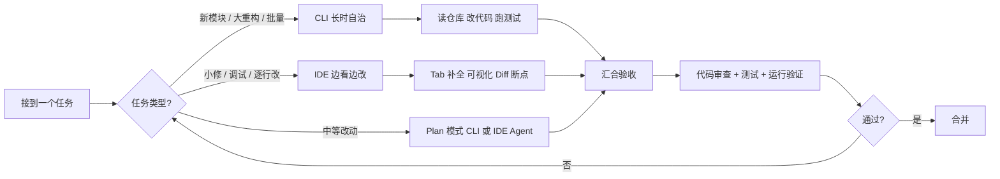

# AI 编程选 CLI 还是 IDE？

> 一句话点题：CLI 和 IDE 不是替代关系，是按任务类型和上下文形态分工的工具，别被"都 2026 年了还用 IDE"这种话带偏。

## CLI 和 IDE 在 AI 编程里到底指什么

AI 编程语境下这两个词比传统开发窄一点。AI IDE 指带图形界面、把代码编辑、运行调试和 AI 对话整合在一个窗口里的环境，Cursor、Kiro、TRAE、Windsurf、Zed 都算，JetBrains 系列加 AI 插件也算。AI CLI 指纯终端交互、没有图形界面的命令行工具，Claude Code、Codex、Qwen Code、OpenCode 都属这类——你在终端里说自然语言，AI 自己读仓库、改代码、跑测试、看报错、再改，全程在黑窗口里，你的角色从"写代码的人"变成"指挥 AI 干活的人"。

一句话区分：CLI 适合"告诉 AI 要什么，等它交付"，IDE 适合"边看边改、逐行审核"。

| 维度     | AI IDE                          | AI CLI                      |
| -------- | ------------------------------- | --------------------------- |
| 交互方式 | 图形界面（鼠标 + 键盘）         | 纯文字指令（终端）          |
| 人的参与 | 逐行参与，实时审核              | 目标定义，结果验收          |
| 核心优势 | 可视化 Diff、Tab 补全、调试集成 | 轻量、长时自治、易脚本化    |
| 典型场景 | 日常编码、UI 调试、小改动       | 大重构、多文件变更、CI 集成 |

> 纠偏一点：这里的 CLI 和 IDE，关键不是"有没有界面"，而是默认工作流是否以 Agent 任务闭环为中心。CLI 打开就能跑完"读-改-跑-修"的闭环，IDE 的默认心智是"人在写、AI 辅助"。同一个能力（比如多文件编辑），CLI 是主路径，IDE 要把它做好就得把界面推倒重做。这才是两者真正的分野。

## 边界在动：CLI 往 GUI 走，IDE 往 Agent 走

把时间拉到现在，两边早就不是泾渭分明了（能力现状经联网核对，部分以资料版本为准）：

- **Claude Code**：终端起家的 agentic 工具，现在也能在 IDE 里用、还能在 GitHub 上 @claude 让它处理 issue；slash 命令、插件、Hooks、Plan 模式、子代理、Skills、MCP 都已齐备。
- **Codex**：开源（Apache-2.0），终端 CLI + VS Code/Cursor/Windsurf 插件 + 独立桌面 App + 云端 web agent 并行，可用 ChatGPT 订阅或 API key。
- **GitHub Copilot**：横跨 VS Code、Visual Studio、Neovim、JetBrains、Xcode、Eclipse 等一堆 IDE 扩展，有 agent 模式和云端 coding agent（甚至能委托 Claude、Codex 干活），还有桌面 App、GitHub CLI 入口、MCP 和多模型选择。
- **Cursor**：文档目录里已经出现 Agent、Rules、MCP、Skills、CLI 字样——一个 IDE 在往命令行延伸。

方向很清楚：CLI 在做 GUI，IDE 在做 Agent，两边都往"以任务为中心、Agent 自主执行"收敛。所以真问题不是"选哪边站队"，而是"这个任务该用哪种形态"。

## 按任务类型挑工具

落到干活上，选型基本是按任务粒度走：

| 任务类型           | 更合适                                   | 为什么                                     |
| ------------------ | ---------------------------------------- | ------------------------------------------ |
| 改一个函数、修样式 | IDE                                      | Tab 补全 + 可视化 Diff，反馈即时           |
| 加接口、改一个模块 | Plan 模式（CLI 或 IDE Agent 都行）       | 平衡规划与执行                             |
| 新功能、大重构     | CLI 长时运行 或 Spec 模式                | 自主性强，适合长时间迭代                   |
| 审查一批 diff      | IDE 看可视化 Diff；CLI 跑 `/code-review` | 看改动 IDE 顺手，找正确性问题 CLI 命令更狠 |
| 调试前端 / UI      | IDE                                      | 浏览器集成、断点、网络请求是刚需           |
| 探索陌生代码库     | 都行                                     | CLI 让它读完产出架构文档，IDE 边跳转边问   |

> 纠偏一个常见误区："CLI 什么都能干，IDE 该淘汰了"。可视化 Diff、实时 Tab 补全、浏览器调试这几样，CLI 现在还是很别扭。你让 CLI 跑前端调试，得额外接 Agent Browser 这类工具，远没有 IDE 里点两下来得快。

## 上下文形态不一样，喂法也不一样

两边的"上下文"长得很不一样，决定了你怎么喂它。

| 上下文维度 | CLI                                           | IDE                                  |
| ---------- | --------------------------------------------- | ------------------------------------ |
| 默认来源   | rules 文件（CLAUDE.md / AGENTS.md）+ 会话历史 | 打开的文件 + 选中范围 + .cursorrules |
| 加载方式   | 一次性读仓库或指定文件                        | 随编辑器焦点实时带                   |
| 污染处理   | `/compact` 压缩或开新会话                     | 关文件、开新 Chat                    |
| 配置文件   | CLAUDE.md / AGENTS.md                         | .cursorrules（现在也认 AGENTS.md）   |

CLI 的上下文窗口是最贵的资源，几乎所有 CLI 技巧本质都在帮你把这块"白板"用得更高效——先 Plan 再执行、`/compact` 比反复纠正更有效、子代理拆任务。IDE 的上下文是"跟着你光标走"的，你打开什么、选中什么，它就看到什么，所以"单 Chat 专注单功能、开新对话别串"特别重要。

> 纠偏：别把 CLI 的"能读全仓库"当成万能。上下文窗口有上限，读太多反而稀释关键信息。真正决定产出质量的，是 rules 写得清不清晰、任务边界窄不窄，而不是"喂得多"。

## 协作模式：单兵 vs 流水线

CLI 天然适合流水线，IDE 天然适合单兵交互：

- **CLI**：可以多会话并行（多窗口 + `git worktree` + 子代理），还能 headless 塞进 CI/CD，本地终端、远程服务器、流水线里跑的是同一套 Agent，能力一致（这就是常说的 Run Everywhere）。
- **IDE**：偏单人前台交互，编辑器被任务占住时你切个文件都碍手；团队协作靠把 Spec 文档入 Git、靠 Rules 统一风格。

团队有两种打法：

- **追求流程规范**：用 Spec 工作流，Spec 文档作为版本化资产提交 Git，先 Spec Review 再 Code Review，全队统一工具。
- **追求工具自由**：把协作规范沉淀在 AGENTS.md 和 Rules 里，每个人用自己最顺手的，CLI 和 IDE 完全可以共存。

> 纠偏："CLI 天然适合团队"是反的。CLI 各跑各的反而更容易各写各的，团队一致性最终还是得靠 Spec/Rules 这类共享资产撑住，跟用 CLI 还是 IDE 没关系。

## 组合打法：CLI 做重活，IDE 做精修

成熟的用法不是二选一，是让两种形态各干各的强项：CLI 跑长任务、批量改动这种重活，你去喝杯咖啡回来它还在干；切到 IDE 看可视化 Diff，决定哪些保留、哪些回退；细节精修、调试、样式微调留在 IDE 里逐行来。验收两端都要上——CLI 的 `/code-review` 找正确性问题，IDE 的人工 Review 看改动合理性，再配测试和运行验证。

举个具体的：把一个老的同步导出改成异步任务，这种活最适合 CLI + IDE 配合。我在 CLI 里开新分支，把"读现有导出逻辑、拆出异步任务、加状态机、补失败重试和幂等"整块交给它跑——读代码、写实现、跑测试、看报错、再改，半小时回来它已交了一版能跑的。然后切到 IDE 用可视化 Diff 逐文件过：异步任务有没有漏租户上下文、状态机回滚分支有没有覆盖、重试有没有幂等键、测试断言有没有被偷偷放弱。不对的地方直接在 IDE 里逐行改，错误码、字段顺序这些细节也留在 IDE 精修。最后 CLI 跑一遍 `/code-review` 找正确性问题，IDE 里人工 Review，再补并发和幂等的压测。CLI 出活，IDE 把关，谁也没抢谁的活。

任务先按类型分流，到验收环节汇合，通不过就回到分流点重来。这套打法比"全程 CLI"或"全程 IDE"都更稳。

## 容易踩的坑

- **被"都 2026 年了还用 IDE"带偏**：可视化 Diff、Tab 补全、浏览器调试，IDE 现在还是更顺，不是落后。
- **CLI 当万能、不看 diff 直接信总结**：AI 一口气改 20 个文件，方向不对你就分不清哪块该留，先看 `git diff` 再信它的总结。
- **IDE 不配 rules、每次手动喂上下文**：每次新对话都从零解释项目，既累又容易上下文污染，把规范写进 `.cursorrules` / AGENTS.md。
- **上下文窗口当无限用、不 `/compact`**：越跑越歪，污染了就压缩或清空重来，比反复纠正便宜。
- **团队各用各的却不沉淀 Spec/Rules**：CLI 各跑各的、IDE 各开各的，最后风格四分五裂，一致性靠共享资产不靠工具统一。
- **把"一人即团队"当目标**：AI 把你能力放大了，老板的期望也跟着放大，效率越高越累是真实现象。接活前先想清楚哪些该交给 Agent、哪些该自己盯。

## 小结

1. CLI 和 IDE 不是替代关系，是按任务类型和上下文形态分工，别一刀切。
2. 选型看任务粒度：小修调试走 IDE，新功能大重构走 CLI 或 Spec，中等改动 Plan 模式两边都行。
3. 上下文喂法不同：CLI 靠 rules 文件 + 会话、靠 `/compact` 管窗口；IDE 靠打开的文件 + 选区、靠开新 Chat 防污染。
4. 协作看团队：要规范就 Spec 入 Git 统一工具，要自由就把规范沉淀进 AGENTS.md/Rules、工具各自顺。
5. 组合打法最稳：CLI 做重活、IDE 做精修，验收两端汇合，通不过回分流点重来。

## 参考

综合公开 AI 编程资料《AI 编程选 CLI 还是 IDE？》《10 道 AI 编程开放性面试问题》两篇资料，并经联网核对 Claude Code（GitHub 仓库：终端 agentic 工具，可于 IDE 与 GitHub 使用，支持 slash 命令与插件）、Codex CLI（开源 Apache-2.0，终端 + VS Code/Cursor/Windsurf 插件 + 桌面 App + 云端 agent）、GitHub Copilot（多 IDE 扩展 + agent 模式 + 云端 coding agent + 桌面 App + GitHub CLI + MCP + 多模型）、Cursor（文档已含 Agent/Rules/MCP/Skills/CLI）的现状，对"CLI 万能""CLI 天然适合团队"等说法做了纠偏改写。
