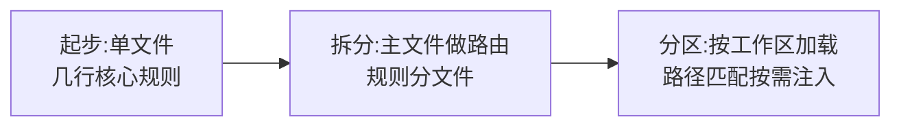

# AGENTS.md/CLAUDE.md 上下文规则怎么写？

> 一句话点题：上下文规则是给 AI 的项目级常驻约束，不是给人看的 README。

## 上下文规则到底是什么

`AGENTS.md` 和 `CLAUDE.md` 都是放在仓库里、专门写给编码 Agent 看的项目级指令文件。两者差别只在适用范围：`AGENTS.md` 是面向各类编码 Agent 的开放格式，Codex、Cursor、Jules 这类工具都会读；`CLAUDE.md` 是 Claude Code 的专属入口。内容可以复用——仓库若已有 `AGENTS.md`，让 `CLAUDE.md` 用 `@AGENTS.md` 导入再补 Claude Code 特有要求即可，别维护两份重复规则。

它和你在对话框里临时敲的 prompt，本质区别是**常驻 vs 临时**：

|          | 一次性 prompt                  | AGENTS.md/CLAUDE.md             |
| -------- | ------------------------------ | ------------------------------- |
| 生命周期 | 单轮对话用完即弃               | 每次进项目自动加载，跨会话常驻  |
| 适合放   | 本次任务目标、上下文、验收标准 | 长期稳定、AI 容易猜错的项目约定 |
| 触发方式 | 你手动给                       | 工具读仓库时自动注入            |

打个比方：一次性 prompt 是开会前口头叮嘱几句，AGENTS.md 是贴在工位上的长期注意事项。前者管"这次干什么"，后者管"在这个项目里怎么干活"。

这类规则文件还能放在不同位置叠加生效：组织级、用户级、项目级、本地级、子目录，越靠近当前项目、作用范围越具体的规则越靠后注入，也越容易被采纳。常见的做法是——团队都要遵守的写进项目级文件提交 Git，只和自己有关的偏好放进本地文件并加进 `.gitignore`，别把个人习惯混进团队文件。加载它们时会从外层一路走到当前目录，后面的不直接覆盖前面的，而是叠加在一起，更具体的规则通常优先。

## 该写什么、不该写什么

判断一条内容该不该进规则文件，用一个很土但好用的标准：**这行删掉后，AI 会不会更容易犯错？** 会，就留；不会，它就是在浪费上下文窗口。规则文件的每一行都吃掉一块有限的上下文预算，写多了反而把真正重要的约束淹掉。

值得写的，大致是这几类：

- **技术栈与版本**：Spring Boot 2 和 3 的配置方式差异很大，不标注版本 AI 会倾向用训练数据里更常见的写法，可能和你的实际版本对不上。
- **常用命令**：构建、测试、lint、启动，放进代码块。代码块里的命令 AI 更倾向于原样执行，写在自然语言里它有时会自己改写。
- **架构决策及理由**：光写"不要直接写 SQL"效果一般，补上"因为审计系统依赖 Wrapper 解析来记录操作日志"，AI 才能在别处也自觉用 Wrapper。
- **团队约定与项目坑点**：提交信息格式、分支命名、环境变量依赖，这些代码里读不出来，新人入职一定会问。
- **不动的目录**：生成目录、迁移脚本、生产配置，明确标出"别碰"。

不该写的：

- **代码风格**：缩进几个空格、import 怎么排序、要不要尾分号，交给 formatter，别用自然语言干格式化的活。项目没配 Checkstyle 或 Prettier，先配工具。
- **框架默认行为**："Python 用 f-string 格式化"这类在现代语言里理所当然的事，写下来只是噪音。
- **大段参考文档**：外部 API 文档、SDK 参数表，放链接让 AI 需要时自己读，别整段塞进来。

下面是一组差的 vs 好的对比。差的版本是 `/init` 跑完原样提交的产物，看着没毛病，对 AI 几乎没约束力：

```markdown
# 差的 rules

这是一个 Spring Boot 项目，使用 Java 17 和 Maven。

- 写干净的代码
- 遵循最佳实践
- 提交前运行测试
```

"写干净的代码"删掉后 AI 会少做什么吗？大概率不会。正确废话占满上下文，真正重要的规则反而被冲淡。好的版本只放 AI 猜不准、删了就会犯错的东西：

```markdown
# 好的 rules

Spring Boot 3.2 + MyBatis-Plus + MySQL 8.0 订单服务。

## Commands

- 构建：`mvn clean package`
- 测试：`mvn test`

## Must Follow

- Controller 只做参数校验，不写业务逻辑
- @Transactional 只放 Service 层
- 对外响应统一用 `Result<T>`

## Never Do

- 不要直接抛 RuntimeException，用 BusinessException
- 不要在数据库事务内调用 LLM 或外部 HTTP
- 不要改 migrations/ 目录
```

每一条都能被执行，你也能一眼看出 AI 到底做到没有。规则不在多，在每条都有指向性。禁令最好顺手补替代方案：不要做 X，遇到这种情况应该做 Y，否则 AI 容易绕出另一种奇怪写法。

## 项目变大怎么拆

一个人的项目，一份规则够用。项目一大、团队一介入，单文件就撑不住。组织方式大致经历三段演进：



| 阶段 | 根级放什么                       | 局部放什么                 | 适合规模 |
| ---- | -------------------------------- | -------------------------- | -------- |
| 起步 | 技术栈、命令、核心边界、禁止清单 | 不拆                       | 中小项目 |
| 拆分 | 项目概述 + `@docs/xxx.md` 引用   | 架构规范、API 约定各自独立 | 中型项目 |
| 分区 | 全局通用规则                     | 子目录专项规则，按路径匹配 | 大型项目 |

分区阶段用带 `paths` 的规则文件，编辑 Controller 时只加载 Controller 规则，编辑 Service 时只加载 Service 规则，不必每个会话塞全套：

```markdown
---
paths:
  - "src/main/java/**/controller/**/*.java"
---

# Controller 规范

- 统一用 Result<T> 包装返回值
- 所有接口加 Swagger 注解
```

这里有几个边界必须提前知道：

> 纠偏：带 `paths` 的规则是在 AI **读取**匹配文件时注入的，不是每次工具调用前都注入。所以"新建文件必须带某文件头"这类创建期约束，不该只放在路径规则里——创建时它可能还没进上下文，应放进全局规则或用 Hook 硬约束。另外，不带 `paths` 的规则仍像全局规则一样持续消耗上下文，并不是天然省预算。
>
> 纠偏：`@path/to/file` 会把整个文件内容嵌进上下文，大文件每个会话启动都烧掉一大块指令预算。大文件改成自然语言引用——"架构细节见 docs/architecture.md"，AI 需要时会自己读。这就是渐进式披露：先给最关键的，需要细节时再加载。

## 规则怎么维护

规则文件写完不能放着不管，项目一变里面的规则就过期，AI 会照着过期约束做错事。

维护节奏上把握两条：

- **添加要慢**：一条规则只有在 AI 确实犯了错、且这条规则能防住同类错时才值得写。为没发生的事预设规则，多半在浪费空间。
- **删除要果断**：某条规则删掉后 AI 行为没变化，说明它从一开始就没起作用——AI 本来就会这么做，果断移除，把空间留给真正需要的。

两个预警信号值得留意：一是 AI 为"已经写在文件里的规则"道歉（"抱歉我忽略了 XX"），说明措辞太软没被当回事，换个更直接的表述；二是同一条规则在不同会话反复被违反，这通常不是措辞问题，而是文件太长规则被稀释，解法是压缩整份文件而不是加感叹号。

每隔几周可以做一次对话式审查：挑几条规则问 AI"删掉这条你会改变行为吗"，它说不会的就可以考虑删。但 AI 对自身行为的预判不完全可靠，拿不准的最好开两个平行会话分别带/不带某条规则、给相同 prompt，看输出差异。同类错误出现几次后再收敛成规则，别每次出错都加一条，否则规则文件很快变成垃圾桶。

还要把它和工具自带的自动记忆分开看。规则文件是你主动写给 AI 的长期指令，放"必须遵守的规则"和"每个会话都要知道的项目事实"；自动记忆是工具在协作过程中自己学到的调试结论、个人偏好和工作习惯，更偏本机经验，不进仓库、不算团队共享规范。比如"所有接口返回 `Result<T>`"该写进规则文件；"这个项目的 Redis 测试要先本地起 Redis"这类调试发现，交给自动记忆就够了。两者别混淆，否则要么把团队规矩写成本机记忆无人复用，要么把一次性经验塞进常驻上下文浪费预算。

## 容易踩的坑

- **规则只进不出**：文件越写越长，AI 反而开始漏规则。加粗加叹号都没用，真正有用的是删。
- **@ 导入巨型文件**：会话还没开始就先烧掉一大块上下文。大文件改自然语言引用，让 AI 需要时自己读。
- **路径规则管新建文件**：创建期路径规则未必加载，"新建文件必须带文件头"这类约束更适合全局规则或 Hook。
- **多个规则文件打架**：AI 往往不告诉你它选了哪条执行，定期全量审查清掉冲突。
- **为偶发事故加永久规则**：一次罕见事故就写长期规则，后面每个会话都要为它付上下文成本，通常不划算。
- **规则写成人读而非 AI 读**：通篇项目背景介绍、愿景描述，AI 读了一堆"正确废话"，真正可执行的约束反而被冲淡。
- **软约束当硬约束用**："不要改 .env"写一百遍不如加一个 PreToolUse Hook。能用工具机械强制的规则，别只靠自然语言提醒。

## 小结

1. AGENTS.md/CLAUDE.md 是给 AI 的项目级常驻约束，管"怎么干活"，和管"这次干什么"的一次性 prompt 互补；两者可复用同一份基础规则。
2. 只写 AI 猜不准、删了就会犯错的内容：技术栈版本、常用命令、架构决策及理由、团队约定、禁止目录；代码风格、框架默认、大段文档交给工具或链接。
3. 判断标准一句话：删掉这行，AI 会不会更容易犯错。
4. 项目变大就拆：根级通用规则 + 子目录专项规则，按路径匹配按需加载，大文件用自然语言引用做渐进式披露。
5. 规则要像代码一样维护，添加要慢、删除要果断；文件太长规则被稀释时压缩文件，而不是加感叹号。
6. 规则文件是软约束，高风险操作要靠 Hook、权限、lint、CI 兜底。

## 参考

综合 Claude Code 与 Codex 官方最佳实践，围绕 CLAUDE.md/AGENTS.md 该写什么、怎么拆分、怎么维护做了交叉验证，并结合指令链加载、路径规则、渐进式披露和 Hook 硬约束等工程经验整理。
