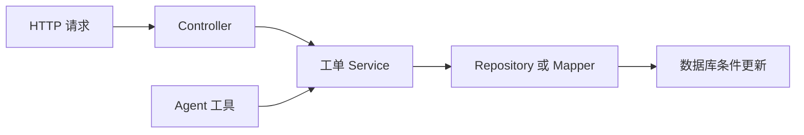

# 怎样用 AI 定位 Java 多租户缺陷，并设计能抓错的测试？

> 先把不能改变的数据写进验收条件，再让 AI 沿调用链找证据，用数据库终态判断修复是否成立。

本文使用**构造的教学案例**，所有结果都是未运行的预期推演，不是真实事故复盘。Java、SQL 和测试片段用于说明定位方法，没有配套工程或测试执行记录。

## 一个工单编号，为什么可能改到两个租户？

假设工单编号只在租户内唯一，数据库使用 `(tenant_id, ticket_no)` 唯一约束。两个团队恰好都有 `T-1048`：

| 租户  | 工单编号 | 负责人 | 优先级 | 状态 | 版本 |
| ----- | -------- | ------ | ------ | ---- | ---- |
| north | T-1048   | alice  | P3     | OPEN | 7    |
| south | T-1048   | bob    | P3     | OPEN | 7    |

alice 是 north 的客服，允许调整本人工单的优先级。她把 T-1048 从 P3 改为 P1，正确结果应满足：

- north 的目标记录变为 P1，版本变为 8。
- south 的记录仍是 P3、版本 7。
- 不具备权限的主体不能通过 HTTP、工具或服务入口完成修改。

这里第二条与第一条同样重要。如果验收只写“优先级修改成功”，AI 可能只验证目标记录，没有检查其他租户。

## 给 AI 的第一份材料应该是什么？

先提供数据规则、请求意图和原始代码，暂时不指定根因。下面是一份任务描述示意：

```text
目标：定位工单优先级更新可能影响其他租户的原因。
上下文：工单编号仅在租户内唯一；存在普通接口和 Agent 工具两个入口。
重点：追踪可信身份如何进入 Service，最终 SQL 使用哪些过滤条件。
约束：不改表结构，不扩大重构范围，不从请求体或模型参数取得可信租户。
完成标准：给出调用链、缺陷证据、最小修复和回归判据。
当前阶段只分析代码，不执行项目或测试。
```

不要一开始就说“肯定是事务没加”。事务能控制提交与回滚，却不会自动补充租户过滤条件。

也不要把“用户已登录”当成“有权修改这条工单”。登录身份、角色权限和资源归属需要分别核对。

## 为什么不能只看 Controller？

假设普通接口会解析登录主体，并检查 alice 是否有调整权限。但 Mapper 最后执行的是：

```sql
UPDATE ticket
SET priority = :priority,
    version = version + 1
WHERE ticket_no = :ticketNo
  AND status = 'OPEN'
  AND version = :expectedVersion;
```

在上述夹具中，两条记录都符合条件。如果原服务接受“更新行数大于零”作为成功，就可能把两条记录一起提交。

更隐蔽的是，Agent 工具可能绕过 Controller，直接调用同一个 Service：



让 AI 给每一条判断标出证据位置：

| 要核对的问题     | 应寻找的代码证据                         |
| ---------------- | ---------------------------------------- |
| 租户从哪里来？   | 认证结果及其向下传递的位置               |
| 谁能修改？       | 服务层的角色、资源归属与业务前提检查     |
| 实际改哪些记录？ | Mapper SQL、ORM 条件或租户插件的最终效果 |
| 工具会不会绕过？ | 工具注册、参数绑定和实际服务调用路径     |
| 异常会不会提交？ | 事务入口、更新行数处理与异常传播         |

若项目使用自动租户插件，还需要核对它是否覆盖这条 SQL。不能只因配置里存在插件就认定隔离已经生效。

## 最小修复应落在哪几个位置？

首先，让可信身份进入共享的业务边界。下面是省略类型定义与实现的服务设计示意：

```java
@Transactional
public void changePriority(
        AuthenticatedCaller caller,
        String ticketNo,
        Priority priority,
        long expectedVersion) {
    var ticket = repository.findByTenantAndNumber(
            caller.tenantId(), ticketNo)
        .orElseThrow(TicketNotAccessibleException::new);

    authorization.requirePriorityChange(caller, ticket);

    int changed = repository.updatePriority(
            caller.tenantId(), ticketNo, priority, expectedVersion);
    if (changed != 1) {
        throw new TicketUpdateConflictException();
    }
}
```

`AuthenticatedCaller` 表示服务端已经核实的主体，不应直接绑定用户请求体。工具执行器也要从可信执行上下文取得它，不能把模型生成的 `tenantId` 当成身份依据。

`requirePriorityChange` 应检查所需角色、资源范围和业务前提。示例假设更新异常是会触发事务回滚的运行时异常，且调用实际经过事务边界；仅写出注解不能证明事务已经生效。

接着，修改最终更新条件：

```sql
UPDATE ticket
SET priority = :priority,
    version = version + 1
WHERE tenant_id = :tenantId
  AND ticket_no = :ticketNo
  AND status = 'OPEN'
  AND version = :expectedVersion;
```

租户条件限定资源范围，状态和版本条件处理业务前提与并发冲突，各有职责。若负责人等授权条件也可能并发变化，需要进一步通过条件更新或适当锁定保持授权检查与写入一致。

更新行数异常应中止操作并回滚，不能捕获异常后返回成功。不过，“检查行数”不能替代租户条件：隔离范围必须在查询和写入时都明确。

## 哪些修复看起来合理，却没有解决问题？

**只在 Controller 加判断。** 普通请求可能被挡住，工具、消息消费者或其他内部入口仍可能调用不受保护的服务。

**只加 `@Transactional`。** 如果 SQL 选中了两个租户，事务也可以把两个租户的修改一起提交。

**让模型补上租户参数。** 参数符合 JSON Schema，只能说明结构合法，不能证明它属于当前调用者。

**只按角色授权。** north 的客服不能因此获得 south 工单的操作权，角色判断不能替代对象范围检查。

Spring Security 支持方法级授权，但需要启用相应配置。官方文档明确说明，Starter 不会默认启用方法授权，未标注的方法也不会自动获得这些注解的保护。采用这一机制时，应检查实际调用路径，不能只搜索到一个 `@PreAuthorize` 就结束审查。

## 为什么原来的测试可能全绿？

假设查询与授权已经准备了合法夹具，测试又把更新方法替换成下面的固定返回值。这里省略共同的准备代码，只看它是否验证了 SQL：

```java
when(repository.updatePriority(any(), any(), any(), anyLong()))
        .thenReturn(1);

service.changePriority(caller, "T-1048", Priority.P1, 7);
```

Repository 已经被替换，无论真实 SQL 是否漏了 `tenant_id`，它都会按预设返回 1。再加一句“接口返回 200”，也没有增加数据库隔离的证明。

应把不同层次的测试分开：服务单测检查授权分支与异常分类，Repository 集成测试检查真实过滤条件，入口测试检查身份传递。具体分层见 [Java Agent 测试](../ai/ai-agent-java-evaluation.html)。

## 怎样让测试真正识别这类缺陷？

先准备相同编号、相同状态和相同版本的两个租户，避免夹具碰巧只让一条记录满足条件。以下是 JUnit 风格的**未执行断言示意**：

```java
@Test
void changingNorthTicketLeavesSouthUnchanged() {
    // Fixture、身份上下文与查询方法均为教学占位。
    var fixture = twoTenantsWithSameOpenTicket("T-1048", 7);
    var caller = fixture.authenticatedNorthSupport("alice");

    fixture.invokeInCallerContext(caller, () ->
        service.changePriority(caller, "T-1048", Priority.P1, 7));

    // 表示写事务结束后，通过独立读取观察已提交状态。
    var north = fixture.committedTicket("north", "T-1048");
    var south = fixture.committedTicket("south", "T-1048");

    assertEquals(Priority.P1, north.priority());
    assertEquals(8, north.version());
    assertEquals(Priority.P3, south.priority());
    assertEquals(7, south.version());
}
```

测试必须经过真实被测服务与持久化路径。不能让 `committedTicket` 返回预先填写的对象，否则只是换了一种方式自证成功。

写事务结束后的读取，应避开旧的 ORM 一级缓存和测试事务中的未提交视图。真实 HTTP 请求还可能在其他线程和事务中执行，不能假设测试方法的事务会自动覆盖服务端操作。

数据库隔离、方言与更新行为应在目标数据库上验证。H2 可以承担部分检查，但不能据此认定 PostgreSQL 或 MySQL 的行为完全一致，参见 [Testcontainers 与集成测试](../engineering/engineering-integration-test-testcontainers.html)。

此外还需要无权限主体、版本冲突、伪造租户请求、工具入口和直接服务入口的用例，分别检查拒绝结果与数据库未发生变化。

## 如何反过来检查测试有没有用？

可以设计一次人为突变：暂时从更新 SQL 中去掉 `tenant_id`，其他条件不变。测试应该识别出回归。

这里有一个容易误判的细节：修复后的服务要求更新行数等于 1。突变 SQL 如果更新两行，服务应抛异常并回滚。因此，测试可能因为“合法操作未能成功”而失败，south 的最终记录仍然没有变化。

这同样说明测试抓到了缺陷。不能坚持宣称“删除租户条件后，另一个租户一定已经提交修改”。

检查测试是否同时验证了两件事：合法操作应成功，越界数据应保持不变。只测拒绝或只测目标记录，都可能留下盲区。

## 修复说明应该怎样留下证据？

区分已经执行的检查与尚未执行的设计。对于本文这种只做文章推演的情况，可以这样写：

```text
缺陷机制：工单编号在租户内唯一，更新条件遗漏租户。
修复方案：可信身份进入共享服务，校验资源权限，更新条件限定租户。
预期验收：目标记录正确变化，其他租户不变，越权入口被拒绝。
验证状态：教学代码与用例设计，尚未运行项目、数据库或测试。
```

AI 给出的调用链、修复建议和测试代码都需要审查。真正有价值的是可核对的缺陷机制与验收条件，不能用“AI 已确认安全”代替它们。

## 小结

1. 先写清合法变化和禁止变化，再让 AI 沿所有入口追踪可信身份、授权与最终 SQL。
2. 租户隔离要进入共享业务边界和持久化条件，Controller、角色或事务注解都不能单独保证隔离。
3. Mock 返回成功与 HTTP 200 无法证明数据库正确，测试应检查目标记录和其他租户的已提交终态。
4. 删除租户条件的突变应被测试识别；若行数检查触发回滚，也可以通过合法操作未成功捕获问题。
5. 教学推演、静态审查和实际测试结果必须分开记录，未经执行的检查只能写成预期验收。

## 参考

综合仓库 `docs/` 下的 AI 编程任务拆分、规范与验收、AI 应用工具授权资料，结合站内代码验收和数据库集成测试内容整理。将资料中的通用方法具体化为多租户工单案例，补充了共享入口、更新条件和事务回滚对测试预期的影响。

- [Spring Security：Method Security](https://docs.spring.io/spring-security/reference/servlet/authorization/method-security.html)——于 2026-11-21 核对方法授权的启用要求、服务层用途与未标注方法的边界。
- [AI 生成代码后应该怎样验收？](./ai-coding-acceptance.html)——风险测试矩阵与过度 Mock 的识别。
- [Java Agent 的测试怎样分层并覆盖关键故障？](../ai/ai-agent-java-evaluation.html)——身份、事务、数据库与模型替身的证明范围。
- [集成测试怎么跑得像线上？](../engineering/engineering-integration-test-testcontainers.html)——目标数据库及测试环境边界。

本文没有运行 Java 工程、数据库、容器或测试，也没有把构造案例写成真实故障记录。
