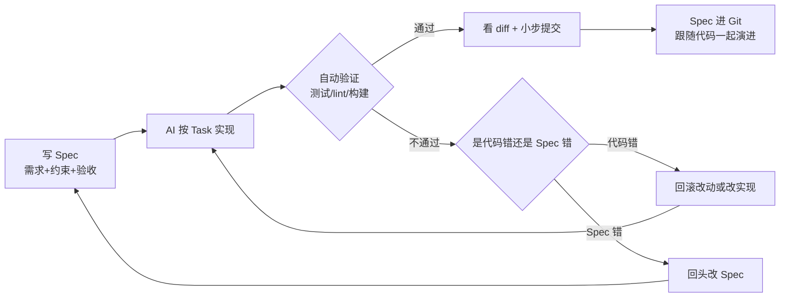

# Spec 驱动编程怎么治 Vibe Coding 的野？

> 一句话点题：Vibe Coding 快但不收敛，Spec 驱动用“先写规范再实现”把它拉回工程化。

## Vibe Coding 的“野”在哪

Vibe Coding（氛围编程）指的是凭感觉丢一句模糊意图给 AI，顺着它输出的代码往下改。验证一个想法、写一次性脚本、做个内部小工具时很爽，几秒钟一个函数就出来了。

把它搬到要长期维护的项目里，“野”就慢慢显形：

| 症状         | 怎么产生的                              | 后果                         |
| ------------ | --------------------------------------- | ---------------------------- |
| 无规范       | 没提前定错误码、分层、字段命名          | 每个接口各写一套，后期对不齐 |
| 难审查       | AI 一口气改了 20 个文件，方向可能早偏了 | 不知道哪块该留、哪块该扔     |
| 难回滚       | 裸跑在主分支上，没分块提交              | 改坏了难定位、难撤销         |
| 上下文漂移   | 一个会话里又写登录又改支付又重构缓存    | 旧约束和废弃方案混在一起     |
| 改动不可追溯 | 约定只写在聊天里，没进文件没进 Git      | 下次会话 AI 拿到的还是空白   |

判断标准可以收成一句话：这段代码要活多久？两天就扔的脚本，Vibe 够了；三五天的中间地带，写一份轻量 Spec，只写关键约束和验收；超过一周、要别人维护、碰数据或外部接口的，就别裸 Vibe。

Vibe Coding 不是原罪，真正的问题是验证完想法之后，顺手就把 Vibe 出来的代码推上了生产。Demo 阶段错了就改、坏了就删，生产代码后面会接数据库、接支付、接用户数据、接别人的维护成本，今天省的半小时可能变成后面几天排雷。

## Spec 驱动的核心：先写规范再实现

Spec Coding（规范驱动编程）做的事情，是把这些规则提前写下来，再让 AI 按规则干活。差别就一句话：**AI 的行为是由你定义的，还是由它猜的？**

平时很多人直接丢一句“帮我做一个用户系统”。AI 当然能写，看起来还挺像那么回事。但用户怎么注册？邮箱能不能重复？密码怎么存？接口失败返回什么格式？哪些这期不做？管理员能不能禁用用户？这些不写清楚，AI 不会停下来反问，它大概率先补一套自己觉得合理的方案。

> 纠偏：Spec 驱动不是要消灭 Vibe Coding，而是给“要长期活下去的代码”加一层兜底。Demo、脚本照样 Vibe，只是别顺手推上生产。

完整流程通常拆成四步：Specify → Plan → Tasks → Implement。

| 阶段      | 做什么   | 产出                      | 关键动作                         |
| --------- | -------- | ------------------------- | -------------------------------- |
| Specify   | 产品定义 | requirements.md / spec.md | 定“做什么”，把边界写出来         |
| Plan      | 技术规划 | design.md / plan.md       | 定“怎么做”，定技术栈、架构、契约 |
| Tasks     | 任务拆解 | tasks.md                  | 拆成原子任务，每条带验收         |
| Implement | AI 执行  | 代码                      | AI 按 Spec 干活，人验收          |

核心是先写清楚要做什么，再写清楚怎么做，然后拆任务，最后交给 AI 执行。传统设计文档也写这些，但人看完大方向，很多细节能靠团队习惯补上——密码不能明文存、错误码要统一、日志要带 trace_id，成熟团队通常不用反复强调。AI 不一样，你没写它就猜，猜对了算运气，猜错了就回来返工。

## Spec 写什么、写到多细

写 Spec 容易走两个极端：写成项目说明书，或只写两句需求。前者劝退自己，后者等于没写。落到实操，一份能用的 Spec 至少要包含三块：需求 + 约束 + 验收。

以订单导出为例，一份轻量 Spec 长这样：

```markdown
## 任务目标

实现订单导出接口，支持按时间范围导出 CSV。

## 关键约束

- 单次导出最多 5000 条
- 时间范围不能超过 31 天
- 必须校验权限，只能导出当前租户的数据
- 查询必须命中 order_tenant_time_idx 联合索引
- 导出失败要记录失败原因，不能只返回 unknown error

## 验收标准

- 正常导出 CSV，字段顺序符合产品约定
- 超过 5000 条时返回明确错误
- 越权租户数据不能被导出
- 单元测试覆盖空时间、越界时间、无权限、无数据四种场景
```

约束里最值钱的是那些“AI 容易猜错、代码里读不出来、团队又必须遵守”的规则。比如密码存储，别只写“登录要安全”，AI 可能给你整一个看着安全、实际不该用的方案；写成“用 bcrypt 哈希，cost 默认 12，数据库只存哈希”，它就把“安全”这个大词拆成了可执行的几条。错误处理也一样，别写“返回友好提示”，直接定死统一格式 `{"code":"USER_NOT_FOUND","message":"...","trace_id":"xxx"}`，再补一段状态码约定，AI 至少知道该往哪个方向写。

细到什么程度有个粒度经验：一个 Task 对应一个 API、一张表的核心操作，或一个能独立验收的小功能。别一上来“完成用户模块”——注册、登录、查询、禁用、权限、校验、异常、测试全塞一个任务，AI 容易写着写着漏东西；也别拆到“创建 UserDTO、加 email 字段”这种粒度，维护任务列表的时间比写代码还长。

验收标准要尽量量化。“高性能”“代码优雅”“保证安全”这类话约束力很弱，AI 不知道你心里的安全到底指什么；写成 `QPS > 1000`、`P95 < 200ms`、`bcrypt cost=12`、`branch coverage >= 80%`，才能跑测试验证。覆盖率阈值别机械套：纯逻辑模块 80% 通常合理，涉及大量外部依赖、异步、复杂 mock 的可以放宽到 60-70%，重点放在关键分支组合有没有覆盖。

## 验收闭环：Spec → 实现 → 自动验证 → 回滚/改 Spec

Spec 写完不是终点，闭环才让它真正收敛 Vibe Coding 的野。闭环的形态是：Spec 定义边界 → AI 按任务实现 → 用测试、构建、lint 自动验证 → 不通过就回滚改动或回头改 Spec → 通过再看 diff、小步提交。



闭环里有几条比“让它写完”更重要的纪律：

- **先写失败测试再写实现。** 不让 AI 一边改代码一边补一个永远会通过的测试，先让测试失败，再让实现通过，心里踏实得多。
- **验收看证据不看自述。** AI 最爱说“已修复”“已优化”。要看三样东西：测试、命令输出、diff。让它贴出跑过的命令和结果，没跑就写“未运行”并说明原因，最怕它没跑但写一句“已验证”糊弄。
- **Spec 进 Git，跟代码一起走。** 代码变了 Spec 也要改，否则下次 AI 拿到的是过期说明，写出来的代码自然对不上。
- **Spec 变更做影响评估。** Spec 文件里维护“依赖此文件的模块”列表，更新时触发受影响模块的回归测试，CI 里加一条判断：Spec 有变动，自动跑相关模块测试。

## 适合场景：什么时候该上 Spec

Spec 驱动不是处处都上，强行套用反而拖效率。按风险和改动面分：

| 场景                                           | 是否上 Spec | 说明                                    |
| ---------------------------------------------- | ----------- | --------------------------------------- |
| 大改动、跨文件、新模块                         | 强烈建议    | 不写 Spec AI 必然脑补，返工成本高       |
| 高风险改动（权限、支付、数据迁移、外部写操作） | 强烈建议    | 失败后果重，必须先只读分析+人工确认方案 |
| 中等任务（三五天、单模块流程）                 | 写轻量 Spec | 只写关键约束和验收，半小时搞定          |
| 一次性脚本、Demo、内部小工具                   | 不必上      | Vibe 够了，写 Spec 反而拖效率           |
| 改文案、调样式、补注释                         | 不必上      | 看一眼 diff 就行                        |

判断标准还是那条：这段代码要活多久、失败后果多重。短平快的原型可以大胆 Vibe，先把东西跑起来；只要代码要长期维护，就得回到工程流程里。AI 写代码越快，Git、测试、Review、Spec 这些老东西越不能丢——以前它们是为了约束人，现在还得顺手约束 AI。

## 容易踩的坑

**Spec 过细，变成逐行伪代码。** 把 Service 层每个方法签名都定死，AI 连个参数名都不敢改。Spec 定的是边界，不是实现细节。一旦僵化，AI 失去正常灵活性，改一个字段要回头改五处 Spec，维护成本反噬。

**Spec 过粗，等于没写。** 只写“做一个用户系统”“保证安全”“性能要好”，AI 该猜的还是猜。关键边界没定义，它就按训练数据里出现频率最高的方案拼一段“看起来能跑”的代码，猜对了算运气，猜错了算日常。有项目里 AI 用了 MD5 存密码，就是因为 Spec 里没写用什么加密算法。

**Spec 与实际脱节。** 最隐蔽的坑。Task-001 完成时错误格式是 `{"code","message"}`，两周后 Spec 更新加了 `trace_id`，但 Task-001 的代码已经没人管，规范和实现悄悄跑偏。应对办法是 Spec 进 Git、变更做影响评估、CI 监测 Spec 变动自动跑回归。

**只写不验。** Spec 写了一大堆但没接到 CI 里，最后变形式主义。写完没人检查，跟没写差不多。能机械化验证的——格式、类型、安全扫描、测试门禁——都该交给工具执行，别只靠自然语言提醒。

**上下文一股脑塞进去。** 单次会话里把所有 Spec 全贴进去，AI 看着一堆和当前任务无关的约束反而更容易跑偏。优先放三类：全局约束（代码风格、错误码、日志）、当前任务需求、当前任务验收。其他按需带，单次输入控制在 3000-8000 tokens 比较稳，超出就拆会话。上下文越长，关键信息越可能被淹在中间，最后反而漏掉最重要的约束。

**约束只靠 Prompt。** “请你谨慎一点别做危险操作”约束力基本为零。直连生产库、提交密钥、删线上数据这类绝对禁止的操作，要落到配置模板、Pre-commit hook、工具的 ignore 配置和 CI 硬性检查里，停在“文档里有写”这一步迟早出事。那个合并按钮，永远应该握在你自己手里。

## 小结

1. Vibe Coding 的“野”在于无规范、难审查、难回滚、上下文漂移、改动不可追溯；判断该不该收，看这段代码要活多久、失败后果多重。
2. Spec 驱动的核心是把“AI 行为由你定义还是它猜”变成前者，用 Specify→Plan→Tasks→Implement 四步把规则提前写下来。
3. 一份能用的 Spec 至少包含需求+约束+验收，约束写那些 AI 容易猜错、代码读不出、团队必须遵守的规则，验收尽量量化。
4. 闭环比写完更重要：Spec→实现→自动验证→不通过回滚/改 Spec，验收看证据不看自述，Spec 进 Git 跟代码一起演进。
5. 大改动、高风险改动上 Spec，一次性脚本和 Demo 大胆 Vibe；避开过细、过粗、脱节、只写不验、上下文堆砌、只靠 Prompt 六个坑。

## 参考

综合 Spec Coding 规范驱动编程与 Vibe Coding 实用技巧资料，结合需求/约束/验收三段式 Spec、四步落地流程、验收闭环与 Spec 分层管理整理，并以订单导出、用户系统等场景做了交叉验证。
