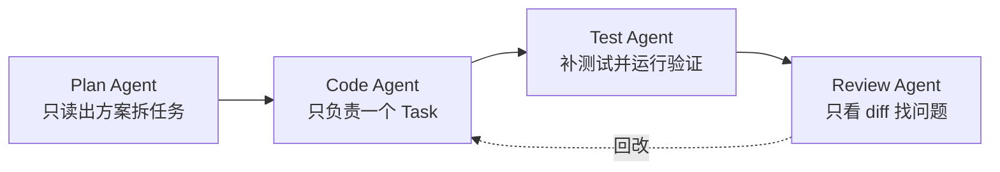

# Vibe Coding 实战里那些少踩坑的技巧

> 一句话点题：Vibe Coding 不是乱来，是"快但可控"——靠 Git、Spec、上下文和验收把野性收住。

第一次让 AI 写代码确实会上头，看着文件一行行被补出来，比打游戏还爽。但翻车来得也快：AI 一口气改了 20 个文件，方向不对时你已经分不清哪块该留、哪块该扔。Vibe Coding 想一直稳，靠的不是手感，而是把几条老派工程动作插进 AI 动手之前。

## 子问题小节

### Git 站在 AI 动手之前

如果只留一个技巧，就是 Git。它不是写完代码补的仪式，要在 AI 改之前就位。让 Agent 动手前先看工作区：

```bash
git status --short          # 有改动先弄清是谁的、要不要留
git switch -c feat/order-export   # 确认干净后再单独开分支
```

任务再小也开分支。主分支裸跑心理负担越来越大；分支隔离后 AI 写歪了也只是当前分支的事。改完别急着看它的总结，先看仓库自己怎么说：

```bash
git diff --stat     # 看影响面
git diff            # 看细节
git add -p          # 分块暂存，一个提交只做一件事
git commit -m "feat: add order export"
```

一个 commit 只做一件事，后面 Review、回滚、定位都会轻。回滚优先用 `git restore`、`git revert` 这类可控动作；`git reset --hard` 别随手交给 Agent，除非分支就是一次性实验。并行任务用 `git worktree` 隔离：一个 Agent 一个目录、一个分支、一个任务，乱改也只乱在自己工作区。

### Spec 先把范围写窄

"帮我实现导出订单功能"太宽泛，AI 不知道导几条、什么格式、哪些字段、字段顺序。信息不够它就猜，猜出来能跑但未必是你想要的。开工前花几分钟写轻量 Spec，通常比返工便宜：

```markdown
## 目标

实现订单导出接口，支持按时间范围导出 CSV。

## 约束

- 单次最多导出 5000 条
- 时间范围不超过 31 天
- 只能导出当前租户数据
- 查询必须走 order_tenant_time_idx

## 验收

- 正常导出 CSV，字段顺序为 order_no、amount、status、created_at
- 超过 5000 条返回明确错误
- 越权租户数据不能被导出
- 单测覆盖无数据、越权、超条数、超时间范围 4 种情况
```

Spec 不用一次写到位，可以由粗到细：先写一段"粗 Spec"定方向——目标是什么、哪些绝不做、验收大概看哪几条；确认方向没跑偏后，再细化成带接口格式、错误码、表结构的"细 Spec"。这样做的好处是，AI 自由发挥跑偏前，方向已经被你卡住，而不是等它写完一坨才发现理解错了。小任务写清目标、约束、验收就够了；中等任务再补接口格式、错误码、表结构；大需求再拆 requirements、design、tasks 三份文档。别一上来把流程拉满，不然你会先被文档劝退。

比抽象规范更管用的一招：给 AI 看项目里写得好的代码。"代码要优雅、符合最佳实践"约束力很弱，模型更擅长模仿具体样板。让它先读 `UserController`、`UserService` 和对应测试，参考分层、异常处理、返回体、日志和测试写法，再实现 `OrderExportController`，并明确"不要引入新响应格式、不要新增全局异常处理器、不要绕过现有权限校验"。

### 上下文别越堆越乱

上下文窗口大不等于效果好——窗口能装更多东西，但模型能不能稳定找到重点是另一回事。一个会话里先写登录、再改支付、再重构缓存、最后问为什么测试挂了，旧约束和废弃方案迟早混成噪声。

上下文要管三件事。第一，别把仓库一股脑塞进去。当前任务只需要 Spec、相关文件、报错日志、验收命令和少量参考实现，其他用路径、文件名挂着，需要时再让 Agent 去读。第二，长任务及时压缩，Claude Code 用 `/compact` 压缩、`/clear` 清空，压缩是保留重点（架构决策、已改文件、未解决问题、失败命令、下一步）丢掉重复对话。第三，关键进展落到文件里，让 Agent 维护一份 `NOTES.md` 或 handoff，记录已完成、剩余任务、下个 Agent 要先读哪些文件，开新会话就不用重新解释半天。

一个习惯：一个会话只处理一个任务；同一处纠正超过两次还不对就开新会话；新会话只带当前 Spec、相关文件、失败日志、验收命令和上一轮 handoff。3000 到 8000 tokens 的高质量上下文，通常比几十万 tokens 的杂乱对话更可靠。

### 多 Agent 先串行再并行

多 Agent 协作很香，但别一上来就并行——一个写代码、一个补测试、一个 Review、一个写文档，很容易把项目搞乱。先串行跑顺：



在同一个 feature 分支上按顺序提交 `[plan]`、`[code]`、`[test]`、`[review]`，等流程跑顺再考虑 worktree 并行。并行最怕的不是 Git 冲突，那种至少能看到。真正麻烦的是不冲突——两个 Agent 同时改同一个公共 DTO，一个加字段一个删字段，合并时看着没问题，接口语义、序列化结果、前端依赖可能已经变了。所以多 Agent 要靠任务边界、分支隔离和验收项管住：哪些文件能改、哪些模块不能碰、改完跑哪些测试、哪些 diff 必须人工看，都提前写清楚。

Sub-Agent 是另一种用法，偏任务委派而非多 Agent 并行。主会话在实现功能，把"检查这次 diff 有没有权限绕过"交给 Review subagent，"补单元测试"交给 Test subagent，各自做完把结论返回主会话。它适合边界清楚、能验收的局部任务；任务太小、边界不清、代码还在剧变时，拆出去反而增加沟通成本。

### 验收：别听它说修好了，看证据

AI 最爱说"已修复""已优化""没问题"，听听就行，别直接信。要看三样东西：测试、命令输出、diff。

修一个订单导出 Bug，别只问"修好了吗"。可以要求先根据 Spec 补测试，覆盖正常路径、参数非法、权限不足、无数据、并发重复请求，测试一开始应该失败，确认合理后再改实现直到通过。这个做法像 TDD 但不用教条，重点是别让 AI 一边改代码一边补一个永远会通过的测试——先让测试失败，再让实现通过，心里踏实很多。

至少也要让它列清验收项：新增接口有权限校验、错误返回符合统一格式、查询命中指定索引、空值越界重复请求都有测试、日志不打印 token/password/api key、所有测试通过。还要让它贴运行过的命令和结果（`mvn test`、`pnpm lint` 等），没跑就写"未运行"并说明原因，最怕的是没跑却写一句"已验证"糊弄过去。性能优化更不能只听它说，让它把优化前后的 SQL、`EXPLAIN`、数据量、P95/P99 贴出来，没有真实压测就只写预期收益和待验证项，别让它编数字。

> 测试全绿也只是证据之一，能证明"这些测试覆盖的路径没坏"，不能证明所有行为都正确。该对比 main 和 feature 分支的对比，该看日志的看日志，必要时手工验证。

## 容易踩的坑

| 翻车场景                         | 后果                                | 对策                                                            |
| -------------------------------- | ----------------------------------- | --------------------------------------------------------------- |
| 一次让 AI 改太多文件             | 方向不对时分不清哪块该留哪块该扔    | 开分支隔离、`git add -p` 分块提交、一个 commit 只做一件事       |
| 不跑验证攒一大堆                 | 错误叠错误，定位成本指数上升        | 每步跑测试/编译，让 AI 贴命令和结果，没跑就写"未运行"           |
| 迷信"已修复""已优化"             | 测试或行为其实没通过                | 看测试、命令输出、diff；性能优化要前后对比数据                  |
| 一个会话无限长                   | 旧约束和废弃方案混成噪声            | 一会话一任务，超两次纠正开新会话，进展落 `NOTES.md`             |
| 把仓库一股脑塞上下文             | 模型被无关文件带偏，上下文耗尽      | 只带 Spec、相关文件、报错、验收命令，其他按需读                 |
| Spec 写得太宽泛                  | AI 自己猜，能跑但不是你要的         | 目标+约束+验收三段式，再给项目样板代码参考                      |
| 多 Agent 一上来就并行改代码      | 公共 DTO 语义悄悄变化，合并后才发现 | 先串行跑顺，再 worktree 隔离，靠任务边界+验收项管住             |
| 权限全开省确认                   | 误删文件、改坏配置、读到密钥        | allow/ask/deny 分层，`.env`、`secrets/` 进 deny，高风险人工确认 |
| `CLAUDE.md`/`AGENTS.md` 越写越满 | 规则太多反被冲淡、不被遵守          | 只留"删掉后 AI 更易犯错"的规则，代码能读出来的删掉              |

## 小结

Vibe Coding 想一直稳，关键不是 AI 多能写，而是把 Git、Spec、上下文和验收这几件老派工程动作插进 AI 动手之前。Git 站在动手之前，开分支、小步提交、可控回滚，别在主干裸跑；Spec 先把范围写窄，给 AI 看项目样板比讲"最佳实践"管用；上下文只带当前任务需要的，长任务及时压缩、关键进展落文件；多 Agent 先串行跑顺再考虑并行，靠任务边界和验收项收住野性；验收看测试、命令输出和 diff，别听"已修复"。

短期原型可以大胆 Vibe，先把东西跑起来；但代码要长期维护时，还得回到工程流程里。AI 写代码越快，Git、测试、Review、Spec 这些老东西越不能丢——以前它们约束人，现在还得顺手约束 AI。

## 参考

- [Vibe Coding 实用技巧总结：Git、Spec、上下文管理与多 Agent 协作](https://javaguide.cn/ai-coding/the-cool-tricks-for-vibe-coding.html)
- [Claude Code 使用指南：配置、工作流与进阶技巧](https://javaguide.cn/ai-coding/claudecode-tips.html)
- [Spec Coding 规范驱动编程实战：从 Vibe Coding 到 AI 代码规范](https://javaguide.cn/ai-coding/spec-coding.html)
- [Claude Code 核心命令详解](https://javaguide.cn/ai-coding/claudecode-commands.html)
