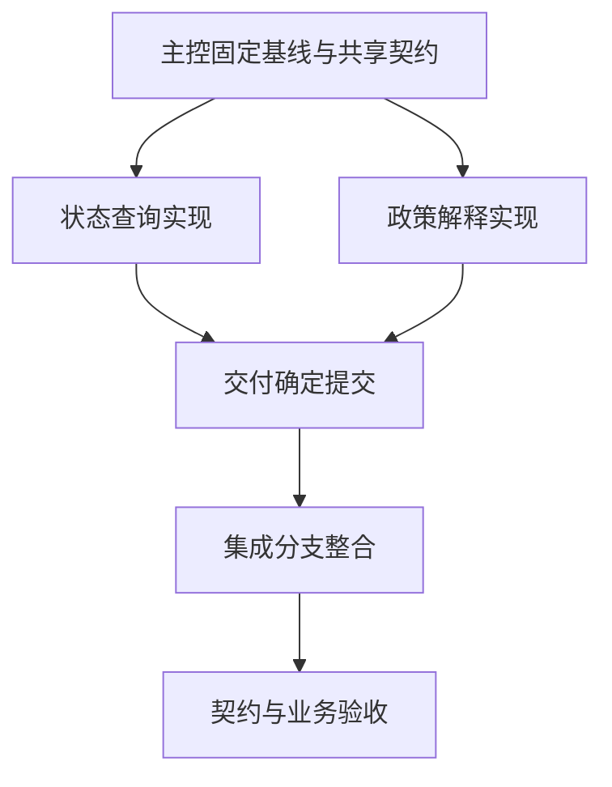

# 多 Agent 配合 git worktree，怎样拆任务和整合结果？

> 先固定共同基线和接口契约，再隔离独立任务；交付以后，围绕整合后的同一版本重新验收。

## 两个助手各写各的，为什么合起来仍可能出错？

假设工单平台要增加两项能力：查询工单状态，以及根据状态解释适用政策。

主控先定义共享对象 `TicketSnapshot`，其中包含工单编号、状态和观察时间。状态查询模块提供事实，政策解释模块根据事实查规则，两项实现可以在固定契约下分别推进。

如果共享对象尚未确定，两个助手却各自设计字段，那么后面的整合就要重新解释类型、含义和调用方式。

本文使用构造的教学方案，命令只作说明，没有创建工作区、启动项目或执行测试。一般协作原则见[多 Agent 任务编排](../ai/ai-agent-coordination.html)，这里集中讲代码交接与整合。

## 哪些工作可以并行，哪些必须等待？

先画依赖关系，再分配角色：



本例允许查询模块和政策模块分别修改自己的实现与测试，共享 DTO、认证接口和依赖版本由主控维护。

“一个写实现，另一个写测试”则不一定是独立任务。测试如果依赖尚未交付的新接口，就不能从旧基线开始执行，再把编译失败当成实现有问题。

可以并行设计测试场景，但验证新实现时，要明确取得它所在的提交。审查同样需要确定的输入版本，不能一边不断改代码，一边让审查者追着移动的目标判断。

## 共同基线怎样固定，才不会各自从不同地方开始？

主控先检查已有修改的归属，确认任务基线。未提交内容不会自动进入从提交创建的新 worktree，因此不能省略这一步。

下面是**未执行的命令示意**，假设分支名和目标目录尚不存在：

```bash
git status --short
BASE_SHA=$(git rev-parse HEAD)

git worktree add -b feat/ticket-status ../ticket-status "$BASE_SHA"
git worktree add -b feat/ticket-policy ../ticket-policy "$BASE_SHA"
git worktree add -b feat/ticket-integration ../ticket-integration "$BASE_SHA"
```

三个工作区从同一提交出发。创建前需要确认共享契约已经包含在该提交中，而不是只存在于主控未保存的编辑区。

`BASE_SHA` 应随任务说明交付。后续主分支发生变化时，由主控决定是否更新基线，并说明哪些检查需要重新进行，不能让各助手自行追踪最新提交。

Git 默认也会保护已经被其他 worktree 检出的分支。不要为了让多个助手操作同一分支，随意绕过这个保护。

## 一份子任务契约应该写到什么程度？

只说“负责查询模块”还不够。助手需要知道从哪里开始、哪些条件已经确定，以及交付什么才能被整合。

下面是状态查询任务的教学示例：

```text
代理名称：ticket_query_worker
目标：实现当前主体可见的工单状态查询。

基线：主控记录的完整 BASE_SHA。
只读输入：共享 DTO、认证接口、工单状态定义。
允许修改：ticket/query 下的实现及对应测试。
输出接口：按既定契约返回 TicketSnapshot。

禁止动作：
- 不改共享 DTO、状态含义和依赖锁文件。
- 不从客户端或模型参数认领可信租户。
- 不提交另一任务的文件，不启动共享服务。

完成条件：
- 查询对象和租户范围符合契约。
- 异常、空结果和权限拒绝能够区分。
- 提供回归判据，说明哪些检查尚未执行。

交付：
- 基线与最终提交 SHA。
- 修改文件、接口变化、验证记录和未确认事项。
```

政策任务使用相同结构，但写入范围换成自己的模块。共享文件确实需要修改时，先向主控报告影响，再调整契约与依赖关系。

任务契约不是权限系统。禁止访问生产凭据等要求，还需要运行环境和工具权限落实，不能只靠助手读过说明。

## worktree 隔离了什么，又没有隔离什么？

不同 worktree 有各自的工作文件、索引和 HEAD，可以避免两个助手同时覆盖同一个工作目录。

但它们仍属于同一个 Git 仓库：

| 对象                       | 是否可以视为独立                 |
| -------------------------- | -------------------------------- |
| 工作文件、索引与 HEAD      | 各工作区分别维护                 |
| Git 对象与多数引用         | 共享，存在少量专用引用例外       |
| 仓库配置                   | 默认共享，特定工作区配置另有机制 |
| 服务端口、数据库与外部 API | 不因 worktree 自动隔离           |
| 进程、凭据与系统资源       | 需要独立的运行约束               |

所以，“每个助手一个 worktree，乱改只影响自己”说得过于绝对。修改共享引用、访问同一数据库或占用同一端口，仍可能影响其他任务。

依赖目录也要分别考虑。可复用受支持的下载缓存，但不宜让多个工作区随意改写同一份 `node_modules` 等安装树。依赖版本与锁文件的变化应由明确责任人整合。

如果以后需要运行项目，还要分配端口、测试数据和任务命名空间。目录分开不能替代这些资源边界。

## 交付提交为什么比“已经完成”更可靠？

助手结束任务时，应返回具体提交及对应证据。主控可以据此核对：

- 提交是否来自约定基线，修改是否落在允许范围。
- 检查针对哪个提交、使用什么环境和判据。
- 是否有未提交、未跟踪或尚未交付的必要文件。
- 是否改变了共享契约，或者依赖另一任务的额外修改。

检查完成后又补了一次代码，原结果不能自动覆盖新提交。交付记录要同步说明变化与待复核内容。

没有执行条件时，可以交付代码分析和验收方案，但必须写清未运行。本文中的任务只用于说明交接设计，不代表已经产生这些提交。

## 没有 Git 冲突，为什么还需要集成验收？

构造一个反例：查询任务没有修改共享枚举，却把“等待用户补材料”也映射成 `WAITING_VENDOR`；政策任务按原契约，将该状态解释为等待供应商。

两个分支修改不同文件，文本合并可能成功，编译也未必报错。但用户会得到错误的政策解释。

因此，主控需要检查字段语义，而不只是文件冲突：

```text
查询结果中的状态和时间单位
→ 序列化后保留的字段
→ 政策模块对这些字段的理解
→ 最终解释与实际工单事实是否一致
```

两个分支各自的检查，只能证明各自版本满足了那些判据。它们不能替代整合后对接口、异常语义、授权和业务行为的检查。

相关测试反例见[Java 多租户缺陷与测试](./ai-coding-java-bugfix-walkthrough.html)。

## 整合时怎样避免输入继续变化？

主控先记录两个任务最终交付的 SHA，确认分支仍指向对应提交，再在集成工作区按顺序纳入结果。

下面仅展示纳入过程，假设主控已经核对两个分支，并且集成工作区仍处于约定基线：

```bash
STATUS_SHA=$(git rev-parse feat/ticket-status)
POLICY_SHA=$(git rev-parse feat/ticket-policy)

git -C ../ticket-integration merge --no-ff "$STATUS_SHA"
git -C ../ticket-integration merge --no-ff "$POLICY_SHA"
git -C ../ticket-integration rev-parse HEAD
```

每一步有冲突或检查失败，就先停在当前结果处理，不能无条件执行下一次合并。最后记录整合后的提交标识，后续检查都绑定这个版本，而不是分别引用两个任务之前的检查结果。

需要自动化时，应让受信任流程使用已确认的提交标识，而不是直接执行助手生成的命令。整合期间不让多个助手同时修改集成分支。

每纳入一项结果，检查实际差异与契约；两项都进入以后，再针对整合后的提交进行验收。若要求兼容新的主分支基线，也需要在更新后重新确认结果。

发现语义冲突时，先由主控明确正确契约，再委派边界清楚的修正。不要让两个助手互相等待对方“适配一下”，形成无人负责的循环。

失败也应保留已经完成的提交、证据与未解决事项。取消尚未完成的子任务，不意味着已经写入的外部操作会自动撤销。

## 工作区和助手，怎样收尾才不丢成果？

先确认提交已经整合或另行保存，再检查工作区状态。除了普通未跟踪文件，还要单独核对被忽略的配置、数据和临时笔记，避免把有用材料留在待移除目录。

停止已经完成的助手，以及明确属于这些任务的后台资源。不能因为端口被占用，就结束归属不明的其他进程。

确认干净后，可以使用正常的 worktree 移除命令：

```bash
git -C ../ticket-status status --short --untracked-files=all
git worktree remove ../ticket-status
git worktree remove ../ticket-policy
```

示例不使用 `--force`。Git 拒绝移除时，应先核对原因，而不是自动强制清理。工作区移除与分支删除也是两件事，不能据此推断提交已经被保存到其他位置。

`git worktree prune` 清理的是失效的管理记录，不负责合并、提交或保存文件。集成工作区也应在交付完成后，按同样原则收尾。

## 小结

1. 先固定共同基线与共享契约，再并行处理独立任务；测试与实现的真实依赖不能忽略。
2. 子任务要明确读写范围、输出接口和完成条件，交付绑定具体提交与未验证事项。
3. worktree 隔离工作文件及相关状态，不隔离共享 Git 资源、进程、凭据或数据库。
4. 文本合并成功不代表业务语义一致，最终验收必须针对整合后的同一版本。
5. 清理前保存成果并核对未跟踪材料，正常移除工作区，同时回收助手和任务资源。

## 参考

综合仓库 `docs/` 下的规范驱动开发、多代理交接和 AI 编程实践资料，结合站内任务编排与验收内容整理。将通用分工展开为共同基线、任务契约、确定提交和集成验收，纠正了角色不同即可并行、工作目录隔离等于资源隔离等泛化。

- [Git：git-worktree](https://git-scm.com/docs/git-worktree)——于 2026-11-21 核对独立工作状态、共享引用与配置、分支保护和工作区移除条件。
- [Agent 协作与任务交接](../ai/ai-agent-coordination.html)——依赖、证据交接与执行资源回收。
- [AI 代码验收](./ai-coding-acceptance.html)、[真实 PR 审查案例](./ai-coding-pr-review-case.html)——衔接差异审查和可核对的验收依据。

本文所有目录、任务与命令均为教学设计，未创建 worktree、运行项目、整合提交或执行测试，也未将预期验收写成已通过的结果。
