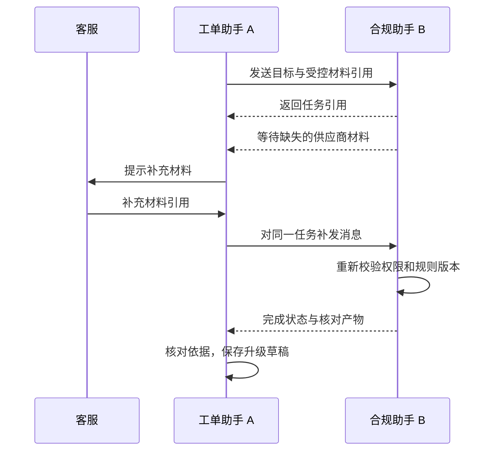

# A2A 怎样跨服务委托任务、校验身份和跟踪状态？

> 把目标委托给远程 Agent 后，调用方要保存任务引用，接收方要独立鉴权，双方再按明确的状态和业务证据推进。

## 工单助手为什么需要把合规核对交给另一个服务？

客服要求“核对 T-104 的升级材料，符合条件时准备升级草稿”。工单助手 A 能读取工单，却不能直接访问合规服务 B 的内部规则。B 可以自行检索规则、追问缺少的材料，最后返回有依据的核对结果。A 需要知道材料是否齐全、该等谁，以及断开后到哪里继续查，而不用知道 B 内部用了哪个模型、几次检索。

如果 B 只做一个确定性的同步校验，普通 HTTP 接口已经足够。多个独立 Agent 需要复用发现、交互、任务跟踪和产物契约时，A2A 才有接入价值。它通常也通过 HTTP 或 gRPC 工作，仍然需要超时、鉴权和幂等。A2A 面向远程任务协作，MCP 面向外部工具与资源接入，两者可以组合。B 内部可以调用 MCP 工具，A 不因此获得这些工具的访问权。[多 Agent 协作](./ai-agent-coordination.html) · [MCP 的职责边界](./ai-mcp-architecture.html)

本文按 **2026-11-20 读取的官方仓库标签 `v1.0.1`** 核对。它对应的线上协议号使用主、次版本 `1.0`；补丁号不参与协议协商。下文采用这一版的类型和操作名，旧例子里的 `tasks/send`、短横线状态名等不能与这一版报文混用。

## 找到 Agent Card，是否就可以照着地址调用？

Agent Card 提供服务说明、能力、输入输出类型、技能和接入要求。可以从预配置地址、受控目录或 `/.well-known/agent-card.json` 获取。1.0 类型用 `supportedInterfaces` 声明接入地址、协议绑定和 `protocolVersion`，应用自身的 `version` 则是另一件事。客户端选双方支持的接口与版本，不要用应用版本填协议头。HTTP 调用按契约携带 `A2A-Version: 1.0`。

卡片也是外部输入。接入配置需要确认域名、服务归属与允许的出站范围，凭据只能发给审核过的目标。卡片描述“擅长合规审核”不证明它有权读取某个客户的工单，描述中嵌入的指令也不能提高权限。变更了目标地址、认证要求或输出能力时，重新核对兼容性与信任配置。

若选中的接口声明了 `tenant`，客户端按卡片中的值路由。这个字段是协议的路由标识，不能当成当前用户已经通过业务租户鉴权的证据。B 还要从可信认证上下文中取得用户和业务数据范围。

A2A 的 Agent Skill 是卡片中的能力描述，不等于按需加载的 `SKILL.md` 文件，也不意味着调用方能读取远程 Agent 的内部提示词和工具实现。[Skills 与执行约束](./ai-agent-skills-harness.html)

## A 代表用户委托 B，B 应该相信哪一层身份？

本例需要保留三类信息：连接来自哪个服务、它代表哪个用户、该用户在 B 能访问哪些数据。生产传输采用 TLS，接收端逐请求检查凭据。若使用 OAuth 令牌，验证发行者、有效期、目标受众和权限；不一定所有令牌都是可由客户端解析的 JWT。

| 约束     | 在工单委托里如何落实                                      |
| -------- | --------------------------------------------------------- |
| 服务身份 | B 确认调用者确实是获准的工单应用，而不是相信消息中写的“A” |
| 用户委托 | A 取得面向 B、范围受限的授权，审计保留主体与代理关系      |
| 数据范围 | B 检查 T-104 属于当前可见租户，且该主体有权提交合规核对   |
| 动作范围 | 允许核对和生成草稿，不等于允许执行升级或修改合规规则      |

用户交给 A 的访问令牌如果只面向 A，就不能原样转发给 B，再让 B 放弃受众检查。可采用独立用户授权，或在身份平台支持时用 RFC 8693 Token Exchange 交换适用于 B 的受限令牌。Token Exchange 是可选的身份基础设施方案，A2A 没有要求每个部署实现它，也不会自动替调用者扩权。RFC 8707 的 `resource` 用于表达目标资源，Scope 用于表达访问类型，两者分工不同。

若采用服务账号访问 B，系统仍要通过可信、可校验的委托机制保留用户的数据约束；不能只传一个模型生成的 `userId`。凭据保存在认证层，不写入自然语言正文、Artifact 或模型上下文。下游数据服务再次检查自己的权限范围。[远程调用中的受众与归属校验](./ai-mcp-authorization.html)

## Message、Task 和 Artifact 分别应该记在哪里？

A 给 B 的 Message 可以包含目标说明与受控的数据引用。B 处理复杂请求时返回 Task，结果通过 Artifact 表达。简单交互也可能直接返回 Message，所以调用方不能假定每个响应一定有任务 ID。消息 Parts 允许文本、文件和结构化数据，A2A 并没有把所有业务交接强制成一份 JSON 或 XML 模板。

| 标识或对象                    | 谁创建、解决什么问题                   | 不能拿来保证什么                                   |
| ----------------------------- | -------------------------------------- | -------------------------------------------------- |
| `messageId`                   | 消息创建方分配，标识一次消息           | 规范只允许服务端用它做去重，没有承诺所有发送都幂等 |
| `Task.id` / 消息中的 `taskId` | 服务端创建任务，后续消息可引用已有任务 | 客户端不能自填新 `taskId` 代替服务端建任务         |
| `contextId`                   | 将相关任务和消息归为同一上下文         | 不是访问凭证，也不等于某个数据库事务               |
| `artifactId`                  | 在单个任务内标识结果产物               | 一份产物输出结束，不代表整项任务完成               |
| 业务操作号                    | 应用按业务意图签发并持久化             | 不由 JSON-RPC 请求号、消息号或连接号自动替代       |

任务引用至少和远程服务身份、接口、当前可信主体、业务操作号一起保存。只存一个 `taskId`，换了服务或用户就可能误查。Artifact 中的规则版本、引用和结论还要按应用契约验证，远程任务“完成”不会自动证明用户要求的升级已经执行。

## 怎样开始任务，又怎样区分等待材料和等待授权？

1.0 的 `SendMessage` 可开始交互或向已有任务补发消息。`configuration.returnImmediately` 为真时，返回任务引用后由客户端继续跟踪；为假或未设置时，按该配置的语义等到终态或中断态再返回。直接 Message 响应不受这个开关影响，流式操作也按自身实时更新的方式工作。

`v1.0.1` 的操作概述仍有“立即返回”的泛化措辞，而配置章节与 `a2a.proto` 明确写了上述默认等待行为。接 SDK 时要对照配置和实际实现验证，不能只照着概述推断超时设计。



图中采用立即返回模式。状态名以这一版枚举为准，不能把应用自定义的“审批通过”直接塞进协议枚举。

| 状态组         | 1.0 中的状态                                                                              | 调用方接下来做什么                     |
| -------------- | ----------------------------------------------------------------------------------------- | -------------------------------------- |
| 已接收、处理中 | `TASK_STATE_SUBMITTED`、`TASK_STATE_WORKING`                                              | 保留引用，按预算继续跟踪               |
| 等待业务输入   | `TASK_STATE_INPUT_REQUIRED`                                                               | 展示缺失信息，对同一任务补发消息       |
| 等待授权       | `TASK_STATE_AUTH_REQUIRED`                                                                | 走可信授权流程，继续订阅或查询         |
| 终态           | `TASK_STATE_COMPLETED`、`TASK_STATE_FAILED`、`TASK_STATE_CANCELED`、`TASK_STATE_REJECTED` | 保存结果或原因，不向该任务继续追加工作 |

等待授权不是让模型索要密码。1.0 支持把补充授权责任交给客户端；凭据通过带外流程交付，除非双方已经另行协商安全扩展。授权到位后，服务可能自动继续执行，所以 A 不应无限等另一条“恢复成功”消息而停止查状态。普通 `401` 仍表示当前请求认证失败，不等于已经建立了一个等待授权的任务。

`INPUT_REQUIRED` 和 `AUTH_REQUIRED` 都是中断态，不能当成失败或完成。任务进入终态后，新的业务目标应建立新任务；可保留原任务引用与上下文关系。

## 订阅断了，怎样避免旧事件把完成状态覆盖掉？

有任务 ID 后，用 `GetTask` 查询当前状态。B 声明支持流式能力时，可以用 `SubscribeToTask` 跟踪尚未终结的任务。1.0 订阅流的第一项是当前 Task，后面才是状态或产物更新，这减少了“先查完状态、再开始订阅”之间的信息缺口。已终结任务用查询取结果，不把重新订阅终态当成必然支持的操作。

客户端为每条订阅分配本地连接代次，重连时停止旧连接并忽略它的迟到回调，以新订阅的初始 Task 或重新查询的快照更新界面。断流只表示观察中断，不能把远程任务标成失败，更不能重发创建。不要给状态硬排“进度大小”：等待输入之后可以继续工作，状态也没有可供所有客户端比较的统一修订号。

Artifact 更新中的 `append` 和 `lastChunk` 针对同一产物的拼接与结束。断线时不知道漏了几块，就取当前完整产物，避免把新旧片段直接相加。推送通知与流式能力都要先检查卡片；推送接收端仍需认证、去重、校验任务归属，不能因为请求里有一个 task ID 就执行后续写操作。

## 提交超时和取消竞态，怎样在本地验证？

A 提交后超时，B 可能已经创建任务。如果拿到了任务 ID，就继续查询原任务；还没拿到时，按双方约定的去重或业务关联记录恢复，不能假定重发安全。应用可对“可信主体 + 动作 + 业务操作号”做唯一约束，另存规范化输入摘要做一致性校验：重复请求返回同一任务，参数变化则报冲突。若把摘要也放进防重键，换参数会绕过原记录。规范允许按消息号去重，不提供跨服务业务副作用的恰好一次保证。[业务幂等与恢复](./ai-agent-workflow-recovery.html)

下面用 Node.js 内置模块验证应用适配层的策略，保存为 `delegation-state.mjs` 后运行。对象和 `revision` 是本例内存实现的字段，不是 A2A 线上报文。身份对象模拟已经完成认证的上下文，生产环境要由认证组件产生，并把任务与防重记录持久化。

```javascript
import assert from "node:assert/strict";
import { createHash } from "node:crypto";

const tasks = new Map();
const operations = new Map();
const terminal = new Set(["COMPLETED", "FAILED", "CANCELED", "REJECTED"]);
const caller = { tenant: "north", user: "alice" };
const copy = (value) => structuredClone(value);

function authorize(task, actor) {
  if (!task || task.tenant !== actor.tenant || task.user !== actor.user) {
    throw new Error("not found or forbidden");
  }
}
function submit(actor, operationId, input) {
  const key = JSON.stringify([actor.tenant, actor.user, operationId]);
  const fingerprint = createHash("sha256").update(JSON.stringify(input)).digest("hex");
  const old = operations.get(key);
  if (old) {
    assert.equal(old.fingerprint, fingerprint, "同一业务操作不能换参数");
    return copy(tasks.get(old.id));
  }
  const id = "remote-" + (tasks.size + 1);
  tasks.set(id, { id, ...actor, state: "WORKING", revision: 1, artifact: null });
  operations.set(key, { id, fingerprint });
  return copy(tasks.get(id));
}
function get(id, actor) {
  authorize(tasks.get(id), actor);
  return copy(tasks.get(id));
}
function complete(id, artifact) {
  const task = tasks.get(id);
  assert.ok(task && !terminal.has(task.state), "终态不能被重新完成");
  Object.assign(task, { state: "COMPLETED", artifact, revision: task.revision + 1 });
}
function cancel(id, actor) {
  const task = tasks.get(id);
  authorize(task, actor);
  if (task.state === "CANCELED") return copy(task);
  if (terminal.has(task.state)) throw new Error("TaskNotCancelableError");
  Object.assign(task, { state: "CANCELED", revision: task.revision + 1 });
  return copy(task);
}

const input = { ticket: "T-104", policyVersion: "r4" };
const first = submit(caller, "review-104", input);
assert.equal(submit(caller, "review-104", input).id, first.id);
assert.equal(tasks.size, 1);
assert.throws(() => submit(caller, "review-104", { ...input, ticket: "T-105" }));
assert.throws(() => get(first.id, { ...caller, tenant: "south" }));
assert.throws(() => get(first.id, { ...caller, user: "bob" }));

let generation = 1;
let view = first;
const oldGeneration = generation;
function accept(old, snapshot) {
  if (old !== generation) return;
  view = snapshot;
}
complete(first.id, { verdict: "MATERIALS_READY", evidence: "policy:r4/2" });
generation += 1;
accept(generation, get(first.id, caller));
accept(oldGeneration, first);
assert.equal(view.state, "COMPLETED");
assert.throws(() => cancel(first.id, caller), /TaskNotCancelableError/);

const second = submit(caller, "review-105", { ...input, ticket: "T-105" });
assert.equal(cancel(second.id, caller).state, "CANCELED");
assert.equal(cancel(second.id, caller).state, "CANCELED");
console.log("防重、参数冲突、租户隔离、迟到事件与取消竞态检查通过");
```

实验让“完成先于取消”稳定发生，取消返回不可取消，而不是把完成记录改成取消。若取消先成功，服务也不能随后随意发布完成。真实实现还要用事务或版本条件更新仲裁这两个操作，并向仍在执行的工具传播取消。

`CancelTask` 是取消请求，不是业务回滚。1.0 将取消操作定义为幂等，但是否还能取消取决于远程任务状态。已经完成的升级、付款或通知仍需查询业务终态，必要时另走获得授权的补偿流程。关闭 A 的 HTTP 连接也不证明 B 或其下游停止工作。

## 小结

1. A2A 统一远程 Agent 的交互与任务契约，普通接口、MCP 和 A2A 按交互需求组合，远程内部实现仍由对端负责。
2. 卡片负责发现与能力描述，可信服务、用户委托、目标受众和业务对象归属分别检查。
3. 消息、任务、上下文、产物和业务操作号各有作用，先保存引用，再处理跟踪和重试。
4. 等待输入、等待授权和终态分开处理；重连使用当前快照，迟到事件不能覆盖新的观察结果。
5. 提交超时不证明没创建，取消不保证回滚；持久化防重与业务终态才是恢复依据。

## 参考

综合仓库 `docs/` 下的 Agent 范式、工作流状态与错误处理资料，按官方 `v1.0.1` 标签的规范和 Proto 类型交叉核对。区分了卡片技能与文件技能、业务操作号与消息号，并按配置章节纠正“发送一定立即返回”的概括。

- [A2A v1.0.1 规范：操作、状态、发现、鉴权与版本](https://github.com/a2aproject/A2A/blob/v1.0.1/docs/specification.md)
- [A2A v1.0.1 类型定义](https://github.com/a2aproject/A2A/blob/v1.0.1/specification/a2a.proto)
- [A2A v1.0.1 发布说明](https://github.com/a2aproject/A2A/releases/tag/v1.0.1)
- [RFC 8707：OAuth 资源指示符](https://www.rfc-editor.org/rfc/rfc8707)
- [RFC 8693：OAuth Token Exchange](https://www.rfc-editor.org/rfc/rfc8693)

用 Node.js 24.8.0 执行本文的合成状态实验，验证重复提交、参数冲突、跨租户拒绝、旧连接迟到与两种取消结果。实验未启动 A2A Server，也未进行 OAuth 签发、真实网络重连、跨进程恢复或业务补偿联调。
