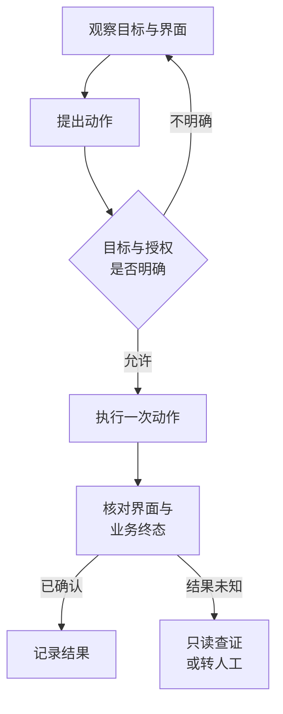

# Computer Use Agent 怎样操作界面，并确认动作真的成功？

> 把界面当作需要持续观察的执行环境，每次动作都核对目标、授权和后置状态，再决定继续、查证或停下。

## 按钮已经点了，工单为什么还没有升级？

客服授权助手升级工单 T-104。助手看见“升级工单”，点击后页面弹出“请求已发送”，于是报告升级成功。实际上，后端可能拒绝了这次请求；也可能已经写入，但响应在途中丢失。两种情况都可能让页面停在“处理中”，下一步却完全不同。

界面操作链包含模型提议、执行器输入、浏览器事件、业务请求和状态变化。鼠标事件发出只能证明其中一步。Computer Use 的难点也就从“模型会不会点”扩展成“怎样把这个动作放在可核对的业务过程中”。工单状态由后端接口与审计确认，页面上的状态和提示是可用的观察，仍要考虑异步刷新与乐观更新。

## 已经有业务 API，为什么还要操作界面？

先看任务真正缺少什么接口，再决定执行通道。下列路线可以在同一任务中组合，每一步都受相同的业务授权约束。

| 通道           | 工单例子                          | 主要约束                           |
| -------------- | --------------------------------- | ---------------------------------- |
| 明确的业务 API | 查询工单、提交带操作号的升级      | 需要稳定契约，服务端核验身份和归属 |
| 浏览器语义定位 | 在自有后台的指定工单区域点升级    | 依赖可访问名称、角色和页面结构     |
| 截图与像素动作 | 操作没有可用 DOM 的远程桌面或画布 | 依赖当前画面、坐标变换和重新观察   |

已有受支持的业务 API 时，直接调用更容易检查参数、读取错误与关联业务操作号。需要验证界面流程，或者系统只暴露界面时，再使用浏览器或桌面操作。不要为了让演示像真人，绕开已建立的权限和幂等接口。Java 服务可继续负责审批、凭据与任务记录，把 UI 执行器放在受控进程中，通过窄接口交换动作和证据。[业务工具调用](./ai-tool-calling-business-api.html)

浏览器里优先使用角色、可访问名称与明确的测试标识。例如限定 T-104 所在区域，再选其中名为“升级工单”的按钮。Playwright 的 Locator 在执行动作时重新解析 DOM，因此能适应一部分重新渲染。但它只会重新寻找满足选择条件的元素，仍需防止同名按钮指向另一张工单。任意 CSS 路径或一次快照中的元素位置也不能充当业务对象标识。[Playwright 定位器](https://playwright.dev/docs/locators)

## 截图、DOM 和可访问性树，分别能说明什么？

截图可以显示弹窗、遮罩、布局和画布内容。DOM 便于读取元素与字段，但可能混有隐藏区域、旧节点或与当前任务无关的文本。可访问性信息包含角色、名称和状态，有助于找到用户能理解的控件；缺少语义的画布、自定义组件或错误标签仍需其他观察补充。

一次观察可以附带应用内部的 `observationId`、页面或窗口标识、URL、当前工单标识、视口与截图尺寸、滚动位置和采集时间。这些是执行器自行设计的元数据，不是所有 Computer Use API 通用的字段。模型提出动作时引用此次观察，执行器在动作前核对目标仍处于允许范围。页面跳转、主窗口切换、弹窗出现或目标工单改变后，旧动作应重新观察和规划。

像素坐标必须说明使用哪套坐标系。若模型看到的是裁剪并缩小后的图片，映回原视口时需要恢复裁剪偏移和缩放比例。CSS 像素、截图像素和设备缩放不能混用，浏览器缩放、滚动或远程桌面分辨率改变后也要重新建立映射。官方参考实现会在截图与执行坐标之间显式换算；其中的推荐分辨率只是该实现的选择，不能当成所有模型的硬限制。[Computer Use 参考实现](https://github.com/anthropics/claude-quickstarts/tree/4a4224bdf0e9cfb3332167b69c90457403813625/computer-use-demo)

观察编号只能帮助发现过期信息。检查后、执行前，页面仍可能改变。高风险业务的对象、参数、审批和版本前提最终还要在后端原子校验，不能用一张“刚截的图”替代。

## 动作前后各要检查什么？

以升级 T-104 为例，执行器先确认页面与租户、工单、动作类型和审批参数一致，再检查当前控件是否唯一且能正常交互。模型负责提出“做什么”，执行策略负责判断“这一步是否可做”。目标不明确时重新观察，碰到未知弹窗、权限变化或登录失效时暂停，而不是猜一个坐标。



Playwright 的自动等待会检查点击所需的可见、稳定、可接收事件和启用条件，检查超时会抛错。它不了解“工单升级已提交”的业务含义。`force` 会跳过部分检查，不能作为挡住按钮时的通用修复。应调查是加载、遮罩、权限还是目标选择错误。[动作可用性](https://playwright.dev/docs/actionability)

执行后检查业务后置条件，比如工单号仍是 T-104、终态变为已升级、操作记录可关联本次操作号。动作前把状态和关键参数记下来，便于区分“此前已升级”和“本次刚升级”。只有截图时，可以用新画面核对可见结果，同时明确它的证据范围；需要强业务保证而没有查证通道时，应报告无法确认。不要用固定睡眠或一个 Toast 文案代替终态检查。

## 怎样在本地复现“点击成功，结果却不同”？

下面的实验使用 Playwright 1.59.1 和已安装的 Chrome。可以在一个独立临时目录安装 `playwright@1.59.1`，将片段保存为 `ui-result.mjs` 后运行 `node ui-result.mjs`。浏览器使用新的 Context，没有加载日常浏览器的配置或登录态。所有页面和请求都由内存路由提供，未匹配请求直接中止。

同一份页面在点击时先显示“请求已发送”。第一轮模拟业务明确拒绝且未写入，第二轮模拟写入成功但响应丢失。测试特意让“页面应已升级”的断言失败，再用只读查询区分真实结果。

```javascript
import assert from "node:assert/strict";
import { chromium, expect } from "playwright/test";

const html = `<!doctype html><meta charset="utf-8">
  <main><h1>工单 T-104</h1>
  <output data-testid="ticket-status">处理中</output>
  <button>升级工单</button><p role="status" aria-label="提交提示"></p><p role="alert"></p></main>
  <script>
    document.querySelector('button').onclick = async () => {
      document.querySelector('[role=status]').textContent = '请求已发送';
      try {
        const res = await fetch('/api/tickets/T-104/upgrade', { method: 'POST' });
        if (!res.ok) throw new Error('not confirmed');
        document.querySelector('output').textContent = (await res.json()).status;
      } catch {
        document.querySelector('[role=alert]').textContent = '升级未确认';
      }
    };
  </script>`;

const browser = await chromium.launch({ channel: "chrome", headless: true });
try {
  for (const mode of ["rejected", "committed-response-lost"]) {
    const ticket = { id: "T-104", status: "处理中" };
    let posts = 0;
    let writes = 0;
    const context = await browser.newContext();
    try {
      const page = await context.newPage();
      await page.route("**/*", async (route) => {
        const request = route.request();
        const url = new URL(request.url());
        if (url.origin !== "https://tickets.example.test") return route.abort();
        if (url.pathname === "/tickets/T-104" && request.method() === "GET") {
          return route.fulfill({ contentType: "text/html", body: html });
        }
        if (url.pathname === "/api/tickets/T-104" && request.method() === "GET") {
          return route.fulfill({ json: ticket });
        }
        if (url.pathname === "/api/tickets/T-104/upgrade" && request.method() === "POST") {
          posts++;
          if (mode === "rejected") {
            return route.fulfill({ status: 409, json: { error: "NO_WRITE" } });
          }
          ticket.status = "已升级";
          writes++;
          return route.abort("failed");
        }
        return route.abort();
      });

      await page.goto("https://tickets.example.test/tickets/T-104");
      await page.getByRole("heading", { name: "工单 T-104", exact: true }).waitFor();
      await page.getByRole("button", { name: "升级工单", exact: true }).click();
      await expect(page.getByRole("status", { name: "提交提示", exact: true })).toHaveText(
        "请求已发送",
      );
      await expect(page.getByRole("alert")).toHaveText("升级未确认");
      await assert.rejects(
        () => expect(page.getByTestId("ticket-status")).toHaveText("已升级", { timeout: 300 }),
        /已升级/,
      );

      const actual = await page.evaluate(async () => {
        const res = await fetch("/api/tickets/T-104");
        if (!res.ok) throw new Error("status unavailable");
        return res.json();
      });
      assert.equal(actual.id, "T-104");
      assert.equal(actual.status, mode === "rejected" ? "处理中" : "已升级");
      assert.equal(posts, 1);
      assert.equal(writes, mode === "rejected" ? 0 : 1);
      console.log(mode, { ui: "处理中", actual: actual.status, posts, writes });
    } finally {
      await context.close();
    }
  }
} finally {
  await browser.close();
}
```

第一轮观察到页面和业务都还是“处理中”，第二轮页面没更新，业务却已升级。两轮的 `click()` 都完成了，HTTP 提交次数也都是一次。第二轮再次点击会形成第二次提交，不能用“页面没变”判断前次没有写入。这里的 `NO_WRITE` 是模拟服务明确约定的错误语义，真实系统不能仅凭某个 HTTP 状态码推断没有副作用。

示例用页面内的 `fetch` 读取受路由控制的只读结果，断言另核对模拟业务状态和写入计数。它验证执行和查证的边界，没有调用视觉模型，也没有模拟真实工单的认证、事务和数据库。实际产品仍需验证这些层。

## 超时或页面变化后，什么时候重试，什么时候停下？

先确定超时发生在哪一段。等按钮可点击超时，通常还没有发出这次点击，但仍要检查执行器的明确记录。点击后的导航等待超时、请求断开或界面没有更新，则可能已有写入。此时保留结果未知状态，通过可信只读接口或审计查询操作号；没有操作号时，按系统支持的查证流程确认，不凭相似的工单标题猜测结果。

只有确认未执行且前提仍有效时，才按预算重试。已提交的业务动作由后端幂等约束处理，浏览器重载、换一个会话或重跑模型都不应产生新的业务意图。无法查明、已到预算或需要新的授权时，暂停并交代已知事实。取消执行器也不会撤销已经完成的业务操作。[审批与恢复](./ai-agent-java-approval-recovery.html)

审计记录可保存任务标识、观察引用、目标工单、提议动作、策略决定、执行结果与业务操作号。截图和 DOM 可能包含其他客户资料、令牌或个人信息，只采集任务需要的区域，控制访问和留存，不把完整页面长期复制进日志。复跑使用隔离页面、受控数据和替身工具，避免再次写入。

## 页面里的文字和现成登录态，能带来哪些额外权限？

工单留言、图片文字、网页提示都是外部内容。它们可以提供待处理信息，不能批准新的付款、上传资料或扩大任务范围。发现页面要求跳到另一个域名、读取本机文件或使用其他账户时，执行器按允许范围重新判断，不能因为指令出现在截图里就信任它。[提示注入与运行时边界](./ai-agent-prompt-injection.html)

为每个任务或受控主体建立独立 BrowserContext，有助于隔离 Cookie、localStorage 等会话状态。它不是系统级安全沙箱，也不会替后端隔离租户，更不能靠新建 Context 撤回已经外发的数据。桌面工具还要限制文件、进程、下载上传、剪贴板和网络出口，需要时放在独立受限环境运行。[浏览器 Context](https://playwright.dev/docs/browser-contexts) · [执行沙箱](./ai-agent-sandbox-isolation.html)

敏感动作仍需可信确认绑定真实用户、租户、对象、参数和期限。模型不能凭页面里的“已批准”替自己放行。优先给任务受限会话和所需工具，不把日常浏览器的完整登录态、密码库与文件系统一并交给模型。官方参考实现也专门提醒了网页内容注入、凭据与隔离风险，不能把“在容器里运行”理解成已经解决全部边界。

## 小结

1. 选择能表达任务且便于验证的通道，API、语义定位和像素动作各有边界，权限规则贯穿始终。
2. 每次观察保留目标与坐标元数据，页面变化后重新定位，后端仍检查对象和版本前提。
3. 自动等待保证部分动作条件，完成判据必须核对业务后置状态，点击和提示文案不足以证明提交成功。
4. 超时后先查证，结果未知时不盲重写；审批、业务幂等和取消分别解决不同问题。
5. 页面内容不可信，会话隔离不等于系统沙箱；按任务限制数据、凭据、出口与操作范围。

## 参考

综合仓库 `docs/` 下 Agent 基础、执行环境与验证循环资料，对照下面的一手来源核对定位、自动等待、浏览器会话和坐标变换。供应商工具的版本与参数需按所用模型和 SDK 锁定，本文使用通用执行流程，不指定某个 Computer Use 请求报文。

- [Anthropic Computer Use 参考项目与风险说明](https://github.com/anthropics/claude-quickstarts/tree/4a4224bdf0e9cfb3332167b69c90457403813625/computer-use-demo)
- [Anthropic 截图与坐标变换实现](https://github.com/anthropics/claude-quickstarts/blob/4a4224bdf0e9cfb3332167b69c90457403813625/computer-use-demo/computer_use_demo/tools/computer.py)
- [Playwright Locators](https://playwright.dev/docs/locators)
- [Playwright Auto-waiting](https://playwright.dev/docs/actionability)
- [Playwright Browser contexts](https://playwright.dev/docs/browser-contexts)

2026-11-20 在 Node.js 24.8.0、Playwright 1.59.1 与 Chrome 158.0.8127.36 上执行正文的隔离页面实验。验证两次点击都完成、业务结果不同、每轮只提交一次，并核对写入次数。实验没有接入真实账户、视觉模型或工单服务，也不代表对所有网页和提示注入已完成验证。
