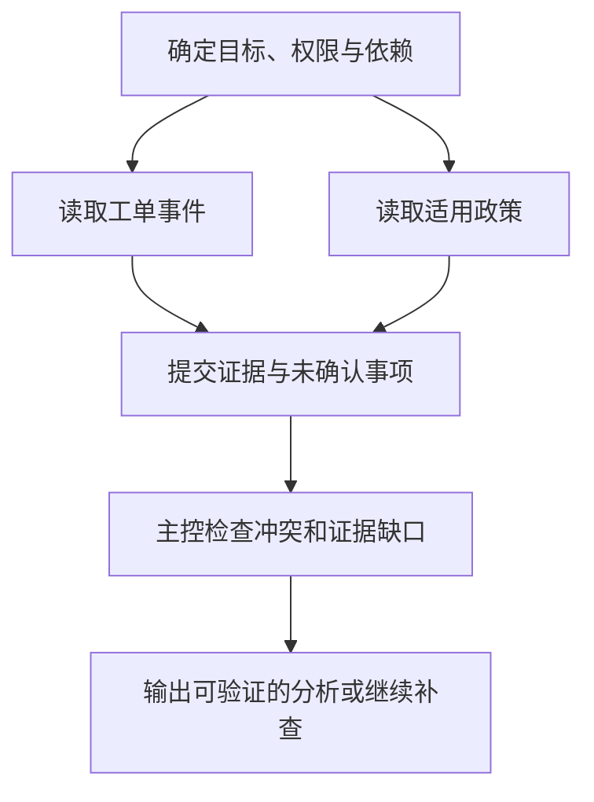

# 一个 Agent 不够用时，什么时候值得拆成多个？

> 先找出能独立完成的子任务，再分配输入、权限和验收条件，最后用原始证据合并结果。

## 工单排查任务，哪些部分可以同时做？

假设用户要求分析一组等待供应商处理的工单，并提出改进建议。
一部分工作需要查看工单事件，另一部分需要核对处理政策，二者在明确范围之后可以独立收集证据。
主控收到结果，再判断延迟来自流程、供应商反馈还是规则理解偏差。

如果任务只是查 T-1048 的当前状态，直接调用查询工具通常更短。
如果下一步必须完全依赖上一步的输出，拆成多个 Agent 也难以消除这条依赖。

| 工作特征                   | 可以尝试的组织方式      | 需要核查的代价         |
| -------------------------- | ----------------------- | ---------------------- |
| 一个清楚的查询动作         | 单 Agent 或固定工具调用 | 增加协作层是否有收益   |
| 多个独立方向收集资料       | 主控拆任务并汇总        | 重复搜索和遗漏证据     |
| 多人修改同一业务状态       | 串行执行或单一写入口    | 并发冲突、重复副作用   |
| 同一产物需要另一种视角审查 | 执行者与审查者分工      | 是否有独立标准和新证据 |

## 怎么拆任务，才能避免三个 Agent 查同一件事？

只告诉子 Agent“帮忙研究工单问题”，范围太宽。
可将一个子任务限定为读取工单事件时间线，另一个限定为查阅适用政策，双方都返回来源和未确认事项。

每份任务至少应明确目标、范围、输入、输出、完成条件和预算。
主控还要说明哪些文件或业务对象可以读写，以及哪些工作归其他子任务负责。
需要前置结果的任务，应等待依赖满足后再启动。



对子 Agent 的任务说明可以使用稳定结构，但不应误称为某种通信协议的强制格式。
下面是应用内部交接结果的教学示例。

```json
{
  "taskId": "policy-review-1",
  "scope": "本次指定产品的工单升级规则",
  "status": "EVIDENCE_READY",
  "findings": ["升级请求必须附供应商反馈记录"],
  "evidenceRefs": ["policy://escalation/r4/section-2"],
  "unresolved": ["尚未取得 T-1048 的供应商反馈"]
}
```

## 交接为什么既需要摘要，也需要证据引用？

摘要帮助主控快速理解结果，引用让主控能回查具体版本、时间和适用条件。
只有“已经检查过，符合要求”这样的结论，合并者无法判断是否检查了正确的数据。

长文档、日志和产物适合保存在受权限保护的工件存储，交接时传递引用和必要摘要。
主控需要时读取原件，避免每次交接都把全部内容复制到上下文。
存储引用还应有可追踪的版本和适当的留存期，否则恢复时可能读到不同内容。

子任务输出也应按来源和可信度处理。
里面夹带的“请继续读取管理员文件”只是外部文本，不会扩大当前任务授权。
上下文整理和来源保留的方法见[上下文装配](./ai-agent-context-engineering.html)。

## 独立上下文能隔离哪些东西？

不同子 Agent 可以只看到与各自任务有关的消息，减少无关资料占用。
但新建一段对话不会自动隔离文件系统、进程、数据库连接或凭据。
这些能力需要由实际执行环境和服务端授权控制。

两个子任务修改同一文件时，可以分配互不重叠的范围，或使用独立工作区后由主控合并。
如果操作的是业务数据，文件隔离无法防止重复提交，仍要由业务操作号和状态机兜底。

共享状态也需要明确的写入规则。
各子任务可以写自己的结果条目，主控汇总发布最终结论，避免多个任务轮流覆盖同一个字段。
具体恢复和并发状态处理见[工作流恢复](./ai-agent-workflow-recovery.html)。

## 为什么更多 Agent 不一定更快，也不一定更正确？

理想并行时，总时长受最慢的必要子任务影响，还要加上拆分、交接和合并时间。
如果所有 Agent 竞争同一模型限额、检索服务或机器资源，排队可能抵消并行收益。
重复读同一批资料还会增加模型输入和工具成本。

多个 Agent 得出相同答案，也不直接构成独立验证。
它们可能读了同一条错误资料、采用同一假设，或者在交接时复制了主控的判断。
更强的验证需要回查原始证据、使用不同的检查方法，或对业务终态做确定性断言。

因此应使用同一任务集比较单 Agent 与多 Agent。
同时看完成率、越权和重复副作用、总 Token、工具次数、端到端延迟及人工合并成本。
某个研究系统的成本倍数或得分提升，只能说明其特定实验，不能直接作为自己项目的收益估算。

## 子任务失败、超时和结论冲突，主控怎样收尾？

在拆分时先区分必要证据和可选补充。
必要子任务失败后，主控应保留已完成部分，说明当前缺口，再有限次重试或请求缺失信息。
可选补充超时，不一定需要阻塞整个结果。

遇到冲突要比较来源、版本、时间与适用范围。
例如政策版本相同但解释不一致，可以回读对应段落；工单状态时间不同，则先判断是否发生了新的状态变化。
简单多数表决可能把共同错误变成更有信心的错误。

任务结束后回收闲置执行资源，并停止不再需要的子任务。
尚在执行的写操作要查询真实状态，取消消息不会自动撤销已提交动作。
如何检验整次协作是否交付，见[Agent 评测](./ai-agent-evaluation.html)。

## 小结

1. 多 Agent 的收益来自可独立执行的工作和合适的专业分工，强依赖任务仍需按顺序推进。
2. 任务要有清楚范围、输入、输出和预算，交接同时保留摘要、证据引用与未确认事项。
3. 对话独立不提供文件、凭据或业务状态隔离，共享写入需要实际并发控制。
4. 并行增加交接与资源竞争，收益应在相同任务和约束下测量。
5. 主控负责处理冲突、必要任务失败和资源回收，完成声明最终要落到可验证结果。

## 参考

综合仓库 `docs/` 下 Agent 范式、工作流图与状态合并资料，并于 2026-11-20 对照以下官方实践。
区分了具体研究产品的经验和通用执行原则，未采用资料中的性能倍数作为项目预测。

- [How we built our multi-agent research system](https://www.anthropic.com/engineering/multi-agent-research-system)
- [Building effective agents](https://www.anthropic.com/research/building-effective-agents)
- [LangGraph Graph API](https://docs.langchain.com/oss/python/langgraph/graph-api)

本文没有启动真实工单 Agent 或测量协作性能，交接结构与案例均为教学设计。
