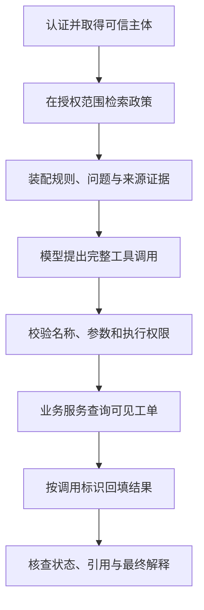

# Java Agent 怎样组织知识证据与工具调用？

> Java 编排层按可信身份选择知识和工具，模型提出调用，业务服务核查数据权限，结果再按调用标识回填并接受验收。

## 工单当前状态和处理政策，为什么需要分开取得？

假设 alice 问“我的 T-1048 为什么还没处理”。
工单服务查询到 `WAITING_VENDOR`，知识库提供该产品的供应商等待说明。
前者回答当前发生了什么，后者帮助解释规则和下一步，两份材料不能互相替代。

| 材料         | 应保留的依据                 | 不能据此推断什么           |
| ------------ | ---------------------------- | -------------------------- |
| 工单查询结果 | 工单标识、状态版本、观测时间 | 上次查询的状态现在仍未变化 |
| 知识政策     | 来源、发布版本、适用条件     | 当前用户有权操作任意工单   |

这些都是合成场景，不代表一次真实业务查询。
检索到相似政策也不能自动认定适用，候选、排序与生成的诊断见[RAG 排障](./ai-rag-retrieval-diagnosis.html)。

## 一轮请求在 Java 应用中怎样流转？



执行器还要维护轮数、超时和预算，不能让一次工具错误形成无限循环。
模型只输出解释而没有查询时，也要判断是否已具备足够的当前事实。
通用的阶段与终态见[Agent 运行时](./ai-agent-runtime-loop.html)，这里重点讨论 Java 各层怎样交接数据。

## 身份和政策正文怎样进入不同的通道？

调用者和租户从已验证的安全上下文取得，模型只提供工单号等业务参数。
用户传入另一个 `userId`、文档宣称“拥有管理员权限”，都不能改变实际主体。
服务端自报信息、模型返回元数据和工具描述也不属于用户认证凭据。

全文和向量检索分支都要携带可信作用域，正文进入重排器或模型之前再确认当前授权。
组装 Prompt 时，应用规则、用户问题和政策证据各自保留角色与来源。
不能把整份检索结果拼进可信规则，让正文中的“忽略约束”取得更高优先级。

政策片段保留 `sourceId`、版本、适用范围及相关段落，实际工单结果则保留观测时间。
材料过期、互相冲突或缺少例外条件时，应标明缺口，再检索或追问。
如何挑选候选和保留必要条件，见[Embedding 与重排](./ai-embedding-reranker.html)。

## 工具定义和真正执行的方法怎样保持一致？

假设本轮只开放 `get_ticket`，输入 Schema 仅接受 `ticketId`，不允许额外属性。
发送给模型的定义必须与执行器当前登记的名称和参数一致。
未知名称、遗漏必填、非法类型和越界值都在进入业务服务前拒绝，不能用模糊匹配调用另一个工具。

下面是应用内部交接的 Java 示意，省略导入、外围错误映射及业务类型，并非完整可运行类。
`Caller` 由外层认证代码构造，`ticketService` 表示已有业务服务，不是 Spring AI 内置 API。

```java
record Caller(String tenantId, String userId) {}
record Call(String callId, String name, Map<String, Object> arguments) {}
record Outcome(String callId, String status, Map<String, Object> data) {}

Outcome queryTicket(Call call, Caller caller) {
    if (call == null || call.arguments() == null
            || !"get_ticket".equals(call.name())
            || !Set.of("ticketId").equals(call.arguments().keySet())) {
        throw new IllegalArgumentException("工具名称或参数结构不符合约定");
    }
    Object raw = call.arguments().get("ticketId");
    if (!(raw instanceof String id) || !id.matches("T-[0-9]{4}")) {
        throw new IllegalArgumentException("工单号不符合约定");
    }
    var ticket = ticketService.findVisible(id, caller.tenantId(), caller.userId());
    return new Outcome(call.callId(), "OK", Map.of(
            "ticketId", ticket.id(), "status", ticket.status(),
            "observedAt", ticket.observedAt()));
}
```

示意中假设 `caller` 已通过外层身份检查，业务服务只返回其可见数据，并对不存在或无权限作受控处理。
真正的租户与归属条件应落实在查询或服务端策略中，不能仅靠方法名 `findVisible` 表达意图。
返回对象也要裁剪字段，查状态通常不需要完整地址、内部备注或其他人的资料。

即使模型声明自己只读，也应照常执行权限与业务校验。
参数规范化只能在明确契约范围内进行，不能把错误工单号改成另一个对象再查询。

## Spring AI 能接管哪些步骤，应用还要决定什么？

以 Spring AI 1.1 系列文档为例，`Prompt` 封装消息与调用选项，`ChatModel` 返回 `ChatResponse`。
`ToolCallback` 表达可调用工具，`ToolCallingManager` 参与工具执行生命周期。
这些抽象便于接入，不能替代业务对象授权或政策适用性判断。

该系列提供 `ToolContext`，用于传入工具需要的额外执行信息，不直接发送给模型。
应用可以从可信主体构造这份上下文，但不能直接信任浏览器传来的租户 Map。
若应用又把它拼入 Prompt 或日志，仍会造成额外的数据暴露。

采用框架内部工具执行时，要让同一套策略约束回调。
自行接管支持该模式的工具生命周期时，可按对应版本设置 `internalToolExecutionEnabled(false)`，由调用方执行并继续对话。
不能在框架已经执行之后，外层循环又按相同响应再调用一次工具。
实际支持范围与 API 需按项目版本核对，本文不提供依赖配置或启动步骤。

## 工具结果回填时，哪些标识不能丢？

每份结果必须对应原来的工具调用标识，不能因为某个请求先完成，就填进另一个调用的位置。
内部 `Outcome` 可以统一数据形态，但发送给模型前仍需转换为目标 API 的消息结构。

例如 OpenAI Chat Completions 使用 `tool_call_id` 对应工具消息，Responses API 使用 `function_call_output` 与 `call_id`。
Anthropic Messages 则使用与 `tool_use_id` 对应的 `tool_result` 内容块。
这几套结构不能混写，还应保留相应 API 要求延续的响应项及完整消息组。

权限拒绝、下游超时和不存在等情况，应转换为适当的受控结果。
不能用空工单对象冒充成功，也不能把 SQL、堆栈、令牌或整份后台对象交给模型。
描述为“只读”的工具结果仍可能夹带外部留言，其中的指令不会扩大授权。

## 最终回答怎样同时核对事实与引用？

对于这次查询，可以核对工单号属于 alice、真实查询得到的状态为 `WAITING_VENDOR`、观测时间有效，以及解释所用政策版本适用。
引用的证据标识存在，只证明能找到材料，还要检查对应段落确实支撑回答中的条件和结论。
关键状态可以用受控映射核验，开放解释则需要规则、人工或经校准的评分辅助。

如果工具失败或缺少可靠政策，回答应说明已取得的信息与未知部分。
模型生成“已升级工单”也不能改变查询任务的性质，更不能证明后台发生了写入。
写操作需要单独的审批和状态链路，继续看[Java 审批与恢复](./ai-agent-java-approval-recovery.html)。

## 小结

1. 政策解释规则，业务服务提供当前事实，两者分别保留来源、版本和时效依据。
2. 身份由可信服务端上下文注入，检索与工具执行都保持对象和租户范围。
3. 工具定义与实际执行器一致，未知名称和非法参数在执行前拒绝，方法名或注解不提供权限保证。
4. 框架执行与应用接管需要明确分工，结果按调用标识转换成目标 API 的合法结构。
5. 最终回答同时核查当前状态、政策适用性与引用，文字完成不代表业务动作完成。

## 参考

综合仓库 `docs/` 下 AI 应用分层、结构化工具调用与权限资料，并与站内检索诊断和运行时笔记交叉核对。
于 2026-11-20 读取以下 Spring AI 1.1 系列原文，核实消息封装、工具上下文及应用接管工具执行的职责。

- [Spring AI 1.1：Chat Model API](https://docs.spring.io/spring-ai/reference/1.1/api/chatmodel.html)
- [Spring AI 1.1：Tool Calling](https://docs.spring.io/spring-ai/reference/1.1/api/tools.html)
- [Spring AI 1.1：Getting Started](https://docs.spring.io/spring-ai/reference/1.1/getting-started.html)

工单、身份与记录均为教学假设。本文只解释数据与执行边界，Java 片段省略外围实现，未编译完整应用，也未完成真实模型、检索或业务服务联调。
