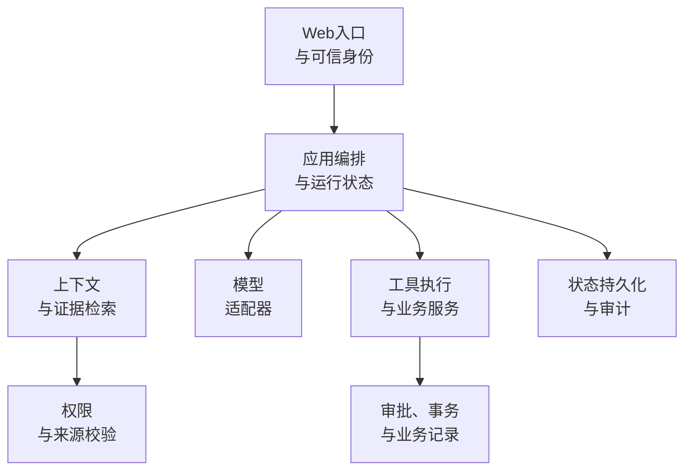

# Java 工单 Agent 的接口与模块应怎样划分？

> 按身份、任务、模型、工具和业务状态划分职责，让每次请求都能回答谁有权执行、目前做到哪里、结果由什么证据证明。

## alice 问一句工单状态，为什么要经过多个边界？

假设 alice 询问本人名下的 T-1048，工单当前状态为 `WAITING_VENDOR`。
助手需要取得可信身份，查询工单与适用政策，再解释正在等待供应商反馈。
如果用户接着要求升级处理，还要保存草稿、取得确认、提交业务动作并记录结果。

这些步骤的输入和可信程度不同。
用户身份来自认证系统，工单状态来自业务服务，政策来自受权限约束的知识库，模型提供的是解释或下一步动作提议。
把它们都交给一个接收字符串的方法，后续就很难判断权限检查、重试和状态更新应该放在哪里。

前面的[Java 接入选型](./ai-java-integration-stack.html)已经讨论框架取舍，本篇沿一条工单请求划清具体职责。

## 哪些模块需要明确职责，哪些可以留在同一个服务？



| 职责           | 工单场景中负责什么                         | 不应交给它决定什么                 |
| -------------- | ------------------------------------------ | ---------------------------------- |
| Web 与认证入口 | 校验请求、解析可信主体、选择同步或任务交互 | 从模型参数中认领用户身份           |
| 应用编排       | 控制轮次、预算、取消和下一步执行           | 把模型的完成声明直接当成业务终态   |
| 上下文与检索   | 取得有权限、带版本和来源的证据             | 把文档里的指令提升为执行授权       |
| 模型适配       | 转换消息、工具定义、响应与用量             | 提交工单事务或分配用户权限         |
| 工具与业务服务 | 校验参数、归属和业务前提，执行允许的动作   | 因模型重试而绕过审批与防重         |
| 状态与审计     | 保存任务位置、业务引用和脱敏执行证据       | 把聊天记录当成外部系统已成功的证明 |

这是责任划分，可以先实现为一个 Java 服务中的包、类和接口。
只有部署、隔离或扩缩容需求不同，才需要进一步拆成独立服务。
框架组件也可以承担其中一部分职责，应用仍要知道这些检查实际发生在哪里。

## 请求对象怎样表达目标，又不允许伪造身份？

对“查看 T-1048”的请求，浏览器只需表达工单标识和问题。
当前用户、租户和可用的数据范围由认证层解析，再通过内部调用传递。
即使客户端添加 `userId=alice`，也不能据此让 bob 获得 alice 的数据权限。

下面是教学接口片段，省略校验实现与类型定义，用于说明契约，不是一份可启动程序。

```java
record StartRun(String ticketId, String question) {}
record Caller(String userId, String tenantId) {}
record RunRef(String runId, String phase) {}

interface TicketAgentApplication {
    RunRef start(StartRun request, Caller authenticatedCaller);
    RunView view(String runId, Caller authenticatedCaller);
    RunView confirm(String runId, ApprovalInput input, Caller authenticatedCaller);
    RunView cancel(String runId, Caller authenticatedCaller);
}
```

这里的 `Caller` 表示认证层已核实的主体，不能直接绑定为用户请求体。
`record` 只描述数据结构，构造成功本身不提供身份真实性保证。
应用接收它之后，还要在工单查询、任务读取和确认入口分别检查对象归属。
`runId` 只是定位信息，拿到它不代表拥有任务访问权限。

## 应用编排怎样组织模型与工具？

编排层先确认任务范围，再装配当前问题、有效历史和必要证据，交给模型适配器。
若模型提出工具调用，执行器验证完整参数、当前授权和预算，执行后按调用标识回填结果。
没有调用权限、证据不足或连续没有进展时，应用应进入明确的等待或结束状态。

查询 T-1048 的工具可以复用已有工单服务，查询条件带上当前用户与租户。
创建升级记录则要进入受控业务动作，不能把任意数据库写入或通用脚本接口直接交给模型。
政策检索与业务查询的证据组织，继续看[知识与工具调用](./ai-agent-java-knowledge-tools.html)。

轮次和工具数应分别限制，因为一次模型响应可能包含多个工具调用。
取消时停止尚未发起的动作，并保留已提交操作的真实状态。
完整的回填与停止机制见[Agent 运行时](./ai-agent-runtime-loop.html)。

## Spring AI 的类型应该出现在哪一层？

以读取的 Spring AI 1.1 系列文档为例，`ChatModel` 接收 `Prompt`，返回 `ChatResponse`。
模型适配器可以使用这些类型，再把文本、调用标识、工具参数、结束原因和用量映射为应用理解的结果。
对外 HTTP 响应不必原样暴露供应商或框架对象。

Spring AI 的工具回调机制也可以管理工具执行与回灌。
采用框架回调时，权限、业务校验和审计应落实到实际回调入口。
如果改为应用自行管理工具循环，需要明确关闭或绕开相应自动执行路径，避免同一调用被框架和应用各执行一次。

MCP 可以作为远程工具的接入适配器，也可以继续使用本地业务方法或 HTTP 服务。
它不决定应用怎样划分事务，也不替代当前用户的授权。
选择其中一种接入方式，不要求所有模块都迁移到同一个 Agent 框架。

## 任务记录、审批记录和业务记录为什么分开？

任务记录说明 T-1048 的分析到了哪一步，可以保存 `runId`、阶段、状态版本、证据引用和待确认草稿。
审批记录说明某位用户在什么时间确认了哪些参数，并绑定有效期与对象版本。
业务记录说明升级操作是否真正提交，以及对应的 `operationId` 和终态。

一次模型调用可能耗时很长，不适合为了等待输出而一直持有工单行锁和数据库事务。
业务事务只覆盖需要原子保证的校验与状态变化，外部调用的未知结果另行查询和恢复。
“任务已保存”不能推导出“升级已经创建”，模型调用 ID 也不能替代业务操作号。

等待用户确认时，应持久保存必要状态并释放请求执行资源。
重启后重新取得身份与当前业务前提，再决定是否继续。
状态与事务的具体安排见[审批与恢复](./ai-agent-java-approval-recovery.html)。

## Web 接口怎样让前端看到真实进度？

下面是一组可选的接口设计，不表示已经存在对应服务。

| 接口                          | 表达的意图                 | 关键约束                           |
| ----------------------------- | -------------------------- | ---------------------------------- |
| `POST /api/runs`              | 受理工单任务，返回运行标识 | 校验主体与任务范围，受理不等于成功 |
| `GET /api/runs/{id}`          | 查询阶段、结果与等待事项   | 每次核验任务归属                   |
| `POST /api/runs/{id}/confirm` | 确认已经展示的升级草稿     | 绑定身份、参数摘要、版本与期限     |
| `POST /api/runs/{id}/cancel`  | 取消后续工作               | 不能承诺已提交的动作自动回滚       |
| `GET /api/operations/{id}`    | 核查业务操作的真实状态     | 操作标识仍受对象权限约束           |

较长任务可以先返回受理结果，再轮询或订阅进度。
流式文本适合展示生成过程，最终任务状态应有独立来源，不能因连接正常结束就标为成功。
超时后也要区分未执行、正在执行与结果未知，避免前端自动重提造成重复升级。

审计通过运行标识关联检索、模型、工具和业务操作，记录来源版本、阶段耗时、授权结果与脱敏错误。
完整留言、访问令牌和审批凭据不应默认写进日志，具体观测口径见[Agent Trace](./ai-agent-observability.html)。

## 小结

1. 按身份、编排、证据、模型、工具和状态划分责任，可以先在同一服务中实现。
2. 请求表达用户目标，可信主体由认证层注入，任务和业务对象仍需逐入口检查归属。
3. 模型适配器处理消息和能力差异，事务与授权由应用及业务服务控制。
4. 框架自动工具执行与应用自管循环需要明确分工，避免重复执行同一动作。
5. 任务、审批和业务记录分别提供恢复与验收依据，受理响应和流式结束都不自动代表业务成功。

## 参考

综合仓库 `docs/` 下 AI 应用架构、模型 API 工程资料，结合站内 Java 接入、Agent 运行时与安全篇交叉整理。
于 2026-11-20 对照 Spring AI 1.1 系列路径读取的官方文档，核对模型接口与工具回调的职责。
纠正了“每项职责都要拆成服务”“模型输出可以直接决定事务”和“自动回调后应用还应重复执行”等误解。

- [Spring AI：Getting Started](https://docs.spring.io/spring-ai/reference/1.1/getting-started.html)
- [Spring AI：Chat Model API](https://docs.spring.io/spring-ai/reference/1.1/api/chatmodel.html)
- [Spring AI：Tool Calling](https://docs.spring.io/spring-ai/reference/1.1/api/tools.html)

文中的工单、Java 片段和 HTTP 接口为教学设计，本篇只说明职责与契约，不提供完整工程或真实服务联调结论。
