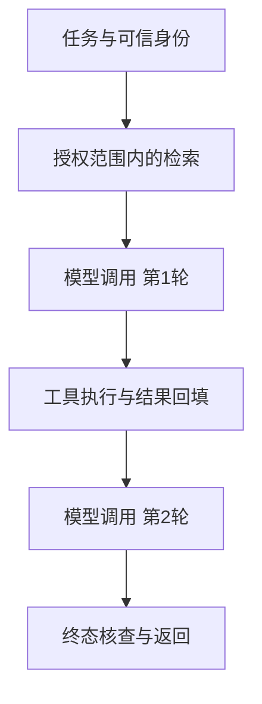

# 一条 Agent Trace 怎样串起检索、工具、模型和费用？

> 将一次任务拆成有层级和关联标识的阶段记录，再分别统计执行耗时、业务结果与实际用量，才能解释慢在哪里、错在哪里。

## 工单回答很慢，先看总耗时还是每个阶段？

假设用户查询 T-1048 的处理进展，助手先找政策、调用模型、查询工单，再让模型组织回答。
页面等了几秒，并不意味着每一秒都花在模型上。
检索、排队、工具接口和前端缓冲都可能造成等待。

Trace 用一组有父子关系的 span 记录执行路径。
指标用于观察一段时间的分布，日志补充必要细节，业务操作表则确认外部动作是否真的完成。
三者需要关联，不能用一条“任务完成”的日志替代全部证据。

## 一次任务怎样拆 span，才能看出因果关系？



这张图表示一条可能的执行顺序，各阶段的span可以关联到同一个任务层级。
第2轮模型需要工具结果，不能在计算关键路径时把它们当成独立并发任务。
如果一个阶段内部还有网络重试，可以在其下记录每次尝试，并保留重试原因。

跨线程执行时需要显式传递上下文，不能只依赖当前线程中仍有同一 trace。
跨服务则按协议与信任策略传播上下文，入口还需处理外部传来的非法或不可信标识。

## traceId、runId、callId 和 operationId 分别回答什么？

| 标识                 | 用途                         | 不能替代什么                     |
| -------------------- | ---------------------------- | -------------------------------- |
| `traceId` / `spanId` | 定位一次执行及其阶段关系     | 不提供用户认证和业务防重         |
| `runId`              | 定位可能暂停、恢复的任务     | 不代表每次恢复属于同一条网络链路 |
| `callId`             | 对应模型提出的工具调用与结果 | 不证明外部副作用只执行一次       |
| `operationId`        | 关联同一笔受授权的业务意图   | 不自动表示当前请求有权查看它     |

长任务跨天恢复，可以出现多条 trace，再通过稳定的运行标识和业务操作号关联。
不必为了“全放在一条 trace”而让一个 span 持续数天。
也不能把调用标识当成退款或工单升级的幂等依据，具体见[工作流恢复](./ai-agent-workflow-recovery.html)。

## 一份教学记录最少保存哪些字段？

下面是应用自定义的脱敏记录，用于说明字段关系，不是固定的 OpenTelemetry GenAI 导出格式。

```json
{
  "runId": "run-demo-1",
  "traceId": "0123456789abcdef0123456789abcdef",
  "spanId": "0123456789abcdef",
  "parentSpanId": "abcdef0123456789",
  "stage": "tool.query_ticket",
  "callId": "call-ticket-1",
  "durationMs": 85,
  "outcome": "SUCCEEDED",
  "attributes": {
    "ticketId": "T-1048",
    "evidenceRevision": 4,
    "toolContractVersion": "v1"
  },
  "simulation": true
}
```

真实记录还要能定位模型和提示词版本、检索配置、错误分类、重试以及当前阶段。
观测系统可以使用相应语义约定，但字段名和稳定性要按锁定版本核对。
应用自定义字段与标准字段分开，避免自造名称却声称所有工具都能自动识别。

## 总耗时为什么不等于所有 span 耗时相加？

假设两个独立只读工具分别耗时 80ms 和 120ms，同时开始，执行部分大约等待较慢的一项，再加调度与合并开销。
把它们相加得到 200ms，会错误估计用户实际等待。
反过来，串行的模型、工具和下一轮模型必须按依赖计算关键路径。

观测时间点也要一致。
供应商请求开始到首个模型事件、网关收到首个文本片段、用户看见首字，属于不同范围。
心跳或空分片不能算可见内容，SSE 分片间隔也不直接等于 Token 间隔。
这些定义见[推理延迟](./ai-llm-inference-latency.html)。

分析时按任务类型、模型版本和失败类型分组，观察 p50/p95、排队、取消和未知结果。
业务失败不能因为网络返回200就变成成功，工具失败与模型等待补充输入也要分别标记。

## Token 和费用怎样记，才能避免重复或假账？

用实际 API 的 usage 或账单记录核对输入、输出和缓存分类。
字符数、估算 Token 或替身返回的单位只适合对应目的，必须明确标注，不能当成真实计费。
价格未配置或用量不完整时，费用应显示未知，不能填零让报表看起来更好。

例如假设某教学价目按百万 Token 计费，输入为2元、输出为8元。
一次调用输入1000、输出200 Token，按该假设计算费用为 `1000 / 1000000 × 2 + 200 / 1000000 × 8 = 0.0036元`。
这是计算示例，不是某家模型的当前价格。

真实产品还可能分别收取缓存写入、缓存读取、工具、图片或音频费用。
重试应逐次记录消耗，再归属到同一任务，不能因为只展示一个最终答案就忽略失败尝试。
同时保留价目版本、币种和估算或已对账状态，避免重复汇总输入用量与其中包含的缓存用量。

## 怎样保留排障信息，又不把日志变成资料外泄入口？

默认保存必要元数据、结果摘要和受权限保护的引用，不默认持久化完整政策、提示词、用户消息或凭据。
正文采样需要独立的用途、访问控制与留存策略。
追踪标识也不能变成绕过租户权限读取原始 payload 的入口。

高基数字段还需要放到合适的位置。
运行ID和用户ID适合在受控日志或追踪中关联，直接作为所有指标的标签可能让时序数量失控。
不要为了排查一次问题，把Bearer令牌、确认令牌或全部环境变量打进日志。

一个可检查的方案应该能回答三类问题。
用户为什么等这么久，对应关键路径；模型为什么给出该结论，对应可回查的证据与版本；业务到底是否完成，对应真实终态。
这些可观察记录不需要索取模型隐藏推理，验收方法见[Agent 评测](./ai-agent-evaluation.html)。

## 小结

1. 用span和阶段关系描述执行路径，指标观察分布，业务记录确认副作用终态。
2. 任务、追踪、工具调用和业务操作标识各有用途，跨恢复时按稳定任务关系关联。
3. 并行阶段不能简单求和，首字与Token间隔需要明确测量点和统计对象。
4. 用量与费用按实际来源、价目和尝试记录，未知值不能伪装为零。
5. 默认控制正文与凭据留存，追踪访问和指标标签都要考虑权限与成本。

## 参考

综合仓库 `docs/` 下 API 调用工程、LLM 网关与评测资料，于 2026-11-20 核对以下官方资料。
区分了标准约定、应用内部记录和教学用量，未将示例Trace写成真实部署的观测结果。

- [OpenTelemetry：Generative AI semantic conventions](https://opentelemetry.io/docs/specs/semconv/gen-ai/)
- [Spring AI：Observability](https://docs.spring.io/spring-ai/reference/1.1/observability/index.html)

本文给出设计和核算方法，JSON与价格均为教学假设，未部署Collector或测量真实模型费用。
