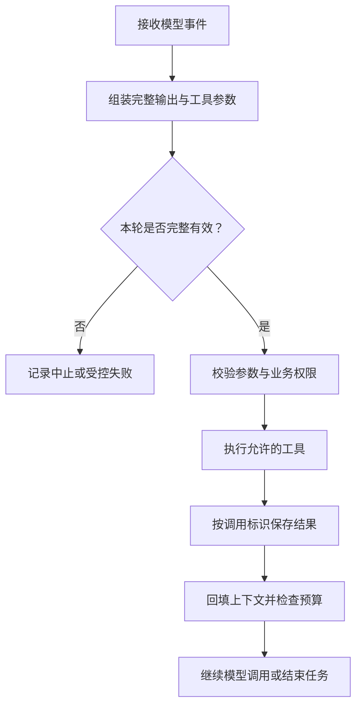

# Agent 的一次运行怎样从模型走到工具再回到模型？

> 运行时要把一轮模型输出变成可校验的工具调用，把结果准确放回上下文，并为任务留下明确的停止状态。

## 一句“帮我看看工单”，实际需要做哪些事？

假设内部工单助手收到请求“帮我看一下 T-1048 为什么还没处理”。
模型提出查询工单，再根据返回的 `WAITING_VENDOR` 状态读取相应的处理说明，最后解释正在等待供应商反馈。

这个过程至少经过两次模型调用和一次工具执行。
运行时需要知道当前阶段、有哪些请求未完成、哪些证据可以回填，以及用户是否仍希望继续。
只保存用户问题和最终回答，无法在故障时还原这段过程。

## 模型响应结束、工具调用结束、任务完成有什么区别？

| 状态             | 已经确定的事                   | 接下来还要检查什么                       |
| ---------------- | ------------------------------ | ---------------------------------------- |
| 模型一轮响应结束 | 收到了本轮可用的输出和结束原因 | 是否包含工具调用，是否截断、拒答或出错   |
| 工具调用结束     | 某个工具返回了结果或受控错误   | 结果是否对应原调用，能否满足当前信息需求 |
| 整个任务完成     | 已满足定义好的业务验收条件     | 是否还要记录结果或交由用户处理           |

例如模型没有提出工具调用，却回答“已查到供应商反馈”，后台实际没有任何查询记录，这个任务不能标记成功。
运行时应区分 `SUCCEEDED`、`WAITING_USER`、`FAILED`、`CANCELLED` 和 `BUDGET_EXHAUSTED` 等任务状态。
这些名称是应用自行设计的状态，不是 MCP 或所有模型 API 的统一枚举。

## 流式输出还没拼完时，为什么不能先执行工具？

模型可能把工具参数分成多个增量片段返回。
读到 `{"ticketId":"T-` 时，既没有完整 JSON，也没有完成参数校验。
即使某个中间前缀恰好能解析成 JSON，也不能据此认定后续不会变化。

应由供应商适配器根据相应 API 的完成事件组装调用，再检查名称、完整参数和调用标识。
Responses API、Chat Completions 和 Messages API 的事件及回填结构不同，需要分别处理。
不能把某家的增量事件名或 `finish_reason` 当成所有模型的公共协议。

一个简单的顺序可以画成下面这样。



执行前还要查当前用户是否能读取 T-1048。
模型生成的用户 ID、工具注解和“我已得到同意”都不能替代后端鉴权。
具体授权和写操作约束见[业务工具接入](./ai-tool-calling-business-api.html)。

## 为什么工具结果一定要对应调用标识？

假设模型同时提出两个相互独立的只读调用，分别查询工单状态和服务值班人。
值班人查询先完成，结果也必须归属于它自己的调用，不能因为先返回就填进工单状态的位置。

应用内部可以保存下面这种记录。它是运行时的内部表示，不是可直接发送给任一模型或 MCP Server 的报文。

```json
{
  "runId": "run-demo-1",
  "turnId": 2,
  "callId": "call-ticket-1",
  "tool": "get_ticket",
  "status": "SUCCEEDED",
  "resultRef": "artifact://runs/run-demo-1/ticket-status"
}
```

适配器再把这条记录转换为供应商要求的工具结果消息。
例如 Responses API 的 `function_call_output` 用 `call_id` 对应原调用，不能把响应对象 ID 当成调用 ID。
还应保留该 API 要求延续的响应项，避免只拼工具文本而丢失必要的对话结构。

界面可以按完成顺序显示进度，最终转录则需要确定的顺序和清楚的标识。
有些实现按模型提出调用的顺序保存结果，这是一种便于回放的实现策略。
不能把它提升为所有供应商都规定的唯一排序方式。

## 哪些工具可以并行，哪些必须等上一步？

查询工单和独立查询值班表可以并行。
“读取当前工单版本，再按该版本创建升级请求”有数据依赖，后一项需要使用前一项真实返回的版本号。
两个操作都只读，也可能因查询预算、配额或一致性要求而需要串行。

运行时应根据工具契约和业务依赖判断是否允许并发。
不能因为模型在同一轮提出两个调用，就推导出它们一定相互独立。
写操作还应由服务端检查状态版本、审批与业务操作号，防止并发绕过约束。

工具超时可能发生在副作用已经提交之后。
重试前要判断结果是否未知，不能把新的模型轮次当成一笔全新的业务。
这部分处理见[MCP 排障与业务幂等](./ai-mcp-troubleshooting.html)。

## 怎样让循环停得下来，又不误报成功？

先为运行设置总截止时间、模型输出预算、工具调用次数和无进展阈值。
数值需要结合业务测量，不存在适合所有任务的固定轮数。

| 停止原因                 | 工单助手应该呈现什么                   |
| ------------------------ | -------------------------------------- |
| 取得有效状态且解释完成   | 返回事实、观测时间和来源               |
| 缺少必须由用户提供的信息 | 进入等待用户状态，说明缺少什么         |
| 相同错误反复出现         | 保留已获得的结果，结束无进展重试       |
| 预算耗尽                 | 明确未完成的部分和可继续的入口         |
| 用户取消                 | 停止尚未发起的动作，核查已在执行的动作 |

取消通常只能尽快阻止后续工作。
已经提交的工单、发送的通知或外部写入，需要查询实际状态，并按业务规则处理。
用一次取消信号保证外部状态回滚，会遗漏响应丢失和不可逆动作。

## 出问题时应保留什么证据？

建议记录 `runId`、轮次、调用标识、工具名、参数摘要、身份作用域、阶段耗时、停止原因和结果引用。
这些记录帮助还原执行轨迹，不需要记录或索取模型的隐藏推理。

工单查询的验收可以检查工具是否实际访问了当前用户可见的数据、返回时间是否合理、最终解释是否有依据。
语言通顺只能验证表达，不能证明任务已经完成。
可重复验收的方法见[Agent 评测](./ai-agent-evaluation.html)。

## 小结

1. 运行时分别管理模型轮次、工具执行和任务终态，模型停止输出不自动代表成功。
2. 流式参数需要按具体 API 的完成规则组装，校验通过后才能进入执行阶段。
3. 每份工具结果对应原调用标识，界面进度和持久化转录可以采用不同顺序。
4. 并行要满足真实的数据与业务约束，重试和取消都不能替代业务幂等。
5. 预算与无进展检测保证运行可停止，工具轨迹和业务结果提供验收证据。

## 参考

综合仓库 `docs/` 下 Agent 基础、循环引擎、工具执行管道三组资料，并在 2026-11-20 交叉核对以下官方资料。
修正了“无工具调用就已完成”“同轮工具天然可以并行”和“事件完成顺序必须等于转录顺序”等过度概括。

- [Building effective agents](https://www.anthropic.com/research/building-effective-agents)
- [Function calling](https://developers.openai.com/api/docs/guides/function-calling)
- [Tool use implementation](https://platform.claude.com/docs/en/agents-and-tools/tool-use/implement-tool-use)
- [Streaming Messages](https://platform.claude.com/docs/en/build-with-claude/streaming)

工单、状态和记录均为教学示例，本文未连接真实工单系统或对模型进行成功率测试。
