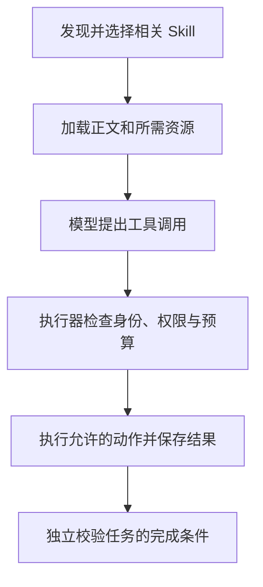

# Agent Skills 怎样按需加载，执行约束由谁保证？

> Skill 保存某类任务的做法，宿主和执行器负责把权限、预算、状态与验收真正落实到运行过程。

## 工单助手为什么会查接口，却总漏掉处理步骤？

假设助手已经能查询 T-1048，但每次分诊的做法都不一样。
有时只看状态就建议升级，有时没有核对所属产品，有时遗漏必须附上的供应商反馈。
继续增加工具数量，无法直接补上这套处理方法。

可以把分诊所需的材料、步骤和完成条件写成 Skill。
任务命中后再加载具体说明，助手据此组织查询和判断。
如果其中某项要求必须保证执行，就在运行时设置相应校验。

## 元数据、正文和附带资源分别在什么时候加载？

Agent Skills 格式以目录中的 `SKILL.md` 为核心，前面是 YAML 元数据，后面是说明正文。
规范允许附带脚本、参考和模板，具体宿主如何发现和触发还取决于实现。

```text
ticket-triage/
├── SKILL.md
├── references/
│   └── escalation-policy.md
├── scripts/
│   └── validate-report.mjs
└── assets/
    └── report-template.md
```

这只是教学目录，没有在本项目中创建真实技能。
一种常见做法是先把名称和适用条件放入可发现目录，确定任务相关后再读取正文，需要细节时继续读取对应资源。

| 层次       | 工单分诊中的内容                                 | 主要作用           |
| ---------- | ------------------------------------------------ | ------------------ |
| 元数据     | 处理内部工单分诊，适用于状态核查和升级建议       | 帮助选择是否使用   |
| 正文       | 先查权限与状态，再核对规则，最后给出有依据的建议 | 说明任务怎么推进   |
| 参考与资源 | 产品例外、报告模板、确定性校验脚本               | 按当前步骤提供细节 |

延迟加载可以减少无关内容，但目录和正文仍有加载成本。
把所有领域知识直接放进 `description`，或让每次任务都读取全部参考，会削弱按需加载的收益。

## 一份分诊说明至少应该交代哪些内容？

对工单 T-1048，可以先限定 Skill 只处理状态核查和升级建议。
正文要求读取当前状态和观测时间，核对适用政策，说明缺少的证据，并给出下一步可执行建议。

当用户只想解释处理时效时，流程不应自动创建升级工单。
如果确实需要提交升级请求，要转入已有的可信审批和业务执行入口。
模型写在报告中的“已审批”不能成为执行凭据。

完成条件也要可检查。
例如报告应包含正确工单号、授权范围内的真实状态、规则版本、证据引用和未完成事项。
脚本能检查字段与引用是否齐全，工单状态是否真实则要与业务数据核对。

复杂步骤可以指向相邻参考，避免读者和模型在多层跳转中丢失规则。
只有执行到某一步时才需要的政策例外，可以放在对应的参考文件里。

## 说明写了“禁止越权”，执行器还要做什么？



一次正常分诊可以由 Skill 指导查询顺序。
但工具能否访问工单、能否执行写操作，仍应由服务端策略判断。
如果模型跳过步骤直接调用受限工具，执行器也必须拒绝。

有些技能元数据支持 `allowed-tools`，Agent Skills 规范将它标为实验性字段，宿主支持情况可能不同。
不能把一份 Markdown 中的字段当成跨宿主统一的权限边界。
有关工具能力与技能说明的分工，见[MCP 接入架构](./ai-mcp-architecture.html)。

## Harness 怎样让一次运行能够继续、核查和交付？

Harness 通常指模型周围负责执行的那组设施，包括上下文装配、工具适配、状态保存、隔离环境、预算和验证。
具体分层由产品决定，把它画成六层或其他层数都需要说明各层职责，并无所有实现必须遵循的统一层数。

对工单助手，可以让运行时保存任务目标、证据引用、已完成步骤和等待用户的事项。
下一次恢复时先核对真实状态，再继续处理。
长任务能否恢复，还取决于持久化、身份和业务防重，见[工作流恢复](./ai-agent-workflow-recovery.html)。

验收工具也应尽量独立于生成过程。
生成一份分诊报告后，校验器检查字段、权限和证据，必要时由人工判断升级建议是否符合业务要求。
仅让同一个模型自评“完成得不错”，不能提供同等强度的证据。

## 纯文本 Skill 为什么仍可能带来风险？

纯文本可以诱导后续行为，附带脚本还可能读写文件或访问网络。
第三方参考中夹带的指令、过宽的脚本参数和未经检查的依赖，都可能扩大执行范围。
因此来源审核、版本固定、最小凭据和运行环境隔离仍有必要。

更新 Skill 之后，需要同时检查是否更容易误触发、是否漏掉该触发的任务，以及执行质量是否发生变化。
测试集可以放入“解释工单状态”“仅润色已有报告”“缺少工单号”“未经审批要求直接升级”等不同请求。
分别观察选择、执行和拒绝行为，再决定是否发布。

稳定流程可以直接编码成业务方法，灵活步骤可以留在说明中。
二者如何取舍，要看错误代价和是否需要确定执行，不必把每项业务能力都包装成 Skill。

## 小结

1. Skill 用说明和资源沉淀做法，常见加载顺序是目录、正文、当前步骤所需资源。
2. 触发条件、任务边界和完成条件要具体，执行了某个脚本也不自动代表业务结果正确。
3. 身份、工具权限、预算和写操作审批由运行系统落实，`allowed-tools` 不是跨宿主统一保证。
4. Harness 提供状态、执行环境与验证能力，分层数量属于设计选择。
5. 文本与脚本都可能影响安全边界，更新后要回归触发准确性和任务完成质量。

## 参考

综合仓库 `docs/` 下 Skills、Harness、技能加载机制资料，并在 2026-11-20 对照以下原文核实。
修正了“纯文本没有安全风险”“Skill 不会带代码”和“六层结构是统一标准”等泛化。

- [Agent Skills 格式规范](https://agentskills.io/specification)
- [Effective harnesses for long-running agents](https://www.anthropic.com/engineering/effective-harnesses-for-long-running-agents)
- [Effective context engineering for AI agents](https://www.anthropic.com/engineering/effective-context-engineering-for-ai-agents)

目录和工单场景均为教学设计，本文未安装第三方 Skill，也未执行附带脚本或真实业务操作。
