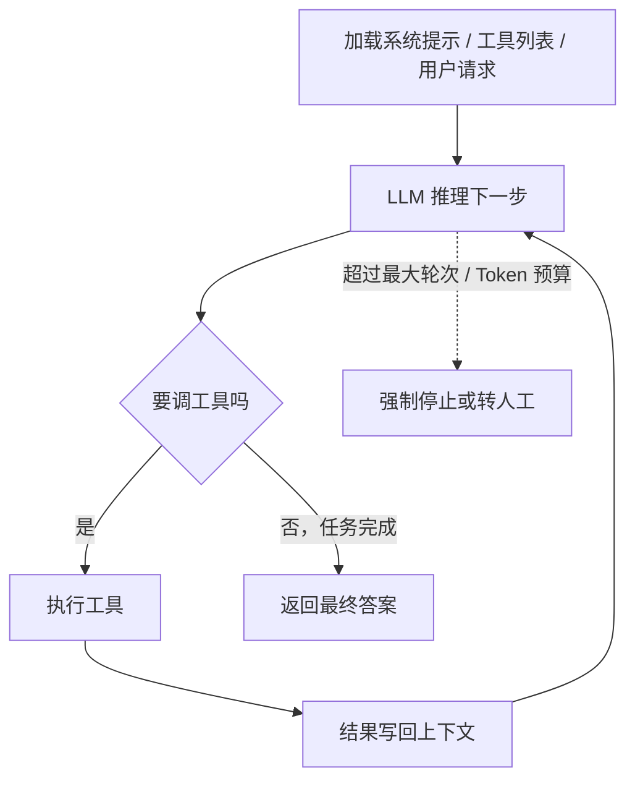
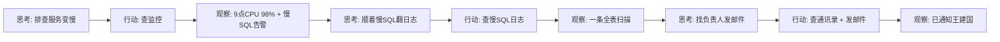

# Agent、工具调用、多轮编排怎么搭？

> 一句话点题：Agent 不是"套个 prompt 让它自己干"，是 LLM + 工具 + 循环 + 收敛约束的工程。

很多人第一次做 Agent，会把它想成"给模型一段足够聪明的提示词，剩下交给它自己跑"。真做下去就会发现：要么跑几轮就绕圈，要么工具调不对，要么上下文越堆越长、模型开始胡说。问题基本不在模型不够聪明，而在循环、工具、上下文和刹车这几块没搭好。

## Agent 和一次性问答到底差在哪

普通问答是"你问一句、它答一句"，模型只负责生成文字。Agent 的本质区别是它会进到一个动态环境里，自己观察、判断、执行，直到任务完成。可以记成一句话：**Agent = LLM + 规划 + 记忆 + 工具**。LLM 负责理解和决策，工具负责真正去执行（查库、读文件、发请求），记忆负责留住上下文和历史经验，规划负责把目标拆成一步步动作。

但它不是万能的。先用一张表分清三种东西的边界：

| 形态               | 控制权在哪   | 适合什么                                             |
| ------------------ | ------------ | ---------------------------------------------------- |
| 传统编程           | 代码写死     | 逻辑固定、高频、要性能（扣库存、支付流转）           |
| Workflow（工作流） | 人画好流程图 | 步骤清晰、节点有限、要可观测（审批流、发布流）       |
| Agent              | 模型动态决策 | 步骤没法提前穷举、要理解自然语言意图（排查线上故障） |

一个简单判断：**执行路径能提前写出来，就用 Workflow；写不出来，再上 Agent**。很多人觉得任务"路径不确定"，其实是需求没拆清楚——拆完发现大部分是"在固定节点里让 LLM 做生成或判断"，这种用 Workflow 更稳、更好排查。真正适合纯 Agent 的，是那种你事先规定不了每一步的任务，比如"帮我查清楚今早服务为什么变慢"。

## Agent Loop：感知、规划、行动、观察怎么转

Agent 真正跑起来的地方就是那个 while 循环。每一轮大概做三件事：让 LLM 推理下一步、调用工具、把工具结果写回上下文。一直转到任务完成或触发停止条件。



循环本身不难写，难在两点：**上下文管理**和**收敛约束**。

任务跑久了，历史越堆越长，关键信息被稀释，模型就会跑偏。有个叫"Lost in the Middle"的研究专门指出：模型对上下文中间段的信息利用率明显比首尾低，窗口再大也不能无脑塞。收敛约束则是刹车——不设最大轮次（一般 10 到 20 轮）、不设 Token 预算、不设"连续两轮失败原因相同就停"这类无进展检测，循环很容易死转，或者越跑越偏还停不下来。

## 工具怎么注册：Function Calling 与 Schema

模型调工具，靠的是结构化描述。主流基本都向 OpenAI 的 Function Calling Schema 靠拢，用 JSON Schema 写工具名、用途、参数类型、必填项。模型读这段描述来决定"要不要调、参数怎么填"。

```json
{
  "type": "function",
  "function": {
    "name": "query_slow_sql",
    "description": "查指定服务在某时间段的慢 SQL 日志。服务响应慢、数据库超时、CPU 飙升且怀疑和库相关时用。如果用户问的是网络或内存问题，别调这个。",
    "parameters": {
      "type": "object",
      "properties": {
        "service_name": { "type": "string", "description": "服务名，如 order-service" },
        "time_range": { "type": "string", "description": "格式 HH:MM-HH:MM，如 09:00-09:30" }
      },
      "required": ["service_name", "time_range"]
    }
  }
}
```

这里最容易被低估的是 `description`。模型选不选得对工具、参数填得对不对，主要就看这几句话。好的描述要写清三件事：**什么时候用、要哪些参数、什么时候不要用**。上面那句"如果用户问的是网络或内存问题，别调这个"，对模型很有用——它把禁用场景讲死了。

工具执行后还有几个工程动作别省：参数要在服务端做强校验（别指望模型"自觉传对"），工具失败时要把结构化错误回传给模型让它修正方向，高危操作要走二次确认。如果一类任务要连调好几个工具（排查慢查询＝读日志＋跑分析＋对规范），每次从零拆既不稳定又费 Token，就把它封成 Skill：用 `description` 做路由，命中任务时再加载详细流程，而不是启动就全塞进上下文。

## MCP 是什么，和 Function Calling、Agent 什么关系

> 纠偏：常有人把 MCP 说成"AI 领域的 USB-C，什么都能统一"。它解决的是工具怎么接入宿主程序，不是让模型变聪明，更不是替代 Function Calling。

三者其实不在同一层：

| 概念             | 解决什么                     | 举例                                                |
| ---------------- | ---------------------------- | --------------------------------------------------- |
| Function Calling | 模型怎么表达"我要调工具"     | 模型输出 `{name:"read_file", arguments:{path:...}}` |
| MCP              | 工具从哪来、怎么被发现和接入 | Claude Desktop 连上 Git Server 后自动发现工具       |
| Agent            | 任务怎么一步步做完           | 多步推理＋调工具＋等结果＋再判断                    |

MCP（模型上下文协议）是 Anthropic 在 2024 年 11 月推出的一套通信协议，底层用 JSON-RPC 2.0。核心角色三个：Host（AI 应用，如 Cursor）、Client（Host 里负责跟 Server 通信的那层）、Server（把能力封装出去）。一个 Host 可以连多个 Server，Server 后面再接数据库、文件、第三方 API。

这里要分清一个容易混的点：**JSON Schema 是数据格式，MCP 是通信协议**。MCP Server 对外暴露工具时，内部照样用 JSON Schema 描述参数——MCP 没有取代 Schema，只是在它外面包了一层标准接入。传输方式按场景选：本地工具、个人用，优先 stdio（把 Server 当子进程，走标准输入输出）；团队服务、远程 API、多用户，优先 Streamable HTTP。stdio 有个经典坑：别往 stdout 打调试日志，stdout 是 JSON-RPC 消息通道，一句 `print()` 就能把消息流污染掉导致断连，日志要写到 stderr 或文件里。

## 记忆：短期上下文 vs 长期记忆

为什么不能全塞进上下文？除了 Lost in the Middle，还有成本随 Token 线性涨，而且 Session 一结束、进程一崩，没落库的轨迹就没了。记忆要分两层，物理和逻辑上都隔开。

**短期记忆**活在当前会话里，就是上下文窗口中的对话历史和工具结果。控制它膨胀常用三把刀：滑动窗口（超阈值丢最早 N 轮）、摘要压缩（用小模型把旧对话压成摘要）、上下文卸载（工具返回的大结果存外部，Prompt 里只留一个文件路径引用，要用再按需读）。

**长期记忆**活在 Session 之外，是"写入-检索"两条链路。写入通常在对话结束后异步触发，让 LLM 从这轮里抽出高价值结构化事实（"用户技术栈是 Python + FastAPI"），再写进向量库。检索在新会话开始时跑，把用户问题向量化，去长期库里捞最相关的几条，塞进系统提示。注意写入要做幂等（基于消息 ID 而不是结果文本哈希，因为温度采样会让字面不同但语义相同），不然重试就写一堆重复。

> 纠偏：长期记忆和 RAG 技术上很像，都用向量库和语义检索，但服务对象不同。RAG 挂的是共享知识（公司规章、产品文档），对不同用户返回同一套；长期记忆管的是和特定用户交互中沉淀的个性化偏好，因人而异。两者不是二选一，可以分别召回再融合排序。

还有一点容易被忽略：**要舍得遗忘**。很多团队舍不得删，结果向量库里几十万条记忆，Top-K 里混着一堆过期噪音，Agent 给的建议还停留在三年前。给记忆打分（`relevance × importance × decay(t)`），过期的标废弃，新事实和旧事实矛盾时让旧边失效——这套代谢机制，比一味往里写重要得多。

## 多轮编排：ReAct 还是 Plan-and-Execute

ReAct 是"走一步看一步"：模型推理一步，拿到工具反馈，再推下一步，交替进行。它的价值是能根据证据修正方向——查监控发现是内存 OOM 而不是慢 SQL，下一步就去翻 Heap Dump，而不是继续翻 SQL。



Plan-and-Execute 是"先规划全局再执行"：让 LLM 先把整条计划拆出来，执行器再按步走。它适合步骤多、依赖明确的长期任务，比 ReAct 不容易在长任务里迷路；代价是计划定下来后动态调整弱，更像静态流程。

| 场景                     | 推荐             | 代价                          |
| ------------------------ | ---------------- | ----------------------------- |
| 路径不确定、要边查边改   | ReAct            | 灵活，但 Token 烧得多、调试难 |
| 任务长、步骤多但结构清晰 | Plan-and-Execute | 不易迷路，动态调整弱          |
| 输出质量要求高、允许多轮 | 叠加 Reflection  | 不单独用，配在 ReAct/P&E 上   |

实际项目里经常组合：先用 CoT 生成全局步骤，再在每个步骤内部嵌一个 ReAct 子循环，既有全局结构，也保留局部灵活性。Reflection（任务后复盘、把教训存进记忆）一般不单独用，而是叠在上面让 Agent 有自适应能力。选型记住一句话：先用最简单的方式跑通，再按实际失败模式决定升级哪一层，别一上来就搞 Multi-Agent 加全动态推理。

## 容易踩的坑

1. **工具一多模型就选择困难**。几十个工具全塞进上下文，模型反而容易调错。把高频组合封成 Skill，或按任务动态组装工具描述。
2. **循环不设刹车**。不写最大轮次、Token 预算、无进展检测，轻则死循环烧钱，重则越跑越偏还停不下来。
3. **工具失败不兜底**。超时、文件超限没有降级返回，模型拿到的是异常栈，方向就被带歪。读大文件要分块、超阈值只返回元数据。
4. **上下文不管理**。每轮都重新读项目、重新猜规则，最后变成一台很贵的复读机。该常驻的常驻，该按需加载的按需加载。
5. **把 Agent 自评当验收**。让写代码的 Agent 自己说"我觉得改好了"风险很高，用外部硬信号兜底——测试退出码、CI 状态、lint、截图对比、独立审查 Agent。
6. **权限一次给太大**。读日志和自动合并 PR 是两回事，删除、改生产配置、发外部消息默认都要人工确认。权限分级给，别一步到位放写权限。

## 小结

1. Agent = LLM + 规划 + 记忆 + 工具，缺哪块都有明显短板；它和一次性问答的本质区别是在动态环境里持续观察、判断、执行。
2. Agent Loop 每轮做"推理—调工具—结果写回上下文"，真正难的是上下文管理和收敛约束，不是 while 循环本身。
3. 工具描述是 Agent 效果的命门：写清"何时用、要什么参数、何时不要用"，参数服务端强校验，失败要结构化回传。
4. Function Calling 管"模型怎么表达意图"，MCP 管"工具怎么接入"，Agent 管"任务怎么做完"，三者不在同一层，别混成一锅。
5. 记忆要分短期 / 长期并隔开，长期记忆和 RAG 服务对象不同；要舍得遗忘，过期噪音比没有记忆更糟。
6. ReAct 适合路径不确定、Plan-and-Execute 适合长任务，两者常组合；先用最简单方式跑通，再按失败模式升级。

## 参考

综合自仓库 docs 下 Agent 基础、Agent 记忆、MCP、Loop Engineering 四篇资料，交叉验证后用自己的话重写。模型上下文窗口等时效性数据变化快，具体数字以各模型官方文档为准。
