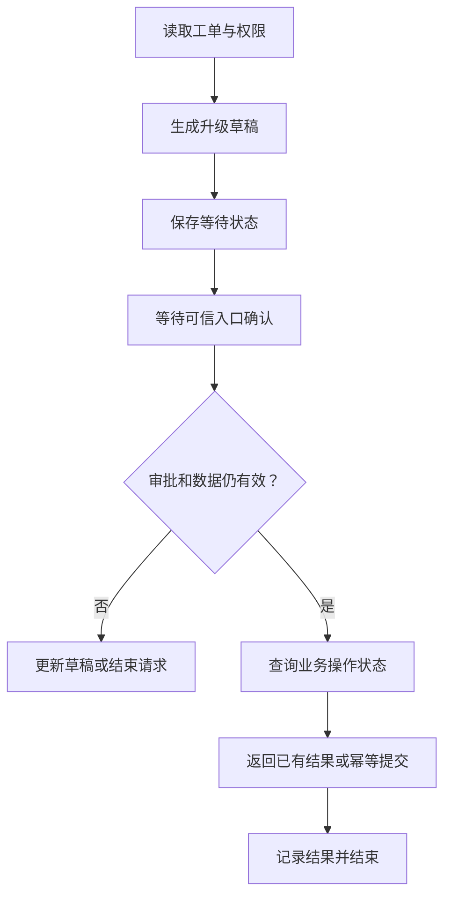

# Agent 跑到一半中断，工作流怎样接着执行？

> 恢复执行需要知道流程位置、有效状态和已经发生的业务动作，再决定哪些步骤可以安全重跑。

## 工单助手等用户确认时，应该保存什么？

假设用户要求升级本人名下的工单 T-1048，查询结果为 `WAITING_VENDOR`。
助手可以先整理升级理由和目标团队，展示待确认草稿，等用户确认后再创建升级工单。
用户可能第二天才回来，执行进程也可能在等待期间重启。

这段流程适合拆成有明确职责的节点。
节点读取状态并产生更新，边决定下一步，State 保存恢复时还需要的事实。
其中查询、生成草稿和提交升级分别承担不同责任，恢复时就能单独判断是否需要重做。



图中的等待状态需要持久保存，线程和 HTTP 连接可以释放。
队列、执行权和租约如何管理，沿用[AI 长任务设计](./ai-async-task-pipeline.html)，这里关注任务内部的恢复位置。

## State 怎样支持恢复，也避免并行节点互相覆盖？

下面是示意性的内部状态，字段名属于应用设计。
`tenantId` 来自可信身份，恢复请求仍要重新检查当前调用者的访问权限。

```json
{
  "runId": "run-upgrade-demo-1",
  "tenantId": "tenant-demo",
  "graphVersion": "upgrade-v3",
  "stateVersion": 7,
  "ticketId": "T-1048",
  "ticketVersion": 12,
  "ticketStatus": "WAITING_VENDOR",
  "phase": "WAITING_USER",
  "draftRef": "artifact://runs/run-upgrade-demo-1/draft",
  "operationId": "upgrade-demo-1",
  "approvalRef": null
}
```

工单版本与状态用于发现等待期间的数据变化，草稿引用用于取回用户实际看到的内容。
`operationId` 标识同一笔待授权的业务意图，重试时保持稳定，不能每进入一次节点就重新生成。
访问令牌、数据库连接和运行线程无法靠序列化安全延续，应在恢复时按身份重新取得。

每个状态字段还要规定更新方式。
当前阶段可以由负责推进流程的节点覆盖，证据集合可以按稳定标识合并，消息更新则需要保留调用对应关系。
普通列表追加遇到重放会重复累积，两个分支同时覆盖 `result` 也可能丢掉其中一份结果。
并行节点宜写各自的结果槽位，再由汇总节点明确合并和排序规则。

LangGraph 用 reducer 定义状态键的合并语义，这是具体框架的机制。
重放可能改变更新顺序时，合并函数也要有确定行为，不能依赖“哪个模型先回答”。

## 检查点、会话树和业务记录各自恢复什么？

| 保存内容       | 恢复时解决的问题             | 仍要另外处理的边界         |
| -------------- | ---------------------------- | -------------------------- |
| 工作流检查点   | 图状态、待执行节点和恢复位置 | 外部系统是否已经完成写入   |
| 会话消息与分支 | 当前对话路径、历史证据和选择 | 文件及业务状态的实际变化   |
| 业务操作记录   | 同一操作是否执行、结果与凭据 | 下一步该由哪个流程节点处理 |

以 LangGraph 为例，完整检查点按 super-step 边界保存，同一步内成功节点的写入也可用于故障恢复。
具体恢复粒度取决于持久化方式和配置，应核对当前框架版本。
内存中的检查点只能在进程存活期间保留，跨进程恢复需要持久存储。

会话树切回旧分支时，已经创建的升级工单继续存在。
历史消息可以重建上下文，外部状态则需要查询或经过明确授权的补偿操作。
这也是会话恢复与业务回滚需要分别设计的原因。

## 用户点击确认后，怎样安全恢复等待中的节点？

可信确认入口应绑定用户、租户、业务对象、草稿参数摘要、版本和有效期，并记录实际的确认动作。
恢复请求根据受权限保护的运行标识找到等待状态，验证审批，再推进流程。
模型生成的“用户已经确认”不具备这样的证明作用。

等待期间，工单可能已关闭，目标团队也可能变化。
恢复时应重新查询必要的业务前置条件，参数变化后重新展示草稿并确认。
旧审批不能随着恢复自动覆盖新参数或新的业务意图。

LangGraph 的 `interrupt()` 提供一种暂停交互机制。
恢复使用同一 thread 标识定位状态，节点可能从开头重新进入，暂停点之前的代码会再次执行。
因此，暂停前适合做可重入的准备工作，并在业务条件满足后执行受保护的写入。
单纯把副作用移到暂停点后面，仍需要考虑节点随后重试的情况。

## 已经创建成功，检查点还没保存就宕机，会怎样？

最容易漏掉的是下面这个故障窗口。

1. 用户已确认，提交节点携带 `upgrade-demo-1` 调用业务服务。
2. 业务服务成功创建升级工单，并保存操作号与结果的关联。
3. 工作流尚未持久化节点结果，进程就退出了。
4. 恢复后再次进入提交节点，先按同一操作号查询已有终态。
5. 若确实需要重试提交，仍使用原操作号和原参数，由业务服务的唯一约束与状态机兜住重复执行。

“先查有没有”与“再创建”之间仍然可能发生并发。
最终防重必须落实到业务服务，单靠客户端查询无法排除另一个执行器同时提交。
下游还有其他系统时，需要稳定的下游操作号、结果查询和对账，共同处理跨系统未知状态。

将副作用拆成独立节点，可以缩小重跑范围。
它无法单独消除“外部动作已提交、节点完成记录未落盘”的间隙，也无法自动保证外部动作恰好发生一次。
相同的业务防重边界也适用于[MCP 调用超时与重试](./ai-mcp-troubleshooting.html)。

## 两次恢复请求或一次版本升级，会怎样影响状态？

用户重复点击确认，或者两个执行器同时恢复，都可能拿到同一份旧状态。
推进时可以用 `stateVersion` 做条件更新，只有拿到当前版本并满足前置状态的执行器才能完成状态迁移。
过期恢复请求需要重新读取最新状态，成功终态不得因旧请求被重新打开。
业务写入仍由独立的操作号约束保护，两层校验各自承担责任。

发布新工作流时，也要考虑旧检查点。
节点改名、状态字段变更、合并规则变化，可能让旧状态无法按新逻辑正确解释。
工程上可选择按原图版本继续，或显式迁移状态并验证恢复路径。
新生成的草稿与旧草稿不同，应重新取得授权，不能将旧审批直接附到新输出上。

验收恢复逻辑时，可以在测试环境分别模拟暂停后重启、确认过期、并发恢复，以及业务成功后丢失节点结果。
检查最终工单数、操作号、审批参数和任务终态，才能验证恢复是否正确。
“界面显示已继续”只证明界面收到了一个响应。

## 小结

1. 工作流用节点、边和明确的状态更新规则管理恢复位置，等待用户时应持久化必要状态并释放执行资源。
2. 检查点恢复图状态，会话分支恢复对话路径，业务记录确认外部动作，各自有独立责任。
3. 暂停恢复可能重新进入节点，审批需要绑定身份、参数、版本与有效期，恢复时重新核验业务前提。
4. 独立副作用节点仍存在提交后未记录完成的故障窗口，稳定操作号、业务唯一约束和终态查询共同防重。
5. 并发恢复需要控制状态版本，工作流升级需要处理旧检查点，参数改变后不能继续复用旧授权。

## 参考

综合仓库 `docs/` 下工作流结构、状态更新策略和会话树资料，结合站内长任务设计重写。
于 2026-11-20 对照以下官方文档，核对了检查点边界、状态合并和暂停恢复的重入行为。

- [LangGraph Graph API](https://docs.langchain.com/oss/python/langgraph/graph-api)
- [LangGraph Checkpointers](https://docs.langchain.com/oss/python/langgraph/checkpointers)
- [LangGraph Interrupts](https://docs.langchain.com/oss/python/langgraph/interrupts)
- [LangGraph Persistence](https://docs.langchain.com/oss/python/langgraph/persistence)

工单、审批和操作号均为教学示例，本文未运行真实工作流或完成故障注入测试。
