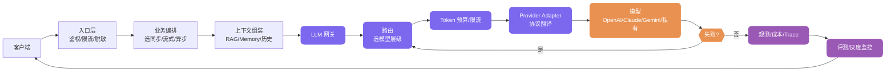

# AI 应用工程化、网关和成本怎么控？

> 一句话点题：Prompt Demo 能跑和生产能扛是两件事，中间隔着网关、评测、成本和可观测。

一个最小版 AI 应用很好搭：前端收一句用户问题，后端拼好 Prompt 调一次模型 API，页面上就能返回一段看着不错的答案。Demo 到这里基本够了。真实用户进来事情就具体了：供应商偶发 429 越重试越堵；运营改了一版 Prompt 昨天能答对的今天跑偏；月底看账单只知 Token 涨了，说不清花在哪个租户哪个功能；用户投诉“AI 胡说”排查时只能从日志和向量库命中里一点点拼。这篇讲怎么把能跑通的 Demo 改造成能上线、能排查、能回滚、能控成本的生产级 AI 应用。

## 子问题小节

### Demo 能跑和生产能扛，差在哪六件事

最朴素的 `前端输入 → 后端拼 Prompt → 调模型 API → 返回答案` 能演示产品想法，但缺了生产系统最关键的六件事：

| 维度     | Prompt Demo              | 生产级架构                                            |
| -------- | ------------------------ | ----------------------------------------------------- |
| 稳定性   | 单模型单调用，失败就报错 | 多模型路由、重试、Fallback、熔断、降级响应            |
| 权限     | 能问什么就查什么         | 检索前权限过滤、工具调用按用户租户鉴权                |
| 成本     | 只看一次调用能不能成功   | Token 预算、模型分层、缓存、成本归因和限额            |
| 可观测   | 只记用户问题和最终答案   | 记 Prompt 版本、检索片段、工具调用、Token、延迟、错误 |
| 评测     | 靠人工试几条样例         | 固定评测集、线上抽样、LLM-as-Judge、人工复核          |
| 数据治理 | 文档直接入库，日志随便存 | PII 脱敏、留存周期、审计、版本化                      |

最容易低估的一点：AI 应用把一部分决策交给了概率模型，问题不一定能落到某一行代码上。传统后端 if-else 出错沿调用栈走一般能定位；LLM 出错，原因可能是 Prompt 版本、上下文顺序、检索噪声、工具描述、模型采样、权限过滤、输出解析里的任何一环。所以生产架构要把模型周边的输入、执行、输出和反馈都工程化，让每次回答可追踪、可回放、可评测、可治理。

### 为什么要加一层 LLM 网关

很多团队第一次接大模型会直接在业务服务里写 `Controller → Service → OpenAI SDK → 返回`，链路短、开发体验好，但线上规模一来问题集中暴露：

| 直连模型的典型问题 | 线上表现                             | 网关对应能力                 |
| ------------------ | ------------------------------------ | ---------------------------- |
| 模型名写死         | 模型升级、下线、切供应商时到处改代码 | 模型注册表 + 配置化路由      |
| API Key 分散       | 多服务各自存密钥，轮换困难           | 统一密钥管理                 |
| 供应商限流         | 429 后业务疯狂重试，越重试越糟       | 限流、排队、Fallback、熔断   |
| 成本不可见         | 月底只知道总账单                     | usage 记录 + 成本归因        |
| 所有请求走同一模型 | 简单任务浪费钱，复杂任务效果差       | 按任务类型做模型路由         |
| 日志缺失           | 排查时找不到模型输入输出             | Trace、Prompt 版本、调用日志 |

LLM 网关不是传统 API 网关的翻版——传统网关管 HTTP 流量（鉴权、限流、转发、日志、熔断），LLM 网关还要处理模型特有的：模型选择、Token 预算、上下文长度、供应商差异、流式输出、工具调用、结构化响应、成本统计和 Prompt 版本。

> 纠偏：别把 LLM 网关和 LLM Router 混为一谈。Router 只管“这个请求选哪个模型”，是网关里的一个环节；Gateway 管的是从请求进来到结果返回的整段生命周期——鉴权、限流、路由、Fallback、日志、成本、审计。只有 Router 没有网关，解决不了密钥、限流、日志、审计和供应商切换。

网关不需要一上来就做满。第一版只要把模型调用从业务代码里抽出来、统一日志、记 usage 和延迟，就能减少一大半生产事故，等数据攒够了再去做规则路由、Token 预算和成本优化。下面这张图是一次请求的完整链路，网关在中间做收口：



### 多模型路由：贵模型兜底，便宜模型兜流量

最贵最强的模型不一定是最适合的。所有请求都走旗舰模型，很快遇到成本不可控（分类、改写、摘要也走旗舰，流量上来很吓人）、延迟不稳定（强推理模型为复杂任务设计，不适合实时对话和轻量判断）、资源浪费。落地时把任务分三层更稳：

- **能不用大模型就不用**：固定规则过滤、关键词判断、权限校验、简单模板填充交给代码更稳，别让模型判断“用户是不是空字符串”。
- **能用小模型就先用小模型**：意图分类、轻量摘要、标题生成、简单改写、低风险抽取，更需要结构化输出和枚举约束，不一定需要旗舰。
- **复杂任务再升级**：多文档归纳、复杂 Agent 规划、强事实核验、金融法务医疗相关，错误成本高，强模型更合理。

第一版别急着上学习型或语义路由，**固定规则路由是起步首选**：按任务、用户类型指定对应模型，好落地、结果可控，比如翻译走模型 A、代码生成走模型 B、免费用户走小模型付费用户走强模型。进阶做成本优先 / 级联路由——小模型先试，解析失败或置信度低再升级，难点在“什么时候判断小模型不够用”，且会多一次推理，只有能容忍额外延迟的场景才可行。

> 纠偏：路由策略要绑定到模型层级、成本区间、上下文能力、风险等级这些稳定属性，而不是绑死某个具体模型名。模型会升级、改名、下线，但这些维度不会消失。网关里维护 Model Registry，把内部 `tier-fast`、`tier-balanced`、`tier-flagship` 映射到当前真实模型，升级时只改注册表和灰度配置，不改业务路由规则。不管哪种路由，日志都要记 `route_reason`——不只记“用了哪个模型”，还要记“为什么用它”。

### Fallback 与限流：不是“失败就换一个再试”

Fallback 最容易误解成“失败就换一个模型再试”，得先区分错误类型：

| 错误类型              | 是否适合 Fallback | 处理方式                                 |
| --------------------- | ----------------- | ---------------------------------------- |
| 网络瞬断 / 供应商 5xx | 适合              | 短重试 + 熔断 + 切供应商                 |
| 429 限流              | 适合但要谨慎      | 读 `Retry-After`，排队或切模型           |
| 上下文超限            | 不适合直接重试    | 压缩上下文、减少检索片段或换长上下文模型 |
| 参数错误 / 安全拒答   | 不适合            | 修请求或进业务拒答流程，别重复打供应商   |
| 结构化解析失败        | 可有限修复        | 让模型修 JSON 或降级 Schema              |

两个容易漏的细节。**Fallback 必须和幂等绑定**：用户点一次“生成报告”，主模型其实生成完了但网关超时，又切备用模型生成一次，最后落库两份报告、成本扣两遍。Gateway 侧不能只存“已处理”标记，最好把最终 `LLMResponse` 按 `tenant_id + idempotency_key` 缓存下来，重复请求直接返回历史结果。**Fallback 不能偷偷改变业务语义**：法务审核从强模型降到便宜模型不打标记不审核就把风险藏起来了，高风险场景宁愿返回“当前系统繁忙”，也别硬塞低质量答案。

限流不能只按 QPS。请求 A 输入 500 输出 100 Token，请求 B 输入 80K 输出 8K Token，都是 1 次调用，但对配额和账单差两个量级。网关至少看五层：用户级、租户级、模型级、供应商级、Token 级。更稳的做法是**先扣预算再发请求**：估算 `input_tokens + reserved_output_tokens`，各桶都扣得动再发，扣不动就排队、降级或拒绝。落地走四步：**estimate → reserve → 真实 usage → reconcile**，先用估算占预算，调用结束用供应商返回的真实 usage 对账修正，否则长时间跑下来成本统计一定积累偏差。

### 成本控制：Token 预算、模型分级、缓存、Prompt 压缩

成本控制的前提是知道钱花在哪。很多团队说“降低大模型成本”但连账单都说不清——这不是优化，是猜。网关每次调用至少记这些归因字段：租户 / 用户 / 场景、Prompt 版本、模型层级和真实模型、输入输出 Token 和缓存命中 Token、按价格快照算的成本及价格版本、是否 Fallback 和错误码。有了这些字段，排查和控成本才有抓手：哪个租户最烧钱、哪个功能最费 Token、哪个 Prompt 版本让输出变长、哪个模型在某场景性价比最好。成本计算也要有版本——模型价格、缓存折扣、计费项都会调整，账单对不上时需要知道当时用的是哪份价格表，别只存一个 `cost`。

控制手段按收益从大到小排：**模型分级**把流量从贵模型导到便宜模型（意图分类走 `tier-fast`，复杂推理才上 `tier-flagship`，收益最大）；**缓存**让 FAQ 这类稳定请求连模型都不用调，但语义缓存要谨慎——“订单没发货”和“订单退款”语义接近却业务动作不同，供应商 Prompt Cache 则要求稳定内容放前面、动态内容放后面，否则前缀一直变命中不上；**Token 预算与压缩**超预算按顺序降级——删低相关 RAG 片段 → 压缩早期历史 → 减少工具 Schema → 降最大输出 → 切长上下文模型 → 拒绝；**Prompt 压缩**精简 System Prompt、合并重复说明。

> 纠偏：成本优化不会调一次参数就结束，后面要持续看数据、改路由、回放失败样本。只看“接了多少模型”没意义——模型接得多只说明适配层写得多，不代表链路稳，更有用的是看路由命中率、Fallback 率、平均成本、P95 延迟、缓存命中率、路由漂移这些数据。

### 评测闭环：别只靠人肉看几个 case

很多 AI 应用早期靠体感上线：本地试几条觉得好了就推上去，一周后业务方说“不如以前准”，结果没人知道它到底有没有变差——旧版本什么水平、新版本哪类退步、是真退步还是用户预期变高，一查发现历史质量数据几乎没有。这就像在黑盒里飞行。

公开 benchmark 替代不了自己的评测集。它用干净通用数据衡量平均能力，但业务真正敏感的往往是特定失败——合同审查漏掉高风险条款、客服把退款流程说错、代码 Agent 执行危险命令，这些在通用榜单里基本看不出来。榜单能做粗筛，能不能上业务还得靠自己的 Golden Set。

Golden Set 的价值在分布，不在总量。少于 50 条统计方差太大，50~200 条通常够起步，比总量更关键的是分层：正常路径约 50%、边缘场景约 25%、对抗样本约 15%、高权重失败约 10%。数据来源有三类：生产日志分层采样（重点看点了“不满意”、追问、转人工、差点失败的边缘案例）、人工构造（正常 + 边缘 + 对抗）、上线后失败案例回填。只采高频问题容易漏掉低频但失败率高的场景。

评测方法别三选一，组合用：**规则评测**做最快筛选（JSON 格式、字段完整性、枚举值、引用是否存在），**LLM-as-Judge** 做语义判断（相关性、忠实度、完整性），**人工评测** 做标定和校验。LLM-as-Judge 有已知偏差要管：位置偏差（A/B 对比时交换顺序取一致结论）、冗长偏差（Prompt 里明确说不考虑长度）、自我强化偏差（重要节点用不同厂商交叉验证）、有限推理能力（数学 / 代码 / SQL 给参考答案或执行结果，别让 Judge 空评）。

> 纠偏：RAG 评测必须分检索和生成两段。检索差和生成差最终都表现为“回答不准”，但修复方向完全不同——检索差改分块、向量库、混合检索权重，生成差改 Prompt、模型或注入方式，只看 E2E 优化一定跑偏。还有个陷阱：别把检索结果直接当标准答案再算相似度，那评的是“有没有复述检索”，不是“有没有答对”。

闭环串起来是这样：

```text
线上失败样本 → 进数据集 → 固定版本回放 → 定位 Prompt/RAG/Tool/模型问题 → 灰度新策略 → 对比指标 → 再发布
```

具体三段：**离线评测**发布前跑 Golden Set 比对新旧指标，提前定阈值（比如 Faithfulness 下降超过 3% 就阻断）；**Trace 回放**从生产采样真实请求用新 Prompt / 模型重跑，覆盖 Golden Set 到不了的场景，前提是系统记够了完整上下文；**线上灰度** 1% → 10% → 100%，结构化输出用规则自动评，开放式回答对灰度流量做 LLM-as-Judge 采样。灰度通过后还要持续监控——生产分布会变、供应商可能静默升级，建议每天对 3%~5% 流量采样评测，核心指标连续 3 天下跌就告警。

### 可观测：全链路 Trace 是排查地基

AI 应用出问题最怕只看到最终答案。一次完整请求要记 Prompt 版本与渲染结构、检索片段与权限过滤、工具调用与结果、模型与 Token、延迟分布（含 TTFT）、成本归因、答案与评测分数，`request_id` 贯穿全链路唯一才拼得起来。大字段放对象存储，业务表只留摘要和 Hash。审计别无脑长期保存完整 Prompt 和回答——里面可能有 PII、企业文档、合同条款；元数据长期保留、正文采样存储、PII 入口脱敏、按租户配置是否留 payload。没有 Trace 和回放，优化基本靠猜。

## 容易踩的坑

- **只看 Demo 效果不计成本**：所有请求都走旗舰模型“图稳”，意图分类、标题生成这种小任务每月烧掉的钱没算过，流量上来成本失控。
- **没有降级链或 Fallback 不绑幂等**：模型超时就干等，或用户点一次“重新发送”导致账单和落库翻倍。
- **Fallback 偷偷降语义**：法务审核从强模型降到便宜模型不打标记不审核，把风险藏进低质量答案。
- **限流只按 QPS**：500 Token 和 80K Token 都算 1 次请求，配额和账单压力差两个量级却看不出来。
- **评测集和真实分布不一致**：只采高频问题构建 Golden Set，漏掉低频但失败率高的边缘场景，连续几个版本的“质量提升”都是假提升。
- **路由绑死具体模型名、日志不记 `route_reason`**：模型一升级改名满仓库改代码，出了问题还没法复盘“为什么用它”。
- **缓存乱用**：语义缓存把“订单没发货”和“订单退款”当一类；Prompt Cache 前缀每次夹时间戳随机 ID，命中不上还以为在省钱。
- **RAG 评测不分段**：检索差和生成差都表现为“回答不准”，只看 E2E 优化方向一定跑偏。
- **审计无脑全量落库 / 一上来就追智能路由**：Prompt 含 PII 却默认全量长期保存；没有评测集和 Trace 就先上学习型路由，只多一个难解释的黑盒。

## 小结

1. **Prompt Demo 只证明“能回答”，生产架构要证明“长期可控地回答”**：稳定性、权限、成本、可观测、评测、数据治理这六件事，Demo 一件都扛不住。
2. **LLM 网关是模型调用控制面**：把供应商差异、路由、Fallback、限流、Token 预算、成本归因、日志审计收口，避免业务代码直连一堆 SDK；Router 只是网关里“选模型”那一环。
3. **多模型路由按“贵模型兜底、便宜模型兜流量”**：能不用大模型就不用，能用小模型先用，复杂任务再升级；路由绑模型层级而非模型名，日志记 `route_reason`。
4. **Fallback 要区分错误类型并绑幂等**：限流按 Token 而非 QPS，先扣预算再发请求，estimate → reserve → reconcile 四步对账。
5. **成本控制的前提是知道钱花在哪**：模型分级收益最大，缓存次之，Token 预算与 Prompt 压缩兜底；成本按租户、场景、Prompt 版本归因，还要记价格版本。
6. **评测闭环决定系统能不能持续变好**：Golden Set 重分布不重总量，规则 + LLM-as-Judge + 人工组合评测；离线评测阻断回归，Trace 回放覆盖真实场景，线上灰度验证用户，可观测要全链路 Trace，审计做脱敏采样和租户级开关。

## 参考

- 综合公开 AI 应用资料《AI 应用系统设计》《大模型网关详解》《AI 应用评测体系》三篇，交叉验证后用自己的话重写
- 核对点：LLM 网关与 LLM Router 的边界、Fallback 与幂等绑定、Token 级限流与四步对账、Golden Set 分层占比、RAG 分段评测、LLM-as-Judge 四类偏差
- 时效性说明：模型名、上下文窗口、价格、可用区域以各供应商官方文档最新展示为准，应放配置中心或模型注册表维护，不写死在业务代码里
