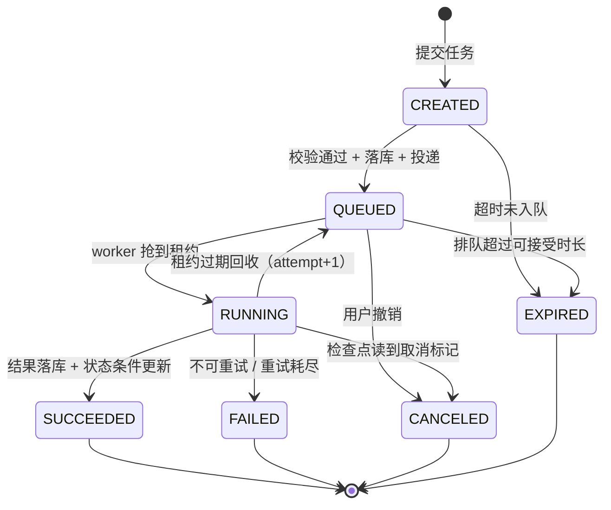

# 模型很慢，长任务怎么设计？状态机、回调和补偿怎么摆？

> 慢本身不是问题，问题是链路里没有一处地方替你记住「干到哪一步了」；异步任务的全部价值，就是把一次 40 秒的调用变成一条可查、可续、可赔的流水。

[流式输出与后端治理](/ai/ai-streaming-sse-backend.html) 讨论了生成期间怎样展示内容。需要离线等待、审核、故障恢复或批量交付时，可以增加持久任务与增量读取。应用保存的事件能够用于重放，供应商能否续接原调用则取决于具体接口，不能一概认为断流后重新请求就是原 Token 流的继续。

## 先判定：同步、流式、还是异步

「慢就异步」是错的。异步要额外付一张表、一个状态机、一套重试与观测，前端还得改成交互式刷新，**只有「用户不该在这个窗口里等」时才值得**。

| 判断项         | 倾向同步 / 流式      | 倾向异步                   |
| -------------- | -------------------- | -------------------------- |
| 单次耗时       | 总长 60 秒内         | 单次几十秒以上、批量多篇   |
| 用户是否在场   | 在场，等结果做下一步 | 可离开、稍后回来看         |
| 是否需人工审核 | 不需要               | 要复核 / 二次确认          |
| 是否需重试对账 | 失败让用户重发即可   | 必须自动重试、可回放可对账 |

三条路的差别不在技术难度，而在「谁承担等待」：

| 维度     | 同步                   | 流式（SSE）                  | 异步任务                       |
| -------- | ---------------------- | ---------------------------- | ------------------------------ |
| 用户感知 | 等待请求结束           | 逐步展示，首字时间仍需测量   | 返回受理标识，进度另查         |
| 连接寿命 | 一次请求               | 一条长连接，与生成同寿命     | 请求秒回，与任务解耦           |
| 断线后果 | 核查原请求是否已执行   | 已保存内容可按事件协议回放   | 连接与执行分离，仍需恢复机制   |
| 可重试性 | 先核查状态、预算与幂等 | 已输出内容及副作用限制重试   | 按阶段和未知结果决定是否重试   |
| 复杂度   | 低                     | 中（缓冲、超时、取消、心跳） | 高（状态机、租约、幂等、补偿） |
| 典型场景 | 意图分类、标题、短摘要 | 对话、代码解释、边生成边展示 | 长报告、批量改写、多步 Agent   |

同步、流式与异步没有通用的秒数分界，应结合用户是否在场、实际延迟、恢复和审核要求选择。异步任务也可以通过 SSE 展示进度或有边界的内容增量；交互方式不决定任务是否已经完成。

## 状态机：显式转换与终态边界

任务表最怕写成自由字符串，谁都能 `update status = 'xxx'`。先把图定死，代码照着图写条件更新：



图中的 `RUNNING → QUEUED` 表示未完成任务的执行权回收，只适用于已经核查且允许恢复的情况。租约失效不能证明旧 worker 或上游调用已停止；外部结果未知时先保留核查记录，不直接再发一次动作。恢复以执行代次和条件更新裁决写入权，每次状态变化都追加事件。

这里的 `attempt` 表示任务执行尝试，具体模型请求还应有自己的调用标识。已经进入 `FAILED` 等终态后，人工重跑可以创建关联原任务的新任务，保留旧结果和失败记录；不要把终态原地改回运行态。任务、模型调用与业务操作的标识分别承担恢复、成本和副作用防重职责。

`RUNNING` 内部还要能回答「卡在哪」，用一列 `phase` 细分，它与 `status` 正交：状态是业务承诺，阶段是执行位置。重试按 checkpoint 从失败阶段续，别从头跑——一次 20 秒的生成不该因为 500ms 落盘失败全部重来。

| phase      | 干什么                    | 可重试 | 典型耗时   | 备注                       |
| ---------- | ------------------------- | ------ | ---------- | -------------------------- |
| `RETRIEVE` | 检索、拉上下文、拼 Prompt | 是     | 数百毫秒   | 最便宜，先在这里重试       |
| `GENERATE` | 调模型生成                | 是     | 十几秒~    | 最贵，超时预算按它算       |
| `REVIEW`   | 内容审核 / 人工复核       | 部分   | 分钟~小时  | 审核不通过是终态，不是错误 |
| `PERSIST`  | 写独立产物、发布结果引用  | 有条件 | 随产物变化 | 核查已保存版本与当前执行权 |

状态机最典型的死法不是跳错，而是**某个状态没有出口，任务永久挂在那里**：

| 状态 / 阶段       | 谁判超时           | 转到             | 为什么这样转                                 |
| ----------------- | ------------------ | ---------------- | -------------------------------------------- |
| `CREATED`         | 定时扫描与投递核查 | `EXPIRED`        | 保留原受理记录与幂等映射，重提按明确规则处理 |
| `QUEUED`          | 扫描 + 队首告警    | `EXPIRED`        | 排到用户早走了，交付已无意义                 |
| `RUNNING`         | 租约扫描与核查     | 可恢复才重新排队 | 先确认执行权和外部动作状态，未知结果继续核查 |
| `RUNNING(REVIEW)` | 审核 SLA 扫描      | `FAILED`         | 审核超时默认「不发布」，不能没人审就自动放行 |
| 终态              | 归档策略           | 保留 N 天后归档  | 终态也要清理出口，否则表只涨不消             |

`RUNNING(REVIEW)` 那行值得单独说：**默认放行是事故，默认不通过是成本**。AI 生成内容对外发布时，宁可超时判失败让用户重提，也不要因为审核人手不够把内容放出去。

## 存储：任务表、结果、事件表

三张表分工，别塞成一张 JSON 大字段：

| 字段                                                      | 作用                                      |
| --------------------------------------------------------- | ----------------------------------------- |
| `task_id` / `biz_no`                                      | 任务号 + 业务单号，两者都要能反查         |
| `tenant_id` + `idempotency_key`                           | 幂等键，联合唯一索引                      |
| `scene` / `prompt_version` / `model` / `model_version`    | 复现问题必需：功能、Prompt 版本、模型快照 |
| `status` / `phase` / `progress`                           | 主状态、阶段、进度百分比                  |
| `attempt` / `lease_owner` / `lease_until` / `lease_epoch` | 执行权归属与 fencing                      |
| `deadline_at` / `budget_tokens` / `used_tokens` / `cost`  | 截止时间、预算与已消耗（含失败 attempt）  |
| `result_ref` / `result_sha256` / `result_chars`           | 结果引用与摘要，正文不在这张表            |
| `error_code` / `error_msg`                                | 归一化错误码，用于统计分布                |

幂等键需要明确的租户或业务作用域，例如联合唯一约束 `(tenant_id, idempotency_key)`。同一次提交重试时沿用键，并保存输入与关键配置的摘要；同键内容不同应拒绝或要求建立新请求，不能直接返回旧结果。并发受理还需由事务与状态记录协调，唯一约束本身不提供完整恢复流程，详见[幂等设计](/high-availability/high-availability-idempotency-design.html)与[消息幂等](/high-performance/high-performance-message-idempotency.html)。

大结果可以保存在对象存储，任务表保存 `result_ref`、字节摘要与必要元数据。对象路径区分任务、尝试和执行代次，或者使用内容寻址，避免旧 worker 覆盖新产物。分片场景另存片段状态和输入依赖版本，才便于恢复单片并核对整体一致性；摘要值只证明字节对应关系，不证明内容正确。

事件表 `t_ai_task_event(id, task_id, seq, from_status, to_status, phase, attempt, cost_tokens, error_code, created_at)` 是另一回事：任务表是**快照**，事件表是**账本**，`seq` 单调递增，既回答「卡在哪一步」，又直接当 SSE 的 `Last-Event-ID` 用（事件表保留期要 ≥ 前端重连窗口，否则补发会断档）。状态更新与事件追加放同一个本地事务——补日志失败的那一下，恰恰是你要排障的那一下。

## 执行侧四个工程点

### ① 投递去重：本地消息表 + 状态机兜第二层

「写任务」和「发消息」跨系统，存在中间态。可以将业务记录与 outbox 放在同一本地事务，再由投递器发送；事务消息则有相应的提交与回查协议。可靠性依赖持久化和恢复条件，消费者仍需允许重复到达。处理时按任务状态与执行代次条件更新；未取得执行权应区分已完成、正在处理和状态异常，不能无条件重新执行。相关排查见[消息可靠性](/high-performance/high-performance-message-reliability.html)和[消息积压](/high-performance/high-performance-message-backlog.html)。

### ② 租约与心跳：同时防「两个人干」和「僵尸永久 RUNNING」

这是最容易出事故的一段，因为它同时导致**双倍成本**和**任务永不结束**：

```sql
-- 抢租约：影响 1 行才算抢到，0 行说明别人抢了或状态已变，直接退出
update t_ai_task
set status = 'RUNNING', lease_owner = :worker,
    lease_until = now() + interval 90 second, lease_epoch = lease_epoch + 1
where task_id = :id and status = 'QUEUED';

-- 续租：只续自己的，且必须是同一代
update t_ai_task set lease_until = now() + interval 90 second
where task_id = :id and lease_owner = :worker and lease_epoch = :epoch and status = 'RUNNING';
```

示例 SQL 使用 MySQL 风格的时间表达式，具体数据库还需核对语法。心跳应与可能阻塞的模型调用分开调度，按租约时长的一部分续约，并为调度抖动留出余量。单步执行可以长于租约，只要可靠续租；不能把 TTL 与单步超时机械地规定成固定倍数。

回收、续租与发布结果均检查当前状态及 `lease_epoch`。旧 worker 恢复后，它的旧代次应无法更新当前任务结果。fencing 只约束真正检查了代次的写入端，不能取消已经发出的模型请求，也不能撤销外部业务写入或已发生成本。

### ③ 超时分段：每次工作都服从剩余截止时间

连接截止、流式空闲、单次模型调用、任务总时限、人工审核与结果留存是不同的时间边界。异步受理请求可以很短，后台任务可以更长；租约由心跳维护，也不必等同于模型调用超时。

```text
剩余任务时间
  → 判断是否还值得排队、退避或开始下一步
  → 为本次调用和必要收尾分配预算
  → 到点停止新增工作，记录实际完成与未知部分
```

排队、检索、模型、审核、退避和落库都消耗时间。教学配置可以设定最多 12 步、单次最多 60 秒、任务截止 15 分钟，但 `12 × 60` 只是部分执行预算，不能证明 15 分钟内必然交付成功结果。

每次重试前重新检查剩余时间与费用，必要时缩短等待或停止。人工审核若有更长时限，应明确是否暂停自动执行预算，并单独记录审核期限，不能混进同一个倒计时。

用相同负载测量阶段分布、排队和失败比例，再制定服务目标。P95 或 P99 可以帮助选择配置，却不是“所有请求都能完成”的保证；超时后也需要交付明确状态，而非伪造成功。

### ④ 并发与配额：别让一个租户吃满队列

| 层次   | 手段                               | 目的                       |
| ------ | ---------------------------------- | -------------------------- |
| 租户级 | 最大并发任务数、每日 token 配额    | 单客户容量上限，可售卖     |
| 用户级 | 单用户排队任务数、提交频率限流     | 防刷、防误操作刷屏         |
| 集群级 | worker 信号量、供应商 RPM/TPM 限流 | 不超上游配额，避免全局 429 |

再加一条优先级：交互式任务（用户在等）高优，批处理低优，队列水位高时低优主动降速。别用一个固定线程池「大锅饭」消费，池子打满时高优和低优一起排队。

## 重试与补偿：能重试的前提是幂等

| 错误类型             | 是否继续     | 需要先判断什么                                         |
| -------------------- | ------------ | ------------------------------------------------------ |
| 连接或读超时         | 有条件       | 原调用是否已执行、是否已交付内容，外部结果未知则先核查 |
| 429 限流             | 有条件       | 尊重适用的 `Retry-After`，检查独立配额、剩余时间与预算 |
| 5xx、502、503        | 有条件       | 是否属于暂时故障，能否重试或切换，是否存在副作用       |
| 参数或 Schema 非法   | 不重试原请求 | 修正原因，再决定是否形成新的合法请求                   |
| 上下文超长           | 有条件       | 在预算内重新装配，不能随意截掉必要证据                 |
| 内容拒答或审核不通过 | 按业务策略   | 不当作普通格式错误自动反复生成                         |
| 应用预算耗尽         | 停止新增调用 | 交付状态或等待明确的新额度，不能靠换模型绕过           |

可重试的故障也要限制次数、退避与总截止时间。每次真正发起新模型请求，都建立独立调用尝试并计入用量；原请求失败、取消或断流，并不保证没有上游费用。仅在应用内重新处理同一个已保存结果，不等于又调用了一次模型。

幂等控制应分成三项：同一用量事件只能结算一次；同一业务操作不能重复提交；同一通知事件不能重复发送。若确实发生了两次模型调用，两次实际消耗都要保存，不能把未采用的输出标为 `discarded` 后删除其成本。

客户是否对失败任务收费，属于独立产品规则，不改变供应商成本。已发送但没有完整 usage 时，保留未知项并对账，不能按零消耗退款。具体预占与结算见[Token 预算台账](./ai-token-budget-ledger.html)，切换限制见[供应商调用契约](./ai-llm-provider-contracts.html)。

## 结果怎么给前端：轮询、SSE、webhook

| 方案       | 实现                                           | 优点                           | 代价 / 坑                                | 适合               |
| ---------- | ---------------------------------------------- | ------------------------------ | ---------------------------------------- | ------------------ |
| 短轮询     | `GET /tasks/{id}` 每 2s，逐次退到 5s           | 最简单、可断可续、过网关无压力 | 延迟粒度粗，QPS 随在线用户涨             | 起步首选、后台任务 |
| SSE 推进度 | 轻事件流，只带 `status` / `progress` / `phase` | 体验好、秒级感知               | 断线重连、占连接额度、要防代理缓冲       | 用户盯着看的任务   |
| webhook    | 完成后回调业务方                               | 解耦、适合 B 端集成            | 签名、时间戳、nonce 防重放，还得自己幂等 | 开放平台、异步通知 |

一种适合大报告的方案是流传进度、最终结果从受控存储读取。需要边生成边展示时，也可以保存有序内容增量再回放，但要限制事件大小、缓冲和留存。下面仅示意进度与完成事件，不表示所有 SSE 都不能传正文：

```text
id: 42
event: progress
data: {"taskId":"t_1001","status":"RUNNING","phase":"GENERATE","progress":65}

id: 43
event: done
data: {"taskId":"t_1001","status":"SUCCEEDED","resultRef":"tasks/t_1001/attempt-2/epoch-3/output.md"}

```

`id` 可以编码事件表中的序号，读取回放时仍需限定任务、生成代次和当前授权。留存窗口内可按游标补发并去重，超出窗口则明确返回快照或不可续传状态，不能假装恢复了原模型流。短轮询可以返回轻量字段与 `nextPollAfterMs`。下载可采用授权代理或短期预签名链接，后者还需明确有效期内的撤权限制。webhook 应对规范化载荷、时间与防重放信息签名，窗口和留存按协议配置。

## 一致性与取消

以对象存储保存结果的方案，应先确认不可变产物可读，再原子更新当前结果引用、状态和事件。若产物与状态位于同一事务存储中，也可以采用相应的原子提交方式，不能将一种存储安排称为唯一方案。

```text
1) 写入独立的结果版本，确认字节与引用可用
2) 本地事务内核对任务、尝试、执行代次与当前状态
3) 条件更新结果引用和终态，追加 task_event 与通知 outbox
4) 提交后按通知事件幂等投递 webhook
```

不能在产物尚未形成时就承诺成功。对象写入后数据库提交失败，可能留下孤立草稿，应按引用与执行记录核查；旧代次不能再发布它。数据库成功、通知失败则由可靠投递重试，不需要重新生成内容。对象存储与数据库没有天然的跨系统原子性，必须分别保留恢复入口。

长文分片的失败粒度是**片**，不是任务：10 片里第 7 片超时，只重跑第 7 片（前 6 片已付过钱）；该片重试 2 次仍失败就降级标注未生成，整体 `degraded`；关键片（结论、摘要）失败或失败片超过 30%，整任务 `FAILED`。注意**部分成功不能偷偷交付**：要么状态带 `degraded`，要么结果里明确写出缺哪段，用户按 10 段验收你交 8 段还不吭声，比直接失败更伤。

取消包括应用状态、执行链与账务三个方面。先对允许取消的状态条件更新，再传播取消并在检查点阻止后续动作。更新没有命中时，应区分已完成、已取消、版本变化和无权限，不能一律报告成功或已完成。

取消与成功发布竞争同一份状态，迟到回调不能把已取消任务重新标成当前成功结果。但取消不自动停止远端生成或撤销已经提交的业务动作，仍需按真实操作号核查。可靠确认未发送的预占可以释放；已发送但用量未知的记录保留待对账；实际已发生的上游消耗与面向客户的收费分别处理。

## 预算与成本：任务级三把闸

| 闸门                   | 举例            | 超了怎么办                                     |
| ---------------------- | --------------- | ---------------------------------------------- |
| 最大 token（入 + 出）  | 单任务 32k      | 中止，`reason=budget_exceeded`，交付已完成部分 |
| 最大步数               | 12 步（含重试） | 中止，别让死循环把整月账单吃掉                 |
| 最长时长 `deadline_at` | 15 分钟         | 到点不再发起新调用，收尾落库                   |

预算既约束成本，也约束继续执行的条件。步数、单次超时和截止时间都是护栏，不承诺成功交付。到点停止新增工作并记录超时、部分完成或结果未知，具体状态取决于实际发生的事情。

每次模型尝试记录上游用量，再按任务、租户和场景汇总。重复消费同一用量事件不重复结算，真正发生的新调用则不能按业务任务去重抹掉成本。是否继续正在运行的任务，要检查已预留额度与后续需求，不能一概规定余额耗尽后仍可无限续调。预占、超估和未知用量的处理见[预算台账](./ai-token-budget-ledger.html)。

## 观测：六个指标回答「卡在哪」

| 指标                             | 高了说明什么             | 先动哪                 |
| -------------------------------- | ------------------------ | ---------------------- |
| 队列积压 / 排队等待时长 P95      | 消费能力不足或上游被限流 | 扩容、查 429、降批处理 |
| 任务时长 P95（按 phase 拆）      | 能定位到具体阶段         | 看 `GENERATE` 还是排队 |
| 失败率 + `error_code` 分布       | 供应商抖动还是参数 bug   | 分布集中 = 代码问题    |
| 僵尸任务数（RUNNING 但心跳过期） | 回收没跑或 worker 卡死   | 心跳线程、调度器       |
| 平均 token / 单任务成本          | Prompt 变胖或重试率升高  | 按场景拆开看           |
| 取消率 + 取消所处 phase          | 用户在哪个阶段失去耐心   | 优化该阶段或提前反馈   |

排障顺序固定成：**先看积压趋势 → 再看僵尸任务 → 最后看失败分布**。积压会把所有指标一起带坏，先排除它，剩下的异常才是真异常。上线也不要一把梭：先灰度一个场景、一个租户，观测 `attempt` 分布和僵尸数稳定后再放量，并留一条手动同步的兜底通道（见 [AI 功能怎么灰度、怎么评测、怎么兜底](/ai/ai-feature-rollout-guard.html)）。

## 面试怎么答

1. **选择交互方式**：按离线等待、审核、批量和恢复需要决定是否持久受理，同步、流式与异步可以组合。
2. **表达执行状态**：任务阶段、执行尝试和业务结果分别记录，终态不原地重跑，结果未知先核查。
3. **控制推进权**：投递与事件防重，租约和执行代次约束写入，剩余时间、额度与并发决定是否继续。
4. **定义交付条件**：产物、状态与事件关联到确定版本，内容与引用另行验证，重放事件不等于续写原模型流。

这套设计应能回答：目前做到哪里、谁拥有推进权、哪些结果已经确定，以及下一步按什么规则停止或恢复。

## 容易踩的坑

- **把「慢」直接等于「异步」**：15 秒能出的摘要也做成任务，用户被迫多点一次刷新，比转圈更差。
- **状态回退式重跑**：`SUCCEEDED` 改回 `RUNNING`，历史结果被覆盖，账单和交付对不上。
- **把租约过期当成执行停止**：旧 worker 或供应商请求仍可能运行，写入要检查代次，外部动作另行核查。
- **超时只算模型步数**：排队、退避、审核与收尾也消耗时间，百分位数据和固定倍数都不能保证成功交付。
- **重试不幂等**：一次 400 重试 5 次账单翻倍；通知没去重，用户收到三条「完成了」。
- **无界积累流式内容**：限制单事件、缓冲和结果大小，大产物通过可核查引用交付，必要增量独立保存。
- **审核超时自动放行或缺少持久状态**：需要审批的内容不应无人审核就发布，存储方案也要明确持久性与恢复边界。

## 小结

1. 异步受理由等待、审核、批量与恢复需求决定，可以与流式展示组合，交互方式不等于任务成功。
2. 任务、阶段、尝试和业务操作分别记录，终态不原地重跑，外部结果未知先核查。
3. 租约与执行代次约束推进和发布，不能自动停止远端调用；每次工作服从剩余时间与预算。
4. 不可变产物与受控发布引用关联，状态、事件和通知保持可靠交接，增量回放仍需授权与留存。
5. 重试可以新增模型成本，同一事件才做结算防重，取消、上游成本与客户收费各按真实状态处理。

## 参考

- 综合仓库内消息可靠性、幂等与高可用幂等相关资料，以及 OpenAI / Anthropic 等供应商公开文档中关于 usage、429 与 `Retry-After`、长任务与批处理接口的说明，交叉验证后用自己的话重写。
- 与站内结论对齐：断线续传引用 [大模型流式输出怎么落到后端](/ai/ai-streaming-sse-backend.html)，投递与重复消费引用 [消息幂等怎么保证](/high-performance/high-performance-message-idempotency.html)，积压排查引用 [消息积压怎么处理](/high-performance/high-performance-message-backlog.html)，幂等键设计引用 [幂等设计](/high-availability/high-availability-idempotency-design.html)。
- 2026-11-21 与[预算预占和结算](./ai-token-budget-ledger.html)、[供应商契约](./ai-llm-provider-contracts.html)、[工作流恢复](./ai-agent-workflow-recovery.html)交叉校正：删除重试免费、超时直接切换和按步数保证交付的表述，区分租约失效、未知结果与实际执行终止。
- 本文 SQL、状态与时限均为教学设计，未运行服务、数据库、故障或性能实验。60s、90s、15min 等数字只用于说明配置关系，不是当前系统的实测参数或时延承诺。
