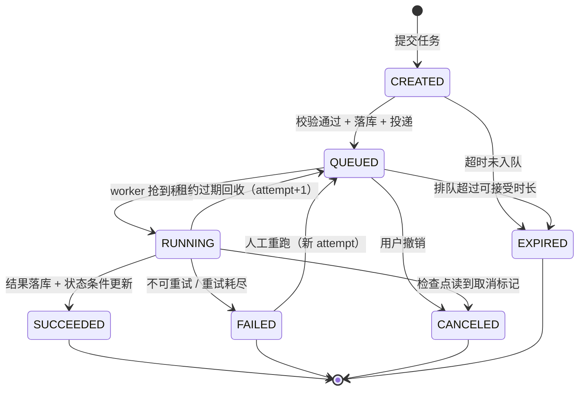

# 模型很慢，长任务怎么设计？状态机、回调和补偿怎么摆？

> 慢本身不是问题，问题是链路里没有一处地方替你记住「干到哪一步了」；异步任务的全部价值，就是把一次 40 秒的调用变成一条可查、可续、可赔的流水。

上一篇 [大模型流式输出怎么落到后端](/ai/ai-streaming-sse-backend.html) 最后落了一句结论：长回答一律走「任务 + 增量读取」，因为供应商一断流，你没法从 token 级别续，能续的只有自己存下来的文本。这篇把这句话拆开：任务长什么形状、谁在推进它、卡住怎么发现、失败怎么赔、取消之后账怎么记。

## 先判定：同步、流式、还是异步

「慢就异步」是错的。异步要额外付一张表、一个状态机、一套重试与观测，前端还得改成交互式刷新，**只有「用户不该在这个窗口里等」时才值得**。

| 判断项         | 倾向同步 / 流式      | 倾向异步                   |
| -------------- | -------------------- | -------------------------- |
| 单次耗时       | 总长 60 秒内         | 单次几十秒以上、批量多篇   |
| 用户是否在场   | 在场，等结果做下一步 | 可离开、稍后回来看         |
| 是否需人工审核 | 不需要               | 要复核 / 二次确认          |
| 是否需重试对账 | 失败让用户重发即可   | 必须自动重试、可回放可对账 |

三条路的差别不在技术难度，而在「谁承担等待」：

| 维度     | 同步                   | 流式（SSE）                  | 异步任务                       |
| -------- | ---------------------- | ---------------------------- | ------------------------------ |
| 用户感知 | 转圈到结束             | 1 秒出第一个字，能判断方向   | 秒回任务号，进度另查           |
| 连接寿命 | 一次请求               | 一条长连接，与生成同寿命     | 请求秒回，与任务解耦           |
| 断线后果 | 重发一次               | 前半段丢，靠事件缓存补       | 无影响，后台继续跑             |
| 可重试性 | 用户手动               | 基本不可（已出字）           | 系统自动退避重试               |
| 复杂度   | 低                     | 中（缓冲、超时、取消、心跳） | 高（状态机、租约、幂等、补偿） |
| 典型场景 | 意图分类、标题、短摘要 | 对话、代码解释、边生成边展示 | 长报告、批量改写、多步 Agent   |

粗糙的开口口径：**8 秒内同步，8~60 秒流式，超过 60 秒或需审核 / 批量 / 重试就异步**。两者并不互斥——异步任务照样可以开一条 SSE 只推进度，用户在页面上看百分比走，这就是后面要给的推荐组合。

## 状态机：只前进，每个状态都有超时出口

任务表最怕写成自由字符串，谁都能 `update status = 'xxx'`。先把图定死，代码照着图写条件更新：



图里唯一「往回走」的 `RUNNING → QUEUED` 要单独解释，否则会被当成状态倒退：**它不是业务状态回退，而是执行权回收**——任务仍未完成，只是这次执行被判死亡，换一次执行重来；落地靠 `attempt` 单调递增表达，绝不允许把 `SUCCEEDED` 改回 `RUNNING` 重跑。配套三条铁律：一律条件更新（`where status='QUEUED'`，影响 1 行才算推进）、非法跳转在 SQL 层就失败、每次变更追加一条事件（谁、何时、从哪到哪、第几次 attempt）。

`RUNNING` 内部还要能回答「卡在哪」，用一列 `phase` 细分，它与 `status` 正交：状态是业务承诺，阶段是执行位置。重试按 checkpoint 从失败阶段续，别从头跑——一次 20 秒的生成不该因为 500ms 落盘失败全部重来。

| phase      | 干什么                    | 可重试 | 典型耗时  | 备注                       |
| ---------- | ------------------------- | ------ | --------- | -------------------------- |
| `RETRIEVE` | 检索、拉上下文、拼 Prompt | 是     | 数百毫秒  | 最便宜，先在这里重试       |
| `GENERATE` | 调模型生成                | 是     | 十几秒~   | 最贵，超时预算按它算       |
| `REVIEW`   | 内容审核 / 人工复核       | 部分   | 分钟~小时 | 审核不通过是终态，不是错误 |
| `PERSIST`  | 落对象存储、写结果引用    | 是     | 百毫秒    | 幂等覆盖写，重试无副作用   |

状态机最典型的死法不是跳错，而是**某个状态没有出口，任务永久挂在那里**：

| 状态 / 阶段       | 谁判超时        | 转到                  | 为什么这样转                                   |
| ----------------- | --------------- | --------------------- | ---------------------------------------------- |
| `CREATED`         | 定时扫描        | `EXPIRED`             | 提交了却没入队，说明上游事务断了，别占着幂等键 |
| `QUEUED`          | 扫描 + 队首告警 | `EXPIRED`             | 排到用户早走了，交付已无意义                   |
| `RUNNING`         | 租约扫描        | `QUEUED`（attempt+1） | 僵尸任务不能永久 RUNNING，否则队列永远显示忙   |
| `RUNNING(REVIEW)` | 审核 SLA 扫描   | `FAILED`              | 审核超时默认「不发布」，不能没人审就自动放行   |
| 终态              | 归档策略        | 保留 N 天后归档       | 终态也要清理出口，否则表只涨不消               |

`RUNNING(REVIEW)` 那行值得单独说：**默认放行是事故，默认不通过是成本**。AI 生成内容对外发布时，宁可超时判失败让用户重提，也不要因为审核人手不够把内容放出去。

## 存储：任务表、结果、事件表

三张表分工，别塞成一张 JSON 大字段：

| 字段                                                      | 作用                                      |
| --------------------------------------------------------- | ----------------------------------------- |
| `task_id` / `biz_no`                                      | 任务号 + 业务单号，两者都要能反查         |
| `tenant_id` + `idempotency_key`                           | 幂等键，联合唯一索引                      |
| `scene` / `prompt_version` / `model` / `model_version`    | 复现问题必需：功能、Prompt 版本、模型快照 |
| `status` / `phase` / `progress`                           | 主状态、阶段、进度百分比                  |
| `attempt` / `lease_owner` / `lease_until` / `lease_epoch` | 执行权归属与 fencing                      |
| `deadline_at` / `budget_tokens` / `used_tokens` / `cost`  | 截止时间、预算与已消耗（含失败 attempt）  |
| `result_ref` / `result_sha256` / `result_chars`           | 结果引用与摘要，正文不在这张表            |
| `error_code` / `error_msg`                                | 归一化错误码，用于统计分布                |

幂等键必须带租户作用域：`create unique index uk_ai_task_idem on t_ai_task (tenant_id, idempotency_key);` 前端双击、网关重试、用户刷新重提，全被这一个索引收成同一行。这套「先设计幂等键再选存储」的顺序见 [幂等设计](/high-availability/high-availability-idempotency-design.html) 与 [消息幂等怎么保证](/high-performance/high-performance-message-idempotency.html)；AI 场景补一句：**幂等键要包含输入内容指纹**，否则用户改了 Prompt 重提，会被判成重复直接回旧结果。

结果正文进对象存储，库里只存引用：`tasks/{task_id}/attempt-{n}/output.md` + `result_ref` + `sha256` + 字数。两万字报告塞进 `text` 列，任务表每次状态更新都背大字段，备份变大、`select *` 拖垮接口、行迁移频繁。分片场景再开 `t_ai_task_part(task_id, part_no, status, result_ref, error_code)`，粒度到片才能只重跑失败片。

事件表 `t_ai_task_event(id, task_id, seq, from_status, to_status, phase, attempt, cost_tokens, error_code, created_at)` 是另一回事：任务表是**快照**，事件表是**账本**，`seq` 单调递增，既回答「卡在哪一步」，又直接当 SSE 的 `Last-Event-ID` 用（事件表保留期要 ≥ 前端重连窗口，否则补发会断档）。状态更新与事件追加放同一个本地事务——补日志失败的那一下，恰恰是你要排障的那一下。

## 执行侧四个工程点

### ① 投递去重：本地消息表 + 状态机兜第二层

「写任务」和「发消息」跨系统，天然有中间态。本地消息表最通用：业务写库与 outbox 记录同事务，扫描投递成功后标记，失败重投；用了 RocketMQ 也可以走事务消息（半消息 + 本地事务 + 回查）。两者都只保证「不丢 + 至少一次」，**重复投递一定会发生**，第二层防线是消费侧的条件更新：`QUEUED → RUNNING` 抢不到就当重复消息直接 ack，不报错不重试。丢消息与积压的排查分别在 [消息不丢](/high-performance/high-performance-message-reliability.html)、[消息积压怎么处理](/high-performance/high-performance-message-backlog.html)，这里不重复。

### ② 租约与心跳：同时防「两个人干」和「僵尸永久 RUNNING」

这是最容易出事故的一段，因为它同时导致**双倍成本**和**任务永不结束**：

```sql
-- 抢租约：影响 1 行才算抢到，0 行说明别人抢了或状态已变，直接退出
update t_ai_task
set status = 'RUNNING', lease_owner = :worker,
    lease_until = now() + interval 90 second, lease_epoch = lease_epoch + 1
where task_id = :id and status = 'QUEUED';

-- 续租：只续自己的，且必须是同一代
update t_ai_task set lease_until = now() + interval 90 second
where task_id = :id and lease_owner = :worker and lease_epoch = :epoch and status = 'RUNNING';
```

四个细节：**心跳必须独立于业务线程**（模型一阻塞，同线程的心跳就停，最长的任务最先被判僵尸，用调度器按 `lease_until/3` 续）；**租约 TTL 要大于单步最长耗时**；**回收也要条件更新**（`where status='RUNNING' and lease_until < now()`）；**必须配 fencing token**——旧 worker 只是网络抖了一下，回收后它缓过来继续写结果，此时 `and lease_epoch = :epoch` 让它影响 0 行、安静退出。没有 fencing 就是「旧结果覆盖新结果 + 同一任务计费两次」。

### ③ 超时分段：三层不能倒挂

超时不是一个数字而是一条链，从内到外严格递增：

```text
单步模型超时（60s） × 最大步数（12） < 任务总超时 deadline_at（15min）
        < 用户可接受时长 / 前端承诺（20min） < 结果可查窗口（归档前）
```

每种倒挂都有独特症状，认症状就能定位：

| 倒挂                   | 现场表现                                   | 修法                           |
| ---------------------- | ------------------------------------------ | ------------------------------ |
| 网关超时 < 任务总时长  | 用户 60 秒收到 502，后端日志显示任务还在跑 | 任务接口与执行分离，秒回任务号 |
| 单步 × 步数 > 任务总时 | 最后一步永远跑不完，总在 90% 进度失败      | 按步数反推单步预算             |
| 租约 TTL < 单步超时    | 活跃任务被反复回收，attempt 疯涨           | TTL 取单步超时的 1.5~2 倍      |
| 前端承诺 < 任务实际    | 用户以为卡死，重复提交                     | 承诺按 P95 给，超时页显示进度  |

超时值要按分布反推，不是拍脑袋：抓一周各 `phase` 耗时，单步超时取 `GENERATE` 的 P99，任务总超时取 `max(预算步数 × 单步, P95 总时长 × 2)`。拍一个「5 分钟」上去的结果通常是慢的正常任务被砍、快的错误任务白等 5 分钟。

### ④ 并发与配额：别让一个租户吃满队列

| 层次   | 手段                               | 目的                       |
| ------ | ---------------------------------- | -------------------------- |
| 租户级 | 最大并发任务数、每日 token 配额    | 单客户容量上限，可售卖     |
| 用户级 | 单用户排队任务数、提交频率限流     | 防刷、防误操作刷屏         |
| 集群级 | worker 信号量、供应商 RPM/TPM 限流 | 不超上游配额，避免全局 429 |

再加一条优先级：交互式任务（用户在等）高优，批处理低优，队列水位高时低优主动降速。别用一个固定线程池「大锅饭」消费，池子打满时高优和低优一起排队。

## 重试与补偿：能重试的前提是幂等

| 错误类型                | 可重试 | 处理                                    |
| ----------------------- | ------ | --------------------------------------- |
| 连接 / 读超时           | 是     | 退避重试，已产出的 token 不重复计费     |
| 429 限流                | 是     | 听 `Retry-After`，同时降本租户并发      |
| 5xx / 502 / 503         | 是     | 退避 + 网关侧换 provider（有 Fallback） |
| 400 参数非法            | 否     | 立刻 `FAILED`，重试只是重复烧钱         |
| 上下文超长 / 审核不通过 | 否     | 截断重排或终态记录原因，用户可见        |
| 余额不足 / 配额耗尽     | 否     | 转人工或降级到小模型                    |

把可重试的错当不可重试，用户看到无谓失败；把不可重试的错当可重试，就是**用重试掩盖参数 bug**——一个错误请求在队列里滚 5 次，账单翻 5 倍还拖慢别人。退避节奏 2s（±抖动，防同批重试撞一起）→ 8s → 30s → 2min → 进死信，不再自动重试；人工重跑的正确做法是**新建 attempt，而不是把 `FAILED` 改回 `QUEUED` 复用旧结果**——attempt 递增、结果 key 换一个、旧产物留着对比，这样「第三次和第一次差在哪」可查，模型升级回归也靠它。

重试幂等落地就三件事：**不重复计费**（用量按 attempt 记流水，账单按任务去重，重复的 attempt 标 `discarded`）、**不重复落库**（结果 key 带 attempt，覆盖写天然幂等；状态更新带 `where status='RUNNING'`）、**不重复通知**（通知 / webhook 用 `task_id + 终态` 做幂等键）。模型调用里的写操作同理，见 [Function Calling 调内部接口要注意什么](/ai/ai-tool-calling-business-api.html)：**重试是免费的重复执行，不是免费的重复副作用**。

## 结果怎么给前端：轮询、SSE、webhook

| 方案       | 实现                                           | 优点                           | 代价 / 坑                                | 适合               |
| ---------- | ---------------------------------------------- | ------------------------------ | ---------------------------------------- | ------------------ |
| 短轮询     | `GET /tasks/{id}` 每 2s，逐次退到 5s           | 最简单、可断可续、过网关无压力 | 延迟粒度粗，QPS 随在线用户涨             | 起步首选、后台任务 |
| SSE 推进度 | 轻事件流，只带 `status` / `progress` / `phase` | 体验好、秒级感知               | 断线重连、占连接额度、要防代理缓冲       | 用户盯着看的任务   |
| webhook    | 完成后回调业务方                               | 解耦、适合 B 端集成            | 签名、时间戳、nonce 防重放，还得自己幂等 | 开放平台、异步通知 |

**结论只有一句：流只传进度，结果走存储 + 拉取。** 理由很硬：流会断、流不能重放、流里塞大结果会撞网关内存缓冲和 MQ 消息体上限，用户刷新一下什么都没了。所以 SSE 事件长这样，不带正文：

```text
id: 42
event: progress
data: {"taskId":"t_1001","status":"RUNNING","phase":"GENERATE","progress":65}
id: 43
event: done
data: {"taskId":"t_1001","status":"SUCCEEDED","resultRef":"tasks/t_1001/attempt-2/output.md"}
```

`id` 就是事件表的 `seq`，断线重连带 `Last-Event-ID` 回来，按 `seq > ?` 补发，进度无缝接上——这套续传机制与 [SSE 的连接治理](/ai/ai-streaming-sse-backend.html) 同源，只是事件从 token 换成了进度。短轮询的实践点：返回体只给轻量字段、用 `nextPollAfterMs` 引导节奏、结果下载走预签名 URL 直连对象存储。webhook 的签名要覆盖 `timestamp + nonce + body`（`X-Signature: HMAC-SHA256`），时间窗 5 分钟，nonce 落 Redis 去重。

## 一致性与取消

结果与状态的写入顺序只有一个正确答案：**先写结果，再改状态**。

```text
1) 写结果到对象存储（key 含 task_id + attempt，覆盖写幂等）
2) 条件更新 status=SUCCEEDED + result_ref（where status='RUNNING' and lease_epoch=?）
3) 追加 task_event
4) 发通知 / webhook（幂等键去重）
```

反过来就麻烦：状态先变 `SUCCEEDED`，前端立刻拉，`result_ref` 还空着，用户看到「已完成但打不开」。当前顺序里唯一的失败是「结果写了、状态没改」，这个态能自愈——覆盖写同一个 key、重试条件更新都无副作用，再不行还有租约回收把它拉回队列。

长文分片的失败粒度是**片**，不是任务：10 片里第 7 片超时，只重跑第 7 片（前 6 片已付过钱）；该片重试 2 次仍失败就降级标注未生成，整体 `degraded`；关键片（结论、摘要）失败或失败片超过 30%，整任务 `FAILED`。注意**部分成功不能偷偷交付**：要么状态带 `degraded`，要么结果里明确写出缺哪段，用户按 10 段验收你交 8 段还不吭声，比直接失败更伤。

取消要做三件事，少一件都算没取消：**标记**（`where status in ('QUEUED','RUNNING')`，影响 0 行就回「已完成，取消失败」，别假装成功）、**检查点**（每个模型调用之间、每片之后读一次状态；没有检查点的取消只是前端不显示了，钱照烧）、**账务**（分清两本账：**成本是已经花掉的钱，一定发生；计费是向用户收的钱，可以按规则退**。取消就说「不收费」是自欺欺人，但取消了仍按全额占用户配额，下次他就不敢点了）。还有个竞态要写进代码：worker 刚写完结果、用户同时点取消，靠条件更新裁决先到者赢——`SUCCEEDED` 落定后取消只能走退款或重新生成一个新任务。

## 预算与成本：任务级三把闸

| 闸门                   | 举例            | 超了怎么办                                     |
| ---------------------- | --------------- | ---------------------------------------------- |
| 最大 token（入 + 出）  | 单任务 32k      | 中止，`reason=budget_exceeded`，交付已完成部分 |
| 最大步数               | 12 步（含重试） | 中止，别让死循环把整月账单吃掉                 |
| 最长时长 `deadline_at` | 15 分钟         | 到点不再发起新调用，收尾落库                   |

预算不只是省钱，它还是**超时设计的输入**：知道最多 12 步 × 每步 60 秒，才敢承诺「15 分钟内一定有结果」。成本要记到 `task_id` 和 `tenant_id` 两个维度——前者回答「这份报告花了多少」，后者回答「这个客户这个月花了多少、哪个功能最贵」；重试的 attempt 也要记成本但按任务去重结算，否则出账口径和成本口径永远对不上。租户日配额用完时应当**拒绝新任务**，而不是中途砍掉正在跑的。

## 观测：六个指标回答「卡在哪」

| 指标                             | 高了说明什么             | 先动哪                 |
| -------------------------------- | ------------------------ | ---------------------- |
| 队列积压 / 排队等待时长 P95      | 消费能力不足或上游被限流 | 扩容、查 429、降批处理 |
| 任务时长 P95（按 phase 拆）      | 能定位到具体阶段         | 看 `GENERATE` 还是排队 |
| 失败率 + `error_code` 分布       | 供应商抖动还是参数 bug   | 分布集中 = 代码问题    |
| 僵尸任务数（RUNNING 但心跳过期） | 回收没跑或 worker 卡死   | 心跳线程、调度器       |
| 平均 token / 单任务成本          | Prompt 变胖或重试率升高  | 按场景拆开看           |
| 取消率 + 取消所处 phase          | 用户在哪个阶段失去耐心   | 优化该阶段或提前反馈   |

排障顺序固定成：**先看积压趋势 → 再看僵尸任务 → 最后看失败分布**。积压会把所有指标一起带坏，先排除它，剩下的异常才是真异常。上线也不要一把梭：先灰度一个场景、一个租户，观测 `attempt` 分布和僵尸数稳定后再放量，并留一条手动同步的兜底通道（见 [AI 功能怎么灰度、怎么评测、怎么兜底](/ai/ai-feature-rollout-guard.html)）。

## 面试怎么答

1. **先给判断标准**：单次几十秒以上、批量、需人工审核、需自动重试且可回放，才上异步；否则同步或流式就够，流式只改首字延迟不改总耗时。
2. **再给状态机**：`CREATED → QUEUED → RUNNING → SUCCEEDED / FAILED / CANCELED / EXPIRED`，`RUNNING` 内用 `phase` 细分检索 / 生成 / 审核 / 落库；状态只前进，每格都有超时出口，重跑用 `attempt` 递增而不是改状态。
3. **四个硬点**：投递靠本地消息表 + 幂等键 + 条件更新双重兜底；worker 靠租约 + 独立心跳 + `lease_epoch` fencing 防双跑和僵尸；超时三层不能倒挂；配额按租户 / 用户限流，防单客户吃满队列。
4. **结果与预算**：流只传进度（SSE 带 `seq` 可续传），结果进对象存储、DB 存引用，前端拉取，webhook 要签名 + 时间戳 + nonce；任务级三把闸（max_token / max_steps / deadline）加成本记到租户。

加分的一句：**「我们不是把接口改异步就完事，是让任务在任何时刻都能回答三个问题——现在到哪、谁在干、最坏什么时候结束。」**

## 容易踩的坑

- **把「慢」直接等于「异步」**：15 秒能出的摘要也做成任务，用户被迫多点一次刷新，比转圈更差。
- **状态回退式重跑**：`SUCCEEDED` 改回 `RUNNING`，历史结果被覆盖，账单和交付对不上。
- **心跳跑在业务线程里**：模型一阻塞心跳就停，最长的任务最先被判僵尸，回收后原 worker 复活写结果，没有 `lease_epoch` 就是双计费。
- **超时拍脑袋**：网关 60s、任务 15min、租约 30s，活人被反复判死；超时必须从内到外严格递增并按 P95/P99 反推。
- **重试不幂等**：一次 400 重试 5 次账单翻倍；通知没去重，用户收到三条「完成了」。
- **大结果塞进 SSE 或消息体**：撞网关缓冲和 MQ 消息上限，前端还要处理半成品 JSON；消息体只放 `task_id`。
- **审核超时自动放行 / 拿 Redis 当唯一状态存储**：前者是事故、后者让任务成孤儿，DB 才是唯一事实来源。

## 小结

1. 异步不是「慢就用」，而是「用户不该等」才用；否则同步或流式就够，流式只优化 TTFT，不改总耗时也不省 token。
2. 状态机只前进，重跑用 `attempt` 递增表达；`RUNNING` 用 `phase` 细分检索 / 生成 / 审核 / 落库，每个状态都必须有超时出口，审核超时默认不通过。
3. 三张表分工：任务表存状态与租约（幂等键联合唯一索引），结果正文进对象存储只留引用与摘要，事件表按 `seq` 留痕回答「卡在哪一步」。
4. 执行侧四个硬点：投递去重、租约 + 独立心跳 + fencing、三层超时不能倒挂、按租户/用户限流。
5. 结果获取一句话：流只传进度、结果走存储 + 拉取；重试必幂等，取消要标记 + 检查点 + 分清成本与计费两本账。

## 参考

- 综合仓库内消息可靠性、幂等与高可用幂等相关资料，以及 OpenAI / Anthropic 等供应商公开文档中关于 usage、429 与 `Retry-After`、长任务与批处理接口的说明，交叉验证后用自己的话重写。
- 与站内结论对齐：断线续传引用 [大模型流式输出怎么落到后端](/ai/ai-streaming-sse-backend.html)，投递与重复消费引用 [消息幂等怎么保证](/high-performance/high-performance-message-idempotency.html)，积压排查引用 [消息积压怎么处理](/high-performance/high-performance-message-backlog.html)，幂等键设计引用 [幂等设计](/high-availability/high-availability-idempotency-design.html)。
- 主动纠偏与时效说明：「异步任务状态放 Redis 就够了」收紧成「DB 是事实来源、Redis 只做加速」；「取消任务就不用付费」拆成成本与计费两本账；「租约到期直接改回 QUEUED」补上 fencing token。各供应商批处理接口与配额语义仍在演进，文中 60s / 90s / 15min 是按 P95 反推的示例，落地以自己链路的耗时分布和最新文档为准。
