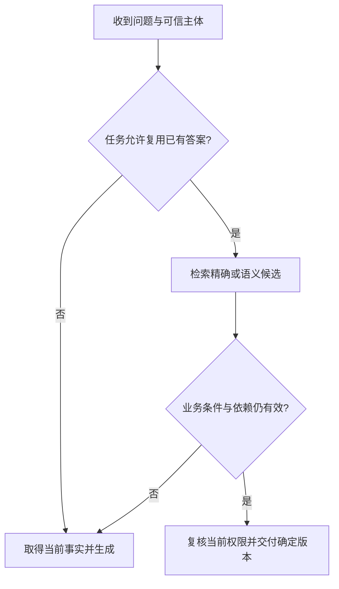

# 答案缓存、语义缓存和前缀缓存，应该怎样选？

> 先判断要复用答案还是计算，再检查本次问题的条件、证据与权限；命中缓存只是找到了候选，不代表可以直接交付。

## 同样问退款，为什么不能直接返回上一次答案？

假设售后助手已经回答过：“标准商品签收后七天内可以申请无理由退货。”

另一个用户问：“我的定制商品签收六天，还能退吗？”两句话都包含商品、签收和退货，语义很接近，但定制商品可能属于例外。

如果只按向量相似度返回旧答案，模型甚至没有机会看到新条件。缓存让回答更快，也可能让同一个错误被更快地重复交付。

本文使用订单与售后 FAQ 的教学场景，不部署缓存服务或执行模型实验。重点是缓存放在哪里，以及复用前需要检查什么。

## 三类缓存，到底复用了哪一部分？

| 类型           | 复用对象               | 命中后的主要行为         | 主要边界                 |
| -------------- | ---------------------- | ------------------------ | ------------------------ |
| 精确答案缓存   | 某组确定输入对应的结果 | 返回已保存答案           | 输入及依赖是否真正相同   |
| 语义答案缓存   | 与当前问题相近的旧结果 | 先找候选，再判断能否复用 | 相似不等于业务条件等价   |
| 供应商前缀缓存 | 可复用前缀的计算状态   | 继续处理输入并生成新结果 | 前缀匹配、模型与平台策略 |

检索结果、解析结果和中间摘要也可以缓存，但它们不是最终答案。命中候选文档 ID 后，应用仍可能需要读取正文、复核授权和调用模型。

前缀缓存则主要减少重复输入计算。即便前缀完全命中，后续通常仍要生成回答，不能把它当成一次零成本的答案读取。

## 缓存键之前，为什么先判断是否允许复用？

先按任务区分稳定说明与动态事实。

公开的“怎样申请退货”可以评估答案缓存；“订单 O-72 当前是否已退款”依赖订单状态、主体权限与观察时间，复用条件就严格得多。

可以先做这样的判定：



这不是所有系统统一的缓存流程。应用需要按错误后果、数据变化速度和可核查条件，决定哪些任务可以进入复用路径。

不能因为缓存键加入了用户 ID，就认定动态事实已经足够新鲜；也不能因为 FAQ 通常公开，就忽略地区、产品和政策版本差异。

## 精确缓存的“相同”，应该包含哪些条件？

只对问题文本做 Hash，通常不足以表达答案依赖。

同一句“怎样退款”，在不同产品、地区、语言或政策版本下可能有不同答案。模型、提示词或输出契约变化，也可能要求重新生成。

缓存键可以按实际依赖纳入：

```text
规范化请求与业务条件
+ 模型、Prompt、Schema 和工具配置版本
+ 数据或知识发布版本
+ 必要的授权作用域
+ 时间窗口、地区、语言及其他有效条件
```

不是字段越多越好，而是要能解释“哪些变化会让结果不再适用”。不影响结果的随机请求 ID 放进键中，只会降低命中机会。

规范化也不能改变语义。去掉无意义空白可以考虑，但不能随意删除否定词、单位，或改变区分大小写的业务编号。

Hash 只是定位和比较手段。授权作用域的摘要不能证明当前权限有效，命中后仍要核查实际访问条件。

## 语义缓存为什么需要第二次判断？

语义检索适合回答“可能有哪些可复用结果”，不能单独回答“这份结果现在就适用”。

售后场景至少要检查：

- 是否为同一种业务意图，例如申请退款与查询退款进度。
- 是否针对相同对象、产品与适用政策。
- 是否保留否定、例外、金额、单位和日期条件。
- 是否依赖当前订单状态或其他动态事实。
- 当前主体是否可以访问答案及其全部必要来源。

例如，“还没发货能退吗”和“已经发货不能退吗”可能很相似，却不能仅靠一个相似度阈值合并处理。

检查无法可靠完成时，就放弃直接复用，重新取数或生成。额外判断也有成本，应计入整个缓存方案的收益。

检索分数与事实正确率的区别，见[幻觉与拒答](./ai-hallucination-abstention.html)。

## 一份缓存答案，应该怎样保存证据依赖？

除了正文，还需要知道这段答案基于哪些输入形成。

下面是应用自定义的教学清单，不是任何缓存产品的标准字段：

```json
{
  "answerVersion": "refund-answer-r8",
  "requestConditions": {
    "productType": "standard",
    "region": "CN",
    "locale": "zh-CN"
  },
  "dependencies": [
    {
      "sourceId": "return-policy",
      "sourceVersion": 13,
      "section": "2.1"
    }
  ],
  "configuration": {
    "promptVersion": "refund-p4",
    "schemaVersion": "answer-v2"
  },
  "authorizationScope": "由可信服务端计算的作用域引用"
}
```

如果回答还使用了用户记忆、业务查询或历史消息，对应依赖也要纳入。只列最后展示的两条引用，不一定覆盖实际参与生成的全部材料。

聚合结果还需要数据批次、查询条件和指标版本。仅有文档版本号，无法复原一次订单金额统计。

依赖清单不完整时，不应声称可以精确判断失效。可以选择更保守的复用范围，或者先缓存来源引用，读取时重新取得当前事实。

## 撤权或政策更新后，TTL 还没到怎么办？

立即按新的有效状态判断，不能等待 TTL 自然过期。

内容更新可以主动驱逐相关条目，但事件可能延迟或处理失败。因此，命中后仍应按权威目录核对版本、有效状态和当前授权。

权限结果取不到时，不能因为“昨天允许”就继续交付私有正文。严格撤权场景还要约定授权检查与实际交付之间的生效边界，不能把一次检查宣传成永久保证。

历史对话、答案引用和下载链接同样可能保留旧内容。清理答案缓存，并不代表这些入口已经同步受控。

相关一致性问题见[企业知识库设计](./ai-enterprise-knowledge-base-design.html)与[索引更新和撤权](./ai-rag-index-lifecycle.html)。

## 前缀缓存为什么要求查看最终渲染输入？

供应商处理的输入包含消息、工具定义、输出格式及其他相关配置，不只是应用最初的一段字符串。

OpenAI 官方原文说明，前缀缓存复用匹配前缀的 KV 状态。相同前缀找到可用条目后，模型仍需处理新增输入并生成结果。

工具名称、描述、Schema、顺序或相关调用设置变化，都可能改变实际前缀。两份问题文字一样，也不能据此保证命中。

稳定指令和工具定义可以放在可复用部分，动态内容放在适当位置，但不能为了提高命中率而保留已失效证据。

缓存支持范围、匹配边界、保留策略和读写价格随平台与模型变化，不能沿用固定“五分钟”“半价”等经验作为通用规则。

命中内容仍参与逻辑上下文，输出与推理等消耗按实际接口计量。缓存与费用边界见[预算台账](./ai-token-budget-ledger.html)。

## 本地按租户分键，是否也隔离了供应商缓存？

不能直接得出这个结论。

本地缓存键决定应用怎样找答案，供应商前缀复用则遵循另一套实现。两者的隔离范围、保留条件和可观测行为需要分别核对。

对私有材料，应检查平台支持的隔离方式与数据处理约定，避免跨信任范围的复用或侧信号泄露。某个引擎支持的隔离字段，也不能当成所有供应商的通用参数。

无论底层怎样复用计算，应用发送资料和展示结果时，都不能跳过自身授权。

## 大量请求同时未命中，怎样避免一起回源？

可以对同一有效键合并生成工作，让其他请求等待相同结果。这类 singleflight 必须限制在相同授权和依赖范围内。

如果两个用户只能看到不同资料，就不能因为问题一样而共享同一份生成结果。

进程内合并只覆盖当前实例。跨实例协调还需要明确的租约、状态版本或其他并发机制，同时处理执行者失联和等待超时。

假设旧生成使用政策第 12 版，新生成已经使用第 13 版。旧执行者稍后恢复，不能覆盖新版本条目。发布结果时应检查依赖代次与执行权，而不是谁最后返回谁写入。

一个等待者取消，也不必然代表所有等待者都希望停止。应明确取消的是订阅还是共享生成，避免关闭一位用户的页面就终止其他人的工作。

## 错误也可以缓存吗？

可以评估短期的失败抑制，但要先分类。

“未找到公开文档”“检索服务超时”“无访问权限”和“生成被截断”不是同一种结果，不能都保存为成功答案。

无证据结果会随索引更新而改变；权限拒绝可能包含敏感信息；服务故障更不应该长期复用成“没有这项政策”。

负缓存应有明确范围、较短的有效策略和可区分状态。权威授权不可用时，也不能靠过期的允许结果继续放行。

容量淘汰、TTL 到期、业务失效和物理删除分别解决不同问题。撤销在线复用，不等于已经清除了日志、备份或外部服务的全部历史副本。

## 怎样判断缓存真的改善了系统？

使用相同问题分布、身份范围与版本条件，分别观察：

- 正确复用、误命中、过期结果和撤权拦截。
- 精确、语义与前缀缓存各自的命中量及实际复用量。
- 查找、判断、回源、写入和失效处理的总成本。
- 首个有效内容、总时延，以及未命中时的额外延迟。
- 并发回源数量、等待超时和旧执行者写入被拒绝的情况。

命中率高却频繁返回不适用答案，没有取得业务收益。供应商未返回完整 usage 时，也应保留未知项，不能直接按预期折扣计算节省额。

这些是评估设计，不是本篇已经执行的缓存实验。

## 小结

1. 答案缓存复用结果，前缀缓存复用部分计算，命中前缀仍需要生成新输出。
2. 精确键覆盖实际依赖，语义检索只提供候选，业务条件与当前授权仍要核查。
3. 依赖版本、撤权和动态事实决定能否复用，TTL 不能替代有效性判断。
4. 并发回源合并应保持作用域一致，旧执行者不能覆盖新代次结果，错误不能冒充成功。
5. 分别衡量正确复用、失效和整体成本，缓存命中率不是最终质量指标。

## 参考

综合仓库 `docs/` 下的模型网关缓存、模型运行机制资料，结合站内知识库授权、记忆撤销与预算台账整理。纠正了语义相似即可复用、TTL 未到即有效，以及前缀命中代表答案或输出免费的概括。

- [OpenAI：Prompt caching](https://developers.openai.com/api/docs/guides/prompt-caching)——于 2026-11-21 读取原文，核对前缀 KV 复用、匹配条件及模型相关的保留与计价边界。
- [企业知识库设计](./ai-enterprise-knowledge-base-design.html)、[索引生命周期](./ai-rag-index-lifecycle.html)——衔接证据依赖、当前授权与撤权处理。
- [Agent 记忆与撤销](./ai-agent-memory.html)、[Token 预算台账](./ai-token-budget-ledger.html)——区分在线复用、历史清理和实际用量。

本文的订单、缓存清单与流程均为教学设计，未部署缓存服务、执行模型调用或测量性能、命中率与费用收益。
