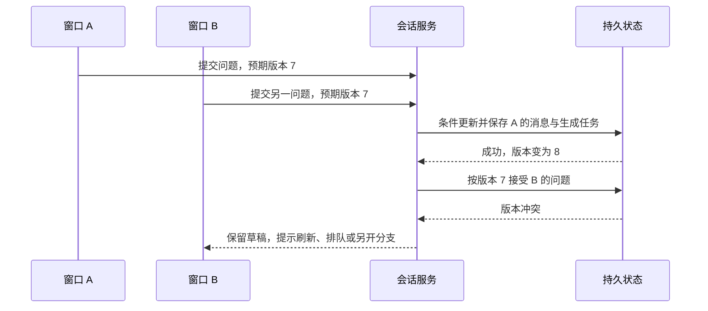

# 同一会话并发提问、重新生成和取消，怎样管理？

> 消息属于哪条路径、回复属于哪次生成、谁还有权提交结果，需要分别记录；不能让最后到达的内容自动成为当前答案。

## 两个窗口都在聊天，为什么历史会突然接错？

alice 在两个浏览器窗口打开同一段报销咨询。窗口 A 问“住宿费怎么报”，窗口 B 仍停留在旧画面，接着问“那交通费呢”。

如果两边都读取旧历史，再分别追加用户问题与模型回答，最终消息可能按网络完成顺序交错。交通费回答甚至会引用住宿费这一轮尚未完成的解释。

随后 alice 点击“重新生成”，新回答已经出现，旧请求却又返回几个分片。若前端只按会话号追加文本，两份答案就会拼在一起。

这些问题涉及会话状态与执行归属，不能仅靠把历史放进线程安全的容器解决。本文给出教学设计，未运行聊天服务、模型或并发实验。

## 会话、消息、分支和生成任务，分别标识什么？

先区分应用需要表达的对象：

| 标识             | 主要职责                       |
| ---------------- | ------------------------------ |
| `conversationId` | 定位会话及其归属               |
| `branchId`       | 定位某条对话路径               |
| `messageId`      | 标识一条用户、助手或工具消息   |
| `parentId`       | 指向该路径上的前驱节点         |
| `runId`          | 标识一次回复生成任务           |
| `attemptId`      | 标识任务内一次真实模型调用尝试 |
| `epoch`          | 区分同一任务的新旧执行权代次   |
| `seq`            | 为指定事件流中的事件排序       |
| `version`        | 检查分支状态是否被其他请求更新 |

这些字段是应用设计，不是所有聊天框架共有的协议。具体类型可以合并或调整，但职责不能混淆。

例如，一次 Agent 回复可能调用模型三轮，因此一个 `runId` 对应多个 `attemptId`。重放同一次接口提交，也不能因此创建三个新的用户问题。

所有定位信息都要经过归属检查。知道 `conversationId`、分支或生成任务标识，不代表有权读到其中的消息、事件和附件。

## 消息树与当前游标，为什么要分开保存？

可以将消息保存为带父节点的结构，而分支记录指向当前采用的路径位置：

```text
会话：归属、访问范围
分支：headMessageId、activeRunId、version
消息：messageId、parentId、role、content、status
生成：runId、branchId、parentMessageId、epoch、status
事件：runId、epoch、seq、eventType、payload
```

这里的 `headMessageId` 表示分支当前采用的位置，不等于整个会话最后插入数据库的那条消息。

重新生成可以留下多个候选回复；模型上下文应沿所选路径装配，不能把所有兄弟节点都按时间拼进去。

部分正文、失败记录与最终回复也需要区分。半截解释可以保留供排障或展示，但不能默认作为已完成的助手回答参与后续推理。

消息窗口与长期记忆的关系，见[上下文装配](./ai-agent-context-engineering.html)和[Agent 记忆](./ai-agent-memory.html)。

## 同一分支同时提问，最简单的处理方案是什么？

可以先限定：**同一分支同时只有一个正在生成的回复**。接受用户问题时，检查预期分支版本，并原子地保存消息、生成记录和分支更新。

假设两个窗口都看到分支版本为 7、头节点为 `m10`：



事务中还要核对头节点与活动任务，不能只有一个孤立的版本数字。相同提交标识再次到达时，应核对内容并返回原受理结果，避免前端重试导致重复消息。

跨多个实例时，仅在一个 JVM 中使用 `synchronized` 不够。应采用共享持久状态上的条件更新、可靠单写者调度，或其他能够覆盖全部写入口的协调方式。

冲突不能静默丢弃用户问题，也不能擅自把它接到一个含义已经变化的新上下文后面。

若产品选择排队，就保存原始提交与父节点，并说明排队后的续答规则；执行时重新判断指代是否仍成立。另开分支则需要明确告诉用户，这次问题将沿另一条路径继续。

## 点击“重新生成”，应该覆盖旧回答吗？

更容易核查的做法是创建新的生成任务，并保留旧候选。两个回复可以关联同一个确定的用户消息，成为不同候选路径：

```text
用户消息 u11
├── 助手候选 a11：旧生成，已完成或被替代
└── 助手候选 a12：新生成，当前选择
```

新任务使用新的 `runId`，记录要使用的父节点、模型配置与上下文版本。不能从“数据库最后一条消息”推断本次重新生成的起点。

如果旧任务仍在执行，可以在同一事务中将它标为已替代，建立新任务并更新当前选择。随后向旧执行链传播取消，但新回复不必假装旧供应商请求已确认停止。

若只是对同一模型调用做网络重试，则还要区分是否真的发起了新尝试。每次真实调用的用量都应记录，不能因用户只看见一个答案就抹掉旧成本，见[预算台账](./ai-token-budget-ledger.html)。

切换候选或回到旧分支，也不会撤销已经提交的报销申请。对话路径与业务状态是两套记录，相关边界见[工作流恢复](./ai-agent-workflow-recovery.html)。

## 旧分片迟到，怎样避免它覆盖新回复？

每个回调携带其所属分支、生成任务和执行代次。服务端提交正文或推进分支之前，要检查这些标识是否仍与当前执行权相符。

可以将最终提交的条件表达为：

```text
当前任务仍允许完成
且回调 runId 与分支 activeRunId 相同
且 epoch 仍是当前执行代次
且分支版本与预期一致
→ 提交完整回复并更新分支位置
```

这是判据示意，不代表一条通用 SQL。检查与提交应处于同一个可靠更新边界，不能先查通过，过一会儿再无条件写入。

`runId` 解决不同生成任务的归属，`epoch` 解决同一任务被新执行者接管后，旧执行者仍返回的问题。两者不能简单互相替代。

旧分片可以按留存策略进入原任务的诊断记录，但不能继续改写当前分支或展示区。前端也应按所选分支与回复标识接收事件，避免将整个会话的所有分片都追加到同一个文本框。

语音场景中的相似机制见[回复代次与迟到音频](./ai-realtime-voice-agent.html)，但文本事件不必照搬音频重排的全部字段和缓冲规则。

## 取消和完成同时发生，应该由谁获胜？

取消和完成需要对同一份任务状态进行条件更新，不能各自读取一次 `RUNNING` 后分别宣布成功。

| 最先提交的状态变化 | 应如何处理后续动作               |
| ------------------ | -------------------------------- |
| 完整回复已提交     | 取消不能再声称该次生成从未完成   |
| 取消或替代已生效   | 迟到完成不能重新发布为当前回复   |
| 远端结果仍未知     | 保留核查记录，不把未知写成未执行 |

用户界面停止接收旧回复、远端模型停止生成、外部业务动作是否提交，是三个需要分别核查的结果。

例如，前端已经隐藏旧回答，供应商仍可能生成剩余内容；工具也可能已经成功提交报销申请。取消信号不会自动撤销这些事实。

取消状态更新没有命中时，也要区分原因：已经完成、已经取消、版本冲突和无权限，不应全部返回“取消成功”。

## SSE 重连怎样补消息，才不会串到另一轮？

事件序号应有明确作用域，例如 `(runId, epoch, seq)`。不能拿整个会话收到的最后一个数字，去恢复任意一条生成流。

服务端可以将这些信息编码成应用事件 ID，客户端作为不透明游标回传。读取回放之前，仍需检查当前主体是否有权访问对应会话、分支和任务。

客户端记录已经处理的事件标识，重复事件不再追加；发现缺口时，按服务约定补取或重新读取已保存快照，而不是猜测缺失文本。

旧任务回放也必须进入旧任务的展示位置。新回答已经选中后，旧连接重连不能把它重新切回当前答案。

`Last-Event-ID` 帮助应用定位已保存事件，不意味着供应商可以从原来的模型 Token 继续生成。事件超出留存窗口时，应明确返回快照或不可续传状态，不能假装补齐了完整过程。

流式传输本身的边界，继续看[SSE 后端与连接治理](./ai-streaming-sse-backend.html)。

## append-only 文件为什么也不能自动解决并发？

会话树资料展示了追加记录与父节点引用的好处：保留历史、重建路径、避免原地改写旧节点。

但追加文件只是存储方式。多进程同时写入、记录分多次写出、缓冲尚未持久化或中途崩溃，都需要具体的协调与恢复设计。

不能仅凭 JSONL 和同步追加，就承诺“最多丢最后一行”，也不能因此认定消息、活动游标和业务记录已经原子提交。

本地单用户实现与多实例聊天服务具有不同条件。选择文件或数据库以后，仍要明确写入者、提交边界、损坏检测和恢复规则。

## 应该用哪些场景检查这套设计？

| 场景                         | 预期核对点                           |
| ---------------------------- | ------------------------------------ |
| 两个窗口从同一头节点同时提交 | 不丢问题，受理顺序或分支选择明确     |
| 重新生成后旧正文继续到达     | 旧事件只归旧任务，不覆盖当前答案     |
| 新执行者接管后旧执行者完成   | 旧代次不能推进分支或发布结果         |
| 取消与完成同时提交           | 任务状态有一致结果，回调不能反向覆盖 |
| 重连收到重复或跨任务事件     | 去重与归属检查都有效                 |
| 不同用户提交相同定位标识     | 无法读取其他主体的消息与回放         |

这些是教学验收条件，未执行相应检查。实际模型效果、持久存储行为和外部工具副作用，需要分别验证，不能由一次界面展示正常一并证明。

## 小结

1. 会话、分支、消息、生成任务和执行代次分别定位不同对象，归属检查覆盖提交与回放。
2. 同分支并发采用明确的受理规则，消息保存、活动任务与分支位置通过可靠更新边界协调。
3. 重新生成保留确定父节点和独立任务，旧候选不必覆盖删除，也不能自动进入当前上下文。
4. 回调按任务与代次核对执行权，取消、完成和外部副作用分别确认，迟到结果不能重新发布。
5. SSE 游标只恢复应用事件，追加文件也不天然提供多写者安全或完整持久性保证。

## 参考

综合仓库 `docs/` 下的会话树、统一事件流与上下文资料，结合站内工作流恢复、记忆和流式调用篇整理。资料中的文件结构属于具体实现快照，本文将其展开为多实例应用的状态设计，纠正了追加文件天然防并发、切换分支能够回滚业务，以及最后到达的回答应成为当前答案等概括。

- [Agent 上下文装配](./ai-agent-context-engineering.html)、[Agent 记忆](./ai-agent-memory.html)——衔接当前路径、历史消息和跨会话记录。
- [工作流中断与恢复](./ai-agent-workflow-recovery.html)——区分会话分支、执行检查点和业务操作记录。
- [Spring AI 调用链](./ai-spring-ai-call-chain.html)、[SSE 连接治理](./ai-streaming-sse-backend.html)——衔接会话授权、流式消费和事件回放。
- [实时语音 Agent](./ai-realtime-voice-agent.html)、[Token 预算台账](./ai-token-budget-ledger.html)——对照迟到结果隔离与真实调用成本。

本文的状态字段、消息树和竞态均为教学设计，未运行项目、模型、存储或并发测试，未将预期验收写成已通过的结果。
