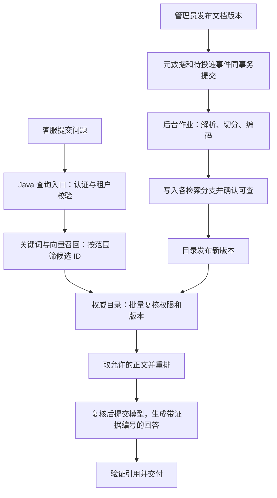

# 怎样设计一个能撤权、可追溯的企业知识库？

> 让每个结论都能追到查询时生效、查询者有权读取的原文。文档和权限变化以后，也能从当时的记录查明答案用了哪份证据。

## 客服问“多久能升级工单”，系统要做到什么？

客服看到一张等待供应商回复的工单，想知道多久可以升级。政策手册规定满 48 小时可升级，另有一份特殊客户的例外条款。回答需要同时说明适用条件和例外，并引用对应段落。客服点开引用时，还要能访问该段原文。

“等待多久才符合政策”查知识库。“这张工单已经等了多久”从有权访问的工单接口读取实际时间。第一版提供问答和引用。后续要执行升级时，再接入业务审批和写入流程。[Java 工单 Agent 的状态与事务](./ai-agent-java-approval-recovery.html)

普通政策更新可以有几分钟的建索引时间。政策废止和用户撤权在权威目录提交后，随后发起的授权检查需要读到新状态。临时找不到安全且足够的引用时，前端要能区分“资料不足”“更新中”和“服务不可用”。这样客服知道该补充问题、稍后再试，还是转人工处理。

## 二十万份文档会占多少空间，模型要承接多少并发？

先约定教学规模，实际项目用文档分布和压测替换这里的假设。

| 输入假设                         | 算出来的量                                      | 用来决定什么                                     |
| -------------------------------- | ----------------------------------------------- | ------------------------------------------------ |
| 20 万份文档，每份平均 8 个片段   | 160 万片段                                      | 入库作业量和检索规模                             |
| 每片段 768 维、每维 4 字节       | 约 4.92 GB 原始向量，等于 160 万 × 768 × 4 字节 | 再实测数据库记录、索引、全文、备份和副本的总空间 |
| 每日约 2,000 份文档需要完整重编  | 约 1.6 万片段需要重新编码                       | 观察更新高峰积压，控制编码批次和供应商配额       |
| 40 次每秒进入生成，平均占用 3 秒 | 稳态平均约 120 次在途模型调用，等于 40 × 3      | 用并发上限、排队超时和压测为突发请求留余地       |

如果压测测得重建链路的持续有效吞吐为每秒 100 片段，全量重建约需 4.4 小时。发布期间旧、新索引可能同时保留，预算要覆盖这段空间和并行的在线查询。120 是模型调用的平均在途量。用同一阶段的平均进入速率和平均停留时间计算，尾延迟和突发峰值另用压测观察。

## Java 服务怎样接查询，离线任务怎样接入库？

可以从一个 Java 应用和一个后台 worker 起步。应用负责认证、知识目录、检索编排和引用，worker 负责耗时的解析与索引。查询路径和导入路径分别限流，批量导入高峰也要给在线查询留出数据库连接和计算资源。

| 接口                                       | 服务端完成的事                                                             |
| ------------------------------------------ | -------------------------------------------------------------------------- |
| `POST /knowledge/documents/{id}/revisions` | 校验编辑权限，登记指向原件的不可变版本并提交导入任务，返回 `202` 和任务 ID |
| `GET /knowledge/imports/{id}`              | 按任务所属知识库和租户授权，查询作业阶段及失败原因                         |
| `POST /knowledge/answers`                  | 从认证上下文取得调用者，校验知识库范围，生成带引用的答案或明确的拒答结果   |
| `GET /knowledge/citations/{id}`            | 按当前权限检查引用对应的版本和原文，再返回允许访问的段落                   |

文档上传完成后，应用在同一个数据库事务里写入版本元数据与待投递事件（outbox）。下游可能重复收到消息，作业以租户、文档 ID、源版本和构建配置防重。数据库提交后即使发送进程崩溃，待投递记录仍然能恢复。向量和全文分支先写入待发布的数据，线上召回按已发布版本筛选。发布前核对两边登记的分块和版本，并用上线查询的读取路径确认可查。目录再用带版本条件的更新切换可见指针，条件会挡住迟到的旧任务。若全文分支写入一半就失败，仍可继续使用尚未废止的当前版本。

源版本决定如何标识和排序文档变更。目录记录哪个版本已发布，并根据业务生效时间决定它能否用于本次查询。构建代次描述用了哪套解析、切分和编码配置，当前授权负责判断谁能读。同一份文档完成重新切分以后，即使源版本不变，分块也能追到各自的构建代次。[索引发布与回滚](./ai-rag-index-lifecycle.html)

客服引用的证据带 `documentId`、`sourceVersion`、构建代次、`chunkId` 和原文位置。比如回答里的 `C1` 指向政策第 13 版第 7 页，服务端从本次已授权的证据集合中解析这个编号并生成链接。编号能映射到原文以后，还要通过业务规则或评测检查原文是否支持答案中的断言。打开链接时仍按位置和版本定位，版本已下线或用户失去权限就返回相应状态。

## 权限和版本在哪几个地方重新判断？

查询入口使用认证后识别出的租户与主体，向量和关键词分支采用同一授权范围与可见版本约束。列在检索索引里的文档权限可以削减候选数量。复制型 ACL 的查询过滤依赖索引保存的权限快照，源端权限更改要经过同步才会体现在索引里。

应用批量从权威目录复核候选 ID、当前授权与可见版本，确认后才取正文和做重排。向外发模型请求时，模型网关按本次证据清单复核当前授权以及租户允许使用的供应商和数据区域。外部重排服务同样经过这层出站检查。授权结果取不到时，本轮停止使用对应资料。

例如客服小周原属华东组，管理员先撤销权限，随后在同一知识库发布排班例外。查询若读到新版正文和旧版权限，小周仍可能看到今天的例外。获取正文前的授权判断要能看到撤权的提交。权威目录与权限若分属不同系统，需要明确检查的读一致性或版本下界。有些授权系统支持在检查时携带版本令牌，要求授权结果至少和对应版本一样新。权限下界还要覆盖此次要生效的撤权，单凭旧文档的版本令牌可能允许陈旧结果。

缓存优先保存候选 ID 和版本，键包含租户、授权作用域、检索配置和知识发布代次。命中缓存以后，查询仍走权威目录复核。若将来缓存最终答案，要保存完整的证据依赖，并在读取时复核每份证据。权限变更事件可以主动驱逐受影响的条目，旧缓存仍由复核挡住。历史对话和 SSE 重连回放一并做访问控制。

小周的请求在 10:00:00 完成第一次授权，10:00:01 管理员撤权，10:00:02 即将发送模型请求，模型网关的复核应拒绝这批证据。若模型在 10:00:00 已接收了正文，应用可以停止后续展示，并向支持取消的上游提交取消。实际停止状态和已发送内容的留存分别受 API 契约和数据保留规则约束。复核与外部发送之间也可能发生撤权。对发送时序有严格约束的场景，需要让权限变更和可信出口的放行具备可验证的顺序，并具体约定放行和交付的时间边界。

高敏政策可以先缓冲答案，验证引用和最新权限后再交付。需要流式时，给可见事件划定交付点，在每个待输出段前检查相关授权，发现撤权就截断后续段。已交付的内容由接收方持有，审计记录可以通过事件 ID 与授权决策追溯那次交付。用首个通过校验的可见段统计首字延迟，心跳和“正在查询”的进度另外记录。

## 客服仍看到旧政策时，从哪里查起？

假设政策从第 12 版的“24 小时”更新为第 13 版的“48 小时”，客服仍收到“24 小时”。先找回答对应的 `requestId`，核对引用中的版本，随后沿着链路查出旧数据在哪一步被放行。

| 查到的证据                                       | 接下来核对哪里                                                               |
| ------------------------------------------------ | ---------------------------------------------------------------------------- |
| 源系统已发布第 13 版，目录还显示第 12 版         | 查看源版本事件、待投递记录、解析错误和索引是否可查，区分排队与构建失败       |
| 目录可见第 13 版，向量拿到第 13 版，全文返回旧版 | 查看全文分支用的索引代次及候选列表，确认合并后是否按当前可见版本剔除第 12 版 |
| 所有检索都返回第 13 版，但模型证据里有旧版       | 检查结果缓存、会话历史和上下文装配，找出将旧段落带回来的入口                 |
| 发给模型的证据只有第 13 版，回答仍说 24 小时     | 核对原文段、引用对应关系和生成结果，回放原请求判断举证是否错误               |

例如追踪显示两路检索均命中第 13 版，装配阶段却又加入了上一轮回答缓存里的第 12 版。修复时把历史政策快照换成证据引用，每轮使用前重新按当前可见版本解析引用。回归用例先生成第 12 版的回答，再发布第 13 版，随后在同一会话追问，检查实际发给模型的证据版本和答案。

如果反馈来自已失去权限的用户，先按授权事故处理。限制受影响资料的出口，通过受限审计记录确认正文是否进入重排、外部模型请求、客户端或会话回放。每条记录关联权限决策版本、内容版本、阶段和拒绝原因，日常排障依赖 ID 和脱敏摘要，原文只在受控且获准的排查中调阅。[RAG 答错时怎样排查](./ai-rag-retrieval-diagnosis.html)

## 怎样证明可以上线？

| 验收对象   | 用例或指标                                                                                 | 判定依据                                                                   |
| ---------- | ------------------------------------------------------------------------------------------ | -------------------------------------------------------------------------- |
| 数据新鲜度 | 从有效的源变更提交算到新版可查，示例目标为 99% 在 5 分钟内                                 | 未完成且超出目标的变更也要进分母。记录源版本和实际可查时间                 |
| 授权       | 跨租户查询、撤权后命中旧缓存、构建时撤权、撤权后重连、内容回滚、复制权限滞后               | 在拒绝场景验证正文未进入重排与模型、引用不可读、未交付的段被截断           |
| 答案质量   | 固定一批带预期证据的正常题、需要例外条款的题、证据不足的题                                 | 分开测必要证据覆盖、引用版本及正文是否支持结论，以及是否在缺证据时拒答     |
| 交互稳定   | 示例目标为 95% 的有效提问在 2.5 秒内收到首个经校验的可见内容，正确的明确拒答也属于可见内容 | 超时、上游失败或预算拒绝单独分类并留在统计里，配合总时延、排队与错误率观察 |

时序测试先确认第 13 版发布后，乱序到达的第 12 版任务会被拒绝。再把请求暂停在“已召回候选、尚未发给模型”的位置，提交撤权后继续请求，检查模型调用记录中是否带有被撤权的正文。将这些用例加入发布评测，灰度时再观察证据覆盖、授权拒绝和首字延迟。[CI 评测门槛](./ai-eval-ci-release-gates.html)

## 小结

1. 工单状态属于业务系统，适用政策属于检索证据。回答同时携带可复查的文档版本和位置。
2. 用片段数估算编码与存储，向量原始空间之外再测索引、全文和版本切换。用平均速率和平均停留时间估算稳态在途量。
3. 文档入库按版本异步构建，各检索分支可用后发布。当前授权独立判断，权限变更后按新策略复核出站证据和引用。
4. 先从坏答案的引用追版本，再比较候选、缓存、实际模型证据和输出。验收同时看新鲜度、权限、质量与响应时间。

## 参考

综合仓库内 AI 应用架构和 RAG 知识库更新资料，核对了异步导入、权限同步、版本变更与召回诊断的职责。文中容量、流量、时延目标和故障时序均为教学假设。容量和并发数字按给定输入复算，部署和实际负载需要用业务数据验证。

- 对照查询过滤使用的权限元数据和源端权限同步边界。[Microsoft Learn 文档级访问控制](https://learn.microsoft.com/en-us/azure/search/search-document-level-access-overview)
- 对照论文第 2.2 节中 ACL 与内容变更的先后关系。[Google Research Zanzibar](https://research.google/pubs/zanzibar-googles-consistent-global-authorization-system/)
- 核对本地事务、独立投递和幂等消费的职责。[AWS Prescriptive Guidance 事务 outbox](https://docs.aws.amazon.com/prescriptive-guidance/latest/cloud-design-patterns/transactional-outbox.html)
- 核对达标事件分子、总事件分母以及时延目标的定义。[Google SRE Workbook Implementing SLOs](https://sre.google/workbook/implementing-slos/)
