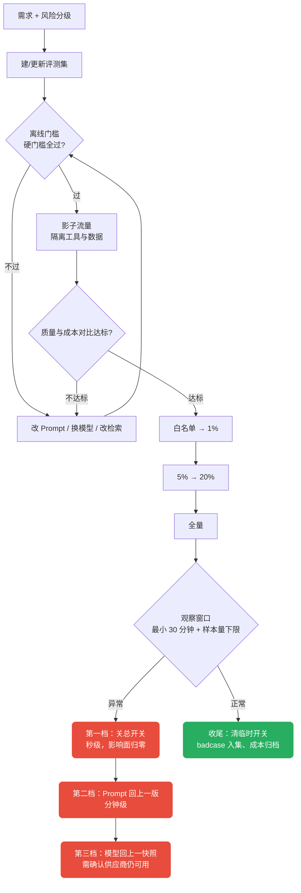

# AI 功能怎么灰度、怎么评测、怎么兜底？

> 一句话点题：AI 功能上线发布的不是一个接口，而是一段概率性行为——灰度控制影响面，评测判断有没有变差，兜底决定坏了以后用户看到什么。

传统功能上线，心里有一笔很确定的账：代码 diff 能 review、单测能断言、报错有堆栈、回滚就是回滚镜像。AI 功能把这笔账全打乱了。同一个问题问两次，措辞可能不同；Prompt 改一句话，准确率可能掉五个点；供应商在你看不见的地方升级了小版本，第二天口吻就变了。所以 AI 上线要回答的不是"接口通不通"，而是三个问题：**影响面能压到多小、质量变差能不能提前发现、坏了以后用户看到什么。**

网关、多模型路由、Fallback、限流、成本归因、Trace 这些技术方案在 [AI 应用工程化、网关和成本怎么控](/ai/ai-application-engineering.html) 里已经讲透，这篇只讲上线过程：怎么放量、怎么卡门槛、怎么准备兜底。

## 为什么说 AI 发布的是"概率性行为"

传统功能的对错是**可判定**的：给定输入，输出要么对要么错，错的那条还能复现、能定位到某个分支。AI 的对错是**分布式的**：整体看起来有 92% 是对的，剩下 8% 散落在长尾里，每条都不一样，而且换一次采样就又变了。没有分布视角，你连"变差了"这个结论都下不出来。

| 维度     | 传统功能           | AI 功能                                  |
| -------- | ------------------ | ---------------------------------------- |
| 发布物   | 代码镜像 + 配置    | 代码 + Prompt 模板 + 模型版本 + 检索策略 |
| 对错判定 | 确定、可断言       | 概率、只能抽样评估                       |
| 回滚动作 | 回滚镜像，一次搞定 | 模型、Prompt、开关要能分别回滚           |
| 失败表现 | 异常、5xx、白屏    | 说得像是对的（幻觉）、格式崩、越权、超时 |
| 成本曲线 | CPU/内存可预算     | Token 随调用量线性放大，一天能烧掉月预算 |
| 用户感知 | 功能缺失           | "它变笨了"，投诉口径完全不同             |

这就是"灰度 + 评测 + 兜底"三件套必须一起上的原因：灰度管**影响面**，评测管**准入与回归**，兜底管**坏的时候的产品体验**。缺任何一个，剩下两个都会失效——没有评测，灰度只是在慢慢扩大事故；没有兜底，灰度出问题时连个体面的收场都没有。

## 灰度维度：模型和 Prompt 必须能独立于代码回滚

传统灰度只切代码版本，AI 灰度要切的是一组"发布单元"。先把这组单元定下来，后面所有开关和日志都围绕它转：

| 灰度维度          | 怎么切                                  | 想验证什么                     | 常见坑                                     |
| ----------------- | --------------------------------------- | ------------------------------ | ------------------------------------------ |
| 租户 / 用户白名单 | 内部员工、种子客户、签了试用的客户      | 可用性、接受度、真实提问分布   | 白名单用户往往是"会提问的人"，评估偏乐观   |
| 按比例            | `hash(tenant_id + user_id + key) % 100` | 规模效应、长尾噪声、容量       | 按请求随机分桶，同一用户时好时坏，投诉翻倍 |
| 按入口场景        | 客服问答先开，合同审查最后开            | 不同场景的风险与容错差异       | 高风险场景和低风险场景一起放量             |
| 模型版本          | 同一份 Prompt 上只把 5% 流量打到新快照  | 质量、延迟、单次成本           | 只测"更强的模型"，不测"更便宜的模型"       |
| Prompt 模板版本   | A/B 两个模板同时在线，按用户固定分流    | 指令改动的实际收益             | 模板写死在常量里，改一个字要发一次版       |
| 检索策略版本      | 分块大小、混合检索权重、rerank 模型     | 召回质量（RAG 场景的主要变量） | 只换模型不换检索，问题定位到错的地方       |

这里有一条最容易翻车的铁律：**模型版本和 Prompt 版本必须能在不发代码的情况下切换和回滚。** 反例很典型——Prompt 写成 Java 里的 `static final String`，运营想调一句话要提 PR、走发布、重启全量实例；线上效果变差时，回滚 Prompt 等于回滚整个服务，把同一批次的其它业务改动一起带回去。正确做法是把模板放配置中心/模板库，按版本号拉取并缓存，回答里带上 `prompt_version`；模型走模型注册表，日志记 `model_snapshot`（真实快照名，不是 "gpt-4 系列"这种模糊说法）。

还有一个容易被忽略的收益：每次放量前把 `{prompt_version, model_snapshot, retrieval_version}` 记成一个 `release_id`，让所有指标按 `release_id` 聚合。这样"昨天开始变差"能直接落到某个 release 上，而不是靠人回忆谁在几点改了什么。

## 开关设计：默认关闭、中心挂了能自力、临时开关会过期

开关是 AI 上线唯一能做到秒级止损的手段，但它自己也是个会出故障的系统。几个必须写进设计里的点：

- **统一开关平台做唯一事实源**，SDK 在本地落盘缓存 + 长轮询/推送更新。开关中心挂了，业务要按"最后一次成功快照"继续跑，而不是抛异常或全部当 false。
- **默认关闭**。新功能、新模型、新场景一律默认 `false`，只有显式配了白名单或比例才进流量。默认开等于把"忘记配"变成"全量上线"。
- **开关带生效范围和过期时间**。范围至少要能表达"环境 + 租户 + 场景"；过期时间到期自动回落到默认值，并在到期前提醒 owner。没有过期时间的临时开关，半年后会变成没人敢动的祖传配置，组合爆炸之后连测试都覆盖不全。
- **一个总 kill switch**。它不是"再关一个开关"，而是一键切断所有 AI 入口，并且必须同时覆盖三处：前端入口、后端调用、异步任务队列（关了入口但队列里还排着几千个任务在烧钱，是最典型的漏网）。

一个实测有用的细节：`本地缓存` 和 `默认值` 是两个层次，不能混。有快照用快照，没快照才用默认值。如果默认值是"关"，那么开关中心不可用时新扩出来的实例会直接没有 AI 功能——这比"按旧快照继续开"更保守，但也会造成"部分实例有、部分实例没有"的割裂体验，所以缓存要落盘、要记 `last_updated_at`，监控上单独盯"开关快照年龄"。

| 开关字段   | 例子                       | 为什么需要                       |
| ---------- | -------------------------- | -------------------------------- |
| key        | `ai.chat.enabled`          | 稳定命名，别用临时工单号         |
| scope      | `prod / tenant=1001 / faq` | 决定影响面，越细越安全           |
| default    | `false`                    | 中心不可用时的行为，必须是安全的 |
| owner      | 具体的人                   | 到期该找谁确认                   |
| expire_at  | `2026-12-31`               | 到期自动失效，防开关债           |
| change_log | 谁、何时、从什么改成什么   | 出问题时能对上变更时间线         |

kill switch 按下之后，用户不能看到 500。降级话术要提前和产品一起写进文案库，比如"智能助手正在升级，你可以先用关键词搜索，或转人工客服"，并且这条话术要能随开关一起下发，而不是等研发临时改前端。

## 评测：上线前的准入门槛

评测方法、Golden Set 怎么分层、LLM-as-Judge 有哪些偏差，前面那篇已经讲过；这里只讲上线这件事需要的部分——**评测集的分类、指标的门槛值，以及"不过就不能合并"这条规矩**。

评测集按用途分五类，缺哪类就会在对应的场景里翻车：

| 类型     | 例子                                 | 判定方式                  |
| -------- | ------------------------------------ | ------------------------- |
| 任务型   | 按指引完成退款流程、工单自动分类     | 规则/状态机断言、关键步骤 |
| 事实性   | 引用的政策条款、合同义务是否真实存在 | 人工 + 带参考答案的 Judge |
| 格式合规 | JSON 字段齐全、枚举合法、长度限制    | 纯规则，最便宜也最有效    |
| 安全红线 | 越权问别人订单、诱导输出系统 Prompt  | 必须 100% 通过，一票否决  |
| 多轮     | 指代消解、中途改需求、纠正上一轮错误 | 脚本化对话回放            |

指标和门槛要提前定，**不能看完结果再决定阈值**，那是事后合理化。一张可用的门槛表大概长这样：

| 指标                | 硬门槛示例      | 说明                             |
| ------------------- | --------------- | -------------------------------- |
| 任务成功率 / 准确率 | ≥ 基线 − 2 个点 | 相对基线比绝对值更有意义         |
| 格式通过率          | ≥ 99.5%         | 结构化输出场景，前端直接依赖它   |
| 越权率              | = 0             | 不计入平均分，直接阻断           |
| 引用正确率          | ≥ 95%           | 引用了不存在的条款比不引用更糟   |
| P95 首字 / 总延迟   | ≤ 1s / ≤ 3s     | 超过用户就不再等，等于功能不可用 |
| 单次成本            | ≤ 预算 × 0.8    | 留余量，防上线后长尾把预算打穿   |

**回归门槛**是这套东西真正起作用的地方：Prompt 或模型变更必须先在 CI 里跑评测集，和当前线上基线做 diff，任一硬门槛不过就阻断合并。这等于把"AI 质量"接进了 code review——不然改 Prompt 的人自己觉得"就是调整下语气"，评审的人也看不出差别，只能靠线上用户教你。

把配对结果按关键场景拆开，就能发现总分掩盖的退步。样本不足时应保留人工复核或补样的入口。[CI 评测门槛](./ai-eval-ci-release-gates.html)

配套的是 **badcase 回流**：点踩、转人工、抽检发现的问题，脱敏后标注入集，并且要求"同一个 bug 不许回归两次"——它一旦进集，之后每次合并都会顺带验证它。没有这条回路，评测集三个月就过期了：真实提问的分布变了，集子里还是上线前那批问题。

## 线上验证：影子、A/B、抽检和反馈信号

离线评测过了只说明"在集子上没退步"，真实分布永远比集子脏。线上验证的手段要按风险从低到高排：

- **影子流量**抽样复制真实请求，让候选模型或 Prompt 在旁路运行，用户仍收到基线响应。候选 Agent 如果接着真实升级工具，即使响应没有返回，工单也可能被再次修改。回放时先限制数据范围并做必要脱敏，写工具换成隔离环境的替身，读工具优先使用已记录的结果，另外给旁路设置独立的资源预算。[Agent 评测与回放](./ai-agent-evaluation.html) · [Istio 流量镜像](https://istio.io/latest/docs/tasks/traffic-management/mirroring/)
- **A/B**：两版同时对外返回，比采纳率、任务完成率、投诉率。要注意新奇效应（用户对新东西初期更愿意点）和样本量，别用几百次调用就宣布胜负。
- **人工抽检**：每天固定抽 N 条，按场景分层。抽检不是为了算分，是为了看"有没有集子覆盖不到的失败模式"。
- **用户反馈信号**：采纳率（复制、引用、点有用）、点踩率、**编辑距离**（用户改了多少才敢用）、追问率、转人工率。编辑距离特别有价值——它比点踩更早、更密集，也更能反映"看起来对但不好用"。

观察窗口和止损条件沿用常规灰度的口径（最小观察时长 + 样本量下限，详见 [灰度发布、金丝雀和蓝绿怎么落地](/distributed-system/distributed-gray-release.html)），AI 这边要额外盯几个自己特有的指标：格式解析失败率、拒答率、越权命中次数、检索为空率、单请求 Token 均价。**投诉是滞后指标**，等用户投诉到客服，事故已经跑了一整天。

止损条件要写死，不能临场讨论：错误率超基线一倍、越权命中大于 0、投诉中 AI 归因占比超阈值、单日成本达到预算 60%——命中任一条就回滚，不需要开会。

## 兜底矩阵：每种故障，用户到底看到什么

兜底最容易写成一句"失败就降级"，但用户看到的不是"降级"，是某一句具体的话。这张表要提前和产品一起填完，并且每种动作都要能在开关平台上单独控制：

| 故障类型          | 兜底动作                             | 用户看到什么                                   |
| ----------------- | ------------------------------------ | ---------------------------------------------- |
| 模型超时 / 5xx    | 短超时快失败，切小模型或模板答案     | "正在为你生成更简洁的回答"或直接给结构化模板   |
| 供应商 429 限流   | 排队 + 降级小模型，读 `Retry-After`  | "当前咨询较多，已为你转人工，预计等待 2 分钟"  |
| 检索为空 / 低相关 | 不做无依据生成，改走澄清或转人工     | "没在知识库里找到依据，建议换个问法或转人工"   |
| 输出不合规        | 校验拦截 → 重试一次 → 仍不过则转人工 | "这个问题建议由人工客服确认"                   |
| 成本超预算        | 按场景优先级排队，低优先级场景关闭   | "智能问答今日额度已用完，可先用关键词搜索"     |
| 供应商整体故障    | 切备用供应商，能力降级并标注         | "当前由备用模型回答，质量可能略有差异"         |
| 越权 / 权限不足   | 直接拒绝并记录，不暴露资源是否存在   | 统一话术"你没有查看该内容的权限"，不做任何解释 |

三个容易做错的点。第一，**降级必须打标**：日志里记 `degraded=true` 和降级原因，否则事后分不清是"模型本身差"还是"那天一直在降级"，复盘会得出完全相反的结论。第二，**检索为空时绝不能硬答**，宁可明确说"没找到依据"，这是 RAG 场景最大的一道防线，编一个像样的答案比承认没找到伤害大得多。第三，**降级不能偷偷改变风险等级**：合同审查从强模型落到便宜模型却不打标记、不要求人工复核，等于把风险藏进了一份看起来正常的报告里，这种场景宁愿直接返回"当前不可用"。

## 成本治理：预算耗尽时的产品行为要提前定义

成本的技术手段（模型分级、缓存、上下文裁剪、先扣预算再发请求）在工程化那篇讲过，这里只补上线视角的三件事：

- **预算要有归属和层级**：日预算、月预算按财务口径定，再往下拆到租户配额和场景配额。没有配额的成本控制，只能等月底账单来教育你。
- **异常检测比均值有用**：盯"某租户一小时 Token 涨 10 倍"这类突变，而不是盯总量。突变通常来自爬虫、Prompt 注入诱导超长对话、或者客户端重试风暴——这三种都不是正常业务增长，限流要能自动化。
- **预算耗尽的动作是产品决策**：是排队、降级小模型、还是直接关入口？必须提前定，写进开关配置和文案，不能凌晨三点现编。常用组合是"核心场景降级小模型 + 非核心场景关闭 + 全员提示"。
- 顺带一个隐藏收益：灰度期 1% 流量的真实成本，可以直接推算全量成本。所以**成本评估应该在 5% 之前完成**，别等全量之后才发现这个功能养不起。

## 数据合规：PII 出网前就要处理

合规不是上线后补材料，它是评测集里"安全红线"那一类的来源，也是架构里的一段代码。落地清单：

| 事项               | 做法                                                       | 为什么                                 |
| ------------------ | ---------------------------------------------------------- | -------------------------------------- |
| PII 出网脱敏       | 手机号、身份证、银行卡、地址在组装 Prompt 前换成占位符     | 模型侧一旦收到，就再也收不回来         |
| 日志脱敏与留存期   | 原始 Prompt/答案不长期明文落库，采样 + 加密 + 留存 7/30 天 | 日志往往比数据库更容易被拖走           |
| 供应商是否用于训练 | 合同确认 no-training，并关掉控制台的"改进产品"开关         | 默认条款和你想的不一样，要主动确认     |
| 跨境与私有化       | 数据出境做评估，高敏场景走境内区域或私有化部署             | 一旦跨境，事后无法补救                 |
| 用户告知与授权     | 首次使用提示、AI 生成内容标识、可关闭                      | 用户有权知道自己在和模型对话           |
| 审计留痕           | 谁能看原始会话、谁导出过、谁改过开关，全部落审计           | 出事时说不清谁看过，比事故本身更难处理 |

脱敏的具体做法（可逆替换、格式保留、按角色分级）见 [数据脱敏与加密](/system-design/security/security-data-masking-encryption.html)；AI 侧要多做一步：**占位符要在 Prompt 里显式声明**（"`<PHONE_1>` 是占位符，不要猜测其内容"），否则模型会尝试补全，反而把脱敏又绕回去了。

## 发布流程：从需求到全量，回滚分三档

把前面几节串起来，一次 AI 功能的上线长这样：



回滚的三档顺序不是随便排的，是按"生效速度 × 归零程度"排的：关开关最快、影响面直接归零，但把功能一起关了；回 Prompt 版本能保住功能、只退质量；回模型版本最慢，还可能因为供应商下线旧快照而根本回不去——所以模型快照要选有明确下线周期的，别用浮动别名。

## 组织与责任：谁批准、谁盯盘、投诉怎么走

技术机制再好，没人负责也会失效。最小分工：

| 角色        | 职责                                 |
| ----------- | ------------------------------------ |
| 业务/产品   | 兜底话术、预算上限、业务侧的准入门槛 |
| AI 工程     | 评测集与门槛、开关与灰度、指标看板   |
| 平台 / SRE  | 容量、限流、供应商故障与切换         |
| 安全 / 合规 | 红线用例、数据出境、供应商条款       |

投诉的处理路径要能跑通，而且第一步永远是"能定位到那条回答"：用户投诉 → 客服打标为 AI 相关 → 用 `request_id` 拉出 Trace（Prompt 版本、检索片段、模型、是否降级）→ 判断是幻觉、越权、格式还是降级 → 脱敏后入 badcase 集 → 下个版本回归验证。前端只截图、不传 `request_id` 的投诉，基本等于无法处理。

## 面试怎么答：四段话加一条教训

被问到"AI 功能怎么上线"，按这四段讲，比背名词有用得多：

1. **灰度维度**：AI 发布的是模型版本 + Prompt 版本 + 检索策略这一组单元，必须能独立于代码切换和回滚；灰度维度除了按比例，还有白名单、场景、模型、Prompt、检索，分桶要按用户哈希保证稳定。
2. **评测门槛**：评测集覆盖任务型、事实性、格式、安全红线、多轮五类；指标提前定阈值，格式通过率和越权率是硬门槛；改 Prompt 或换模型必须先跑评测集、不过就阻断合并。
3. **兜底矩阵**：按故障类型分别定义动作和**用户看到的那句话**，降级必须打标，检索为空不许硬答，高风险场景不许静默降级。
4. **成本与合规**：预算按租户/场景分层，预算耗尽的动作提前定；PII 出网前脱敏、日志有留存期、确认供应商不用你的数据训练。

一条真实教训最能撑住场面：某次 Prompt 里加了一句"请尽量详细地解释"，JSON 格式通过率从 98% 掉到 71%——模型开始把结果包进 ` ```json ` 代码块、还多塞了几个解释字段，前端解析直接失败。因为格式通过率是硬门槛，这次改动在合并前就被评测集拦住了；修复是把"只输出严格 JSON、不要代码块、不要额外字段"写回 system，并在评测集里补了 5 条同类用例。这条教训说明两件事：**Prompt 就是代码**，它同样需要版本、评审和回归测试；**门槛要卡在合并前**，上线后再发现，付出的就是用户信任。

## 容易踩的坑

- **把 Prompt 写死在代码里**：改一句话要发版，回滚 Prompt 变成回滚服务，跟同批次其它改动绑死。
- **开关默认开、没有过期时间**：忘记配就是全量上线；开关越堆越多，组合空间没人测得完，也没人敢删。
- **中心挂了就抛异常**：开关平台成了 AI 功能的单点，本地不落盘、没默认值，配置服务抖一下业务就挂。
- **只关前端入口**：后端接口和异步任务队列还在跑，入口关了钱照烧。
- **按请求随机分桶**：同一用户时而新版时而旧版，体验割裂，指标也被污染。
- **阈值事后定**：先看结果再决定"降 3 个点算不算退步"，门槛就退化成了装饰。
- **只看整体指标**：1% 灰度的问题被 99% 的稳定流量稀释，等全量才暴露。
- **降级不打标**：事后复盘分不清"模型差"和"那两天一直在降级"。
- **检索为空还硬答**：为了"有回答"而生成没有依据的内容，是 RAG 场景最大的伤害来源。
- **合规留到上线后补**：PII 已经出网、日志已经存了半年，这时再谈脱敏只剩补救。

## 小结

1. **AI 发布的是概率性行为，不是接口**：发布单元是代码 + Prompt + 模型版本 + 检索策略，所以上线必须"灰度控制影响面、评测卡住质量、兜底定义坏时的体验"，三件事缺一不可。
2. **模型和 Prompt 必须独立于代码回滚**：模板与模型走配置和注册表，日志记 `prompt_version`、`model_snapshot`、`release_id`，改了才能回、回了才说得清。
3. **开关要默认关闭、能自力更生、会自己过期**：统一平台 + 本地落盘快照 + 默认值兜底，带生效范围与过期时间，再留一个覆盖前端、后端和异步任务的 kill switch。
4. **评测是准入门槛而不是打分报告**：五类评测集分好，阈值提前定，格式通过率和越权率设硬门槛，改 Prompt/换模型不过门槛就阻断合并，badcase 持续回流防同一个 bug 回归两次。
5. **兜底要落到"用户看到哪句话"**：按故障类型逐一写清动作与文案，降级打标、检索为空不硬答、预算耗尽的动作提前定义；成本按租户/场景分层，PII 出网前脱敏并确认供应商不拿数据训练。

## 参考

- 综合灰度发布与特性开关（Feature Flag / 渐进式交付）相关公开资料、AI 应用评测与 RAG 质量评估的工程实践，交叉验证后用自己的话重写
- 核对点：本地缓存与默认值是两层语义（有快照用快照、无快照才用默认）、AI 灰度需要按用户哈希而非请求随机分桶、回滚三档的生效速度与归因程度排序、成本评估应在 5% 放量前完成
- 站内口径对齐：网关、多模型路由、Fallback、Token 预算、Trace 与评测方法引用 [AI 应用工程化、网关和成本怎么控](/ai/ai-application-engineering.html)，分流与观察窗口口径引用 [灰度发布、金丝雀和蓝绿怎么落地](/distributed-system/distributed-gray-release.html)，PII 脱敏与加密引用 [数据脱敏与加密](/system-design/security/security-data-masking-encryption.html)，接入层与密钥合规引用 [Java 后端怎么接大模型](/ai/ai-java-integration-stack.html)，异步任务与队列兜底引用 [模型很慢，长任务怎么设计](/ai/ai-async-task-pipeline.html)
- 时效性说明：模型快照的可用周期、供应商是否使用数据训练、价格与区域限制均随官方条款变化，上线前需按当期文档与合同确认，并把这些结论放进模型注册表与合规清单维护
