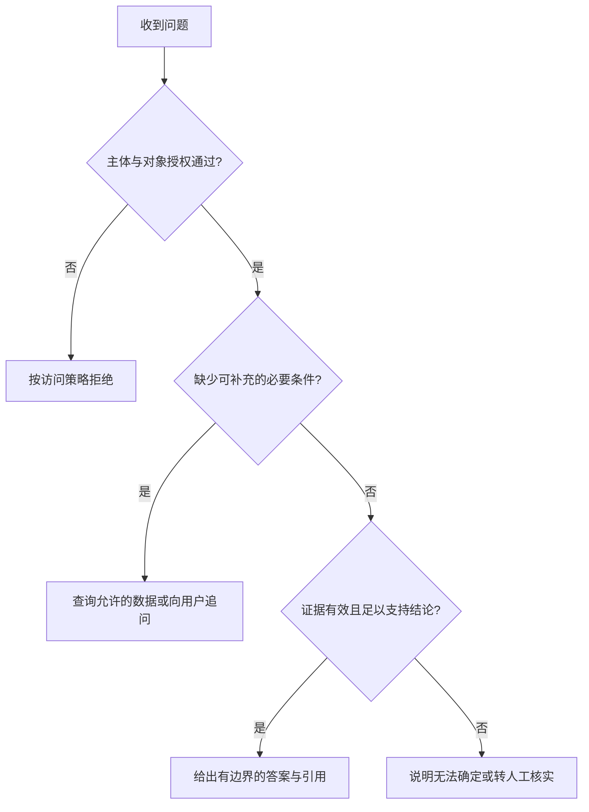

# 模型为什么会自信地答错，什么时候该追问或拒答？

> 流畅表达和高概率输出不能证明事实正确，回答策略应建立在授权、证据与独立验证之上。

## 模型语气很肯定，为什么仍可能没有依据？

客服问：“工单 T-1048 已等待三天，能否自动升级？”

模型回答：“可以，超过三天会自动升级。”句子清楚，也符合常见客服表达，但当前政策实际要求“等待三个工作日，且取得负责人确认”。回答漏掉两个前提，业务含义已经改变。

以常见的自回归语言模型为例，预训练会学习在已有上下文下预测后续 Token。后训练可以改善指令遵循、推理和行为选择，但这些训练不等于每次生成时都核验了当前工单与政策。

模型可能输出训练中常见的说法，也可能误解刚提供的资料。语气肯定只能说明它生成了肯定表达，不能证明它读取了正确来源、满足业务条件，或者已经执行升级。

因此，低温度、严格 JSON 和“请务必准确”分别约束生成方式、结构或任务意图，都不能单独提供事实保证。

## 同样答错，为什么要先区分证据问题？

继续看 T-1048。不同原因需要不同处理，不能统一改成“请重新思考”。

| 问题来源 | 具体表现                             | 首先检查什么                       |
| -------- | ------------------------------------ | ---------------------------------- |
| 证据缺失 | 没有取得工单所属产品，仍套用某条政策 | 缺少的字段或资料是否可以补取       |
| 证据过期 | 引用了已退役政策中的自然日口径       | 来源版本、有效时间与当前适用范围   |
| 证据冲突 | 两份有效资料对升级条件表述不同       | 来源权威性、优先级与适用对象       |
| 证据误读 | 原文写工作日，回答改成自然日         | 关键条件是否进入上下文并被正确表达 |

检索命中不代表证据充分。某段资料与问题很相关，也可能缺少例外条款；模型忠实复述一份过期资料，也仍可能给出错误业务建议。

遇到冲突时，应按业务维护的来源规则处理。没有明确规则，就保留冲突并请求核实，不能让模型按措辞强弱自行决定哪份文件更权威。

检索各阶段的定位方法见 [RAG 故障排查](./ai-rag-retrieval-diagnosis.html)，这里重点讨论取得这些信息后应该怎样决定是否回答。

## 哪些分数看起来像“置信度”，其实不是同一回事？

模型返回 `confidence: 0.95`，很容易让人以为答案有 95% 的概率正确。但这个数字可能只是按提示生成的一段内容。

实际系统中常见四类分数：

| 分数                  | 通常描述什么                                  | 不能直接推导什么         |
| --------------------- | --------------------------------------------- | ------------------------ |
| Token 概率或 logprobs | 给定上下文和解码条件下，某个 Token 的输出概率 | 整段业务结论的正确率     |
| 模型自报 confidence   | 模型按提示生成的自评结果                      | 已经过独立校准的事实概率 |
| 检索或重排分数        | 特定模型衡量的匹配程度                        | 来源真实、有效且足以回答 |
| 分类器概率            | 特定标签在模型中的预测概率                    | 换领域后仍有相同可靠性   |

一句错误的常见说法也可能具有很高的 Token 概率。较低的概率可能来自生僻编号、语言风格或表达差异，不一定意味着事实错误。

检索分数高，则可能只是问题与文本相似。例如问题和资料都反复出现“升级工单”，分数很高，但资料实际适用于另一个产品。

这些信号可以参与评估，前提是用业务样本验证它们与目标错误的关系。不能把不同模型、不同分数范围直接拼成一个统一的“可信百分比”。

## 怎样理解校准，又为什么不能只调低 temperature？

校准关心的是：一组被赋予相似正确概率的预测，其实际正确频率是否接近这个概率。

例如，在明确标注的“政策判断是否正确”任务上，被评分为约 0.8 的一组结果，如果长期只有一半正确，这个评分就过于乐观。

这个关系必须有可核对的标签，并在指定任务、模型和数据分布下判断。某个分数组整体表现良好，也不保证其中某条答案一定正确。

分类校准研究中的 temperature scaling 是对分类分数进行后处理的方法。它和生成 API 中用于调整采样分布的 `temperature` 解决不同问题。

把生成温度从 0.8 调到 0，并不等于完成概率校准。它可能减少措辞变化，也可能更稳定地复述同一个错误。

对于开放式回答，还要先定义“正确”的对象：是工单状态正确、所有政策条件完整，还是答案中每条事实都有依据。标签定义不同，校准结论也不同。

## 回答、追问、拒答和转人工，应该怎样选择？

先做确定性检查，再考虑模型辅助判断：

对 T-1048，可以具体区分：

- **回答**：取得正确产品与当前政策，能核对工作日和确认要求，说明满足了哪些条件。
- **追问**：业务确实需要用户补充某项信息，并且该信息不能从获准的数据源取得。
- **暂不作答**：当前缺少有效政策，明确说明无法据现有证据判断。
- **转人工**：资料冲突、需要负责人裁定，或业务要求由人工确认。
- **权限拒绝**：当前主体无权访问对象，不能因模型“很有把握”而继续检索或输出。

身份和权限来自可信服务端，不能通过追问让用户自行认领一个更高权限身份。拒绝访问时，也应避免泄露对象是否存在等受保护信息。

回答可以限定范围：“记录显示目前仍在等待供应商；是否满足升级条件，还需核对工作日口径与负责人确认。”已经证实的部分和仍未知的部分，应分别表达。

## 拒答更多，为什么不一定意味着系统更好？

下面是一组**教学计数**，用于说明比较方法，并非模型实验结果。

预先固定 100 条已授权请求，其中 80 条具备充分证据，20 条证据不足。比较两个策略：

| 观察项                 | 策略 A          | 策略 B         |
| ---------------------- | --------------- | -------------- |
| 对证据充分的请求作答   | 80 条           | 60 条          |
| 对证据不足的请求仍作答 | 10 条           | 0 条           |
| 正确答案               | 70 条           | 57 条          |
| 错误答案               | 20 条           | 3 条           |
| 未作答                 | 10 条           | 40 条          |
| 回答覆盖率             | 90 / 100 = 90%  | 60 / 100 = 60% |
| 已回答样本的错误率     | 20 / 90 ≈ 22.2% | 3 / 60 = 5%    |

策略 B 的已回答错误率更低，但它也拒绝了 20 条原本可以回答的问题。只公布“错误率从 22.2% 降到 5%”，就隐藏了覆盖率下降的代价。

还应分别检查证据不足时是否适当保留、证据充分时是否误拒，以及高风险错误是否被拦住。业务可以选择更保守的策略，但需要知道因此失去了多少有效服务。

安全拒绝与任务成功也要按用例定义。对越权请求，拒绝可以是预期成功；对有权且证据充分的状态查询，无故拒绝则没有完成任务。

超时、异常和空回答应单独计数，不能统统包装成“安全拒答”，借此美化错误率。

## 判断规则怎样验证，才能避免越调越像训练题？

至少区分三种用途：

1. 开发样本用于分析错误、调整提示和证据供给。
2. 校准或验证样本用于选择分数映射、阈值和回答策略。
3. 冻结测试样本用于在方案确定后评估最终表现。

同一工单的不同问法、同一政策的近重复条款，应按来源家族分组切分。否则模型或规则已经在开发阶段接触过答案，测试分数会被抬高。

标注也要允许“无法判定”。两名审核者对适用政策有分歧时，应先澄清业务口径，不能强行选一个标签来凑齐数据。

关键分组分别报告：正常状态查询、例外条款、过期资料、来源冲突、证据不足和权限拒绝。整体平均值可能掩盖某一类请求持续失效。

模型、提示、检索配置和政策版本变化后，需要检查原来的评分关系是否仍成立。线上出现新输入分布时，也应重新抽样核对，而不是永久沿用一个 0.8 阈值。

模型自评可以作为候选信号。特定研究在指定任务和格式下观察到有用的自评能力，但这不能推广为任意模型对新领域都能可靠识别自身错误。

## 小结

1. 肯定语气、高概率 Token 和合法 JSON 都不能证明事实正确，结论仍需有效证据支持。
2. 缺证据、旧证据、来源冲突和条件误读需要分别定位，增加思考不能替代事实供给。
3. 自报置信度、logprobs 与检索分数含义不同，只有经过目标任务验证才能参与决策。
4. 授权先于回答判断，追问、保留结论和转人工应对应具体缺口。
5. 比较策略同时看回答覆盖率、已回答错误率、误拒和关键风险，冻结测试集避免反复调题。

## 参考

综合仓库 `docs/` 下的模型运行机制、大模型评测与证据处理资料，交叉整理概率信号、事实核验和回答策略。修正了将 Token 概率直接解释为事实正确率、将少答等同于高质量的过度概括。

- [On Calibration of Modern Neural Networks](https://arxiv.org/abs/1706.04599)——于 2026-11-21 核对论文摘要，确认研究对象为分类概率校准，不把其方法直接推广为生成答案的事实保证。
- [Language Models (Mostly) Know What They Know](https://arxiv.org/abs/2207.05221)——同日核对论文摘要，保留自评结果对任务、格式和分布的依赖。
- [Attention 与生成边界](./ai-transformer-attention.html)、[RAG 故障排查](./ai-rag-retrieval-diagnosis.html)——衔接模型表示与实际证据核验。
- [AI 评测集设计](./ai-evaluation-dataset.html)、[评测发布门槛](./ai-eval-ci-release-gates.html)——衔接样本切分、版本记录和发布判断。

本文案例、分数与计数均为教学构造，未调用真实模型，未执行校准或回答策略效果实验。
