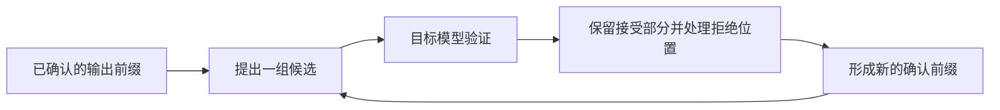

# 推测解码与 Prefill/Decode 分离分别解决什么瓶颈？

> 先判断慢在逐步生成，还是输入处理干扰了输出，再选择草稿验证或阶段分离；新增组件的开销也必须进入同一份比较。

## 用户说“慢”，为什么不能直接选一种加速技术？

假设一个助手处理两类请求：长材料分析与短问题问答。

有时输入很短，却生成很长的回答，每个字都来得慢；有时已经开始输出，另一批长材料进入后，原回答忽然停顿；还有时是应用队列或代理缓冲导致用户看不到内容。

这些现象需要不同证据。推测解码主要改变逐步生成的方式；Prefill/Decode 分离主要改变两个阶段的部署与资源组织；应用排队和网络缓冲则可能需要另行处理。

| 优化                | 主要改变什么                    | 应先确认的瓶颈                     |
| ------------------- | ------------------------------- | ---------------------------------- |
| 连续批处理          | 每个调度边界参与执行的请求      | 固定批次导致资源难以及时复用       |
| 推测解码            | 候选 Token 的提出与目标模型验证 | 逐步 decode 的串行等待及计算利用   |
| Prefill/Decode 分离 | 两个阶段的资源与部署位置        | 输入处理干扰输出，资源配置互相牵制 |

本文只讲原理与方案，案例均为教学推演，没有部署模型或执行性能实验。阶段与指标定义见[推理延迟](./ai-llm-inference-latency.html)。

## 推测解码为什么可以一次推进多个 Token？

普通自回归生成中，后一个 Token 依赖前面已经确定的内容。简单实现往往要让目标模型逐步计算，串行推进。

推测解码引入一个相对便宜的候选生成过程，先提出一串可能的后续 Token，再由目标模型检查这些候选。如果候选与目标模型相符，就可能通过一次验证推进多个位置。

候选可以来自草稿模型，也可以来自适用的其他提出方式。使用哪种方式，取决于目标模型、引擎与任务支持情况，不能把所有实现都解释成“旁边再放一个小模型”。



它没有让目标模型跳过真实性要求或业务校验。被验证的是生成规则下的候选，不是回答已经具备正确的事实依据。

## 草稿被拒绝时，后面的内容还能直接接上吗？

假设草稿提出四个候选：`A、B、C、D`。在一个简化的教学例子中，目标验证接受前两个，却不接受第三个。

此时不能保留第四个候选直接拼接，因为它是在包含 `C` 的草稿前缀下产生的。应按所用算法处理拒绝位置，丢弃不再适用的后续草稿，再继续提出候选。

```text
候选：A B C D
验证：✓ ✓ ×
确认：A B + 按目标算法确定的后续 Token
下一轮从新的确认前缀继续
```

这里的“接受”不能统一理解成两个模型只比较各自概率最大的词。贪婪解码和随机采样的验证规则不同；保持目标采样分布需要配套的接受与重采样机制。

客户端通常只应收到已经确认的内容。若产品另外展示推测草稿，需要独立标识可撤回状态，不能把未经验证的文字当成已交付的最终答案。

## “无损”为什么不等于每次返回一模一样的句子？

经典推测解码研究的一个目标，是在特定算法条件下保持目标模型的输出分布，同时减少串行等待。

分布保持与逐次运行的文本完全一致是不同保证。随机序列、采样设置、数值精度、批次形状和实现差异，都可能影响实际输出。

本次读取的 vLLM 文档将无损说明限定到标准拒绝采样器，并另外列出放宽验证、明确标为 lossy 的方法。不能只看功能名称中有“Speculative”，就推断所有模式都提供相同保证。

因此，验证时应确认：

- 使用哪一种候选与验证算法，是否保持目标分布。
- 目标模型、采样器和输出约束怎样配置。
- 贪婪一致性、采样表现与业务质量分别怎样检查。
- 数值和批次变化对实际运行结果有什么限制。

相同 seed 或温度设置也不能跨硬件与实现保证逐字相同。模型输出仍需通过结构、事实、权限和工具约束，推测验证不替代这些检查。

## 草稿越长，为什么未必越快？

草稿越长，可能一次推进更多内容，也可能增加草稿计算、目标验证、缓存管理和拒绝后的额外工作。

如果任务中两个模型的预测经常不一致，大量候选被丢弃，就可能没有抵消新增开销。高并发时，草稿模型还可能与目标模型竞争设备和缓存。

可将比较问题概括为：产生这些已确认输出所花的草稿、验证和调度总时间，是否低于原方案完成相同工作所需的时间。

接受率值得观察，但不能单独代表加速。例如两种配置接受比例相近，草稿耗时或验证批次不同，最终时延仍可能不同。

本次 vLLM 文档将中低 QPS、访存受限的场景作为一类应用起点，并列出多种方法及其限制。实际收益仍需按负载验证，不能直接套用论文中的历史加速倍数。

## Prefill/Decode 分离，究竟分开了什么？

Prefill 处理输入并建立必要的 KV 状态；decode 使用对应状态持续生成。混合部署可以让两类工作共享资源，但也会相互干扰。

阶段分离将它们放在不同实例或设备池，让两边采用适合自己的资源与调度策略。


它不是把输入文本发给另一台机器就完成了切换。decode 必须使用与输入和模型计算相匹配的状态，接力过程还需要明确的请求关联。

分离后可以减少长输入对持续输出的干扰，但也新增了两端排队、路由、传输、容量匹配与恢复问题。

## KV 传输需要核对哪些兼容条件？

至少应检查模型权重与修订、Tokenizer、输入渲染、实际 Token 序列、位置处理、适配器、KV 表示与精度，以及分片布局和连接器支持。

两边都宣称“兼容同一种聊天 API”，并不证明内部缓存可以直接互用。重新渲染得到不同的输入序列时，即使用户问题文字相同，也不能随意套用另一份 KV。

缓存句柄需要绑定实际请求、执行代次与授权范围，避免错取其他请求或其他租户的状态。失败、取消和超时还要处理暂存缓存的归属与回收。

本次 vLLM 实验文档介绍了通过连接器传输状态，以及在特定路径上复用 prefill Token ID 的能力。这是具体版本的功能，不能推广成任意两个模型服务之间的通用协议。

KV 的容量估算与结构差异见[权重与 KV Cache](./ai-model-memory-quantization.html)。

## 分离减少了干扰，为什么总耗时仍可能更大？

对一个简化请求，可以把首个有效输出之前的等待拆成：

```text
应用与路由等待
+ prefill 排队与计算
+ KV 传输和接入等待
+ decode 排队与首个输出计算
+ 网络及客户端展示
```

如果一份假设的缓存有 2 GiB，实际有效传输带宽为每秒 20 GiB，仅传输数据的理想下界就是 0.1 秒。这个教学算术还没有加入固定通信、调度、复制或拥塞开销。

prefill 池更快以后，decode 池若已经饱和，新的等待只会积累到后面。资源比例、流量和网络条件不合适时，额外路径可能抵消隔离收益。

所以，分别部署不等于整体吞吐必然提升。本次 vLLM 实验页面明确提示该功能不提供吞吐提升；DistServe 论文摘要讨论的则是在指定 TTFT、TPOT 目标与带宽配置下优化有效服务能力。两者都需要保留各自的适用条件。

不能把“阶段可以独立调参”理解成“最终时延彼此完全无关”，同一个用户的端到端请求仍经过整个链路。

## 这两种优化能不能一起开启？

从职责上看，两者可以关注不同环节，但具体实现是否能组合，需要核对版本、模型、缓存、调度与连接器的支持。

草稿与目标验证可能需要额外缓存，阶段分离又要传输和管理相应状态。简单地同时开启选项，可能遇到不支持的布局或把瓶颈转移到通信与内存。

可以先建立未优化基线，再分别观察推测解码、阶段分离的收益；只有两个单独方案都明确后，才比较组合配置。

优先处理应用排队、代理缓冲或明显的上下文冗余，也可能比增加推理组件更直接。调度层的问题可对照[连续批处理](./ai-inference-continuous-batching.html)。

## 对照方案应该保存哪些证据？

在相同硬件预算、模型与质量条件下，固定输入输出长度分布、到达率、并发限制及缓存冷热，分别比较：

| 方案     | 除通用指标外，还要检查什么                                 |
| -------- | ---------------------------------------------------------- |
| 推测解码 | 草稿耗时、接受与拒绝情况、已确认输出量、额外显存及质量变化 |
| 阶段分离 | 两端排队、KV 传输量与耗时、缓存兼容、池间利用率及失败恢复  |
| 组合方案 | 特性兼容与新增资源开销，是否仍满足原质量及时延目标         |

通用指标包括首个可见内容、输出间隔、总时延、吞吐、有效吞吐，以及超时、拒绝与取消数量。展示成功请求的时延时，要同时给出未成功请求的数量与原因。

自建服务还应保留引擎与连接器版本。若只是使用托管 API，没有暴露相关开关和内部指标，就不能仅凭客户端更快或更慢，断言供应商启用了其中某种技术。

本文只提供实验设计，没有执行这些对照，也没有宣称某个模型、设备或连接器获得了实际性能提升。

## 小结

1. 推测解码通过候选与目标验证改变逐步生成，阶段分离改变 prefill、decode 的资源与部署组织。
2. 保持采样分布依赖具体验证算法，不能推广为所有模式逐字一致，更不提供事实正确保证。
3. 草稿、拒绝、验证和额外缓存都有成本，接受率不能单独代表整体收益。
4. 阶段接力要求输入与 KV 兼容，还要计入两端排队、传输和资源比例，不能保证吞吐必增。
5. 固定质量、硬件与负载分别比较单项和组合方案，用用户时延与有效吞吐判断价值。

## 参考

综合仓库 `docs/` 下的模型运行机制和部署资料，结合站内推理延迟、缓存估算与连续调度篇整理。将采样优化与资源分离分别分析，纠正了草稿越长必然越快、分布保持即逐次文本相同，以及多开一个阶段服务必然提高吞吐的概括。

- [Fast Inference from Transformers via Speculative Decoding](https://arxiv.org/abs/2211.17192)——于 2026-11-21 核对论文摘要中的候选验证与目标分布保持，不搬用其历史性能数字。
- [vLLM：Speculative Decoding](https://docs.vllm.ai/en/stable/features/speculative_decoding/)——同日读取原文，核对方法范围、标准拒绝采样的无损说明、数值限制和有损模式的区别。
- [DistServe: Disaggregating Prefill and Decoding for Goodput-optimized Large Language Model Serving](https://arxiv.org/abs/2401.09670)——同日核对摘要中的阶段干扰、时延目标、资源配置与带宽条件。
- [vLLM：Disaggregated Prefilling](https://docs.vllm.ai/en/stable/features/disagg_prefill/)——同日读取实验功能原文，核对缓存接力、输入对齐及吞吐提示，具体能力随版本变化。

示例、缓存容量和带宽均为教学假设，未运行草稿模型、目标模型、KV 传输、GPU 服务或性能压测。
