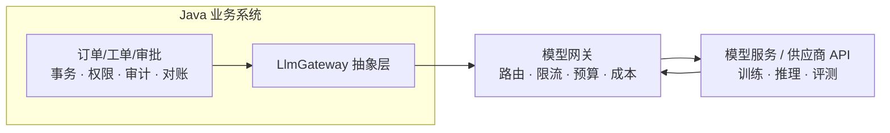
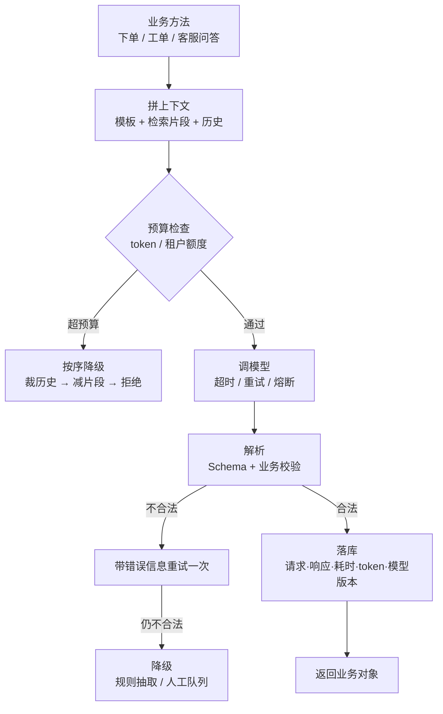

# Java 后端怎么接大模型？Spring AI、LangChain4j 和直连 HTTP 怎么选？

> 一句话点题：先定边界、再定抽象层，框架只是抽象层里的实现细节——选错的代价不是慢，是半年后没人敢动。

面试问"你们用什么框架接大模型"，真正在考三件事：**为什么业务留在 Java、抽象层怎么留后路、超时重试成本密钥这些工程点有没有真踩过**。网关、多模型路由、Fallback、评测、成本归因那一整套已经在 [AI 应用工程化](/ai/ai-application-engineering.html) 里讲透，这篇不重复结论，只讲 Java 侧的选型口径和代码怎么长。

## 三条路先摆在一起看

| 路线        | 一句话定位                                        | 典型依赖                                            | 适合谁                                     |
| ----------- | ------------------------------------------------- | --------------------------------------------------- | ------------------------------------------ |
| 直连 HTTP   | 自己拼 JSON、自己解 SSE，最可控也最费工           | `RestClient` / `WebClient` + Jackson                | 调用点少、只要 chat、不想背框架升级        |
| Spring AI   | 把模型调用做成 Spring 的一个 bean，同源于既有体系 | `spring-ai-starter-model-openai`（或对应 provider） | 已是 Spring Boot，要 Advisor/RAG/工具/指标 |
| LangChain4j | 用接口声明模型能力，像写 Feign 一样写 AI 服务     | `langchain4j`、`langchain4j-*-spring-boot-starter`  | 要做编排、多 provider、RAG 链路长          |

### 直连 HTTP：可控，但脏活全自己干

```java
// 同步：RestClient（Spring 6.1 起，阻塞式，比 RestTemplate 顺手）
ChatResp resp = restClient.post().uri("/v1/chat/completions")
        .header(AUTHORIZATION, "Bearer " + apiKey)
        .body(new ChatReq(model, messages, 0.2, 800)).retrieve().body(ChatResp.class);
// 流式：WebClient 按 SSE 事件切开，但每个事件的内容要自己解
Flux<String> tokens = webClient.post().uri("/v1/chat/completions")
        .bodyValue(new ChatReq(model, messages, 0.2, 800, true)).retrieve()
        .bodyToFlux(String.class)      // text/event-stream 下逐条 data 到达
        .takeUntil("[DONE]"::equals)   // 少这行连接会一直挂着
        .map(this::deltaOf);           // 自己从 choices[0].delta.content 取字
```

好处是依赖最少：出问题一眼看到 HTTP 那一层，供应商加个新参数当天就能用，协议本身也不会因为框架大版本升级而变。代价是所有脏活自己干——**流式解析**（一个事件被 TCP 拆两半、空 delta、缺 `[DONE]`）、**工具调用的多轮循环**、**结构化输出的 Schema 生成与校验重试**，写完还得自己测。流式那些坑在 [流式输出怎么落到后端](/ai/ai-streaming-sse-backend.html) 里单独拆过。

### Spring AI：把模型调用变成 Spring 的一部分

```java
ChatClient client = ChatClient.builder(chatModel)            // 也可 ChatClient.create(chatModel)
        .defaultSystem(promptTemplate.render())              // 模板版本随请求记录
        .defaultAdvisors(
                MessageChatMemoryAdvisor.builder(chatMemory).build(),  // 多轮记忆
                QuestionAnswerAdvisor.builder(vectorStore).build(),    // RAG
                new SimpleLoggerAdvisor())                             // 输入输出进日志
        .build();

String answer = client.prompt().user(q).call().content();
Flux<String> stream = client.prompt().user(q).stream().content();
OrderExtract out = client.prompt().user(text).call().entity(OrderExtract.class);
```

`ChatClient` 是外层 fluent API；**Advisor 是拦截链**，记忆、RAG、日志、内容安全挂在上面，一次装配全链路生效，顺序还有意义（记忆要在 RAG 之前读到历史）。`ToolCallback` 把带 `@Tool` 的方法暴露给模型，`VectorStore` 抽象掉向量库差异，MCP client 让工具来自外部 server，Observation 自动接上 Micrometer 指标与 trace。它的真正优势不是 API 短，是**和现有体系同源**：自动配置、`@MockBean`、Actuator、Micrometer 都是团队已经会的东西。

> 版本口径要盯住：0.8 / 里程碑版本里工具回调叫 `FunctionCallback`，1.0 起是 `ToolCallback` / `@Tool`，装配从"注册 `@Bean`"变成 `.tools(...)`。网上大量中文教程还停在老 API，照抄编译不过不怪你。

### LangChain4j：声明式接口，像 Feign 那样写模型

```java
interface OrderAssistant {
    @SystemMessage("你是订单抽取助手，只输出 JSON，不要解释。")
    @UserMessage("从下面文本里抽取订单信息：{{text}}")
    OrderExtract extract(@V("text") String text);          // 返回 POJO 自动反序列化
    TokenStream chat(@MemoryId String sessionId, @UserMessage String question);
}

OrderAssistant assistant = AiServices.builder(OrderAssistant.class)
        .chatModel(chatModel)                 // 1.0 之前叫 ChatLanguageModel
        .streamingChatModel(streamingModel)
        .chatMemoryProvider(id -> MessageWindowChatMemory.withMaxMessages(20))
        .tools(new OrderTools())              // @Tool 方法直接挂
        .contentRetriever(retriever)          // 内置 RAG：检索 + 拼上下文
        .build();
```

把"模型能力"声明成接口、实现由 `AiServices` 生成：`@SystemMessage` / `@UserMessage` / `@V` 管 Prompt 与变量，`@MemoryId` 管会话，返回值是 POJO 就自动做 JSON 反序列化。内置 RAG（`ContentRetriever` / `RetrievalAugmentor` / `EmbeddingStore`）和 tools，provider 覆盖广。它的气质偏**编排**：一次调用里把检索、记忆、工具、结构化输出串成一条链。

> 版本口径：1.0 把 `ChatLanguageModel` 改名 `ChatModel`、`StreamingChatLanguageModel` 改名 `StreamingChatModel`，`AiServices.builder().chatLanguageModel(...)` 的老写法在新版编译不过。

### 选型维度表

| 维度           | 直连 HTTP          | Spring AI                   | LangChain4j                 |
| -------------- | ------------------ | --------------------------- | --------------------------- |
| 团队栈         | 任何               | 已在 Spring Boot            | Spring 或纯 Java 都行       |
| 抽象层次       | 无，自己定         | 中，ChatClient + Advisor    | 高，声明式接口              |
| 流式           | 自己解 SSE         | `.stream()` 返回 `Flux`     | `TokenStream` 回调          |
| 工具调用       | 自己写多轮循环     | `ToolCallback` / `@Tool`    | `@Tool` + `AiServices`      |
| RAG 内置       | 无                 | `VectorStore` + Advisor     | `ContentRetriever` + 摄取器 |
| 可观测         | 全靠自己埋         | Micrometer Observation 开箱 | 要自己接                    |
| 版本成熟度     | 最稳（HTTP 不变）  | 1.0 GA，API 仍在演进        | 1.0 GA，beta 期很长         |
| 多模型切换成本 | 高（每家一套解析） | 中（换 starter + 配置）     | 低（换 model 实现）         |

**框架选型不是技术优劣，而是"你的团队能不能在半年后还维护得动"。** 团队连 Spring Boot 自动配置都没摸透，上声明式接口只会在出问题时多一层看不懂；反过来，要同时接三家供应商还要 RAG，直连 HTTP 会把适配代码写成第二个框架。

## 为什么业务侧留在 Java，Python 只到模型边界为止

Python 强在模型侧：训练微调、推理框架、评测脚本、实验生态都在那边。但业务系统真正难的不是调模型，是**事务、权限、审计、对账、幂等**——这些在 Java 侧已经跑了十年，连接池、分布式事务、权限模型、消息重试都是现成的。为了调个 HTTP 接口把业务搬到 Python，等于把这些资产重写一遍。跨语言调用只该出现在"模型服务"这个边界上，不该让业务代码用 `ProcessBuilder` 去拼 Python 脚本：那种写法没有超时、没有结构化错误、没有资源回收，排查还要跨两个运行时。



边界上的责任要切干净：Java 侧管"什么时候该问、问什么、结果能不能用"；网关管"用谁问、花多少钱、失败怎么办"；模型侧管"模型本身跑得好不好"。三段不越界，换模型、换框架、换供应商才不会把业务代码拖下水。补一句实话：团队本身就是 Python 栈时，这套边界会整体前移，但"业务逻辑不直接拼模型 SDK"这条不变，它保的是可测试性，不是语言立场。

## 抽象层：自己定义 LlmGateway，给未来留后路

```java
public interface LlmGateway {
    LlmResult chat(LlmRequest req);                          // 同步
    Flux<LlmChunk> stream(LlmRequest req);                   // 流式
    ToolCallResult toolCall(LlmRequest req, List<ToolSpec> tools);
    float[] embed(String text);                              // 向量化，RAG 用
}

// DTO 只放业务语义，不放任何 provider / 框架类型
record LlmRequest(String scene, String tenantId, List<Msg> messages, int maxOutputTokens,
                  String modelTier, String promptVersion, String idempotencyKey) {}
record LlmResult(String content, Usage usage, String modelVersion, long latencyMs) {}
```

`modelTier` 取 `fast` / `balanced` / `flagship`，**不是具体模型名**——业务说"要快、要便宜"，注册表决定今天映射到哪个真实模型，升级只改注册表加灰度。做对了收益很具体：换供应商从"改 30 个类 + 30 处测试"变成"加 1 个实现 + 1 行配置"。三条纪律，缺一条抽象层就白做：

1. **签名里不出现框架类型**。把 `org.springframework.ai.chat.model.ChatResponse` 或 `dev.langchain4j...ChatMessage` 放上接口，换框架时照样改 30 个类——你只是把供应商耦合换成了框架耦合。
2. **一个适配器一个类**：`SpringAiLlmGateway` / `LangChain4jLlmGateway` / `RestLlmGateway`，用 `@ConditionalOnProperty` 按配置装配，切换改一行配置。
3. **usage / 模型版本 / 耗时必须回传**。这三样是成本归因和排查的原材料，适配器不返回，上层永远只能猜。

## 一次请求在 Java 侧要走的完整链路



这条链路里只有 **D 是框架管的部分**，B/C 是你的业务，E/H 是你的数据。所以选框架别只看 D 写得爽不爽——B/C/E/H 它通常帮不上多少忙。这也是为什么抽象层比框架选型更值钱。

## 配置项清单：每一条都有配错的后果

| 配置                | 建议口径                               | 配错的后果                                                   |
| ------------------- | -------------------------------------- | ------------------------------------------------------------ |
| 连接超时            | 500ms ~ 2s                             | 配成 30s，供应商抖动时 Tomcat 线程池被占满，整个服务跟着雪崩 |
| 读超时（非流式）    | 30 ~ 60s，按场景                       | 太短正常长回答被掐断；太长故障时线程长时间挂住               |
| 流式超时            | 单独一套：首字节 + 相邻 chunk 间隔     | 沿用非流式读超时，回答到第 31 秒断流，前端只看到半句话       |
| 最大重试次数        | 0 ~ 1 次，且只在"响应未开始"时重试     | 生成不是幂等操作，重试会重复计费并可能落库两份结果           |
| 并发 / 限流         | 按租户 + 按 Token 双桶                 | 只按 QPS 限，80K Token 的大请求把配额打满，小请求全 429      |
| 最大输出 token      | 按场景给上限（抽取 500、报告 2000）    | 不设上限模型能写 4000 字，成本翻倍还挤爆上下文               |
| temperature / top_p | 抽取分类用 0~0.2，创意写作用 0.7+      | 抽取任务用 0.7，同一段文本两次结果不同，回归测试永远飘       |
| 模型版本            | 固定到带日期的快照，不用 `latest` 别名 | 供应商静默升级，Prompt 没改指标却变了，根本查不出来          |

> 采样参数有个坑：部分新模型用 `max_completion_tokens` 取代 `max_tokens`，推理类模型还不接受 `temperature` / `top_p`，传了直接 400。Token 与参数口径见 [大模型到底怎么调](/ai/ai-llm-basis.html)，配置按模型能力分组维护，别一份 DTO 打天下。

## 上下文与成本：Java 侧能动手的五个地方

**一、历史裁剪**。滑动窗口、摘要、只留结构化事实，按场景选；最省事的实现是"先保事实、再从近到远补"：

```java
List<Msg> trimHistory(List<Msg> history, int budget) {
    List<Msg> kept = new ArrayList<>(factsOf(history));  // 订单号/金额/日期优先，丢了模型就瞎猜
    int used = estimateTokens(kept);
    for (int i = history.size() - 1; i >= 0 && used + estimateTokens(history.get(i)) <= budget; i--) {
        used += estimateTokens(history.get(i));
        kept.add(1, history.get(i));                     // 从近到远补，补不下就停
    }
    return kept;
}
```

**二、RAG 片段预算**。`topK × 单片长度` 要跟总预算绑定，别让检索把上下文吃满，切分与召回的取舍见 [RAG 从切分到召回怎么做才不翻车](/ai/ai-rag.html)。

**三、Prompt 模板版本化**。模板放仓库或 DB，带 `version` + `hash`，改模板走评测再上线，日志记版本号。模板改一次全量行为跟着变，没有版本号就无法回滚、也无法解释"为什么昨天好好的"。

**四、缓存**。可缓存：分类、抽取、翻译、固定 FAQ；不可缓存：依赖实时状态的（订单当前状态）、强个性化的（用户画像）。key 必须含 `modelVersion + promptVersion + 归一化输入`，否则模型升级后还在命中旧答案，看着省钱实际在返回过期结果。

**五、Token 计量**。输入输出分别计价，用供应商 `usage` 对账，别拿字符数估算当账单；缓存命中的 token 单独记一栏，不然成本分析会把省下的钱算成浪费。

## 结构化输出在 Java 侧的落法

```java
public <T> T extract(String text, Class<T> type) {
    LlmResult first = gateway.chat(LlmRequest.extract(text, type, "extract-v3"));
    try {
        return validate(json.readValue(stripFence(first.content()), type));  // 先剥围栏标记
    } catch (Exception e) {                                                 // 缺字段/枚举越界都在这
        LlmResult retry = gateway.chat(LlmRequest.extract(text, type, "extract-v3").withRepairHint("上次输出不合法：" + e.getMessage() + "，请只返回修正后的 JSON"));
        return validate(json.readValue(stripFence(retry.content()), type));  // 再败抛出去走降级
    }
}
```

1. **Schema 约束**：能开 provider 的 `json_schema` 严格模式就开，但严格模式只支持 JSON Schema 子集，`minLength`、`pattern` 之类未必生效，别指望它替你做业务规则。
2. **反序列化 + 业务校验 + 带错重试一次**：`@NotNull`、枚举白名单、数值范围、唯一键回查；失败时把异常信息塞回去重试，比"请重新输出"有效得多。
3. **再失败降级**：规则抽取或人工队列，绝不返回半个对象。

三条铁律：**模型输出不当 SQL、不当 shell 命令、不当路由 key 或白名单之外的枚举**。模型给的业务 ID 必须回库确认存在——这些位置一旦被"猜"出来的值占住，就是注入和越权。Prompt 与 Schema 怎么写见 [Prompt 工程和结构化输出怎么落地](/ai/ai-prompt-structured-output.html)，这边只讲 Java 里怎么接。

## 密钥、脱敏与审计

- **密钥**：放 KMS / Vault，由部署平台以环境变量注入，Spring 里就是 `api-key: ${OPENAI_API_KEY}`。不进 Git，也不进配置中心明文；每环境一套、按场景分 key（便于计费和单独吊销）；轮换走"双 key 并存 → 切流量 → 吊销旧的"。
- **脱敏**：手机号、身份证、地址、姓名在出网关前替换成占位符，返回后按 mapping 回填，mapping 只活在本次调用的内存和 trace 里（手法见 [数据脱敏与加密](/system-design/security/security-data-masking-encryption.html)）。
- **审计**：谁（userId / tenantId）、什么模型和版本、输入摘要（不是全文）、输出、耗时、token、费用、是否命中缓存；高危场景（法务、医疗、金融）还要记人工复核。
- **条款**：确认数据是否用于训练、是否支持零留存、存在哪个区域；私有化部署要确认权重与日志归属——这是接口设计时就得定的，不是合规部门单方面的活。

## 可观测：一次调用要能回答五个问题

| 字段                                        | 回答什么问题                                 |
| ------------------------------------------- | -------------------------------------------- |
| `traceId` / `spanId` / `scene` / `tenantId` | 这次调用在哪条业务链路、哪个功能、哪个租户   |
| `model` + `modelVersion` + `promptVersion`  | 用的哪个快照，行为变化是模板改的还是模型换的 |
| `input` / `output` / `cached` token         | 成本花在输入还是输出、缓存有没有省到         |
| `ttftMs` / `latencyMs`                      | 首字延迟与总耗时，配合 P95 看容量            |
| `retryCount` / `errorCode`                  | 是不是在靠重试硬撑、失败属于哪一类           |

Spring AI 的 Observation 默认就埋了模型调用的 span，接上既有 traceId 就能和业务日志串起来。三层口径跟 [可观测三支柱](/high-availability/high-availability-observability-pillars.html) 一致：metrics 看趋势（P95 延迟、失败率、单位成本），traces 看单次，logs 看细节。

## 测试策略：别让模型进单测

- **单测 mock `LlmGateway`**：测超时分支、解析失败重试一次、降级路径、预算拒绝——纯逻辑，模型不参与，CI 也不依赖外部 API。集成测试用 WireMock 挡在 HTTP 层或录制回放 fixture，重点覆盖脏数据：SSE 事件被拆成两包、空 delta、缺 `[DONE]`、返回 HTML 错误页、429 带 `Retry-After`。
- **Prompt 回归靠评测集**：断言"JSON 合法 + 字段齐 + 枚举合法 + 关键事实命中"，别 `assertEquals("好的，以下是……")`。模型输出本来就不稳定，断言字符串的唯一结果是有人把测试注释掉。评测集怎么建见 [AI 应用工程化](/ai/ai-application-engineering.html)。

## 面试怎么答

按这个顺序说，四句话就能对上岗位描述：

1. **先划边界**：业务在 Java，模型在服务外，中间隔一层网关；业务代码不直接拼模型 SDK，也不把业务逻辑塞进 Python 脚本。
2. **再说三条路和取舍**：直连 HTTP 可控但脏活全自己干；Spring AI 胜在和 Spring 体系同源（自动配置、Observation、测试）；LangChain4j 胜在声明式接口与编排、provider 覆盖广。选哪个看团队半年后还维护不维护得动。
3. **然后说抽象层**：自定义 `LlmGateway`（chat / stream / toolCall / embed），provider 适配器实现它，`modelTier` 绑层级不绑模型名。
4. **最后补五个工程点**：超时（流式单独配）、重试（生成非幂等，靠幂等键去重）、成本（预算 + 分级 + 缓存）、密钥（KMS + 脱敏）、审计（trace + 落库）。

加分的一句：**"我们不是选了个框架就完事，是让换模型这件事只改一个类。"**

## 容易踩的坑

- **业务代码直接 `new OpenAiApi(...)`**：三个月后模型升级，全仓库改 model 名；换供应商等于重写。
- **抽象层签名里塞框架类型**：接口上挂 `ChatResponse`，等于把供应商耦合换成框架耦合，白抽一层。
- **流式沿用非流式超时、重试不看是否已开始返回**：前者把长回答掐断，后者让前端看到重复段落还多付一次钱。
- **`latest` 别名当版本 / 把 `max_tokens` 当性能参数**：前者行为漂移时没法定位，后者在抽取场景纯属烧钱。
- **密钥进配置中心明文 / 审计只存最终答案**：前者等于把 key 撒出去，后者让你既查不出问题也说不清钱花在哪。

## 小结

1. **先定边界再选框架**：业务留在 Java（事务、权限、审计、对账），模型调用抽成 `LlmGateway`，Python 只到模型服务边界为止。
2. **三条路各有位置**：直连 HTTP 最可控但脏活全自己干；Spring AI 胜在和 Spring 体系同源（Advisor、ToolCallback、VectorStore、Observation）；LangChain4j 胜在声明式接口与编排。选型看可维护性，不看 API 短不短。
3. **抽象层是核心资产**：接口只放业务语义（`scene`、`modelTier`、`promptVersion`、`idempotencyKey`），适配器一实现一装配，换模型从改 30 个类变成改 1 个实现。
4. **工程细节决定能不能上生产**：流式超时单独配、重试要防重复计费、输出 token 设上限、模型版本固定快照、限额按 Token 而不只按 QPS。
5. **密钥、脱敏、审计是接口设计的一部分**：KMS/Vault 注入、PII 出网前替换、每次调用落 traceId + 模型版本 + token + 费用；结构化输出永远走"Schema + 业务校验 + 重试一次 + 降级"。

## 参考

- 综合 Spring AI 官方文档（`ChatClient`、Advisor、ToolCallback、Observation）、LangChain4j 官方文档与 1.0 迁移说明、OpenAI 结构化输出与参数文档，交叉验证后用自己的话重写
- 核对点：`FunctionCallback` → `ToolCallback` 的版本分界、`ChatLanguageModel` → `ChatModel` 的重命名、严格 JSON Schema 只支持子集、`max_tokens` 与 `max_completion_tokens` 的差异、流式超时须与非流式分开配置
- 站内口径对齐：Token、采样参数与上下文窗口引用 [大模型到底怎么调](/ai/ai-llm-basis.html)，结构化输出与校验重试引用 [Prompt 工程和结构化输出怎么落地](/ai/ai-prompt-structured-output.html)；网关与成本结论不在此重复。时效性说明：框架 API 与供应商参数仍在演进，版本号、starter 名称与参数名以官方文档最新版本为准，工程里通过配置与注册表维护
