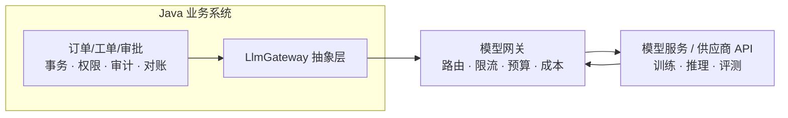
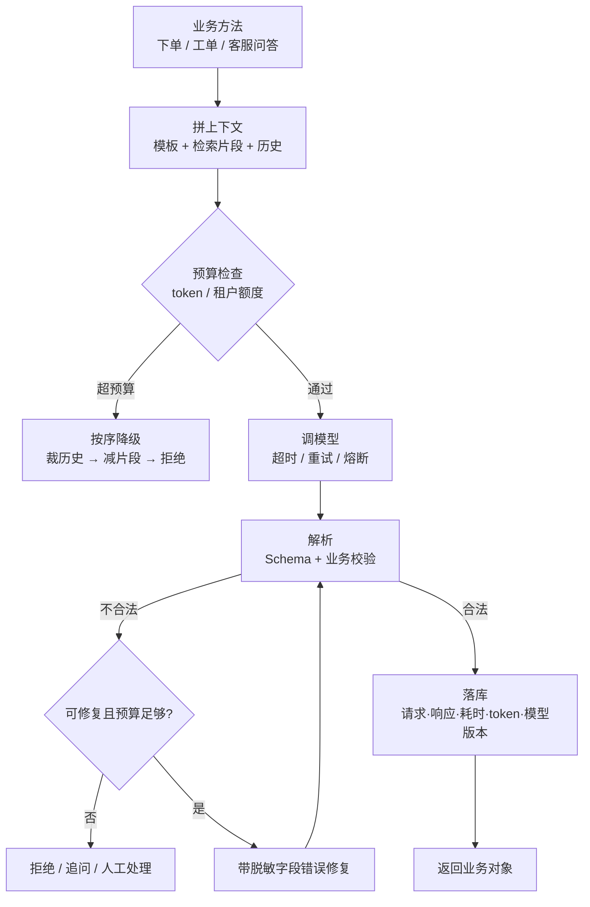

# Java 后端怎么接大模型？Spring AI、LangChain4j 和直连 HTTP 怎么选？

> 一句话点题：先定边界、再定抽象层，框架只是抽象层里的实现细节——选错的代价不是慢，是半年后没人敢动。

面试问"你们用什么框架接大模型"，真正在考三件事：**为什么业务留在 Java、抽象层怎么留后路、超时重试成本密钥这些工程点有没有真踩过**。网关、多模型路由、Fallback、评测、成本归因那一整套已经在 [AI 应用工程化](/ai/ai-application-engineering.html) 里讲透，这篇不重复结论，只讲 Java 侧的选型口径和代码怎么长。

本文的 SDK 片段展示接入思路，省略了依赖、DTO 和完整配置，不能直接作为完整工程运行。
Spring AI 片段采用 1.1 系列 API 风格，其他供应商与 LangChain4j 片段也需按项目实际版本核对，本文没有逐一编译这些接入组合。

## 三条路先摆在一起看

| 路线        | 一句话定位                                        | 典型依赖                                            | 适合谁                                     |
| ----------- | ------------------------------------------------- | --------------------------------------------------- | ------------------------------------------ |
| 直连 HTTP   | 自己拼 JSON、自己解 SSE，最可控也最费工           | `RestClient` / `WebClient` + Jackson                | 调用点少、只要 chat、不想背框架升级        |
| Spring AI   | 把模型调用做成 Spring 的一个 bean，同源于既有体系 | `spring-ai-starter-model-openai`（或对应 provider） | 已是 Spring Boot，要 Advisor/RAG/工具/指标 |
| LangChain4j | 用接口声明模型能力，像写 Feign 一样写 AI 服务     | `langchain4j`、`langchain4j-*-spring-boot-starter`  | 要做编排、多 provider、RAG 链路长          |

### 直连 HTTP：可控，但脏活全自己干

```java
// 同步：RestClient（Spring 6.1 起，阻塞式，比 RestTemplate 顺手）
ChatResp resp = restClient.post().uri("/v1/chat/completions")
        .header(AUTHORIZATION, "Bearer " + apiKey)
        .body(new ChatReq(model, messages, 0.2, 800)).retrieve().body(ChatResp.class);
// 流式：WebClient 按 SSE 事件切开，但每个事件的内容要自己解
Flux<String> tokens = webClient.post().uri("/v1/chat/completions")
        .bodyValue(new ChatReq(model, messages, 0.2, 800, true)).retrieve()
        .bodyToFlux(String.class)      // 此编解码配置按 SSE data 读取，不能按 TCP 分片解析
        .takeWhile(data -> !"[DONE]".equals(data)) // 仅处理本例 Chat Completions 的结束标记
        .map(this::deltaOf);           // 自己从 choices[0].delta.content 取字
```

直连便于观察 HTTP 契约，也需要自己管理供应商与 API 的差异。上面的例子针对 Chat Completions，结束标记要在 JSON 解析前过滤；其他 API 可能用完成事件或不同结构，不能统一假设存在 `[DONE]`。流式解析、工具多轮循环和结构化输出的校验都需要测试，流式边界见[流式输出怎么落到后端](/ai/ai-streaming-sse-backend.html)。

### Spring AI：把模型调用变成 Spring 的一部分

```java
ChatClient client = ChatClient.builder(chatModel)            // 也可 ChatClient.create(chatModel)
        .defaultSystem(promptTemplate.render())              // 模板版本随请求记录
        .defaultAdvisors(
                MessageChatMemoryAdvisor.builder(chatMemory).build(),  // 多轮记忆
                QuestionAnswerAdvisor.builder(vectorStore).build())    // RAG
        .build();

String answer = client.prompt().user(q).call().content();
Flux<String> stream = client.prompt().user(q).stream().content();
OrderExtract out = client.prompt().user(text).call().entity(OrderExtract.class);
```

`ChatClient` 提供外层调用 API，Advisor 链可以参与记忆、检索与日志处理，顺序应根据各 Advisor 的实际读写行为验证。`ToolCallback` / `@Tool` 描述可调用方法，`VectorStore` 抽象存储接入，MCP Client 负责外部工具。工具何时执行、能访问谁的数据，仍需检查自动执行配置与业务授权。Spring 的自动配置、测试替身和 Micrometer 可以复用，但敏感 Prompt 与结果不应默认全量写入日志。

> 版本要成组锁定。Spring AI 1.1 系列官方说明支持 Boot 3.4.x / 3.5.x，具体版本仍需按项目选定的 BOM 核对。旧教程中的 `FunctionCallback` 与新的 `ToolCallback` 风格可能不同，Bean 注册和显式传入工具也可能并存，迁移按目标版本逐项验证。

### LangChain4j：声明式接口，像 Feign 那样写模型

```java
interface OrderAssistant {
    @SystemMessage("你是订单抽取助手，只输出 JSON，不要解释。")
    @UserMessage("从下面文本里抽取订单信息：{{text}}")
    OrderExtract extract(@V("text") String text);          // 返回 POJO 自动反序列化
    TokenStream chat(@MemoryId String sessionId, @UserMessage String question);
}

OrderAssistant assistant = AiServices.builder(OrderAssistant.class)
        .chatModel(chatModel)                 // 1.0 之前叫 ChatLanguageModel
        .streamingChatModel(streamingModel)
        .chatMemoryProvider(id -> MessageWindowChatMemory.withMaxMessages(20))
        .tools(new OrderTools())              // @Tool 方法直接挂
        .contentRetriever(retriever)          // 内置 RAG：检索 + 拼上下文
        .build();
```

把"模型能力"声明成接口、实现由 `AiServices` 生成：`@SystemMessage` / `@UserMessage` / `@V` 管 Prompt 与变量，`@MemoryId` 管会话，返回值是 POJO 就自动做 JSON 反序列化。内置 RAG（`ContentRetriever` / `RetrievalAugmentor` / `EmbeddingStore`）和 tools，provider 覆盖广。它的气质偏**编排**：一次调用里把检索、记忆、工具、结构化输出串成一条链。

> 此处展示 `AiServices`、`ChatModel` 与 `StreamingChatModel` 风格。旧名称和集成模块的支持范围应按锁定版本核对，不能仅凭一段示例判断所有核心与 Spring 集成版本互相兼容。

### 选型维度表

| 维度           | 直连 HTTP           | Spring AI                   | LangChain4j                 |
| -------------- | ------------------- | --------------------------- | --------------------------- |
| 团队栈         | 任何                | 已在 Spring Boot            | Spring 或纯 Java 都行       |
| 抽象层次       | 无，自己定          | 中，ChatClient + Advisor    | 高，声明式接口              |
| 流式           | 自己解 SSE          | `.stream()` 返回 `Flux`     | `TokenStream` 回调          |
| 工具调用       | 自己写多轮循环      | `ToolCallback` / `@Tool`    | `@Tool` + `AiServices`      |
| RAG 内置       | 无                  | `VectorStore` + Advisor     | `ContentRetriever` + 摄取器 |
| 可观测         | 全靠自己埋          | Micrometer Observation 开箱 | 要自己接                    |
| 版本验证       | 固定 API 与模型契约 | 按目标版本选择兼容的 Boot   | 核心与集成模块分别核对      |
| 多模型切换成本 | 高（每家一套解析）  | 中（换 starter + 配置）     | 低（换 model 实现）         |

**框架选型不是技术优劣，而是"你的团队能不能在半年后还维护得动"。** 团队连 Spring Boot 自动配置都没摸透，上声明式接口只会在出问题时多一层看不懂；反过来，要同时接三家供应商还要 RAG，直连 HTTP 会把适配代码写成第二个框架。

## 已有 Java 业务，为什么通常保留原有业务边界

已有 Java 系统通常积累了事务、权限、审计、对账与幂等设施，接入模型时可以继续复用这些边界。Python 同样可以承担业务服务，语言分工取决于团队资产与运行要求。若通过子进程调用解析或模型脚本，需要显式设计超时、参数、结构化结果和资源回收，`ProcessBuilder` 本身既不提供这些业务约束，也不会自动禁止实现它们。



图中 Java 层负责业务约束，网关管理模型接入、预算和故障策略，模型侧处理推理。小系统可以把部分职责放在同一服务，仍需保留清楚接口与测试边界。框架适配也可能随能力差异调整，不能承诺换模型永远只改一个配置。

## 抽象层：自己定义 LlmGateway，给未来留后路

```java
public interface LlmGateway {
    LlmResult chat(LlmRequest req);                          // 同步
    Flux<LlmChunk> stream(LlmRequest req);                   // 流式
    ToolCallResult toolCall(LlmRequest req, List<ToolSpec> tools);
    float[] embed(String text);                              // 向量化，RAG 用
}

// DTO 只放业务语义，不放任何 provider / 框架类型
record LlmRequest(String scene, String tenantId, List<Msg> messages, int maxOutputTokens,
                  String modelTier, String promptVersion, String idempotencyKey) {}
record LlmResult(String content, Usage usage, String modelVersion, long latencyMs) {}
```

`idempotencyKey` 在这里是应用请求的关联或去重依据。它不会自动让供应商免除重复计费，也不能替代退款、工单等副作用的业务操作号。网络超时后，上游可能已经处理请求，需要结合供应商明确提供的幂等机制、状态查询与本地记录判断。

`modelTier` 取 `fast` / `balanced` / `flagship`，**不是具体模型名**——业务说"要快、要便宜"，注册表决定今天映射到哪个真实模型，升级只改注册表加灰度。做对了收益很具体：换供应商从"改 30 个类 + 30 处测试"变成"加 1 个实现 + 1 行配置"。三条纪律，缺一条抽象层就白做：

1. **签名里不出现框架类型**。把 `org.springframework.ai.chat.model.ChatResponse` 或 `dev.langchain4j...ChatMessage` 放上接口，换框架时照样改 30 个类——你只是把供应商耦合换成了框架耦合。
2. **一个适配器一个类**：`SpringAiLlmGateway` / `LangChain4jLlmGateway` / `RestLlmGateway`，用 `@ConditionalOnProperty` 按配置装配，切换改一行配置。
3. **回传可取得的用量、模型版本与耗时**。计量缺失时明确未知，并区分实际用量与估算，不能为了填满 DTO 伪造账单。

## 一次请求在 Java 侧要走的完整链路



框架可以参与模型调用、检索、工具描述、结构化转换和观测，但业务权限、数据语义和验收规则仍由应用定义。生成修复需要确认错误可纠正且预算允许，不能把权限拒绝、用户信息缺失或写操作结果未知都转成一次新的模型请求。

## 配置项清单：每一条都有配错的后果

| 配置                | 建议口径                            | 配错的后果                                                   |
| ------------------- | ----------------------------------- | ------------------------------------------------------------ |
| 连接超时            | 500ms ~ 2s                          | 配成 30s，供应商抖动时 Tomcat 线程池被占满，整个服务跟着雪崩 |
| 读超时（非流式）    | 30 ~ 60s，按场景                    | 太短正常长回答被掐断；太长故障时线程长时间挂住               |
| 流式超时            | 单独一套：首字节 + 相邻 chunk 间隔  | 沿用非流式读超时，回答到第 31 秒断流，前端只看到半句话       |
| 最大重试次数        | 按错误类别、总截止时间与预算控制    | 响应未到也可能已执行，重试存在重复计费和结果未知风险         |
| 并发 / 限流         | 按租户 + 按 Token 双桶              | 只按 QPS 限，80K Token 的大请求把配额打满，小请求全 429      |
| 最大输出 token      | 按场景给上限（抽取 500、报告 2000） | 不设上限模型能写 4000 字，成本翻倍还挤爆上下文               |
| temperature / top_p | 按模型支持范围和业务样本选择        | 只靠低温度无法保证结构、事实或跨请求一致性                   |
| 模型版本            | 使用可固定的模型修订或服务版本      | 仅用浮动别名时，行为变化与实际版本难以对应                   |

> 采样参数有个坑：部分新模型用 `max_completion_tokens` 取代 `max_tokens`，推理类模型还不接受 `temperature` / `top_p`，传了直接 400。Token 与参数口径见 [大模型到底怎么调](/ai/ai-llm-basis.html)，配置按模型能力分组维护，别一份 DTO 打天下。

表内数值仅作容量与超时设置的示例起点。低温度不保证逐字确定，参数是否支持要按目标 API 与模型验证；流式场景还应区分首个响应、空闲间隔与整次请求截止时间。

## 上下文与成本：Java 侧能动手的五个地方

**一、历史裁剪**。滑动窗口、摘要、只留结构化事实，按场景选；最省事的实现是"先保事实、再从近到远补"：

```java
List<MessageGroup> trimHistory(List<MessageGroup> history, int budget) {
    List<MessageGroup> kept = new ArrayList<>();
    int used = 0;
    for (int i = history.size() - 1; i >= 0; i--) {
        MessageGroup group = history.get(i);
        int tokens = estimateTokens(group);
        if (used + tokens > budget) break;
        used += tokens;
        kept.add(0, group);
    }
    return kept;
}
```

这里的 `MessageGroup` 是应用定义的完整消息组，包含目标 API 要求成对保留的工具调用与结果。`budget` 已扣除当前规则、目标、证据与输出余量，不能按单条消息随意裁剪。具体装配与摘要恢复见[Agent 上下文工程](./ai-agent-context-engineering.html)。

**二、RAG 片段预算**。`topK × 单片长度` 要跟总预算绑定，别让检索把上下文吃满，切分与召回的取舍见 [RAG 从切分到召回怎么做才不翻车](/ai/ai-rag.html)。

**三、Prompt 模板版本化**。模板放仓库或 DB，带 `version` + `hash`，改模板走评测再上线，日志记版本号。模板改一次全量行为跟着变，没有版本号就无法回滚、也无法解释"为什么昨天好好的"。

**四、缓存**。分类、抽取或 FAQ 可按需求缓存，仍需纳入模型、模板、数据版本与必要的授权作用域。实时状态和个性化结果还要明确有效期、撤权及失效机制，不能跨用户共享私有答案。答案缓存与供应商前缀计算缓存也要分别计量。

**五、Token 计量**。输入输出分别计价，用供应商 `usage` 对账，别拿字符数估算当账单；缓存命中的 token 单独记一栏，不然成本分析会把省下的钱算成浪费。

## 结构化输出在 Java 侧的落法

```java
public <T> T extract(String text, Class<T> type) {
    LlmResult first = gateway.chat(LlmRequest.extract(text, type, "extract-v3"));
    try {
        return parseAndValidateOutput(first.content(), type);
    } catch (OutputContractException e) {
        if (!repairPolicy.allow(e)) throw e;
        LlmResult retry = gateway.chat(LlmRequest.extract(text, type, "extract-v3")
                .withRepairHint(publicError(e)));
        return parseAndValidateOutput(retry.content(), type);
    }
}
```

`OutputContractException`、`parseAndValidateOutput`、`repairPolicy` 和 `publicError` 是本例的应用层抽象。解析层只把可修复的格式与字段错误归为此类，修复策略检查总预算与截止时间，公开错误去掉原文、堆栈和敏感数据。身份拒绝、业务前提失败和副作用结果未知不进入这条生成修复路径。

1. **Schema 约束**：按目标模型支持的子集声明，注册或启动时验证。严格模式不支持的关键字可能导致请求被拒绝，不能默认它们会被静默忽略。
2. **反序列化与业务校验**：先处理拒答、截断和 API 错误，再检查类型、必填、枚举、对象归属及业务前提。结构合法不证明事实真实。
3. **有条件修复与降级**：只对可纠正错误做预算内修复，无法判断时追问或转人工，不返回未经验证的对象。

模型输出不能未经处理就拼成 SQL、Shell 命令或路由标识。确需生成查询时，应使用解析、允许范围、执行身份与资源限制共同控制。业务 ID 还要检查当前用户和租户是否有权访问，仅确认对象存在不足以防越权。具体契约见[Prompt 与结构化输出](./ai-prompt-structured-output.html)。

## 密钥、脱敏与审计

- **密钥**：放 KMS / Vault，由部署平台以环境变量注入，Spring 里就是 `api-key: ${OPENAI_API_KEY}`。不进 Git，也不进配置中心明文；每环境一套、按场景分 key（便于计费和单独吊销）；轮换走"双 key 并存 → 切流量 → 吊销旧的"。
- **脱敏**：需要替换敏感字段时，mapping 保存在受限的请求上下文或专用安全存储中，并设访问与留存边界。Trace 不保存完整映射、令牌或原始敏感正文，回填结果仍核验接收者权限（手法见[数据脱敏与加密](/system-design/security/security-data-masking-encryption.html)）。
- **审计**：记录主体作用域、模型版本、脱敏输入输出摘要或结果引用、耗时、Token 与计价来源。拿不到实际用量或价格时明确未知，不能由文本字数伪造账单。
- **条款**：确认数据是否用于训练、是否支持零留存、存在哪个区域；私有化部署要确认权重与日志归属——这是接口设计时就得定的，不是合规部门单方面的活。

## 可观测：一次调用要能回答五个问题

| 字段                                        | 回答什么问题                                 |
| ------------------------------------------- | -------------------------------------------- |
| `traceId` / `spanId` / `scene` / `tenantId` | 这次调用在哪条业务链路、哪个功能、哪个租户   |
| `model` + `modelVersion` + `promptVersion`  | 用的哪个快照，行为变化是模板改的还是模型换的 |
| `input` / `output` / `cached` token         | 成本花在输入还是输出、缓存有没有省到         |
| `ttftMs` / `latencyMs`                      | 首字延迟与总耗时，配合 P95 看容量            |
| `retryCount` / `errorCode`                  | 是不是在靠重试硬撑、失败属于哪一类           |

Spring AI 的 Observation 默认就埋了模型调用的 span，接上既有 traceId 就能和业务日志串起来。三层口径跟 [可观测三支柱](/high-availability/high-availability-observability-pillars.html) 一致：metrics 看趋势（P95 延迟、失败率、单位成本），traces 看单次，logs 看细节。

## 测试策略：别让模型进单测

- **单测 mock `LlmGateway`**：检查超时、可修复格式错误、不可重试失败、预算拒绝和降级。HTTP 集成可用替身或录制数据，覆盖 SSE 跨读取块、空事件、对应 API 的完成标记缺失、HTML 错误页与限流；不依赖真实模型生成唯一字符串。
- **Prompt 回归靠评测集**：断言"JSON 合法 + 字段齐 + 枚举合法 + 关键事实命中"，别 `assertEquals("好的，以下是……")`。模型输出本来就不稳定，断言字符串的唯一结果是有人把测试注释掉。评测集怎么建见 [AI 应用工程化](/ai/ai-application-engineering.html)。

## 面试怎么答

按这个顺序说，四句话就能对上岗位描述：

1. **先划边界**：业务在 Java，模型在服务外，中间隔一层网关；业务代码不直接拼模型 SDK，也不把业务逻辑塞进 Python 脚本。
2. **再说三条路和取舍**：直连 HTTP 可控但脏活全自己干；Spring AI 胜在和 Spring 体系同源（自动配置、Observation、测试）；LangChain4j 胜在声明式接口与编排、provider 覆盖广。选哪个看团队半年后还维护不维护得动。
3. **然后说抽象层**：自定义 `LlmGateway`（chat / stream / toolCall / embed），provider 适配器实现它，`modelTier` 绑层级不绑模型名。
4. **最后补五个工程点**：超时分层、按错误和预算重试、用实际用量管理成本、限制凭据与敏感数据、记录脱敏审计。应用请求键、供应商计费去重和业务副作用幂等各有边界。

加分的一句：**"我们不是选了个框架就完事，是让换模型这件事只改一个类。"**

## 容易踩的坑

- **业务代码直接 `new OpenAiApi(...)`**：三个月后模型升级，全仓库改 model 名；换供应商等于重写。
- **抽象层签名里塞框架类型**：接口上挂 `ChatResponse`，等于把供应商耦合换成框架耦合，白抽一层。
- **流式沿用非流式超时、重试不看是否已开始返回**：前者把长回答掐断，后者让前端看到重复段落还多付一次钱。
- **`latest` 别名当版本 / 把 `max_tokens` 当性能参数**：前者行为漂移时没法定位，后者在抽取场景纯属烧钱。
- **密钥进配置中心明文 / 审计只存最终答案**：前者等于把 key 撒出去，后者让你既查不出问题也说不清钱花在哪。

## 小结

1. **先定边界再选框架**：复用既有业务的事务、权限、审计和对账能力，语言按团队条件选择，模型适配留出可测试边界。
2. **三条路各有位置**：直连 HTTP 最可控但脏活全自己干；Spring AI 胜在和 Spring 体系同源（Advisor、ToolCallback、VectorStore、Observation）；LangChain4j 胜在声明式接口与编排。选型看可维护性，不看 API 短不短。
3. **抽象层是核心资产**：接口只放业务语义（`scene`、`modelTier`、`promptVersion`、`idempotencyKey`），适配器一实现一装配，换模型从改 30 个类变成改 1 个实现。
4. **工程细节决定能不能上生产**：流式超时单独配、重试要防重复计费、输出 token 设上限、模型版本固定快照、限额按 Token 而不只按 QPS。
5. **密钥、脱敏、审计是接口设计的一部分**：Trace 保存可核查元数据，敏感映射另受保护；结构化输出先判终态，再校验和有条件修复。

## 参考

- 综合 Spring AI（`ChatClient`、Advisor、ToolCallback、Observation）、LangChain4j AI Services 与结构化输出资料，按各自职责组织为接入示意。
- 核对点：按锁定版本确认工具 API 与框架兼容性、JSON Schema 子集和响应终态、流式超时及重试边界，不将历史 GA/beta 描述作为当前选型结论。
- 站内口径对齐：Token、采样参数与上下文窗口引用 [大模型到底怎么调](/ai/ai-llm-basis.html)，结构化输出与校验重试引用 [Prompt 工程和结构化输出怎么落地](/ai/ai-prompt-structured-output.html)；网关与成本结论不在此重复。时效性说明：框架 API 与供应商参数仍在演进，版本号、starter 名称与参数名以官方文档最新版本为准，工程里通过配置与注册表维护

2026-11-20 另核对了 [Spring AI 1.1 Getting Started](https://docs.spring.io/spring-ai/reference/1.1/getting-started.html)、[工具执行控制](https://docs.spring.io/spring-ai/reference/1.1/api/tools.html)、[LangChain4j AI Services](https://docs.langchain4j.dev/tutorials/ai-services/) 与 [Structured Outputs](https://developers.openai.com/api/docs/guides/structured-outputs)。本篇展示边界与片段，不代表逐一完成全部供应商 SDK 的编译或真实模型联调。
