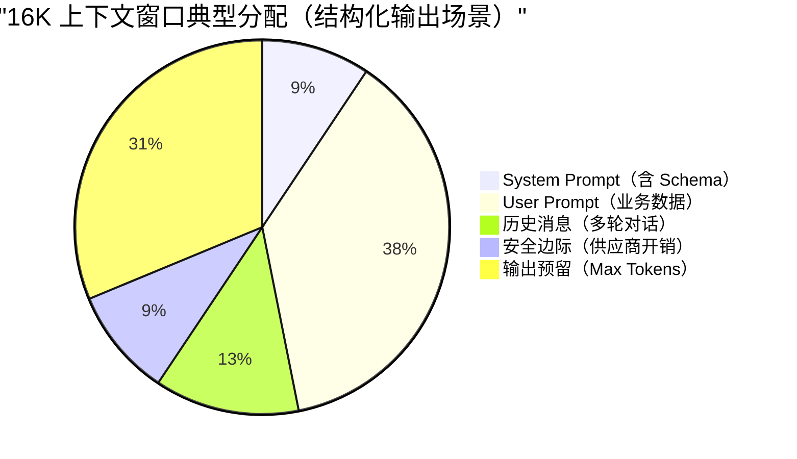
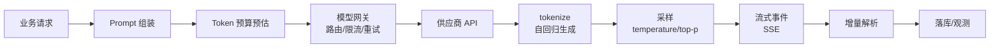

# 大模型到底怎么调、Token 和上下文窗口怎么算？

> 一句话点题：调用大模型不是调个 HTTP 接口，理解 Token 和上下文窗口才能算清成本和边界。

很多人本地跑通一次模型 API、页面上能看到回答，就以为 Demo 稳了。一上生产，问题才具体：用户等 8 秒还看不到第一个字、JSON 只返回了一半、供应商偶发 429 越重试越被限流、用户点了取消后端还在烧 Token。这些坑的根都不在 HTTP 层，而在没搞清 Token、上下文窗口、采样参数和调用工程这层地基。

## 子问题小节

### Token 是模型的"阅读单位"，不是字也不是词

模型生成文本的方式叫**自回归生成**：每次只补一个 Token，把它加进上下文，再预测下一个，循环到结束。所以 Token 是模型每一步补的文本碎片，也是计费、长度、延迟的物理标尺。

为什么不照人类那样按字、按词切？因为要在"词表大小"和"序列长度"间找平衡：每字一个 Token 词表小但序列长，每词一个 Token 序列短但词表爆炸。实际用的是 **BPE / Unigram 子词切分**——高频词保留整体，低频词拆成更小片段，像乐高积木拼搭。

Token 既不是字也不是词的等价物：英文一个单词可能拆成多个 Token，中文可能一词拆多 Token，也可能几字合一 Token。经验估算只够粗略规划：

| 文本 | 经验估算           | 说明                 |
| ---- | ------------------ | -------------------- |
| 英文 | 1 Token ≈ 3~4 字符 | 与文本类型相关       |
| 中文 | 1 Token ≈ 1~2 汉字 | 与中英混排比例强相关 |

精确计费要看 API 返回的 `usage` 字段，别拿"1 字 1 Token"做基准——它只对高频词成立。

举个切分例子感受粒度：原文 `你好，我是小明。`，切分结果可能是 `[你好] [，] [我是] [小] [明] [。]`——原文 9 个字符，切成 6 个 Token，压缩比约 1.5 倍。不同供应商的 Tokenizer 对相同文本可能切出不同序列，预算前最好查官方 Tokenizer 工具。

此外还有两类容易被漏算的 Token：特殊 Token（BOS/EOS/PAD、工具调用边界 `<tool_call/>`）对用户不可见但占窗口；多模态图片也转成一批 Token（一张 1024×1024 图，GPT-4o 低细节约 85、高细节约 765~1105 Token），做 RAG 时要把图片 Token 也纳入预算。

### 上下文窗口是稀缺的"工作记忆"

上下文窗口是模型在工作时能看到多少文本的上限，单位是 Token。"支持 128K/200K/1M"指的是一次调用能塞进去的总 Token 上限，多数模型输入输出合计，少数（如 Gemini）输入输出分别设限，用前查文档。

窗口被隐形成本吃掉：System Prompt、多轮历史、RAG 检索片段、工具 Schema、格式开销，**连输出 Token 也占窗口**。所以真正能塞进去的业务内容远小于标称值。

为什么有上限？Transformer 自注意力是 O(N²) 复杂度：输入翻倍计算量变 4 倍，首字延迟 TTFT 显著增加，攻击面也变大。FlashAttention、GQA、Sliding Window 等优化降了常数项，没改变理论上限。

超了怎么办？三招递进：**截断**（砍早期历史或多余 RAG 片段，最省事但可能丢信息）、**摘要**（把长文档压成要点再塞）、**分批**（多段任务拆成多次调用、两阶段生成）。优先减输入，而不是赌模型会自我约束。

> 纠偏：标称 1M 不等于可以无脑堆。实测存在"中间丢失"——模型对开头结尾敏感，对中间召回率显著下降；1M 窗口下 TTFT 还会暴涨。

实用预算公式：`window ≥ input_tokens + max_output_tokens`；思维链模型要加上思考链：`window ≥ input + reasoning + output`，reasoning 难估，按 max_output 的 2~3 倍预留。反过来做更稳：先定 max_output，再留 10%~20% 安全边际，最后反推可用输入。

把上下文窗口当成固定容量的桶，一次调用的 Token 预算大致这样分配：

顺带一个省钱常识：多数供应商对输出 Token 计价是输入的 2~4 倍（输出比输入贵），所以"长 Prompt + 短输出"通常更经济；存在大量固定前缀（System Prompt、长 RAG Context）时，用 Prompt Caching 能把缓存命中的部分按正常价 10%~50% 收费，适合多轮对话和批量评估。

### 采样参数：调温度还是调抽签池

模型每步给词表每个候选 Token 打分（logits），softmax 转成概率，再按概率"抽签"。采样参数就插在这条链路里。

**Temperature** 调分布形状：softmax 前把分数除以 T。T<1 分布更尖、更稳；T>1 更平、更野；T=0 就是贪婪解码。用"今天天气真\_\_"举例：T=0.2 时"好"概率飙到约 98%，T=1.5 时"好"降到约 35%，"棒""糟糕"都有机会被选中。

**Top-p**（核采样）从高到低累加概率，保留累计刚达 p 的最小集合再采样，候选数自适应；**Top-k** 固定保留 k 个。实践中 Top-p 更常用，因为它能随分布自适应——头部很集中时自动只留一两个。

调参经验：

| 场景              | Temperature | Top-p |
| ----------------- | ----------- | ----- |
| JSON / 结构化输出 | 0~0.3       | 1.0   |
| 代码评审 / 分析   | 0.4~0.7     | 0.9   |
| 多轮对话          | 0.6~0.8     | 0.9   |
| 创意写作          | 0.8~1.2     | 0.95  |

> 纠偏：别同时乱调两个参数。想稳定就压低温度配合严格 Schema，想多样就放开 Top-p，凭直觉同时动温度和 Top-p 经常互相抵消。追求可复现时仅 T=0 不够（GPU 浮点误差仍有非确定性），要配 seed；但模型版本更新、跨区域、Top-p<1 仍可能不一致，CI 里别对 LLM 输出做强断言。思维链模型（DeepSeek-R1、o1 类）会忽略 temperature/top_p/penalty，靠 Prompt 控制而非采样参数。

Penalty（repetition/presence/frequency）能治复读，但结构化输出别乱加——JSON 字段名需要反复出现，会被惩罚掉导致残缺；RAG 问答别加 presence penalty，它鼓励"说点新的"，反而增加幻觉。拿不准就保持默认。

### 调用工程：把模型当不稳定外部依赖治理

一次生产级调用是条跨业务、网关、供应商、前端的链路：

核心判断：**模型网关不是透明代理，是稳定性控制面**。API Key、超时、重试、限流、日志、供应商切换都要收口到统一的 LLMGateway，否则每个业务各自处理，长期一定变事故放大器。

**流式输出**边生成边返回，降低的是 TTFT 不是总耗时，也不省钱。SSE 适合服务端到浏览器单向推送（EventSource 原生支持），WebSocket 适合双向交互（语音、插话打断），HTTP chunked 更偏底层传输。SSE 踩坑点：`text/event-stream` 对换行敏感，模型正文里的 `\n` 会被当成事件分隔符，出站前要转义 `\n`→`\\n`；反向代理要关 `proxy_buffering`，否则流式被攒成批量。

**重试**只能对瞬时错误做：网络瞬断、5xx、供应商过载可指数退避加抖动有限重试；429 看 `Retry-After` 排队降级；400 参数错误、401/403、安全拒答不能重试同一 payload。重试必须绑**幂等 Key**（形如 `tenantId:userId:conversationId:messageId:attemptGroup`），把多次 attempt 挂在同一条业务消息下，只允许一个成 final，避免重复落库扣费。

**限流**不能只按 QPS：500 Token 请求和 80K Token 请求都是 1 次请求，压力差两个量级。要同时看 RPM、TPM、并发、上下文大小、最大输出、租户预算。建议**先扣预算再发请求**——估算 `input + reserved_output` 在各桶里扣，扣不到就排队降级，别等供应商 429 才想起来。

## 容易踩的坑

- 拿"1 字 1 Token"做成本估算，只对高频词成立，中英混排和图片 Token 常被漏算。
- 把标称上下文当可用容量，忘了 System Prompt、历史、RAG、输出都在抢窗口。
- 追求稳定只设 T=0 不配 seed，模型版本更新或跨区域仍不一致，CI 里别对 LLM 输出做强断言。
- 结构化输出乱加 repetition penalty，把必须反复出现的 JSON 字段名也惩罚掉，输出残缺。
- 把模型网关当透明代理，重试不绑幂等，用户狂点"重新发送"导致 Token 账单和落库翻倍。
- SSE 不处理换行转义、不关 Nginx buffering，流式变成批量，TTFT 体感回到同步。
- 流式断流时把半截内容当成成功落库，没有 `finish_reason` 校验，前端展示"完整答案"其实是残缺 JSON。

## 小结

调用大模型的底层地基就三层：**Token 是成本与性能的物理标尺**，按 Token 算账而不是按字数；**上下文窗口是稀缺工作记忆**，再大的标称值也要做预算分配，超了用截断/摘要/分批；**采样参数是业务调音台**，求稳就压温度配 Schema，求多样就放开 Top-p，别同时乱调。在这之上，调用工程把模型当不稳定、昂贵、受配额约束的外部依赖治理：网关收口稳定性，流式降 TTFT，重试绑幂等，限流按 Token 而非 QPS。地基稳了，再去看 RAG、Agent、MCP 才不会塌。

## 参考

- OpenAI 官方 Tokenizer / Rate limits / Structured outputs / Streaming 文档
- Anthropic Streaming Messages / Errors / Structured outputs 文档
- Gemini Structured outputs / Rate limits 文档
- MDN Server-sent events / EventSource / 429 Too Many Requests
