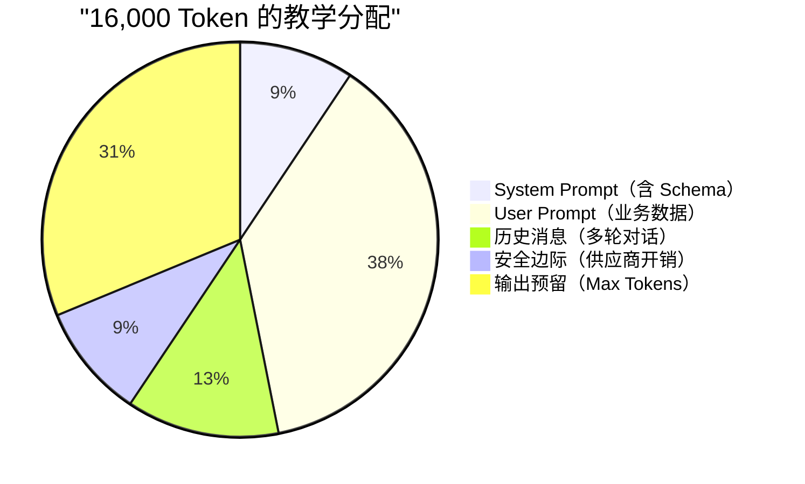
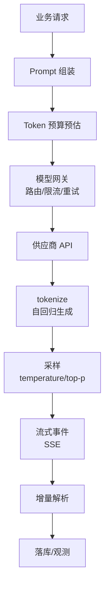

# 大模型到底怎么调、Token 和上下文窗口怎么算？

> 一句话点题：调用大模型不是调个 HTTP 接口，理解 Token 和上下文窗口才能算清成本和边界。

很多人本地跑通一次模型 API、页面上能看到回答，就以为 Demo 稳了。一上生产，问题才具体：用户等 8 秒还看不到第一个字、JSON 只返回了一半、供应商偶发 429 越重试越被限流、用户点了取消后端还在烧 Token。这些坑的根都不在 HTTP 层，而在没搞清 Token、上下文窗口、采样参数和调用工程这层地基。

## Token 是怎样的计量单位？

模型生成文本的方式叫**自回归生成**：每次只补一个 Token，把它加进上下文，再预测下一个，循环到结束。所以 Token 是模型每一步补的文本碎片，也是计费、长度、延迟的物理标尺。

为什么不照人类那样按字、按词切？因为要在"词表大小"和"序列长度"间找平衡：每字一个 Token 词表小但序列长，每词一个 Token 序列短但词表爆炸。实际用的是 **BPE / Unigram 子词切分**——高频词保留整体，低频词拆成更小片段，像乐高积木拼搭。

Token 既不是字也不是词的等价物：英文一个单词可能拆成多个 Token，中文可能一词拆多 Token，也可能几字合一 Token。经验估算只够粗略规划：

| 文本 | 经验估算           | 说明                 |
| ---- | ------------------ | -------------------- |
| 英文 | 1 Token ≈ 3~4 字符 | 与文本类型相关       |
| 中文 | 1 Token ≈ 1~2 汉字 | 与中英混排比例强相关 |

用目标模型的 Tokenizer 和 API 返回的 `usage` 校准预算，费用再结合对应模型的计价规则或账单核对。固定“一个字等于一个 Token”不能作为通用基准。

例如把 `你好，我是小明。` 示意拆成 `[你好] [，] [我是] [小] [明] [。]`，可以看出字与片段不一一对应。这不是某个 Tokenizer 的实测输出，不用来计算真实计费。不同模型与版本可能产生不同的 Token 序列。

序列化消息、角色、工具定义和格式包装也可能产生开销。多模态输入还要按目标模型的图像、音频与视频计量方式估算，不能用一张图片的固定 Token 数推广到全部模型。底层批处理中的填充方式与 API 对外计费也要分开理解。

## 上下文窗口怎样影响可用容量？

上下文窗口是模型在工作时能看到多少文本的上限，单位是 Token。"支持 128K/200K/1M"指的是一次调用能塞进去的总 Token 上限，多数模型输入输出合计，少数（如 Gemini）输入输出分别设限，用前查文档。

窗口被隐形成本吃掉：System Prompt、多轮历史、RAG 检索片段、工具 Schema、格式开销，**连输出 Token 也占窗口**。所以真正能塞进去的业务内容远小于标称值。

完整注意力的输入计算包含随序列长度平方增长的部分，但实际推理还受到模型结构、KV Cache、显存和调度影响。FlashAttention 优化注意力计算与访存，GQA 改变 KV 组织，滑动窗口限制可见范围，它们对成本的影响不同。不能据此断言输入翻倍，整个请求就一定慢四倍。分阶段的机制见[推理延迟](./ai-llm-inference-latency.html)。

超了怎么办？三招递进：**截断**（砍早期历史或多余 RAG 片段，最省事但可能丢信息）、**摘要**（把长文档压成要点再塞）、**分批**（多段任务拆成多次调用、两阶段生成）。优先减输入，而不是赌模型会自我约束。

> 标称窗口只给出容量边界。长上下文能否有效利用，需要按当前模型、证据位置、干扰量和任务验证，不能把特定实验中的“中间丢失”推成所有模型统一的有效窗口比例。

先核对 API 的计量方式。输入输出共享总窗口时，给总输出和请求包装留出预算，再反推可用输入。有些 API 的输出上限已经包含推理 Token，不能重复计入，也没有所有模型通用的预留倍数。预算需要用实际 usage 校准，完整的 32K 教学分配见[Agent 上下文装配](./ai-agent-context-engineering.html)。

把上下文窗口当成固定容量的桶，一次调用的 Token 预算大致这样分配：

上图合计16,000 Token，只说明怎样为输入与输出留预算，不对应某个模型的推荐配置。
输入、输出、缓存读写和其他能力可能分别计价，应对照当前价目与实际命中量计算。前缀缓存可复用部分计算，但命中内容仍占逻辑窗口，也不能仅凭前缀相似就承诺固定折扣或收益。

## 采样参数怎样改变输出？

模型每步给词表每个候选 Token 打分（logits），softmax 转成概率，再按概率"抽签"。采样参数就插在这条链路里。

**Temperature** 对正温度通常通过缩放分数改变分布。较低温度使高分候选更集中，较高温度增加其他候选的机会。API若接受0，通常将它作为贪婪选择等特殊处理，不能在公式里直接除以0。没有具体分数与实现，就无法给出某个词在不同温度下的精确概率。

**Top-p**（核采样）从高到低累加概率，保留累计刚达 p 的最小集合再采样，候选数自适应；**Top-k** 固定保留 k 个。实践中 Top-p 更常用，因为它能随分布自适应——头部很集中时自动只留一两个。

下面仅给可评测的教学起点，使用前先确认目标模型是否支持这些参数及相应范围。

| 场景              | Temperature | Top-p |
| ----------------- | ----------- | ----- |
| JSON / 结构化输出 | 0~0.3       | 1.0   |
| 代码评审 / 分析   | 0.4~0.7     | 0.9   |
| 多轮对话          | 0.6~0.8     | 0.9   |
| 创意写作          | 0.8~1.2     | 0.95  |

> 一次只改一个主要变量，保留模型、输入和评测集，才能判断变化原因。低温度和 seed 都不能跨版本、硬件或服务实现保证完全确定。部分模型限制、拒绝或不提供某些采样参数，不能把全部推理模型归为统一行为。

Penalty 类参数会改变重复项的选择倾向，是否改善表达或破坏结构需要按具体实现评测。结构化任务先依赖支持的约束与服务端校验，拿不准的调节项保留默认，不把它们当成消除幻觉的办法。

## 调用工程应该怎样治理外部依赖？

一次生产级调用是条跨业务、网关、供应商、前端的链路：

核心判断：**模型网关不是透明代理，是稳定性控制面**。API Key、超时、重试、限流、日志、供应商切换都要收口到统一的 LLMGateway，否则每个业务各自处理，长期一定变事故放大器。

**流式输出**通常让用户更早看到内容，但不直接减少模型总计算量或计费。SSE适合单向推送，WebSocket适合需要双向交互的场景。SSE事件通过空行分隔，多行正文需按多行`data:`或JSON编码正确封装，不能把每个TCP分片当成完整事件。代理缓冲与前端渲染也要核对，详见[流式输出](./ai-streaming-sse-backend.html)。

**重试**根据具体错误与执行状态决定。瞬时错误可在截止时间和预算内有限退避，429结合`Retry-After`及配额处理，参数、权限和安全拒绝不能靠原样无限重发解决。请求组标识可以关联多次尝试和避免应用重复落库，但不能自动免除供应商重复计费，也不能替代写工具的业务操作号与状态机。

**限流**不能只按 QPS：500 Token 请求和 80K Token 请求都是 1 次请求，压力差两个量级。要同时看 RPM、TPM、并发、上下文大小、最大输出、租户预算。建议**先扣预算再发请求**——估算 `input + reserved_output` 在各桶里扣，扣不到就排队降级，别等供应商 429 才想起来。

## 容易踩的坑

- 拿固定字数换算Token，忽略Tokenizer、消息包装和多模态输入的差异。
- 把标称上下文当可用容量，忘了 System Prompt、历史、RAG、输出都在抢窗口。
- 把低温度或seed当成完全可复现保证，忽略模型版本与基础设施变化。
- 未经回归就叠加采样调节项，难以判断格式、事实或风格变化的原因。
- 把模型网关当透明代理，重试不绑幂等，用户狂点"重新发送"导致 Token 账单和落库翻倍。
- SSE事件封装、增量解析或代理缓冲不正确，导致内容损坏或延迟展示。
- 流式断流时把半截内容当成功，没有按相应API核对完成、中止、截断与错误状态。

## 小结

1. Token划分依赖目标模型，预算用Tokenizer和usage校准，费用另按实际计价核对。
2. 上下文给输入、输出和包装共同留空间，缓存不会扩大逻辑窗口。
3. 采样参数按模型支持范围使用，低温度与seed不能保证完全确定。
4. 流式处理区分Token、协议事件和网络分片，并核对真实完成状态。
5. 限流、预算和有限重试共同约束成本，请求关联标识不能代替业务幂等或计费对账。

## 参考

- OpenAI 官方 Tokenizer / Rate limits / Structured outputs / Streaming 文档
- Anthropic Streaming Messages / Errors / Structured outputs 文档
- Gemini Structured outputs / Rate limits 文档
- MDN Server-sent events / EventSource / 429 Too Many Requests
