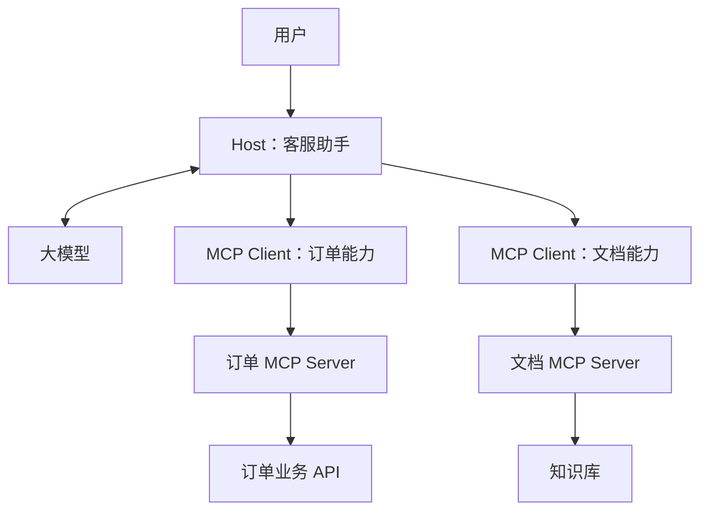

# MCP 解决什么问题，和 Function Calling、Agent、Skill 有什么关系？

> MCP 把外部能力接入 AI 应用的方式标准化，模型选择工具、应用执行任务和业务系统授权仍各有分工。

## 三个助手都要查订单，为什么还要写三份适配？

假设公司已有订单 API，现在要让内部客服助手、开发者 IDE 和一个自动排障程序都能查询订单。
如果每个应用各写工具定义、调用封装、错误转换和发现机制，订单接口每改一次，三个应用都要跟着修改。

MCP（Model Context Protocol，模型上下文协议）把中间的接入契约统一起来：订单团队提供 MCP Server，应用通过 MCP Client 发现并使用能力。
Server 内部仍可调用已有 HTTP API，订单服务不必为了接入 AI 重写业务逻辑。

这种分工把“每个应用都认识每个系统”，变成“应用实现协议接入，业务团队提供协议适配”。
但标准化只减少重复适配，不会让协议版本、权限和工具语义自动一致，客户端仍需支持双方实际使用的能力。

**本文按 2026-11-20 核对的 `2026-07-28` 规范讲解。**
这个版本采用逐请求元数据；旧教程里的 `initialize` 握手属于 `2025-11-25` 及以前的协议。
理解架构时先不绑定某一种握手，具体差异见[能力发现与版本兼容](./ai-mcp-lifecycle.html)。

## Host、Client、Server 分别负责什么？

这三个角色是责任划分，不必机械理解成三个独立进程。

| 角色   | 在订单助手里做什么                             | 不能省掉的责任                           |
| ------ | ---------------------------------------------- | ---------------------------------------- |
| Host   | 承载对话、调用模型、决定哪些工具可见、展示结果 | 用户授权、上下文预算、工具选择与执行策略 |
| Client | 把 Host 的工具请求转成 MCP 消息，处理响应      | 版本兼容、传输、错误处理、连接管理       |
| Server | 描述订单工具，执行调用并返回协议结果           | 参数校验、数据授权、结果脱敏、业务审计   |

一个 Host 可以管理多个 Server 的客户端接入关系。
这不代表每个关系都必须有一个协议级会话：新版 MCP 已移除协议级会话，业务需要跨次调用状态时，可以显式传递受权限保护的业务句柄。

Server 后面的数据库、HTTP API 和文件系统，是具体实现的依赖，不是新增的 MCP 核心角色。
本地 stdio 通常由 Client 启动 Server 子进程；远程 Server 则可以由团队集中部署，服务多个客户端。

## 一次“查订单”到底经过哪些层？

用户问：“订单 O202611200001 发货了吗？”
先假设 Host 已把经过授权的订单工具交给模型，链路可以拆成六步：

1. 模型生成 `query_order_status` 的调用意图，参数中包含订单号。
2. Host 检查工具是否允许执行，将调用交给对应的 MCP Client。
3. Client 按双方支持的协议版本发送 `tools/call`。
4. Server 验证当前用户与租户、参数格式和订单归属，再调用订单 API。
5. Server 返回经过筛选的订单状态；Client 将结果交回 Host。
6. Host 把结果作为工具输出提供给模型，模型据此回答用户。

这里至少存在三种格式：模型供应商的工具调用格式、MCP 的 JSON-RPC 消息、订单 API 的 HTTP 契约。
它们之间需要适配，不能把模型输出的 JSON 原封不动当成 MCP 请求，更不能直接当成数据库查询。

模型也不是网络客户端。它通常只生成“调用什么、参数是什么”，真正持有连接、令牌和数据库权限的是运行时及业务服务。
即便某个平台把执行封装成托管能力，这条责任边界也没有消失。

## Function Calling、MCP、Agent、Skill 怎么配合？

| 概念                            | 核心问题                               | 在订单场景里的例子                     |
| ------------------------------- | -------------------------------------- | -------------------------------------- |
| Function Calling / Tool Calling | 模型如何表达调用意图？                 | 输出工具名与订单号参数                 |
| MCP                             | 应用如何发现、描述、调用外部能力？     | `tools/list`、`tools/call` 与结果契约  |
| Agent                           | 如何根据结果决定下一步，直到完成目标？ | 查订单后继续查物流，证据不足就追问     |
| Skill                           | 某类任务应该遵循怎样的说明和流程？     | 先核对状态，再解释政策，必要时生成工单 |
| HTTP API                        | 业务动作如何被确定性执行？             | 订单服务查询数据库并返回状态           |

所以，MCP 与 Function Calling 经常配合使用，但彼此不等价。
Host 可以把 MCP 工具描述转换为模型供应商的工具定义，再将模型的调用意图映射回 MCP。
也可以由固定工作流直接调用 MCP 工具，全程不让模型决定工具选择。

Skill 同样可以指导 Agent 使用 MCP，也可以只指导写作或调用本地工具。
它通常提供说明与资源，不天然提供隔离、鉴权或执行能力；加载说明仍会占用上下文与时间，不能称为零成本。

如果任务是“解释退货政策”，可能只需检索文档；如果任务是“这单发货了吗”，需要实时业务数据；如果任务是“帮我退款”，还要进入写操作的授权与幂等流程。
使用同一协议，不代表这三类任务具有相同风险。

## MCP 只有工具吗，和 RAG 有什么关系？

MCP Server 常见的三类能力是 Tools、Resources、Prompts：

- **Tools**：可被调用的能力，例如查订单、创建工单。工具也可以只读。
- **Resources**：可读取的上下文，例如一份政策文档、某个业务对象的只读视图。
- **Prompts**：可复用的消息模板，例如让用户选择一套“订单异常分析”模板。

它们的分界取决于交互契约，不取决于 Server 内部是否运行代码。
动态生成的订单只读视图也可以是 Resource；查询数据库也可以作为 Tool。
具体方法与 Schema 见[三类原语设计](./ai-mcp-primitives.html)。

RAG 是检索并组织外部证据的方法，MCP 是接入能力的协议。
可以把文档检索封装成 MCP Tool，内部执行召回和重排；也可以完全不用 MCP 来搭 RAG。
二者可以组合，但 MCP 不负责保证召回质量，RAG 也不负责业务写入授权。

## 什么时候值得接 MCP，什么时候直接调用就够了？

先看你要解决的重复成本在哪里，而不是看工具名字是否流行。

| 实际情况                       | 适合的起点                   | 需要付出的代价                       |
| ------------------------------ | ---------------------------- | ------------------------------------ |
| 单个服务里只有几个固定业务方法 | 直接封装本地工具或 HTTP 调用 | 自己维护内部契约，但链路短           |
| 多个 Host 要复用同一组能力     | MCP Server                   | 增加协议兼容、工具发现与权限治理     |
| 多团队共享远程工具             | 远程 MCP 服务                | 增加 OAuth、多租户、部署和可观测建设 |
| 只是希望模型按固定规范写文档   | 任务说明或 Skill             | 维护说明与适用范围，不必增加服务     |

这些是工程选择，不是协议强制的使用条件。
“一个 MCP Server 就是给每位用户启动一个进程”只适用于部分本地部署；远程共享服务不能照这个成本模型估算。
反过来，接入远程服务也不意味着所有调用都能共享用户身份和缓存，权限仍需逐请求判断。

## 为什么发现了工具，还不能说明系统已经安全可用？

发现能力只回答“对方声明能做什么”。工具描述和 Server 自报名称都不是安全证明。
还要分别验证：

1. 当前身份是否有权调用工具，以及访问参数对应的具体订单。
2. 工具是否返回了真实业务结果，还是错误、截断数据或过期缓存。
3. 结果进入上下文后，有没有被当成可覆盖系统规则的指令。
4. 一次超时后，业务到底没执行、执行中，还是已经成功但响应丢失。

授权问题见[远程 MCP 安全](./ai-mcp-authorization.html)，最后一类问题见[排障与幂等](./ai-mcp-troubleshooting.html)。
协议接通是起点，真正交付的是一个边界清晰、结果可验证的业务能力。

## 小结

1. MCP 标准化应用与外部能力的接入契约，核心价值是复用与解耦，不负责模型推理或业务正确性。
2. Host 管交互与执行策略，Client 管协议通信，Server 管能力实现；部署进程和协议角色不是同一件事。
3. Function Calling 表达意图，MCP 连接能力，Agent 决定任务步骤，Skill 提供说明，业务 API 执行确定性操作。
4. Tools、Resources、Prompts 是不同交互契约；RAG 可以通过 MCP 接入，但检索方法和接入协议不能混为一谈。
5. 先评估跨客户端复用收益，再承担协议、授权与运维成本；工具可见不等于调用安全或业务成功。

## 参考

综合仓库 `docs/` 下 MCP、结构化输出与工具调用、Agent 扩展机制三组资料重写，交叉核对其分层与适用边界。
按 2026-11-20 读取的官方原文补充版本说明，纠正了“所有 MCP 都要先握手”“Server 总是本地独立进程”和“Skill 零开销”等过度概括。

- [MCP 2026-07-28：版本与兼容](https://modelcontextprotocol.io/specification/2026-07-28/basic/versioning)
- [MCP 2026-07-28：传输总览](https://modelcontextprotocol.io/specification/2026-07-28/basic/transports)
- [MCP 2026-07-28：能力发现](https://modelcontextprotocol.io/specification/2026-07-28/server/discover)
- [MCP 2026-07-28：变更记录](https://modelcontextprotocol.io/specification/2026-07-28/changelog)

本文验证的是协议职责与版本边界，不代表对某个商业 Host 完成了兼容性实测。
