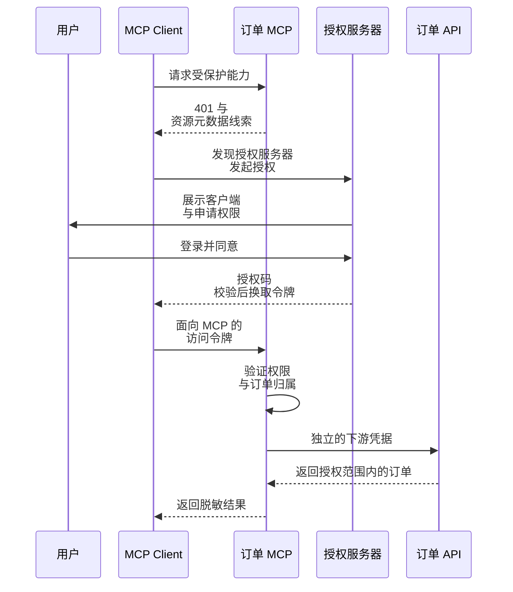

# 远程 MCP 如何认证授权，为什么有 Token 仍会越权？

> 接通 MCP 只说明请求能送达；令牌受众、用户权限、对象归属和用户确认，必须在各自的边界上验证。

## 用户能查订单，为什么不能查任意订单？

假设客服助手接入了订单 MCP Server，提供 `query_order_status(orderNo)`。
用户已经登录，也给助手授予了查询权限，但把订单号改成其他租户的订单后，Server 仍然返回了收货地址。

漏洞不在模型生成了错误参数，而在后端把“有合法 Token”当成“能访问所有订单”。
这里至少有四个独立问题：Token 是否有效、是不是发给这个服务、是否允许查询、是否允许查询这张订单。
前两项主要由 OAuth 资源服务器解决，后两项还需要工具和业务服务授权。

本文按 **2026-11-20 核对的 MCP `2026-07-28` 规范**讲解，重点是 HTTP 远程接入的授权链。
具体工具粒度、写操作草稿与审计设计，参见[内部业务接口的工具调用](./ai-tool-calling-business-api.html)。

## 谁是 OAuth Client，谁签发 Token？

先把协议角色和 OAuth 角色对上，避免把所有服务都叫“认证服务器”。

| 参与方               | 在订单助手里的职责                             |
| -------------------- | ---------------------------------------------- |
| 用户                 | 授予助手访问特定能力的权限，是资源所有者       |
| Host 内的 MCP Client | 发起授权，保管令牌，代表用户调用 MCP Server    |
| 订单 MCP Server      | 作为资源服务器校验入站令牌，再决定是否执行工具 |
| 授权服务器           | 认证用户、处理授权同意、签发访问令牌           |
| 下游订单 API         | 执行业务查询，维护自己的身份与数据权限边界     |

授权服务器可以与 MCP Server 一起部署，也可以由独立身份平台提供。
但它们是不同职责：`tools/list` 是能力发现，不是获取 OAuth 令牌的接口。



这张图把浏览器跳转与换码过程合并展示；完整实现还要验证 PKCE、回调地址、发行者与授权状态。

## 所有 MCP 都必须部署 OAuth 吗？

不是。规范把授权定义为可选能力，HTTP 实现支持授权时应遵循这套互操作框架。
“协议可选”不表示敏感业务可以匿名开放，真实系统仍须根据数据和动作设置访问控制。

stdio 通常由 Host 启动本地子进程，规范建议从环境获取凭据，而不是照搬 HTTP OAuth 流程。
这也不等于把整个 Host 的环境变量都传进去：应只提供所需凭据，并用操作系统权限和沙箱限制进程能力。
凭据放在环境里只是交付方式，本身并不是最小权限或安全存储的保证。

## Client 第一次遇到远程 Server，怎么知道去哪里授权？

以 `https://orders.example.com/mcp` 为例，一个支持授权发现的拒绝响应可以这样给线索：

```http
HTTP/1.1 401 Unauthorized
WWW-Authenticate: Bearer resource_metadata="https://orders.example.com/.well-known/oauth-protected-resource/mcp",
                         scope="orders:read"
```

这里只展示认证挑战响应；`orders:read` 是示例业务权限名，不是 MCP 规定的固定 Scope。
Client 接下来分两次发现，不能把资源元数据地址直接当成 Token 端点：

1. 读取受保护资源元数据，取得 `authorization_servers`，确认资源与授权服务器信息。
2. 读取选定授权服务器的 OAuth 或 OIDC 元数据，取得授权、换码端点和 PKCE 支持信息。
3. 取得 Client ID：已有预注册信息时优先使用，否则按服务端支持情况使用 CIMD 等注册机制。
4. 带上申请权限、PKCE 参数和目标 `resource`，让用户在浏览器中完成授权。
5. 验证回调，再用授权码和 `code_verifier` 换取令牌，随后重试原请求。

没有 `resource_metadata` 挑战参数时，Client 应按规范先探测带 MCP 路径的 well-known 资源元数据，再尝试根路径。
授权服务器的元数据又有自己的发现顺序，不能简单在任意 URL 后面拼 `/authorize` 或 `/token`。

Scope 优先参考当前挑战，按动作逐步申请，避免初次接入就要求写权限。
若挑战没有 Scope，规范要求回退参考资源元数据的 `scopes_supported`；因此 Server 应把这个列表设计为基础所需集合，不能塞入全部高危权限。

## PKCE、resource、audience、issuer 分别防什么？

这些字段不能互相替代。PKCE 做对了，也不能省掉令牌受众与发行者检查。

| 检查                    | 要保证什么                           | 不检查会怎样                           |
| ----------------------- | ------------------------------------ | -------------------------------------- |
| PKCE                    | 兑换授权码者持有本次授权的秘密校验值 | 截获授权码的其他进程可能换走令牌       |
| `resource`              | 授权和换码时明确请求访问的 MCP 资源  | 令牌的目标服务不明确，容易跨服务混用   |
| Token 受众              | 资源服务器确认令牌确实签发给自己     | 另一个服务的有效令牌被拿来访问订单工具 |
| 发行者 `issuer` / `iss` | 元数据与回调来自此前选定的授权服务器 | Client 把授权码发到攻击者的换码端点    |

Client 必须实现 PKCE，并在授权前通过元数据确认支持；具备技术能力时必须使用 `S256`。
若授权服务器元数据缺少 `code_challenge_methods_supported`，Client 必须拒绝继续，不能静默退回无 PKCE 的流程。
授权请求和 Token 请求都必须包含标识目标 MCP Server 的 `resource`。
Server 则要验证签名或内省结果、发行者、有效期、受众与权限；Token 不一定是 JWT，不能要求所有客户端自行解析 JWT 字段来代替服务端验证。

发行者校验也有两层：读取授权服务器元数据时，返回的 `issuer` 必须与用于发现的标识一致；回调如果带 `iss`，必须与授权前记录的发行者精确比较。
若服务端元数据声明支持回调 `iss`，响应却没有它，也应拒绝。
不要擅自去掉尾斜杠或改写编码后再比较，更不能等授权码已送到错误端点后才做检查。

访问令牌通过 `Authorization: Bearer ...` 请求头逐请求发送，不放在 URL、模型上下文或工具结果里。
持久化的预注册或 DCR 客户端凭据要按签发方 `issuer` 隔离，不能因另一个授权服务器地址“看起来相似”就复用。

## Server 后面还有 API，能不能把收到的 Token 直接转发？

不能把 MCP Server 做成不验证受众的 Token 转发管道。
规范明确禁止 Token passthrough：Client 送来的令牌必须面向 MCP Server，下游 API 使用自己的授权链签发的独立令牌。

例如，用户授权助手访问订单 MCP 服务，不等于授权助手访问公司的全部订单管理 API。
Server 如果还要代表用户调用下游，应单独完成下游授权并安全保存凭据；若使用受限服务身份，也必须在业务层保留当前用户的数据约束。
这不是把 Token 换个字段名，而是让两段调用各自有可验证的受众、权限与审计来源。

代理还会遇到“混淆代理”问题：用户以前同意过代理访问下游，恶意的新客户端就想借这份同意获取自己的授权。
不能因为第三方登录页已有同意 Cookie 就跳过 MCP 层的客户端授权；仍支持 DCR 的代理，必须在转往下游授权前取得针对该客户端的用户同意。
回调地址严格匹配，授权状态单次使用并验证归属，不能把“用户同意过某个代理”扩张成“任何客户端都可代表此用户”。

## Scope 校验过了，租户和订单归属还怎么拦？

`orders:read` 通常只说明允许某类操作，不表示允许读取每一张订单。
服务端应从已验证身份取得用户和租户，而不是相信模型传来的 `userId` 或 `tenantId`。
查询条件可以抽象为下面的伪 SQL：

```sql
SELECT order_no, status, updated_at
FROM orders
WHERE order_no = :orderNo
  AND tenant_id = :trustedTenantId
  AND owner_id = :trustedUserId;
```

客服代查等场景按明确的数据范围策略扩展条件，不能直接删掉归属检查。
返回值也按用途裁剪：查发货状态不需要返回完整地址和手机号，缓存更不能跨用户复用私有结果。

`2026-07-28` 已移除协议级会话，但购物车 ID、工作流句柄等业务状态仍然存在。
拿到句柄不等于通过认证；每次使用都要校验它是否属于当前可信主体，不能靠“ID 很难猜”代替授权。

授权错误要分层处理：令牌缺失、无效或过期通常是 `401`；Scope 不足是 `403`，可以按挑战发起有限次数的增量授权。
对象归属失败则按业务策略拒绝，必要时统一为“对象不存在或无权访问”，避免泄露对象存在性。
不要把所有失败都改成重新登录，也不要让模型通过换订单号无限试探。

## 除了 Token，还要守住哪些入口？

**发现元数据也是外部输入。** 恶意 Server 可以把 `resource_metadata`、授权端点等指向内网或云元数据地址。
服务端部署的 Client 需要防 SSRF：校验目标协议与地址、限制出站范围、逐跳验证重定向，并防止 DNS 检查与实际连接不一致。
授权服务器获取 CIMD 文档时也有同类风险，HTTPS 只能保护传输，不能证明目的地址可信。

**浏览器和本机服务之间也有边界。** 生产授权端点使用 HTTPS，回调地址按注册契约严格验证；打开授权 URL 时不经 Shell 拼接执行。
本机 HTTP Server 应限制监听范围并验证 Origin；规范要求存在且非法的 Origin 返回 `403`，不能把“缺失 Origin”一概等同攻击。
Origin 校验防的是一类跨站与 DNS 重绑定风险，不能替代用户认证。

**模型看到的文本不是新的授权凭据。** 工具描述、Prompt 模板、资源内容和工具结果都可能夹带指令。
Server 自报名称、`readOnlyHint` 等注解也不是权限证明；Host 应审核来源与工具变化，服务端仍独立执行权限检查。
需要用户确认的退款，必须由可信界面记录用户、参数摘要、有效期与确认状态，不能相信模型补一句“用户已确认”。

## 旧教程里的 Roots 和动态注册还能直接照搬吗？

先分清“已弃用”和“已删除”。在 `2026-07-28` 中，Roots、Sampling、Logging 和 DCR 已被列入弃用清单，但仍处于兼容窗口。
新实现不应继续把它们当默认新增能力；现有实现应核对对端支持并规划迁移，不能直接假定当天已经不可用。

Roots 从来不是操作系统沙箱，声明目录不会阻止进程访问其他路径。
目录白名单、真实路径校验、最小凭据与进程隔离仍需实现；更不能把 Server 请求补充信息的 Elicitation 当成天然可靠的人类审批凭证。

CIMD 用 HTTPS URL 标识客户端并提供元数据，是当前推荐支持的注册机制；已有关系仍可预注册，DCR 保留兼容用途。
CIMD 证明对元数据域名的控制，不证明某个 `localhost` 回调端口一定由官方客户端监听，授权界面仍须展示实际回调目标并应用信任策略。

## 小结

1. 有效 Token 只是起点，还要验证目标受众、动作权限、租户和具体对象归属；认证通过不等于任意查询。
2. HTTP 授权分资源元数据发现、授权服务器发现和 OAuth 授权三段，PKCE、resource、issuer 与回调校验各自解决不同风险。
3. MCP Server 与下游 API 是不同授权边界，禁止透传 Client 的入站 Token；代理也不能复用其他客户端的用户同意。
4. 工具参数、业务句柄、外部元数据和模型可见文本都不构成权限证明，服务端授权必须逐请求执行。
5. stdio 环境凭据、Origin、Roots 与人工确认都不能相互替代；识别弃用窗口，避免把旧教程当现行默认设计。

## 参考

综合仓库 `docs/` 下 MCP 生产治理、结构化输出与工具调用安全两组资料重写，并以 2026-11-20 读取的官方 `2026-07-28` 规范交叉核对。
重点纠正了“有 Token 就有数据权限”“可直接透传下游令牌”“Roots 是沙箱”和“弃用等于立即删除”的误解。

- [MCP：授权规范](https://modelcontextprotocol.io/specification/2026-07-28/basic/authorization)
- [MCP：授权服务器发现](https://modelcontextprotocol.io/specification/2026-07-28/basic/authorization/authorization-server-discovery)
- [MCP：客户端注册](https://modelcontextprotocol.io/specification/2026-07-28/basic/authorization/client-registration)
- [MCP：授权安全要求](https://modelcontextprotocol.io/specification/2026-07-28/basic/authorization/security-considerations)
- [MCP：安全实践](https://modelcontextprotocol.io/specification/2026-07-28/basic/security_best_practices)
- [MCP：弃用功能清单](https://modelcontextprotocol.io/specification/2026-07-28/deprecated)

本文核验了协议流程与安全要求，未对具体身份平台完成 OAuth 联调或渗透测试；示例权限名和业务策略需按系统实际设计。
