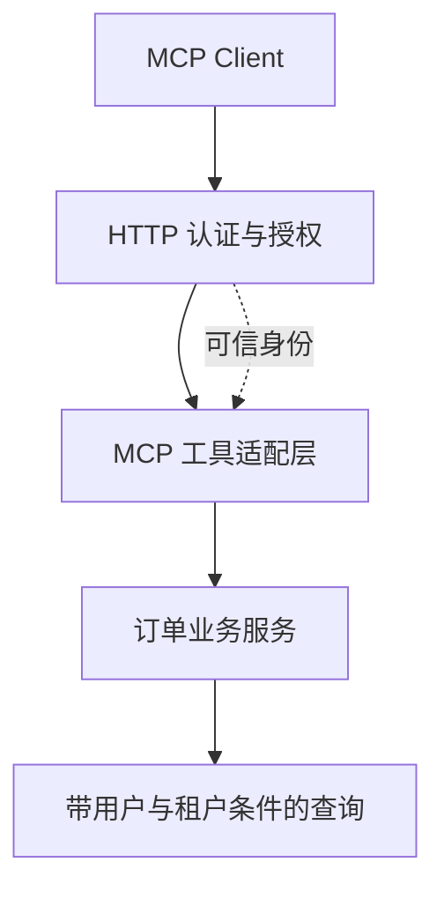

# Java 后端如何把业务接口封装成 MCP Server？

> 先把一个有权限边界的只读业务动作暴露成工具，再验证协议发现、身份传递和业务结果，最后才接模型。

## 已有订单服务，为什么还要再加一层？

假设订单系统已有查询方法，现在想让多个 AI 应用查询订单状态。
MCP 层负责描述与适配：把业务方法暴露成有名称、参数 Schema 和结果契约的工具。
订单归属、租户隔离、状态判断仍留在业务服务，不复制一套“AI 专用权限逻辑”。



这里不需要先配置聊天模型，更不需要模型 API Key：独立 MCP Server 完全可以只提供订单查询。
由另一个 Host 负责选择模型和组织回答，开发时则用兼容当前协议的客户端直接验证。

## 先固定协议和框架版本，别混抄不同代的配置

本篇按 **2026-11-20 读取的 Spring AI 2.1.0 文档、MCP `2026-07-28` 协议**说明。
Spring AI 的 Modern Server 文档要求 MCP Java SDK 2.2.0 系列或更高版本。
依赖由对应 Spring AI BOM 管理，接入前还要确认应用的 Java、Spring Boot 版本满足该版本的兼容要求。

下面是已有 Spring Boot 工程中的依赖片段，不是完整 `pom.xml`：

```xml
<dependencyManagement>
    <dependencies>
        <dependency>
            <groupId>org.springframework.ai</groupId>
            <artifactId>spring-ai-bom</artifactId>
            <version>2.1.0</version>
            <type>pom</type>
            <scope>import</scope>
        </dependency>
    </dependencies>
</dependencyManagement>

<dependencies>
    <dependency>
        <groupId>org.springframework.ai</groupId>
        <artifactId>spring-ai-starter-mcp-server-webmvc</artifactId>
    </dependency>
</dependencies>
```

选择 WebMVC 的 Modern 协议：

```yaml
spring:
  ai:
    mcp:
      server:
        name: order-query-server
        version: 1.0.0
        protocol: MODERN
        type: SYNC
        modern:
          mcp-endpoint: /mcp
```

`server.version` 是应用自报的软件版本，不是 MCP 协议版本。
`SYNC` 是处理方法的编程模型，也不代表旧版有状态协议。
旧 SDK 不能因为多写一个 `MODERN` 就自动支持新报文；要看真实依赖与客户端兼容性，不能只看端点是不是 `/mcp`。

## 业务核心只接收可信身份，不接收模型填写的用户 ID

先写一段不依赖 AI 框架、可独立验证的查询服务：

```java
import java.time.Instant;
import java.util.NoSuchElementException;
import java.util.Objects;
import java.util.Optional;

public final class OrderQueryService {
    public record Caller(long userId, long tenantId) {}
    public record OrderStatus(String orderNo, String status, Instant asOf) {}

    public interface OrderRepository {
        Optional<OrderStatus> findVisible(
                String orderNo, long userId, long tenantId);
    }

    private final OrderRepository repository;

    public OrderQueryService(OrderRepository repository) {
        this.repository = Objects.requireNonNull(repository);
    }

    public OrderStatus query(String orderNo, Caller caller) {
        if (caller == null || caller.userId() <= 0 || caller.tenantId() <= 0) {
            throw new SecurityException("需要有效的用户身份");
        }
        if (orderNo == null || !orderNo.matches("O[0-9]{12}")) {
            throw new IllegalArgumentException("订单号应为 O 加 12 位数字");
        }
        return repository.findVisible(orderNo, caller.userId(), caller.tenantId())
                .orElseThrow(() -> new NoSuchElementException("订单不存在或无权访问"));
    }
}
```

`Caller` 必须来自服务端验证后的安全上下文，不能把它整个放进工具 Schema，让模型自己填写。
Repository 的实现也必须把身份落实到查询条件，例如参数化查询中的：

```sql
WHERE order_no = :orderNo
  AND owner_id = :userId
  AND tenant_id = :tenantId
```

这样返回“没有记录”时，不会先把别人的订单装进对象再做事后过滤。
`asOf` 由业务数据源提供真实观测时间；不能把静态演示数据标成实时状态。

## 工具适配层怎样注册，身份又从哪里来？

Spring AI 支持扫描带 `@McpTool` 的 Spring Bean；也可以用 `ToolCallback` / `ToolCallbackProvider` 接入已有工具。
下面只展示适配方法，省略 Bean 构造与包导入，不是一份完整可运行应用：

```java
@McpTool(name = "query_order_status",
        description = "按订单号查询当前用户的订单状态，不执行取消或退款。",
        generateOutputSchema = true,
        annotations = @McpTool.McpAnnotations(readOnlyHint = true))
public OrderQueryService.OrderStatus queryOrder(
        McpModernRequestContext request,
        @McpToolParam(description = "订单号，O 加 12 位数字", required = true)
        String orderNo) {
    var caller = callerResolver.requireAuthenticated(request);
    return orderQueryService.query(orderNo, caller);
}
```

`callerResolver` 是应用自己实现的安全适配器，不是框架内置 API。
它从服务端已验证的传输上下文中取得 `Caller`，缺失身份时拒绝调用。
`McpModernRequestContext` 属于框架提供的特殊参数，不应生成给模型填写的业务字段。

尤其要注意：**Modern Server 的 `McpTransportContext` 默认是空的，认证信息不会自动传到工具方法。**
WebMVC 可以通过 `McpTransportContextExtractor<ServerRequest>` 从已认证请求解析调用者，保存可信主体，再由安全适配器读取。
复制一个 `X-User-Id` 请求头不等于认证；必须由可信认证层验证或覆盖，不能接受客户端自报身份。

`clientInfo`、工具的 `readOnlyHint` 也只是声明或提示，不是授权依据。
即使客户端绕过界面直接发 `tools/call`，业务核心仍应执行相同的归属校验。
远程 OAuth 与令牌受众的检查见[认证授权篇](./ai-mcp-authorization.html)。

## 只读查询的结果和错误应该怎样返回？

正常结果只暴露订单号、状态与观测时间，不直接序列化整个数据库实体。
声明 `outputSchema` 后，要核实客户端实际收到的 `structuredContent` 与契约一致；文本摘要只作为辅助。

| 情况                           | 处理位置    | 返回目标                               |
| ------------------------------ | ----------- | -------------------------------------- |
| 没有有效令牌                   | HTTP 安全层 | 授权挑战或拒绝，不进入订单查询         |
| MCP 方法未知、报文缺必要字段   | 协议层      | 对应 JSON-RPC 错误                     |
| 订单号不合法、业务查询无法完成 | 工具边界    | 映射为受控的工具执行错误，避免泄露堆栈 |
| 不存在或不属于当前用户         | 业务权限层  | 对外使用一致提示，内部审计记录区别     |

不能把 Java 异常会怎样映射完全交给默认行为。
应在工具适配或异常处理层明确返回策略，并验证 `isError`，而不是只检查 HTTP 200。
新协议的普通结果还需要 `resultType: "complete"`，由支持对应版本的框架处理协议封装。

如果未来增加退款工具，复用的是身份与审计设施，不是“把查询注解改个名字”。
退款还需要用户真实授权、业务操作号、状态机与跨会话幂等，详见[业务工具安全](./ai-tool-calling-business-api.html)和[故障排查](./ai-mcp-troubleshooting.html)。

## 怎样验证接入，而不是让模型说一句“查到了”？

先不接模型，按三层逐步检查：

1. **业务层**：合法订单可查；换用户、换租户、缺失身份、非法订单号都被拒绝。
2. **协议层**：用支持 `2026-07-28` 的客户端检查 `server/discover`、`tools/list`、`tools/call`；输入 Schema 只暴露订单号，输出符合约定。
3. **Host 层**：确认工具被加入当前请求的模型工具集合，调用结果有来源、有时间，模型没有虚构状态。

同一个业务层用例要在不同身份下验证，不能只做“服务管理员能查询”的正向测试。
还应覆盖下游超时、错误脱敏和工具扫描开关，防止未注册工具或错误堆栈被意外公开。

Inspector 也有版本要求：旧客户端只会发 `initialize`，连不上仅支持 Modern 的服务时，先查版本矩阵，再查业务代码。
开发用的演示数据和测试身份必须与生产凭据分开，不能为了让 Demo 跑通而关闭授权。

## 小结

1. MCP 适配层负责协议与契约，订单服务继续负责归属校验、状态判断和数据访问。
2. 固定框架、SDK、协议三个版本；Modern 不是旧配置加一个新名字，更不是 `server.version` 的值。
3. 模型只提供业务参数，用户和租户由可信服务端上下文注入；默认空的传输上下文需要应用显式接好。
4. 工具提示不提供安全保证；异常映射、脱敏、输入输出 Schema 和业务权限都要独立验证。
5. 先验证业务，再验证协议发现与调用，最后验证 Host 回灌；模型一句“查询成功”不能替代这三层证据。

## 参考

综合仓库 `docs/` 下 MCP、结构化输出与工具调用资料，并与站内 Java 接入、业务工具安全笔记交叉核对。
按 2026-11-20 读取的 Spring AI 2.1.0 官方文档检查了 Modern 配置、特殊参数与默认空传输上下文，避免混用旧版双向会话 API。

- [Spring AI 2.1：Modern MCP Server](https://docs.spring.io/spring-ai/reference/2.1/api/mcp/mcp-modern-server-boot-starter-docs.html)
- [Spring AI 2.1：服务端注解](https://docs.spring.io/spring-ai/reference/2.1/api/mcp/mcp-annotations-server.html)
- [MCP 2026-07-28：Tools](https://modelcontextprotocol.io/specification/2026-07-28/server/tools)
- [MCP 2026-07-28：版本与兼容](https://modelcontextprotocol.io/specification/2026-07-28/basic/versioning)

本文的独立业务核心另行编译验证了输入与身份边界；Spring 适配部分为对照官方 API 的接入骨架，未在本仓库启动 Spring Boot 或连接真实订单系统。
