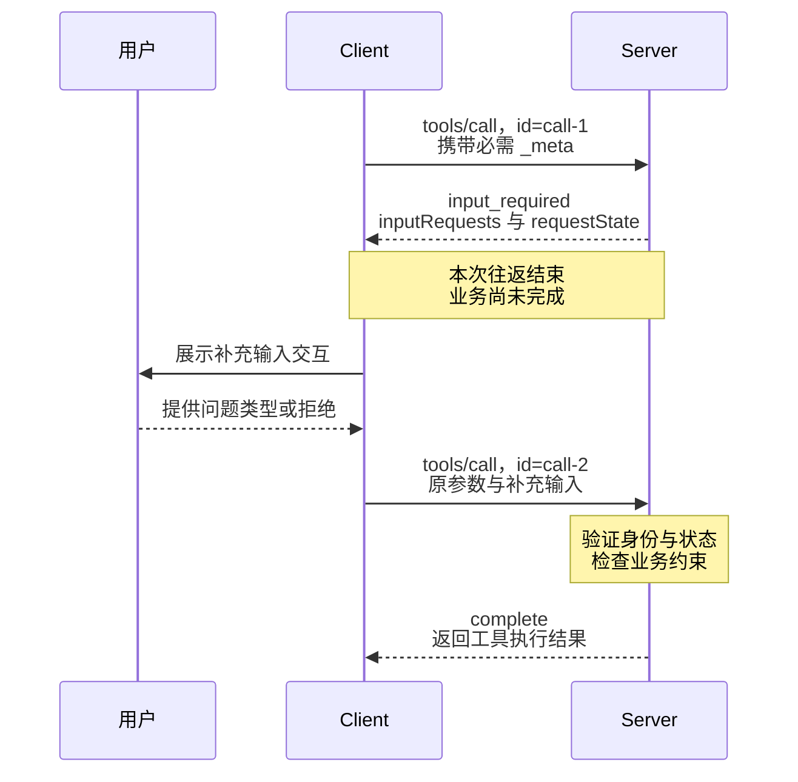

# MCP 如何发现能力、处理请求，并兼容新旧协议？

> 先看协议版本：新版逐请求声明版本和能力，旧版依赖初始化握手，不能把两套生命周期混着实现。

## 为什么教程要求 initialize，抓包却没有？

假设订单 MCP Server 已经响应 `tools/call`，你却因为没看到 `initialize` 就判断“协议没有接好”。
这个判断缺少一个前提：双方用的是哪个协议版本？

本文按 **2026-11-20 核对的 `2026-07-28` 规范**讲解，并单独对照 `2025-11-25` 旧版。
前者移除了初始化握手和协议级会话；后者要求先完成 `initialize` 与 `notifications/initialized`。
这不是“某个 SDK 偷懒跳过握手”，而是协议契约发生了变化。

| 容易混淆的版本            | 表示什么                         | 能否据此判断支持新协议？     |
| ------------------------- | -------------------------------- | ---------------------------- |
| 协议版本 `2026-07-28`     | 消息、能力、传输等双方遵循的规范 | 应直接核对这一项             |
| Server 软件版本 `1.3.0`   | 订单工具服务自身的发布版本       | 不能，名称与版本还是自报信息 |
| Java SDK / Spring AI 版本 | 实现协议的库与集成框架版本       | 不能只凭数字，需查支持范围   |

工具参数中的 `apiVersion` 若存在，则属于业务接口契约，也不等于 MCP 协议版本。
升级一个依赖，并不能证明对端 Host 同时支持了同一版协议。

## 新版如何发现服务端支持什么？

新版 Server **必须实现** `server/discover`，供 Client 获取支持的协议版本、能力和服务信息。
但 Client **可以先调，也可以不先调**：已知目标能力时，可直接发 RPC，再处理版本不支持等错误。
因此 `server/discover` 是发现机制，不是换了名字的强制初始化握手。

下面是新版发现请求的完整 JSON-RPC 消息；HTTP 场景还须补齐传输头，见[传输篇](./ai-mcp-transports.html)。

```json
{
  "jsonrpc": "2.0",
  "id": "discover-1",
  "method": "server/discover",
  "params": {
    "_meta": {
      "io.modelcontextprotocol/protocolVersion": "2026-07-28",
      "io.modelcontextprotocol/clientInfo": {
        "name": "order-assistant",
        "version": "1.0.0"
      },
      "io.modelcontextprotocol/clientCapabilities": {}
    }
  }
}
```

对应响应可以是：

```json
{
  "jsonrpc": "2.0",
  "id": "discover-1",
  "result": {
    "resultType": "complete",
    "supportedVersions": ["2026-07-28"],
    "capabilities": { "tools": {} },
    "_meta": {
      "io.modelcontextprotocol/serverInfo": {
        "name": "order-mcp",
        "version": "1.3.0"
      }
    },
    "ttlMs": 0,
    "cacheScope": "private"
  }
}
```

`capabilities.tools` 说明 Server 声明支持工具能力，具体工具仍由 `tools/list` 获取。
发现响应不等于当前用户有权使用所有工具，更不能拿自报的 `serverInfo.name` 判断服务可信。
示例的 `ttlMs: 0` 不提供可复用的新鲜期；缓存范围与授权边界也不能因为发现调用而被省略。

## 为什么每次请求都要带 _meta？

新版不会从“这个连接之前发过什么”推断当前请求的协议上下文。
同一条 stdio 进程通道也可能交错承载不同任务，连接身份不能充当对话或用户身份。

| 每次请求的 `_meta` 字段                      | 规则                | 用途                     |
| -------------------------------------------- | ------------------- | ------------------------ |
| `io.modelcontextprotocol/protocolVersion`    | 必须提供            | 声明本次请求采用的协议   |
| `io.modelcontextprotocol/clientCapabilities` | 必须提供，可为 `{}` | 声明本次可用的客户端能力 |
| `io.modelcontextprotocol/clientInfo`         | 规范建议提供        | 便于展示、日志和调试     |

即使上一条已经成功执行 `server/discover`，下一条 `tools/call` 仍要带上必需字段。
缺字段应返回 `-32602`（Invalid params）；Server 处理请求需要客户端未声明的能力时，应返回 `-32021`，并在错误数据中列出缺失能力。
HTTP 绑定对这两类错误要求返回 `400`，所以看见 HTTP 400 不能直接认定对方只支持旧版。

`clientInfo` 是自报标识，不是登录身份；声明 `elicitation` 能力也只是说“我能处理补充输入”，不是“用户批准了任何动作”。
可选扩展由 capabilities 的 `extensions` 声明，不能把 SDK 安装了某扩展当作对端已经支持。
缺少双方支持时，应按该扩展约定退回核心行为或返回适当错误。

协议无状态也不意味着业务不能有状态。跨调用任务应使用显式业务句柄，每次传入并重新做权限校验。
新版不再有协议级 `Mcp-Session-Id`；业务任务号、JSON-RPC 请求 ID 和登录用户凭证仍是三个不同概念。

## JSON-RPC 如何对应请求、结果和通知？

Client 发出的请求包含 `id`，Server 的对应结果或错误带回相同 `id`，用于匹配这次往返。
ID 必须是字符串或整数，不能是 `null`，也不能和仍未收到响应的请求重复。
它没有业务去重含义：把 `id` 换成新值再次发退款请求，不会自动避免重复退款。

通知没有 `id`，接收方不能为通知回复响应。进度通知只表示“有进展”，也不代表原请求已经完成。
`notifications/initialized` 是旧版初始化通知，不能因为新版支持通知就继续把它当作必需步骤。

| 收到的内容                            | 应怎样理解                                            |
| ------------------------------------- | ----------------------------------------------------- |
| `error.code: -32601`                  | 方法不存在，结合协议版本与调用阶段排查                |
| `error.code: -32602`                  | 参数或必需元数据不符合要求                            |
| `error.code: -32022`                  | 新版协议版本不支持，查看 `data.supported`             |
| `result.resultType: "input_required"` | 本次往返结束，但操作还需要补充输入                    |
| `result.resultType: "complete"`       | 得到最终协议结果，还需检查工具的 `isError` 和业务状态 |

JSON-RPC 响应用 `result` 或 `error` 二选一，不要同时塞入 `error: null`。
新版所有 `result` 都必须包含 `resultType`；兼容更早协议的 Server 时，Client 必须将缺失值视为 `complete`。
这个兼容规则不是允许新版 Server 省略字段；未知且未协商的 `resultType` 应视为无效。

## MRTR 为什么要把补充信息放进下一次请求？

用户说“为这单创建工单”，Server 发现缺少问题类型。新版可以返回 `input_required`，由 Client 补齐后重发原方法。
这就是 MRTR（Multi Round-Trip Requests，多次往返请求）：Server 不再发起独立的反向 JSON-RPC 请求。
它也不依赖后一次请求必须落到同一服务实例，延续处理需要的信息通过本次请求显式携带。



MRTR 的几个字段容易望文生义：

- `inputRequests` 是 Server 分配键名的输入请求映射，例如要求一次 `elicitation/create` 表单交互。
- `inputResponses` 在重试请求中按同样键名携带结果，不能把并行任务的回答混进来。
- `requestState` 是不透明字符串。Client 收到后若重试，必须原样传回，不解析、不修改；没收到则不能自行添加。
- 每次重试是独立请求，JSON-RPC `id` **必须不同**，且仍需提供全部必需 `_meta`。

Server 只能在 `tools/call`、`resources/read`、`prompts/get` 上返回 `input_required`，不能拿它作为所有方法的通用等待状态。
每份此类结果至少带有 `inputRequests`、`requestState` 之一；涉及的客户端能力必须先在本次请求中声明。
若需要 `inputRequests`，Client 先收集相应输入；只有 `requestState` 而无输入请求时，才可直接重试。

这套机制解决的是“如何补充信息”，不是授权或幂等。
Client 不保证用户一定回答或一定重试；Server 不能在等待补充信息时，就假设写操作已经获批。
`requestState` 若影响授权或业务逻辑，应防篡改并绑定身份、短时效和原请求参数；一次性消费仍需 Server 另外保证。
退款等写操作还要有稳定业务操作号，避免 MRTR 重试、断线重发或跨对话调用造成重复执行。

Roots、Sampling、Logging 在这一版进入弃用状态，仍处于兼容窗口，并非立即删除。
阅读旧 MRTR 例子时可能看到它们，但不应据此给新增系统优先引入这些能力；新交互先考虑仍适用的 Elicitation 与业务参数。

## 双版本客户端如何决定是否退回旧握手？

明确进入 `2025-11-25` 模式后，正常顺序是：`initialize` 请求 → Server 返回版本与能力 → Client 发送 `notifications/initialized` → 正式调用。
旧协议的能力与版本在初始化阶段协商，不能给旧报文只加一个新版 `_meta` 就宣称完成迁移。

| 探测场景                                | 双版本客户端的处理                                       |
| --------------------------------------- | -------------------------------------------------------- |
| stdio 的 `server/discover` 返回发现结果 | 留在新版，选择共同支持的版本                             |
| stdio 探测返回可识别的新版错误          | 留在新版，修正版本或请求，不发送 `initialize`            |
| stdio 探测返回其他错误或合理超时        | 按兼容规则尝试旧握手，不只盯住某一个错误码               |
| HTTP 新版请求返回 `400`                 | 先看响应体；新版错误应修正请求，非新版错误体再尝试旧握手 |

例如 `-32022` 已经证明对方理解新版错误语义。应从 `data.supported` 选共同版本；没有共同版本就报告不兼容。
把它当成“握手失败”再循环调用 `initialize`，反而会制造新的方法错误。
`401`、`403` 等身份与权限问题也不能当成任意降级的理由，应先沿[认证授权链](./ai-mcp-authorization.html)排查。

探测结论应按 stdio 服务进程或 HTTP origin 缓存，而不是每次工具调用都重新猜一次。
只实现新版的 Client 不会因为“改个参数”就获得旧版兼容能力；只支持旧版的 Client 也没有自动升级机制。
是否支持双版本，要看 Host、SDK、Server 各自的真实实现，不能只看服务对外叫不叫 MCP。

## 小结

1. `2026-07-28` 移除初始化握手与协议级会话；`2025-11-25` 的初始化流程要放在明确的旧版模式中理解。
2. 新版 Server 必须实现 `server/discover`，Client 可选择先调用；每次请求仍必须声明协议版本与客户端能力。
3. JSON-RPC `id` 匹配一次往返，通知不带 ID；`complete`、`input_required` 和协议 `error` 要分开处理。
4. MRTR 用新 ID 重发原方法并补充输入，状态必须显式传递；它不替代用户授权、业务幂等或一次性消费控制。
5. 新旧探测依传输规则进行，识别到新版错误就修正请求，不能把所有错误都当成降级信号。

## 参考

综合仓库 `docs/` 下 MCP 与结构化输出、工具调用资料重写，并与以下版本固定的官方原文交叉核对。
核对日期为 2026-11-20，重点纠正旧资料中“所有 MCP 都必须初始化握手”和“每个连接天然对应一个协议会话”的概括。

- [MCP 2026-07-28：版本与兼容](https://modelcontextprotocol.io/specification/2026-07-28/basic/versioning)
- [MCP 2026-07-28：基础消息与逐请求元数据](https://modelcontextprotocol.io/specification/2026-07-28/basic)
- [MCP 2026-07-28：能力发现](https://modelcontextprotocol.io/specification/2026-07-28/server/discover)
- [MCP 2026-07-28：MRTR](https://modelcontextprotocol.io/specification/2026-07-28/basic/patterns/mrtr)
- [MCP 2026-07-28：stdio 兼容规则](https://modelcontextprotocol.io/specification/2026-07-28/basic/transports/stdio#backward-compatibility)
- [MCP 2026-07-28：HTTP 兼容规则](https://modelcontextprotocol.io/specification/2026-07-28/basic/transports/streamable-http#backward-compatibility)
- [MCP 2025-11-25：旧版生命周期](https://modelcontextprotocol.io/specification/2025-11-25/basic/lifecycle)
- [MCP 2026-07-28：变更与弃用](https://modelcontextprotocol.io/specification/2026-07-28/changelog)

本文完成规范与报文结构核对，未对商业 Host、Java SDK 或实际 MCP Server 做新旧版本互通实测。
