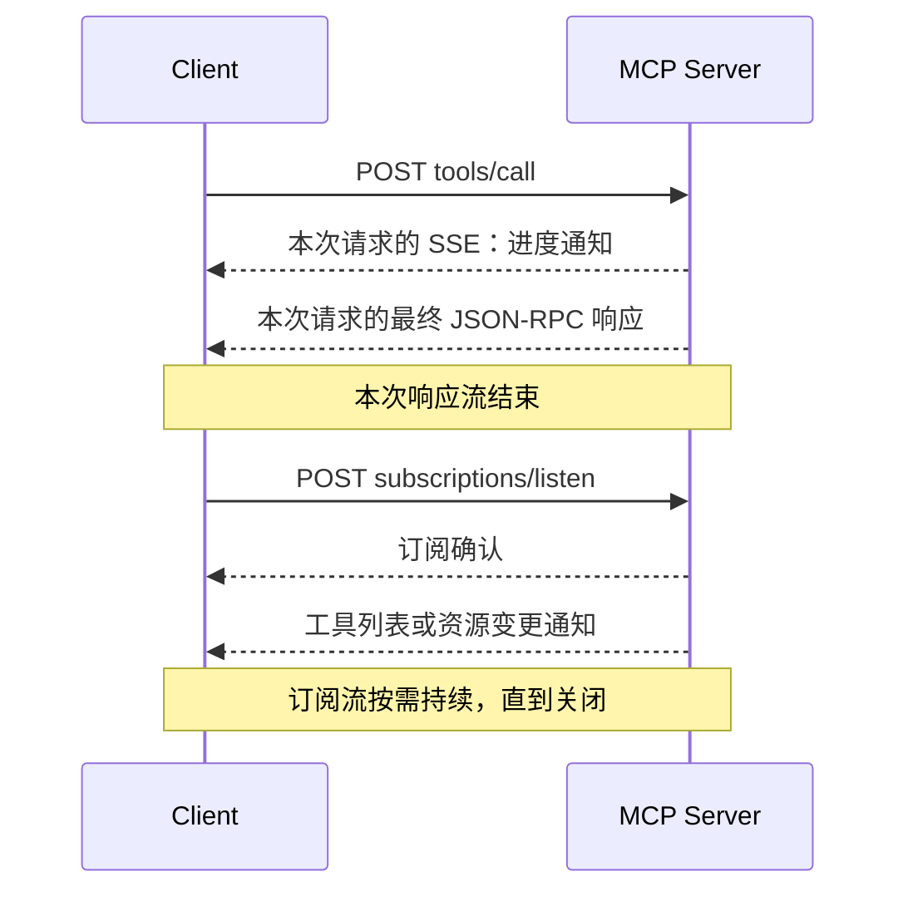

# MCP 的 stdio 和 Streamable HTTP 有什么区别？

> 传输决定 MCP 消息怎么送达，不改变工具含义；选型先看能力运行在哪里，再看连接、授权和故障由谁管理。

## 同一个订单工具，本地启动和团队共享有什么不同？

假设开发者在 IDE 里查询测试订单，而客服团队也要通过浏览器助手查询订单。
两边都调用 `query_order_status`，但部署需求不同：开发者可以由 IDE 启动本地程序；客服不能为每个网页用户安装一套程序，更适合访问集中部署的服务。

这对应两种标准传输：stdio 使用客户端启动的子进程标准流，Streamable HTTP 使用 HTTP 端点。
它们承载的仍是 JSON-RPC 消息，工具名、参数与业务校验不会因为换了传输就改变。

**本文按 2026-11-20 核对的 `2026-07-28` 规范讲解。**
同名的 Streamable HTTP 在 `2025-11-25` 版中仍有不同的会话和恢复机制，不能只看“HTTP”或“SSE”就照搬配置。

| 维度          | stdio                                  | Streamable HTTP                        |
| ------------- | -------------------------------------- | -------------------------------------- |
| 谁启动 Server | Client 通常启动本地子进程              | 团队独立部署服务                       |
| 消息边界      | 每行一个 JSON-RPC 消息                 | 每次 POST 一个请求，响应为 JSON 或 SSE |
| 常见场景      | 本地文件、开发工具、个人集成           | 远程 API、团队共享、多租户服务         |
| 主要故障面    | 程序路径、运行环境、进程退出、消息污染 | TLS、认证、代理、流式响应、网络断连    |
| 安全关注点    | 子进程能访问哪些文件和凭据             | 请求身份、令牌受众、租户与数据权限     |

stdio 不是“没有权限问题”，HTTP 也不是“必须走公网”。
前者继承的本机能力可能很大，后者完全可以部署在内网。

## stdio 为什么一行调试日志就能让连接坏掉？

Client 把消息写到子进程的 `stdin`，从子进程 `stdout` 读取消息；日志另走 `stderr`。
消息使用 UTF-8，以换行分隔，每个消息必须占一行，不能把格式化后的多行 JSON 直接写入通道。
JSON 字符串里的换行可以转义成 `\n`，它不等于在线路中插入一个真正的换行分隔符。

如果 Server 启动时往 `stdout` 打出 `Server started`，Client 会把它当成下一条 MCP 消息尝试解析。
这时真正出错的是通信通道被污染，不是模型不会用工具。
Java 应用的启动横幅、日志框架和依赖库输出，也要检查是否占用了 `stdout`。

注意反方向的误判：**`stderr` 有内容不代表启动失败。**
规范允许信息、调试和错误日志都写到 `stderr`，要结合退出码、有效响应与日志级别判断。

本地“终端能跑，IDE 里跑不起来”，优先核对四件事：

1. 可执行文件和参数是否正确，是否依赖交互式 Shell 才有的 `PATH`。
2. 工作目录是否一致，相对路径有没有指向另一个位置。
3. 所需环境变量与凭据是否明确传入，是否被错误打印到日志。
4. 进程是否持续读取 `stdin`，是否启动后立刻退出。

正常关闭时，Client 先关闭子进程输入流，等待它退出，超时再终止进程。
进程意外退出后可以重启，但未完成请求已经丢失，不能把“程序重新启动”当成“原业务从未执行”。

## Streamable HTTP 的一次请求长什么样？

`2026-07-28` 版使用一个接受 POST 的 MCP 端点。
客户端每次提交一个 JSON-RPC 请求，声明能接收普通 JSON 和 SSE；服务端按本次请求选择返回方式。
下面是省略 TLS 与认证协商过程后，一条完整的工具请求示意：

```http
POST /mcp HTTP/1.1
Host: orders.example.com
Authorization: Bearer <access_token>
Content-Type: application/json
Accept: application/json, text/event-stream
MCP-Protocol-Version: 2026-07-28
Mcp-Method: tools/call
Mcp-Name: query_order_status

{
  "jsonrpc": "2.0",
  "id": "order-query-1",
  "method": "tools/call",
  "params": {
    "name": "query_order_status",
    "arguments": { "orderNo": "O202611200001" },
    "_meta": {
      "io.modelcontextprotocol/protocolVersion": "2026-07-28",
      "io.modelcontextprotocol/clientInfo": {
        "name": "order-assistant", "version": "1.0.0"
      },
      "io.modelcontextprotocol/clientCapabilities": {}
    }
  }
}
```

请求体里的版本与能力信息是协议元数据，HTTP 头把其中一些信息镜像出来，便于网关路由和观测。
`MCP-Protocol-Version` 必须与请求体版本一致，`Mcp-Method` 对应方法名；`tools/call`、`resources/read`、`prompts/get` 还需要对应的 `Mcp-Name`。
服务端不能只相信头部而执行另一个请求体，头体不匹配要拒绝；该版本规定返回 HTTP 400 与 `HeaderMismatch` 错误。

如果工具的 Schema 使用 `x-mcp-header`，还需按规范把相应参数镜像为 `Mcp-Param-*` 头。
非安全 ASCII 的名称或参数值也有专门编码规则，实际实现宜交给兼容该版本的 SDK，不能只手拼示例中的几个固定头。
这些镜像字段都是调用数据，不能替代令牌验证和业务授权。

HTTP 还要防本地服务被恶意网页借 DNS 重绑定访问。
Server 应校验 `Origin`；当该头存在且不合法时，规范要求返回 403，不能把规则误读成“缺少 `Origin` 一律拒绝”。
本地 HTTP 服务宜只监听回环地址，并配置实际认证机制；只绑定本机或配置 CORS 都不能替代身份与资源权限校验。
远程授权的完整链路见[认证授权](./ai-mcp-authorization.html)。

## 用了 SSE，是不是就意味着一直开着一条总连接？

不是。要区分**一次请求的响应流**和**订阅变更的通知流**：



普通工具调用可以一次性返回 `application/json`；耗时调用可以返回 `text/event-stream`，先发送相关进度，最后发送响应。
Client 必须兼容这两种返回，不能看到工具不流式就判定服务端不支持 MCP。
最终响应也不必然表示业务成功，还要检查 JSON-RPC 错误和工具结果，见[分层排障](./ai-mcp-troubleshooting.html)。

需要接收工具列表、资源等变更时，Client 通过 `subscriptions/listen` 主动选择监听类型。
这条响应流发送订阅的变更通知，单次工具调用的进度仍走该调用自己的响应流。
新版不再允许 Server 在 SSE 流里发送独立 JSON-RPC 请求；需要补充输入时，使用结果里的 MRTR 模式，见[请求生命周期](./ai-mcp-lifecycle.html)。

## 为什么旧教程要求 GET、Session ID 和 Last-Event-ID？

因为你看到的可能不是同一代协议。

| 版本或形态                                   | 关键特征                                             | 阅读旧项目时怎么理解                       |
| -------------------------------------------- | ---------------------------------------------------- | ------------------------------------------ |
| `2024-11-05` HTTP+SSE                        | SSE 通道与消息 POST 端点配合，先取得 `endpoint` 事件 | 已弃用的旧传输，不建议新接入采用           |
| `2025-03-26` 至 `2025-11-25` Streamable HTTP | 统一端点，可有 GET 流、协议会话与流恢复              | 按实际协商版本处理可选机制                 |
| `2026-07-28` Streamable HTTP                 | POST 请求，逐请求元数据，订阅走 POST 响应流          | 无协议级 Session ID、GET 通知流和 SSE 续传 |

因此，Streamable HTTP 仍可使用 SSE，不代表它退回了早期 HTTP+SSE。
新版也不要求客户端携带 `Mcp-Session-Id`，不能用 `Last-Event-ID` 恢复丢失的响应流。
只支持新版的服务收到旧 GET/DELETE 时应返回 405；兼容旧版的实现则需要按对应版本提供旧行为。

兼容逻辑也不能简单写成“HTTP 400 就降级”。
先读响应体：现代版本不支持、元数据或头体校验失败也可能返回 400，这时应纠正现代请求，而不是盲目发送旧握手。

## 为什么直连顺畅，经过网关就卡住？

假设订单工具每隔一段时间发送进度，直连可见，经过代理却直到完成才一起显示。
优先查响应缓冲，而不是先换模型：代理可能缓存了 SSE 内容，应用也可能没有及时 flush。
规范建议 SSE 响应携带 `X-Accel-Buffering: no`；代理还要核对对应路由的缓冲和超时配置，不能只增加应用超时。

按链路收集证据会更快：

1. 对比直连和经代理的响应头、首事件时间、最终响应时间。
2. 检查是否保留 `Accept`、版本头与方法头，是否被重定向到登录 HTML。
3. 区分连接超时、首响应超时、读空闲超时和整次请求截止时间。
4. 订阅长时间无变更时可发送 SSE 注释保活；保活只维持连接，不是业务进度或成功凭证。

多副本部署中，新版没有协议级会话，不需要为了这个会话强制粘滞路由。
但跨调用的业务句柄、任务结果和幂等记录仍可能需要共享存储；它们不会因为“协议无状态”就自动跨副本可见。

## 断流和取消，能不能当成业务已回滚？

不能。新版 HTTP 把关闭请求的 SSE 响应流视为取消信号，服务端应尽快停止工作。
stdio 则通过引用请求 ID 的 `notifications/cancelled` 通知取消，因为不能为取消一个请求而关闭所有请求共用的通道。

取消是尽力停止后续工作，已经提交的数据库事务、发出的消息或完成的退款不会自动回滚。
响应流断开后，新版协议要求重新发起请求并使用新的请求 ID；**新的 JSON-RPC ID 不等于新的业务操作**。
写操作应复用业务操作号、先查结果，再在业务幂等约束下恢复，不能让模型换个请求 ID 就再退一次款。

## 小结

1. stdio 管本地子进程标准流，Streamable HTTP 管 HTTP 消息传递；部署和故障面不同，业务授权都不能省。
2. stdio 每行一个 UTF-8 JSON-RPC 消息，`stdout` 只能放协议消息，日志走 `stderr`，且 `stderr` 有输出不等于失败。
3. 新版 HTTP 使用 POST，可返回 JSON 或请求级 SSE；变更订阅另走 `subscriptions/listen`，必需元数据与镜像头必须一致。
4. 旧 HTTP+SSE、旧版 Streamable HTTP 和 `2026-07-28` 的机制不同，GET、Session ID、续传都要按版本判断。
5. 缓冲、空闲超时和断流分别排查；取消不等于回滚，协议重试的新请求 ID 不能替代业务幂等。

## 参考

综合仓库 `docs/` 下 MCP 传输与 Agent 扩展机制资料重写，并于 2026-11-20 逐项核对下列官方原文。
重点纠正了“每个 MCP 都是本地独立进程”“Streamable HTTP 就是旧 SSE”“断线可以直接重做”等概括，并明确区分新旧版取消与续传规则。

- [MCP 2026-07-28：传输总览](https://modelcontextprotocol.io/specification/2026-07-28/basic/transports)
- [MCP 2026-07-28：stdio](https://modelcontextprotocol.io/specification/2026-07-28/basic/transports/stdio)
- [MCP 2026-07-28：Streamable HTTP](https://modelcontextprotocol.io/specification/2026-07-28/basic/transports/streamable-http)
- [MCP 2026-07-28：版本变更](https://modelcontextprotocol.io/specification/2026-07-28/changelog)
- [MCP 2025-11-25：旧版传输，用于兼容对照](https://modelcontextprotocol.io/specification/2025-11-25/basic/transports)

本文做了规范与报文字段核对，未对真实订单服务、商业 Host 或代理部署进行互操作实测。
