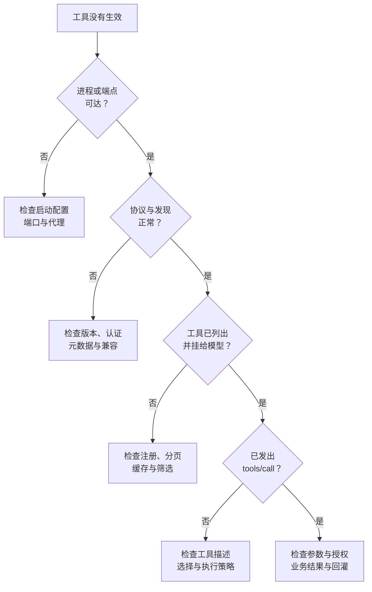

# MCP 工具不出现、调用超时和重复执行时怎么排查？

> 把“工具没生效”拆成可验证的链路；先确定失败停在哪一层，再决定修配置、补能力还是处理业务结果未知。

## 同一句“调不通”，可能是六种不同的问题

假设客服助手接了订单 MCP Server，用户问“订单发货了吗”，页面始终没有给出订单状态。
先别换模型，也别连续重启 Server：进程没起来、协议版本不兼容、工具没注册、模型没选择、业务查失败、结果没回填，都可能产生同样的表象。

本文按 2026-11-20 核对的 `2026-07-28` 规范排查。
这一版不要求 `initialize` 握手，不能拿旧教程里的“有没有初始化成功”作为所有服务的第一道判断。
`2025-11-25` 及以前的连接，才按对应版本检查 `initialize` 与 `notifications/initialized`。

这条链路的作用是缩小问题范围。每一层都留下原始证据，下一层才有判断依据。

## 先绕开模型，把只读调用链跑通

先选一个没有副作用、数据可核对的工具，例如查询一笔测试订单。
在测试环境用支持相应协议版本的 Client 或 Inspector，按下面的顺序验证，不要拿退款、删除工具当连通性探针。

| 验证点       | 要保留的证据                             | 能证明什么                    |
| ------------ | ---------------------------------------- | ----------------------------- |
| 启动或连接   | 进程退出码、stderr，或 HTTP 响应与耗时   | 启动与网络链路能否工作        |
| 现代能力发现 | `server/discover` 的版本、能力与服务信息 | Server 声明支持哪些协议与能力 |
| 工具发现     | 拉完 `tools/list` 的所有分页             | 目标工具是否真正注册          |
| 只读调用     | 固定参数的 `tools/call` 请求与完整响应   | 参数到业务适配的链路是否正常  |
| 结果核对     | 测试订单的业务记录与返回字段             | 工具结果是否真实、准确、脱敏  |
| 模型集成     | 模型收到的工具定义、调用意图与回填结果   | Host 的适配与执行闭环是否正常 |

现代 Client 可以直接调用方法，`server/discover` 并非每次必经的握手。
这里主动调用它是为了排障留证据；Server 必须实现这个方法，Client 是否先调用则是另一回事。
版本与元数据的完整报文见[能力发现与版本兼容](./ai-mcp-lifecycle.html)。

如果只读直调成功、接回模型才失败，问题通常已经缩小到工具挂载、选择或结果回灌，不必继续怀疑数据库连接。
但一次成功样例也不能证明所有租户和参数都正确，授权与边界用例仍需单独验证。

## 工具“不出现”和模型“不选择”，分别查什么？

**Server 的列表里没有工具**，先查工具注册条件、扫描包、配置开关、启动错误和当前部署版本。
同时读完所有分页；只拿第一页就判断“工具丢了”，会误诊按游标分页的服务。

**列表里有，但 Host 看不到**，查 Host 的白名单、用户权限、场景分组、工具名称映射和列表缓存。
新版列表结果的 `ttlMs`、`cacheScope` 是缓存提示和共享范围约束，缓存还必须正确区分身份及授权上下文。
不能把某个用户的私有列表缓存成所有人共享；列表变更后的刷新与订阅也要一起排查。

**Host 已经挂载，但模型没选**，再检查实际发送给模型的工具定义，而非只看 Server 的声明。
工具名和描述是否清楚、Schema 转换是否丢字段、是否与别的工具重名、Host 是否禁用了调用，都可能影响选择。
手动 `tools/call` 成功只证明工具能执行，不证明模型能按自然语言正确选中它。

**模型生成了调用，但 Server 没收到**，查 Host 是否因为审批、参数校验、调用预算或路由规则拦截。
这类情况可能是预期策略生效；应展示明确原因，不能统称“模型不会调 MCP”。

## HTTP 成功、协议成功、业务成功是三回事

拿到响应后，先看传输状态，再看 JSON-RPC 顶层，最后看具体结果类型。
不能只用 `HTTP 200` 或“有 `result` 字段”把整次调用标绿。

| 响应表现                                    | 含义                                   | 下一步                                 |
| ------------------------------------------- | -------------------------------------- | -------------------------------------- |
| 网络超时、连接断开                          | 没拿到可靠终态，业务可能已经执行       | 先判断是否有副作用，再查业务状态       |
| HTTP 认证或网关错误                         | 请求可能尚未进入协议处理               | 查身份、路由与网关原始响应             |
| JSON-RPC `error`                            | 未知工具、请求结构错误等协议失败       | 按错误码修请求或实现，不盲目换业务参数 |
| `resultType: "input_required"`              | MRTR 中间结果，还需要补充输入          | 处理请求的输入，再按规范继续原请求     |
| `resultType: "complete"` 且 `isError: true` | 工具执行失败，例如参数值越界或下游失败 | 给出可行动反馈，按业务规则决定能否重试 |
| `resultType: "complete"` 且工具结果成功     | 这次工具执行得到终态                   | 继续核对数据，再回填模型               |

未知工具、损坏的 `tools/call` 请求结构，与“订单状态不允许退款”不是同一类错误。
前者走协议错误；后者属于工具执行层反馈。错误文本可以帮助模型纠正，但不能回传内部堆栈、SQL 或密钥。

HTTP `400` 也不能一概解释为旧版服务。
`2026-07-28` 会用它报告版本不支持、请求头与消息体不一致等问题。
兼容 Client 应识别响应体中的现代协议错误，修正元数据或选择受支持版本，而非一碰到错误就退回 `initialize`。

## 超时之后，为什么不能直接再执行一次退款？

假设用户已通过可信入口确认一笔 99 元退款，审批系统生成业务操作号 `R202611200001`。
这笔操作绑定当前租户、订单、金额与授权人；工具请求的 JSON-RPC ID 为 `41`。

1. Server 验证授权，业务服务记录这笔退款并调用支付渠道。
2. 渠道退款成功，服务保存了结果，但响应返回途中连接断开。
3. Client 只看到超时，无法据此判断退款有没有发生。
4. Client 先通过受权限保护的状态查询确认这笔操作的终态；已成功就展示原结果。
5. 如果允许重试执行，仍携带同一个业务操作号；新的 JSON-RPC ID 可以是 `42`，业务意图不因此改变。

`2026-07-28` 的响应流不支持用 `Last-Event-ID` 恢复旧请求，协议重发要使用新的请求 ID。
**新的协议请求，不等于新的业务操作。** 如果服务端把每次重发都当成一次新退款，协议完全正确，账仍然会错。

关闭 SSE 流在新版 HTTP 传输中是取消信号，Server 应尽快停止相关工作。
但已经提交的事务、已经成功的支付请求，不会因为断流自动回滚；取消后仍要能查询或对账。
具体传输边界见[stdio 与 Streamable HTTP](./ai-mcp-transports.html)。

## 四种 ID 各自负责什么？

| 标识                  | 负责的问题                   | 能不能直接当业务幂等键？             |
| --------------------- | ---------------------------- | ------------------------------------ |
| JSON-RPC `id`         | 把一次请求与响应对应起来     | 不能，重发与 MRTR 继续请求会换 ID    |
| 旧版 `Mcp-Session-Id` | 标识旧 HTTP 协议会话         | 不能，新版已移除，旧版会话也可能重建 |
| `trace_id`            | 串联一次执行路径的日志与耗时 | 不能，同一业务可能跨多次链路尝试     |
| 业务 `operation_id`   | 标识同一笔被授权的业务意图   | 可以作为幂等依据，仍须校验范围与参数 |

业务操作号应在重试、重连和跨对话继续处理同一笔业务时保持稳定。
它不能只由 `conversationId + toolName + args` 决定：换个对话不应让同一笔退款重新生效，相同参数也可能对应两笔合法且独立的操作。
会话 ID 可以帮助定位来源，但不能替代退款申请号、支付流水等业务标识。

服务端至少要把这几个条件一起落地：

- 在租户与业务类型范围内建立操作号唯一约束，保存处理中、成功、失败等状态及必要结果。
- 同一个操作号重试时检查关键参数摘要；金额或对象变了就拒绝，不能静默复用旧授权。
- 用状态机、金额上限与累计退款校验兜住业务约束；部分退款不能只靠“订单号唯一”处理。
- 幂等记录与本地业务变更尽量放在同一事务；外部渠道使用稳定业务流水，并用查询、回调与对账处理跨系统未知态。

这套保护必须落到业务服务，才能覆盖来自 MCP、普通接口和补偿任务的重复请求。
具体表结构与并发边界见[接口幂等设计](/high-availability/high-availability-idempotency-design.html)。

## MRTR 补充输入，为什么也要考虑重复副作用？

Server 返回 `input_required` 后，Client 会补齐 `inputResponses`，并在存在 `requestState` 时原样带回它，再发起新的 JSON-RPC 请求。
这是协议定义的多轮补充输入，不是一次工具执行失败，也不是“用户重新下单”。

因此，执行器不能在每次进入工具方法时先扣款，再发现缺信息就返回补充请求。
应先完成必要输入和授权检查，把不可逆副作用放到满足条件的阶段，并仍以业务操作号防重。

`requestState` 对 Client 是不透明字符串，不是可以自行修改的业务参数。
Server 必须把传回的状态当作不可信输入：影响授权或业务逻辑时校验完整性，并绑定身份、关键参数及有效期。
签名和有效期只限制重放范围，不能自动保证一次性消费；需要一次性的场景仍要服务端记录消费状态。
补充输入界面本身也不能替代可信的高风险操作审批。

## 怎样让下一次故障能被快速定位？

日志应能从“用户这次任务”一直追到“具体哪笔业务”，而不是只存最终回答。
建议记录协议版本、Server/工具标识、JSON-RPC ID、`trace_id`、业务操作号、用户与租户、阶段耗时、重试原因、结果类型和脱敏后的错误摘要。
令牌、敏感输入及完整订单内容不应为了排障直接写入日志。

上线前可以在测试环境按下面的矩阵做故障注入；这些是待验证的用例，不是本文已经执行过的测试结果。

| 故障或边界                          | 期望行为                                       |
| ----------------------------------- | ---------------------------------------------- |
| 工具未注册、只出现在后续分页        | 能区分注册缺失与分页未读完                     |
| 现代请求头与消息体版本不一致        | 定位到协议字段错误，不无脑降级或重试业务       |
| 切换用户或租户后读取列表与订单      | 缓存和业务授权都不泄漏其他身份的数据           |
| `input_required` 或 `isError: true` | 分别进入补充输入和工具失败分支，不提前宣告成功 |
| 业务成功后丢弃响应，再重复同一操作  | 可以查到原结果，最终业务副作用只发生一次       |
| MRTR 重入、并发重试、跨对话恢复     | 业务幂等继续生效，参数变化不能复用旧授权       |

只读查询在满足限流与预算时可以有限重试，但结果可能因时间变化，不要假设重试得到同一快照。
写操作则要先具备可查询的状态与业务幂等，再讨论退避、次数和自动重试；没有这些条件就明确返回结果未知并进入核查流程。

## 小结

1. 先按启动、传输、协议、发现、选择、执行和回灌逐层留证据；工具不出现与模型不选择是不同问题。
2. HTTP 成功不等于业务成功；JSON-RPC 错误、MRTR 中间结果和 `isError` 必须分开处理。
3. 超时和取消都不能证明业务没有执行，写操作应先查状态，再按业务规则恢复。
4. JSON-RPC ID、旧会话 ID、Trace ID 都不能替代业务操作号；幂等必须跨重试、重连和对话生效。
5. MRTR 的新请求仍可能属于原业务；状态签名、参数绑定、一次性消费和业务状态机各有责任。

## 参考

综合仓库 `docs/` 下 MCP 工程治理资料，并对照站内工具调用约束与接口幂等设计重写；核对日期为 2026-11-20。
通过官方原文确认了新旧协议分界、HTTP 错误处理、工具错误分类和 MRTR 重入规则，纠正“超时就是没执行”“会话 ID 等于业务幂等键”等误解。

- [MCP 2026-07-28：版本与兼容](https://modelcontextprotocol.io/specification/2026-07-28/basic/versioning)
- [MCP 2026-07-28：Streamable HTTP](https://modelcontextprotocol.io/specification/2026-07-28/basic/transports/streamable-http)
- [MCP 2026-07-28：工具与错误处理](https://modelcontextprotocol.io/specification/2026-07-28/server/tools)
- [MCP 2026-07-28：多轮补充输入](https://modelcontextprotocol.io/specification/2026-07-28/basic/patterns/mrtr)
- [MCP 2026-07-28：变更记录](https://modelcontextprotocol.io/specification/2026-07-28/changelog)

本文完成资料交叉核对与排障路径设计，未连接外部 MCP Server，也未实际执行上述退款与故障注入案例。
