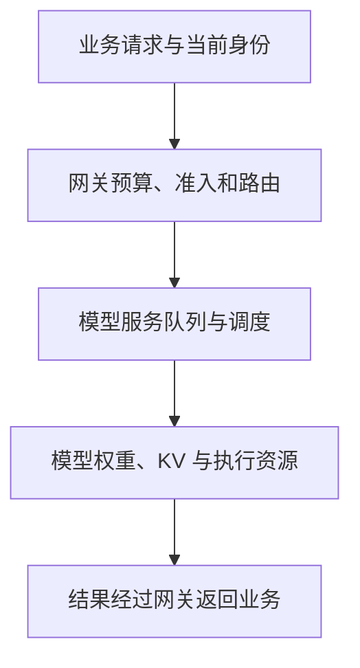

# 模型服务怎样部署，并验证容量与过载行为？

> 部署要同时固定模型与运行环境，再以可比较的负载检查正确性、时延、拒绝和恢复，端口可访问只是其中一步。

## 工单助手连上模型端点，就能接正式流量了吗？

假设工单助手已从业务系统拿到 T-1048 的 `WAITING_VENDOR` 状态，需要模型生成解释。
测试时一名用户很快得到回答，上线后多名用户同时查询，首字等待却明显变长。
原因可能来自模型队列、KV 空间、长上下文，也可能来自网关缓冲。

部署时应明确业务入口、模型入口与执行资源的责任。
业务系统继续控制工单权限，网关处理身份、预算和请求准入，推理服务负责装载模型与执行推理。
托管 API 和自建模型都需要调用侧治理，自建还要承担权重、驱动、调度与运行维护。



## 首次部署前，哪些版本与参数必须能追溯？

至少记录推理引擎版本或镜像摘要、模型仓库与 revision、Tokenizer、Chat Template、量化格式和运行参数。
模型名相同而 revision 不同，输出行为与资源需求都可能变化。
使用远程代码时，还需审核其来源与版本，不能仅为让模型加载成功就无条件打开信任开关。

目标环境也要明确操作系统、GPU 型号和数量、显存、驱动、CUDA 或其他后端兼容条件。
权重文件能下载成功，无法证明当前硬件支持相应算子或量化方式。
权重之外还要为 KV Cache、激活与工作空间预留容量，原理见[推理延迟](./ai-llm-inference-latency.html)。

vLLM 提供 OpenAI-compatible 接口，但具体模型仍需支持目标任务与聊天模板。
Ollama 等实现也有自己的原生接口与兼容范围，不能仅因响应是 JSON 就互换请求格式。
调用方应对实际使用的路径、模型别名、流式事件与用量字段做契约检查。

## 存活、就绪和一次生成成功，分别检查什么？

存活检查关注进程或基本服务是否响应。
就绪检查要确认权重、依赖与必要的执行资源已经准备好，允许接收当前任务。
还需发出有界的试探请求，核对目标模型确实能按约定产生输出。

下面是一条教学用 HTTP 请求，假设测试服务绑定本机回环地址且已配置认证。
模型别名、令牌和参数都须替换为该环境验证过的值，本文没有执行这个请求。

```http
POST /v1/chat/completions HTTP/1.1
Host: 127.0.0.1:8000
Authorization: Bearer <测试环境令牌>
Content-Type: application/json

{
  "model": "ticket-model",
  "messages": [{"role": "user", "content": "仅回答已收到。"}],
  "max_tokens": 64,
  "stream": true
}
```

应验证 HTTP 状态、响应类型、有效文本、结束原因和协议终止，而非把心跳或空分片当成生成成功。
未通过就绪检查的实例不参与业务路由，预热过程也应与正式样本分开记录。
回环绑定只限制一种访问面，仍需检查认证、管理端点、文件与网络访问边界。

## 容量实验怎样控制输入、输出和并发？

先固定模型版本、硬件、精度、调度参数、语料与测量点，再逐步改变一个主要变量。
每组记录请求到达方式、客户端排队、发送时刻、服务端观测和最终结果。

| 实验维度     | 需要保持可比较的部分           | 主要观察                     |
| ------------ | ------------------------------ | ---------------------------- |
| 输入长度     | 输出分布、并发、模板与缓存状态 | 首字等待、prefill 与输入用量 |
| 输出长度     | 输入、并发及采样条件           | 实际生成量、decode 与总时长  |
| 并发或到达率 | 输入输出分布和请求预算         | 等待队列、尾延迟、拒绝与错误 |
| 缓存冷热     | 模型与任务分布                 | 实际命中、预热代价和延迟变化 |

最大输出参数只是上限，不能代替实际生成长度。
热缓存也可能因路由、淘汰、模板变化而失效，应以实际计量确认。
重复同一句短问题得到的容量，不能直接代表长文档问答或多轮 Agent 的业务负载。

客户端限制并发，会让部分请求在客户端等待。
vLLM 官方 benchmark 文档也区分到达率与最大并发，它们控制不同的负载条件。
客户端没有发出更多请求，不能证明服务端能够主动拒绝过载。

## 吞吐、首字和 p95 为什么必须分别报告？

假设某次教学统计在 10 秒观测窗口里完成 20 个请求，完成吞吐就是每秒 2 个请求。
这个比值没有给出每个用户的首字等待，也不能从中推出 p95。
即使完成总数相同，少量用户排队很久也可能导致不同的尾延迟。

报告应同时给样本数、到达方式、成功与失败数量、统计区间及百分位算法。
失败、超时和取消分别计数，不能只对幸存的成功请求给出漂亮均值。
容量目标应包含业务可接受的首字、总时长、错误和质量条件，不能只追求更大的吞吐数。

客户端看到的 SSE 分片间隔并不等于逐 Token 的 ITL。
分片可能聚合多个 Token，隐藏推理或缺少用量信息时，也不能反推虚假的 TPOT 或费用。
自建服务可以结合队列、prefill、decode、KV 与前缀命中指标，实际名称和边界按部署版本核对。

## 超过容量时，怎样让系统有界地等待或拒绝？

请求进入执行前，按用户、租户、模型和 Token 预算做准入，限制队列长度与等待时间。
长上下文和长输出占用的资源不同，仅按 QPS 限额可能无法控制负载。
可以区分交互与批处理任务，使用明确的调度或优先级策略，避免一类请求耗尽全部资源。

不能继续接收时，应返回可识别的拒绝与重试信息，例如约定的 429 和 `Retry-After`。
具体拒绝由网关或服务实现，不能假定每个引擎达到某个并发就自动返回同一错误。
客户端采用有限次数、带抖动的退避，并服从任务总截止时间，防止同步重试放大压力。

压力实验还应检查错误后能否恢复、队列是否回落，以及请求结束后资源是否释放。
如果只增加等待超时，用户仍可能一直占据队列，延迟与内存压力也可能继续累积。

## 超时、取消和模型回滚怎样影响正在执行的请求？

连接截止、读空闲超时和整项任务截止时间分别定义。
用户取消后，调用链应尽快终止尚未执行的工作，并将取消传到推理层，检查残留任务与资源。
连接断开不自动证明后端已经停止生成，外部业务写入也不会随之回滚。

流式回答已经输出一部分后，直接换模型重试可能产生重复、矛盾的文本和额外费用。
应用应记录尝试标识、部分结果与停止原因，并根据业务约定决定是否重新生成。
工具或业务动作仍按自己的审批和幂等规则处理。

版本回滚应恢复完整的模型、Tokenizer、模板与引擎配置组合。
将新流量切回已验证实例，处理旧实例的在途请求，核对回滚后的输出契约和关键回归题目。
保留何种旧实例或状态取决于产品与资源约束，不能只替换权重路径就宣布回滚完成。
完整的观测关联方法见[Agent Trace](./ai-agent-observability.html)。

## 小结

1. 模型部署需要可追溯的权重、Tokenizer、模板、引擎与硬件组合，接口兼容仍须验证。
2. 存活、就绪和有界生成试探分别检查不同层次，预热与正式统计分开记录。
3. 输入、输出、并发与缓存分别控制，客户端等待和服务端排队不能混成一个指标。
4. 容量同时满足吞吐、尾延迟、错误和质量条件，过载需有界准入与有限退避。
5. 超时取消要核对实际执行状态，模型回滚还要处理模板、配置、在途请求与回归。

## 参考

综合仓库 `docs/` 下模型 API 调用工程、网关治理和模型部署资料，于 2026-11-20 对照以下官方正文。
核对接口适用范围、客户端并发控制和引擎指标，避免把端点连通、短问题吞吐或客户端限并发当成完整容量证明。

- [vLLM：Online Serving](https://docs.vllm.ai/en/stable/serving/online_serving/)
- [vLLM：Benchmark serving](https://docs.vllm.ai/en/stable/cli/bench/serve/)
- [vLLM：Metrics](https://docs.vllm.ai/en/stable/usage/metrics.html)
- [Ollama：API Introduction](https://docs.ollama.com/api/introduction)

本文只讲部署与验证方法，HTTP 和吞吐数字均为教学示例，未部署 GPU 服务、执行容量压测或验证特定模型性能。
