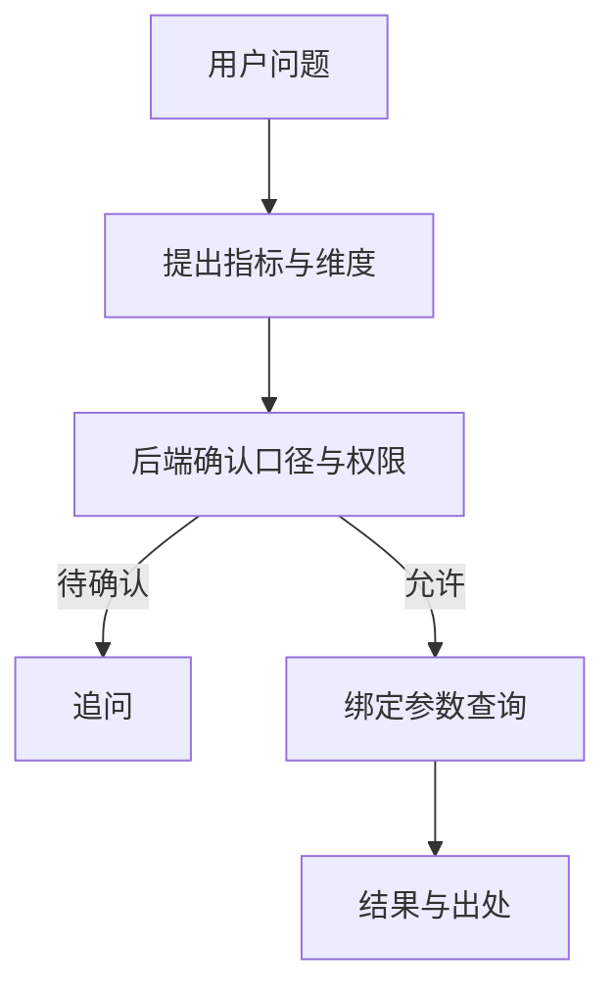

# 自然语言查数怎样对齐指标口径、权限和结果？

> 让模型识别用户想查的指标，再由后端确认口径与可见范围，把数字交给数据库计算。

## 同样一句“上周各组平均首次响应时长”，为什么能查出两个答案？

客服主管想看上周的工单。支持组有一张工单在周日深夜建单，周一凌晨才有人工回复。按建单时间归周，这张算上周。按回复时间归周，它会算进本周。两条查询都能执行，但它们分别在回答“上周进来的工单等了多久”和“上周回复的工单此前等了多久”。

先为第一个问题登记一条业务指标，例如 `first_staff_reply_wall_seconds:v1`。让指标定义、看板和查数助手共用这条约定。

| 口径     | 本例的定义                                             | 为什么要讲清楚                                       |
| -------- | ------------------------------------------------------ | ---------------------------------------------------- |
| 入组条件 | 按创建时间选择工单，按建单时的处理组归集               | 跨周回复和转组不改变归属                             |
| 首次响应 | 第一条符合条件的人工对外回复                           | 机器人回执、内部备注不会提前结束等待                 |
| 单位     | 回复时刻减创建时刻，按自然流逝的秒计算                 | 工作时段耗时需要另一条考虑排班、节假日的指标         |
| 观察截止 | 只纳入数据截至时刻以前已发生、在该版本数据中可见的回复 | 延迟回复可能在后续刷新时改变历史周结果               |
| 分母     | 有符合条件回复的工单数，同时展示建单数与已回复数       | 一个组只回复了半数工单时，平均值仅描述已回复的那一半 |

“上周”也要先定口径。租户已约定使用上海时区和周一开周，本例在 2026 年 11 月 20 日查询时，上一自然周是当地时间 `[11 月 9 日 00:00, 11 月 16 日 00:00)`，转换为 UTC 后是 `[11 月 8 日 16:00, 11 月 15 日 16:00)`。起点含、终点不含，邻接两周的边界行只会落入一周。Java 可以先按 `ZoneId` 求本地两个周一，再用 `LocalDate.atStartOfDay(zone).toInstant()` 换成时间戳，有夏令时的地区也按自己的日历边界计算。

如果产品同时提供“自然耗时”和“工作时段耗时”，用户又只说“响应时长”，系统应按已声明的默认指标解释，或者在两者都合理时问一句。第一次回答显示实际区间、时区和口径，后续追问“那前一周呢”才能有效复用这些条件。

## 模型怎样把一句话变成后端能验证的计划？

给模型看的信息可以是几条允许使用的指标、维度、时间窗口及其含义。用户问完上面这句，模型提出如下候选，服务端收到后再解析和授权。

```json
{
  "metric": "FIRST_STAFF_REPLY_WALL_SECONDS",
  "groupBy": "TICKET_CREATION_GROUP",
  "window": "PREVIOUS_CALENDAR_WEEK"
}
```



后端先用枚举与字段白名单检查结构，再确认指标支持这个分组维度、时间跨度在预算内，并把相对日期按当前业务日历转换成绝对时间。对未知字段或不支持的组合返回明确错误。`tenant_id`、登录用户、可见组、源表、计算表达式均由服务端确定。允许用户点选“华东组”时，服务端也要在此人的可见组内解析名称。

Java 服务可在枚举分派后选固定查询模板，用 JDBC `PreparedStatement` 绑定用户、租户和起止瞬间。占位符表达值。`GROUP BY` 字段、表名、排序方向这些 SQL 结构由注册好的模板或代码选择。只读数据库角色还能限制可访问对象，查询时限与并发配额负责约束资源消耗。结构化输出和工具鉴权的细节见 [Prompt 与结构化输出](./ai-prompt-structured-output.html) 和[工具调用接业务接口](./ai-tool-calling-business-api.html)。

## 权限为什么得在求平均之前确定？

假设同一租户有两个只能被不同角色看见的组，两个租户也可能都用 `support` 作为组 ID。要先按可信的租户、用户、组计算可见记录，再做分组。否则一个用户即使只看到一个组的结果，汇总值也可能已经受到不可见工单影响。用一张记录权限关系的表关联工单时，要把租户放进连接键，并保证权限表对同一主体和组唯一。倘若需要匹配多条权限来源，可以用 `EXISTS` 判断授权，避免把一个工单算几次。

以下例子把一张工单的首条有效回复预先归并为一行，代码聚合的是工单。直接连上包含多条回复的流水表时，先选出每张工单第一条有效人工回复，再核对一张工单只出现一次。对时长做 `AVG(DISTINCT ...)` 会把两张耗时恰好相同的工单压成一项，也会改变分母。行粒度与聚合的关系见[分组与聚合](../database/sql/sql-groupby-aggregate.html)。

`COUNT(*)` 数进入分组的工单，`COUNT(列)` 数该列非空的工单，`AVG(列)` 的分母也是非空值数。把未回复的时长填成零，会把还在等待的工单算成即时回复。没有已回复样本时，平均值保留 `NULL`，展示“暂无已回复样本”。如果组里的建单数也为零，本查询不会生成该组结果。产品需要展示空组时，可先取得授权组，再关联已聚合的结果。

## 怎样用一张小表复现时区、权限和分母问题？

下面片段使用 Node.js 22.18+ 内置的 `node:sqlite`，复制到 `ticket-metric.mjs` 后运行 `node ticket-metric.mjs`。数据保存在本次运行的内存库里，用整数秒表示 UTC 时刻。`caller` 模拟认证层传入的可信身份，权限通过查询实际使用的租户和用户匹配。建单窗口和回复观察截止各用自己的参数，本例的数据批次已覆盖整个建单窗口。如果建单数据只同步了一部分，接口应该明确显示当前覆盖范围。

```javascript
import assert from "node:assert/strict";
import { DatabaseSync } from "node:sqlite";

const db = new DatabaseSync(":memory:");
db.exec(`
  CREATE TABLE visible_group (
    tenant_id TEXT NOT NULL, viewer_id TEXT NOT NULL, group_id TEXT NOT NULL,
    PRIMARY KEY (tenant_id, viewer_id, group_id)
  );
  CREATE TABLE ticket_fact (
    ticket_id TEXT PRIMARY KEY, tenant_id TEXT NOT NULL, created_group_id TEXT NOT NULL,
    created_s INTEGER NOT NULL, first_staff_reply_s INTEGER,
    CHECK (first_staff_reply_s >= created_s)
  );
  INSERT INTO visible_group VALUES
    ('north', 'alice', 'support'), ('north', 'alice', 'field'),
    ('north', 'bob', 'restricted'), ('south', 'alice', 'support');
`);

const add = db.prepare("INSERT INTO ticket_fact VALUES (?, ?, ?, ?, ?)");
const unixSeconds = (iso) => Date.parse(iso) / 1_000;
const start = unixSeconds("2026-11-09T00:00:00+08:00");
const end = unixSeconds("2026-11-16T00:00:00+08:00");
const observedThrough = unixSeconds("2026-11-20T10:00:00+08:00");

add.run("a", "north", "support", start, start + 12 * 60);
add.run("b", "north", "support", end - 5 * 60, end + 13 * 60);
add.run("c", "north", "support", start + 1_200, null);
add.run("d", "north", "support", start + 1_800, observedThrough);
add.run("e", "north", "field", start + 3_600, null);
add.run("f", "north", "support", start - 1, start + 1);
add.run("g", "north", "support", end, end + 30);
add.run("h", "north", "restricted", start + 10, start + 30);
add.run("i", "south", "support", start + 10, start + 100);

const caller = { tenantId: "north", userId: "alice" };
const query = db.prepare(`
  WITH eligible AS (
    SELECT t.created_group_id AS group_id,
           CASE WHEN t.first_staff_reply_s < ?
                THEN t.first_staff_reply_s - t.created_s END AS reply_seconds
    FROM ticket_fact t
    JOIN visible_group p
      ON p.tenant_id = t.tenant_id AND p.group_id = t.created_group_id
    WHERE p.tenant_id = ? AND p.viewer_id = ?
      AND t.created_s >= ? AND t.created_s < ?
  )
  SELECT group_id, COUNT(*) AS tickets, COUNT(reply_seconds) AS replied,
         AVG(reply_seconds) AS mean_seconds
  FROM eligible
  GROUP BY group_id
  ORDER BY group_id
`);

const rows = query
  .all(observedThrough, caller.tenantId, caller.userId, start, end)
  .map((row) => ({ ...row }));
assert.deepEqual(rows, [
  { group_id: "field", tickets: 1, replied: 0, mean_seconds: null },
  { group_id: "support", tickets: 4, replied: 2, mean_seconds: 900 },
]);
console.table(rows);
db.close();
```

`support` 组的两次回复分别等了 12 和 18 分钟，均值 900 秒，即 15 分钟。`a` 恰好建在窗口起点，`b` 虽然跨周回复，仍然属于上周创建的工单。`c` 未回复，`d` 的回复恰好等于观察截止时刻，两者参与建单计数，回复时长为 `NULL`。`f` 和 `g` 落在建单窗口外。`h` 的组对当前用户不可见，`i` 属于另一租户，另有同名组也无法混入。`field` 有一张工单，零个回复样本，平均值为空。

## 结果如何让人复核，出错时又从哪查起？

接口把数据和口径一起返回。每行给 `group`、`tickets`、`replied`、`meanSeconds`，公共字段带指标及版本、查询时间窗和时区、观察截止、数据源与数据批次、`queryId`。面向用户可以显示“支持组 15 分钟，2 / 4 张工单已有首次回复”，并给出受同一权限保护的出处。简单的数值和单位由应用直接渲染。让模型写解读时，引用同一份结果，输出的数字要和原值核对。

审计记录还可以关联后端选择的查询模板版本与此次授权范围。查询缓存按租户、可见范围、口径和时间窗隔离，权限改变后重新检查。一个时间戳说明统计看到哪个时刻，复算出当时那个数字还要有可读取的历史快照或数据批次，特别是工单后来补录回复、迁移或更正时。

验证分三段。先用带标准计划的问题集测意图，覆盖“上周”和“过去 7 天”、自然耗时与工作时段耗时。再用固定记录测查询，核对两端边界、行权限、空分母、转组与重复连接。最后查展示使用了正确的单位、数值、截止时间和文案。这样查错了可以定位到计划选偏、数据库范围偏移，或回答把数字说错。

## 小结

1. 先登记指标口径，明确事件归属、分母、单位、时区和观察截止，再让模型识别用户要查的组合。
2. 模型提出受限计划。服务端检查字段、组合和范围，用可信身份选择参数化模板。
3. 先收敛可见行，再按工单粒度聚合。结果同时展示建单数、已回复数和平均值。
4. 用固定数据核对时间、权限和空样本。审计记录绑定指标版本与数据批次，方便定位和复算。

## 参考

综合仓库 `docs/` 下的 SQL 聚合、表格处理和结构化输出资料。按 SQLite 官方文档核对 `COUNT(*)`、`COUNT(X)` 与 `AVG(X)` 的分母和空值行为，并对照 Java 的绑定和时间 API。

- [SQLite 聚合函数](https://www.sqlite.org/lang_aggfunc.html)
- [PostgreSQL 聚合函数](https://www.postgresql.org/docs/current/functions-aggregate.html)
- [Java JDBC PreparedStatement](https://docs.oracle.com/en/java/javase/21/docs/api/java.sql/java/sql/PreparedStatement.html)
- [Java LocalDate 的 atStartOfDay](<https://docs.oracle.com/en/java/javase/21/docs/api/java.base/java/time/LocalDate.html#atStartOfDay(java.time.ZoneId)>)

正文的九条工单为合成数据。在 Node.js 24.8.0 和 SQLite 3.50.4 上执行片段，两个分组与断言一致。该实验覆盖查询层，模型意图识别与生产数据快照需用各自的输入单独验证。
