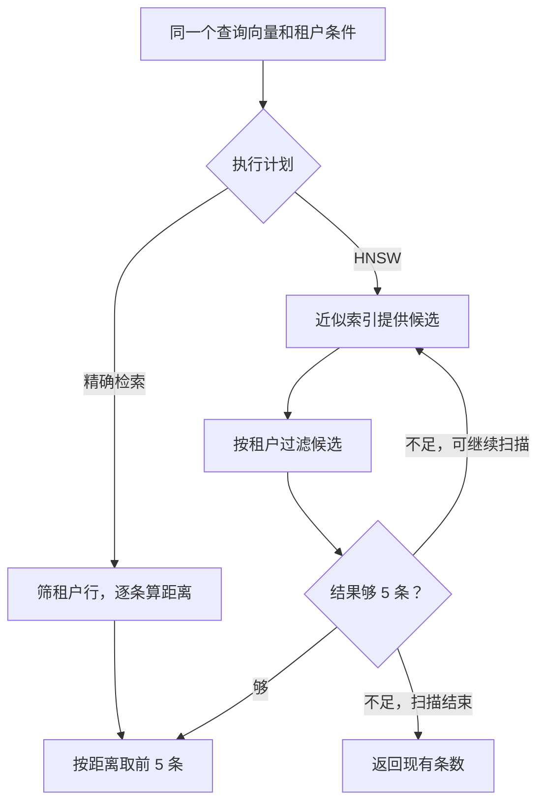

# 向量索引加了租户过滤，为什么凑不齐 Top K？

> 先用同一租户范围内的精确近邻做基线，再看执行计划，才能判断缺的是可检索数据，还是近似索引没扫到这些数据。

## 明明有 80 条可查，为什么会返回 0 条？

工单助手要在租户 42 的知识库里找最相近的 5 条。数据库有 8,000 个片段，其中 80 个属于租户 42。现在建的是全表共享 HNSW 索引。假如索引提供的前 40 个候选都离查询向量很近，却全属于其他租户，执行器按 `tenant_id = 42` 过滤后就只剩 0 条。

这条 SQL 列出了租户谓词和最终排序要求，实际先走哪条路径由执行计划决定。优化器可以先定位租户行再计算距离，也可以从全表 HNSW 索引按距离取候选，并在索引扫描节点上应用过滤。后一路径在当前候选中凑不够结果时，能否继续找取决于扫描设置。



`LIMIT 5` 设定返回上限。关闭迭代扫描时，调大这个上限只改变愿意接收的条数，索引搜索范围仍由 `hnsw.ef_search` 等设置控制。租户条件应来自经过校验的服务端身份，知识库还需按当前文档权限约束候选以及实际交给模型的正文。索引扫描策略决定的是检索效果。 [pgvector 过滤](https://github.com/pgvector/pgvector/tree/v0.8.2#filtering) · [知识库版本与权限](./ai-rag-index-lifecycle.html)

## 怎样判断损失出在索引，还是出在语义？

固定数据快照、查询向量、距离度量、过滤条件和 `K`。把过滤通过的每一行都算一遍距离，取前 `K` 作为精确基线 `E`，然后用同一个查询取近似结果 `A`。

| 指标              | 怎么算                                | 有什么用                         |
| ----------------- | ------------------------------------- | -------------------------------- |
| 返回条数          | `A` 实际有几条                        | 找出列表没凑满的查询             |
| 几何 Recall@K     | `A` 命中的精确近邻数 ÷ `E` 的条数     | 比较索引设置丢了多少最近邻       |
| 业务证据 Recall@K | 命中的黄金证据数 ÷ 此题所需黄金证据数 | 看召回有没有找齐能支撑答案的材料 |

如果该租户只有 3 条符合条件，`K = 5` 时精确基线就是 3 条，找齐这 3 条的几何召回率为 1。没有符合条件的条目时单列为空样本，召回率留空。下面每个向量到原点的距离都不同，比较 ID 就能定位损失。业务数据如果在第 `K` 名有同距并列，先定同距视为等价的计分规则，或用有明确次级顺序的统一口径，避免把两条等距结果算成索引漏召回。

如果向量检索找到了所有精确近邻，仍然漏掉人工标注的“升级例外条款”，再去检查切分、Embedding、关键词召回或过滤条件。近似索引调参只会改变找到几何近邻的机会。 [RAG 检索诊断](./ai-rag-retrieval-diagnosis.html)

## 怎样用执行计划亲手验证？

在装有 pgvector 0.8.0 或以上版本的一次性 PostgreSQL 测试库运行整段 SQL。实验使用三维 L2 距离，ID 越大，向量离原点越远。每 100 条安排一个租户 42 的片段，所以精确的前 5 条可以先心算出来。临时表与参数都在事务中，最后回滚。

```sql
BEGIN;
CREATE EXTENSION IF NOT EXISTS vector;

SELECT current_setting('server_version') AS postgres_version, extversion AS pgvector_version
FROM pg_extension
WHERE extname = 'vector';

CREATE TEMP TABLE rag_chunk (
  id integer PRIMARY KEY,
  tenant_id integer NOT NULL,
  embedding vector(3) NOT NULL
);

INSERT INTO rag_chunk
SELECT i, CASE WHEN i % 100 = 0 THEN 42 ELSE 7 END,
       ARRAY[i::real, 0::real, 0::real]::vector
FROM generate_series(1, 8000) AS s(i);

ANALYZE rag_chunk;

EXPLAIN (ANALYZE, BUFFERS)
CREATE TEMP TABLE exact_top AS
SELECT id
FROM rag_chunk
WHERE tenant_id = 42
ORDER BY embedding <-> '[0,0,0]'::vector, id
LIMIT 5;

CREATE INDEX rag_chunk_hnsw ON rag_chunk USING hnsw (embedding vector_l2_ops);
-- 本实验用这个选项让优化器优先考虑 HNSW，便于对照两种扫描。
SET LOCAL enable_seqscan = off;
SET LOCAL hnsw.ef_search = 40;
SET LOCAL hnsw.iterative_scan = off;

EXPLAIN (ANALYZE, BUFFERS)
CREATE TEMP TABLE ann_once AS
SELECT id
FROM rag_chunk
WHERE tenant_id = 42
ORDER BY embedding <-> '[0,0,0]'::vector
LIMIT 5;

SET LOCAL hnsw.iterative_scan = strict_order;

EXPLAIN (ANALYZE, BUFFERS)
CREATE TEMP TABLE ann_iter AS
SELECT id
FROM rag_chunk
WHERE tenant_id = 42
ORDER BY embedding <-> '[0,0,0]'::vector
LIMIT 5;

SELECT 'exact' AS strategy, count(*) AS returned, array_agg(id ORDER BY id) AS ids,
       CASE WHEN count(*) > 0 THEN 1.0 END AS recall
FROM exact_top
UNION ALL
SELECT 'hnsw off', count(*), array_agg(id ORDER BY id),
       count(e.id)::numeric / NULLIF((SELECT count(*) FROM exact_top), 0)
FROM ann_once AS a LEFT JOIN exact_top AS e USING (id)
UNION ALL
SELECT 'hnsw strict_order', count(*), array_agg(id ORDER BY id),
       count(e.id)::numeric / NULLIF((SELECT count(*) FROM exact_top), 0)
FROM ann_iter AS a LEFT JOIN exact_top AS e USING (id);

ROLLBACK;
```

PostgreSQL 18.0 和 pgvector 0.8.2 下跑了三次，三次都得到同样的条数和 ID。

| 路径                                        | 执行计划中筛掉的行数 | 返回条数 | 返回 ID                 | 几何 Recall@5 |
| ------------------------------------------- | -------------------- | -------- | ----------------------- | ------------- |
| 精确检索                                    | 7,920                | 5        | 100、200、300、400、500 | 1             |
| HNSW，`ef_search = 40`，关闭迭代            | 40                   | 0        | 无                      | 0             |
| HNSW，`ef_search = 40`，迭代 `strict_order` | 495                  | 5        | 100、200、300、400、500 | 1             |

本例的精确计划是 `Seq Scan → Sort → Limit`。扫表后有 80 条通过租户过滤，距离排序取 5 条。近似计划里则是 `Index Scan using rag_chunk_hnsw`、距离 `Order By` 和租户 `Filter`。`Rows Removed by Filter` 统计这个节点拿到候选以后过滤掉的行，在这里能直观看到多找了多少候选。HNSW 内部遍历的图节点数另有口径。

默认优化器在这组小数据上也选了顺扫与排序。实验里的 `enable_seqscan = off` 用来鼓励选择索引路径，比较线上策略时应保留真实优化器设置并核对最终计划。`EXPLAIN (ANALYZE, BUFFERS)` 会执行语句，所以三张临时结果表直接保存了各次实际执行的结果。 [PostgreSQL EXPLAIN](https://www.postgresql.org/docs/18/sql-explain.html)

## 该扩大搜索范围，还是换一条执行路径？

同一张全表 HNSW 索引上，可以先比较更大的 `hnsw.ef_search`，再比较 pgvector 0.8.0 起支持的迭代扫描。`strict_order` 让返回的候选按距离排列，找得够不够仍受近似检索和搜索预算影响。`hnsw.max_scan_tuples` 是继续扫描时的近似预算，初次搜索仍受 `ef_search` 控制。`hnsw.scan_mem_multiplier` 也会影响继续扫描的空间。并发起来后，应一起量召回、尾延迟和内存。 [pgvector 迭代扫描](https://github.com/pgvector/pgvector/tree/v0.8.2#iterative-index-scans)

| 路径                 | 什么时候值得比较                                     | 看什么代价                       |
| -------------------- | ---------------------------------------------------- | -------------------------------- |
| B-tree 加精确排序    | 按租户或组合谓词筛完只剩少量行，逐条算距离有机会更快 | 过滤后行数与维度，大租户可能很慢 |
| 全表 HNSW 加扫描预算 | 热门查询通常能在合理预算内凑齐同租户候选             | 小租户、冷查询的召回与尾延迟     |
| 部分 HNSW 索引       | 少数固定租户或固定业务条件经常查，值得为其建独立索引 | 索引增多带来的写入、构建和维护   |
| 按过滤键分区后建索引 | 查询能按分区键剪枝，希望限制参与检索的分区           | 分区数、租户倾斜和分区内过滤     |

部分索引要求规划器能证明查询谓词满足索引谓词。给 `tenant_id = 42` 建的部分索引，应用用 `tenant_id = $1` 预备查询时，通用计划无法凭未绑定的参数证明这一点。定制计划可以利用本次参数，最终仍应检查实际 `EXPLAIN EXECUTE`。 [PostgreSQL 部分索引](https://www.postgresql.org/docs/18/indexes-partial.html) · [PostgreSQL PREPARE](https://www.postgresql.org/docs/18/sql-prepare.html)

## 怎么判断优化可以上线？

从相同的问集和过滤条件起跑，按租户大小、过滤后行数与问题类型分组。每组同时看达到基线条数的查询比例、几何 Recall@K 和业务证据覆盖。用固定并发重复发起正常查询，按发出查询到收到完整列表的耗时取第 95 百分位，也就是 P95。分别记录预热与冷缓存下的成功数和超时数。成功样本的 P95 下降时，还要核对超时率。单次 EXPLAIN 有测量开销，适合查路径和候选变化。 [PostgreSQL EXPLAIN 的测量开销](https://www.postgresql.org/docs/18/sql-explain.html#SQL-EXPLAIN-NOTES)

如果小租户普通 B-tree 过滤后做精确排序已经满足延迟预算，就保留这条简单路径。如果部分租户采用 HNSW，灰度时按租户组验证扫描预算，并继续检查撤权后的授权过滤和证据引用。评估的依据是业务问集上的召回与耗时，表的总向量数只是其中一个输入。

## 小结

1. 先数过滤范围内共有多少条，再从实际执行计划判断是先筛再精排，还是 HNSW 取候选后过滤。
2. 近似索引和精确基线使用同一数据、距离、权限谓词和 K，几何召回率按实际精确基线条数算。
3. `ef_search` 控制初始候选搜索范围，迭代扫描会在预算内继续找，`strict_order` 约束返回顺序。
4. 用同一问集比较 B-tree 加精确排序、全表 HNSW、部分索引及分区方案，按租户组同时验收召回、P95 和超时率。

## 参考

综合仓库 `docs/` 下的向量库与 RAG 优化资料，用 GrokSearch 查找官方文档并交叉核对过滤顺序、迭代参数及部分索引的计划条件。本文在本地 PostgreSQL 18.0 与 pgvector 0.8.2 上复跑合成数据，验证的是执行计划、过滤条数和几何召回。

- [pgvector 0.8.2 过滤、迭代扫描与性能排查](https://github.com/pgvector/pgvector/tree/v0.8.2#filtering)
- [pgvector 变更日志中的 0.8.0 迭代扫描](https://github.com/pgvector/pgvector/blob/v0.8.2/CHANGELOG.md#080-2024-10-30)
- [PostgreSQL 18 EXPLAIN](https://www.postgresql.org/docs/18/sql-explain.html)
- [PostgreSQL 18 部分索引](https://www.postgresql.org/docs/18/indexes-partial.html)与 [PREPARE](https://www.postgresql.org/docs/18/sql-prepare.html)
