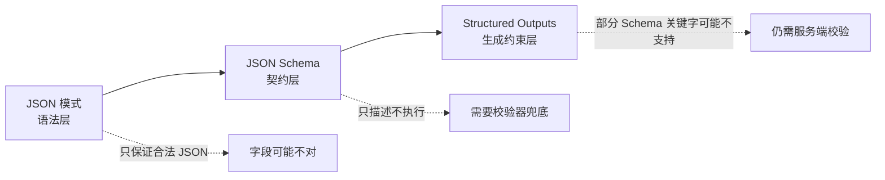
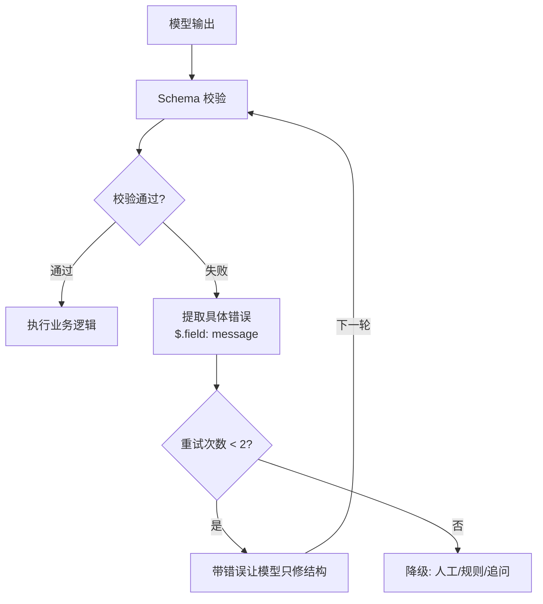

# Prompt 工程和结构化输出怎么落地？

> Prompt 不是咒语，是一份和模型签的契约；结构化输出靠的是约束 + 校验，不是祈祷。

很多人第一次把大模型接进业务都踩同一个坑：本地 Demo 跑得很顺，Prompt 里写一句"请返回 JSON"，模型乖乖吐出一个对象；一上生产就开始冒问题——前面多一句"好的，以下是结果"，少一个必填字段，数字字段变成字符串，或者干脆编一个系统根本不认识的枚举值。解析器一报错，整条链路就断了。

这篇把两件事讲透：一是 Prompt 到底怎么写才算"写清楚"，二是结构化输出怎么从"看起来像 JSON"升级成"后端能稳定消费的契约"。

## Prompt 写得好，到底好在哪

Prompt 好不好不看长度，看有没有把边界讲清楚。一个合格的 Prompt 通常要交代四件事：角色（Role）、任务（Task）、上下文（Context）、格式（Format）。

| 要素           | 作用                         | 常见表述                                      |
| -------------- | ---------------------------- | --------------------------------------------- |
| Role 角色      | 让模型站到合适的知识域和语气 | "你是一位 10 年经验的 Java 架构师"            |
| Task 任务      | 说清要做什么动作             | "请评审下面接口代码的性能问题"                |
| Context 上下文 | 补上和任务相关的背景         | "线上 QPS 2000，响应时间超 500ms"             |
| Format 格式    | 规定输出长什么样             | "输出 JSON，含 bottleneck、solution 两个字段" |

先看一个对比：

```text
差 Prompt：
分析这段代码的性能问题，给出优化建议。

好 Prompt：
你是一位有 10 年经验的 Java 架构师（Role），擅长性能优化与代码评审。
请评审以下接口代码的性能问题（Task）：
- 代码功能：用户订单查询
- 当前状况：线上 QPS 2000，响应时间超 500ms（Context）

输出需包含：
1. 性能瓶颈点（标注代码行号 + 问题描述）
2. 优化方案（附具体修改代码片段）
3. 优化后预期性能指标（Format）
```

差 Prompt 的问题不是"太短"，而是边界太松：模型知道要"分析性能"，却不知道站在什么角色、业务背景是什么、最后输出到什么粒度。于是它只能猜，猜就有概率偏。

这里有个经验性现象值得记住：模型对放在上下文中间位置的关键信息，利用效果往往更差，也就是常说的 "Lost in the Middle"，开头和结尾的信息更容易被注意到。所以实践里可以把角色定义放开头、格式要求放结尾，让模型更容易记住两头约束。但这不是公式，任务类型和输入长度都会影响最佳顺序，关键还是拿真实样例测一遍。

还有个反直觉的点：Prompt 不是越长越好。信息越多，模型越要在噪声里找重点，延迟和成本都上去，幻觉概率也上来。简单任务（查 API、翻译一句话、改一小段文案）一句话就够；复杂任务（代码评审、方案设计）才用四要素框架，但也别把无关背景一股脑塞进去。

> 网上常把"Prompt 调一版就能上线"当常态，真实项目里一条能上线的 Prompt 往往要经历好几轮调整。最小评测可以这样做：选 10-30 条代表性输入覆盖正常/边缘/异常，固定模型、Temperature、System Prompt 和检索材料，每次只改一个变量，看格式合规率、字段缺失率、人工修改次数，上线后保留失败样例定期回放。

## 让模型吐 JSON，为什么会翻车

结构化输出要解决的核心问题，是把"模型看起来像返回 JSON"升级成"后端能稳定消费的结构化数据"。只靠一句"请返回 JSON"，挡不住下面这几类翻车。

**格式漂移**。你让它返回 JSON，它大部分时候会，但不代表每次只返回 JSON：

```text
以下是分类结果：
{
  "category": "PAYMENT",
  "priority": "HIGH"
}
```

人看没问题，程序解析直接失败。流式输出、长上下文、多轮对话里，模型很容易把"解释型回答习惯"带回来。

**字段缺失**。你要求四个字段，它可能只吐两个。在模型视角里这不一定是"错误"——它可能觉得 `priority` 没把握就省略了。但后端 DTO 反序列化、规则引擎、数据库写入都不会因为它"没把握"就自动补齐。

**类型错位**。这是最隐蔽的错误：

```json
{ "orderId": "1029384756", "needManualReview": "false", "confidence": "0.87" }
```

JSON 语法合法，业务类型不合法：`needManualReview` 是字符串不是布尔，`confidence` 是字符串不是数字。很多系统反序列化时会"宽容"地自动转换，看似省事，其实把上游错误静默吞掉，后续排查更痛。

**幻觉字段与枚举越界**。用户输入越规整模型越稳；一旦输入模糊、矛盾或带攻击性，结构就容易崩。它可能编一个业务系统根本不认识的枚举值，比如把优先级写成 `"urgent"`——后端到底当 `HIGH` 还是当非法值？如果在服务端做模糊映射，就等于把模型的不确定性扩散到了业务规则里。

结论很直接：Prompt 可以表达意图，但替代不了 Schema、校验器、重试机制和权限控制。

## JSON 模式、Schema 约束、Function Calling 不是一回事

面试时最容易把 JSON 模式、JSON Schema、Function Calling 混着答，其实它们不在同一层。

- **JSON 模式（JSON Mode）** 是一种输出模式开关，约束模型返回"合法 JSON"。
- **JSON Schema** 是一种结构描述规范，定义字段、类型、枚举、必填、是否允许额外字段。它只描述结构，本身不参与生成。
- **Structured Outputs** 是模型供应商提供的结构化生成能力，把 Schema 接入生成阶段，让输出尽量或严格贴合结构。
- **Function Calling / Tool Calling** 是另一条线：模型根据用户问题和工具描述，生成"调用哪个工具、参数是什么"的结构化意图，真正执行工具的是业务侧。

一句话区分：**JSON 模式管语法，JSON Schema 管契约，Structured Outputs 把契约前移到生成阶段；Function Calling 则在契约之上，把自然语言意图转成可校验的工具调用。**

| 维度           | JSON 模式      | JSON Schema            | Structured Outputs        | Function Calling             |
| -------------- | -------------- | ---------------------- | ------------------------- | ---------------------------- |
| 本质           | 输出格式开关   | 数据结构描述规范       | 模型 API 的结构化生成能力 | 模型到工具的调用意图生成机制 |
| 约束什么       | JSON 语法合法  | 字段/类型/枚举/必填    | 输出贴合 Schema           | 工具名 + 参数                |
| 是否调外部系统 | 否             | 否                     | 否                        | 只生成意图，执行在业务侧     |
| 适合场景       | 简单 JSON 文本 | 定义数据契约和校验规则 | 抽取、分类、参数生成      | 订单查询、发邮件等工具任务   |
| 仍需服务端校验 | 需要           | 需要                   | 仍需要                    | 需要                         |

三层约束可以这样理解：



Function Calling 的名字最容易误导新人——它不是"模型执行你的 Java 方法"。完整链路是：服务端注册工具定义（工具名、描述、参数 Schema）→ 用户发起请求 → 模型生成调用意图（工具名 + 参数）→ 业务侧校验参数并执行真实工具 → 工具结果回填模型 → 模型生成最终回答。模型只负责"要调什么、参数是什么"，执行、校验、权限、审计都在业务侧。

> 很多文章会列一张"哪个模型支持 Structured Outputs / Function Calling"的版本表，但模型迭代很快，今天列的版本号明天可能就变了。别背版本号，记机制：原生结构化输出是把 Schema 前移到生成阶段，具体支持范围和 Schema 关键字支持子集（如 `pattern`、`format`、`oneOf`、递归 `$ref`）都以各厂商当前文档为准。

## 真要上线：校验、重试、降级三道闸

生产环境别假设模型一定听话。结构化输出要按三道闸来设计，任何一道都不能省。



**第一道：服务端 Schema 校验。** 模型返回的不一定是合法业务数据，先用 JSON Schema 校验器过一遍类型、必填、枚举、长度。注意 Schema 设计本身要讲究：一个字段只表达一件事，别把 `"支付问题，高优先级"` 塞进一个 `result` 字段；枚举优先于自由文本，`priority` 用 `enum`，别让它写 `"urgent"`；字段描述要写清"何时用、何时不用"，光写"工单分类"几乎没用。

**第二道：带错误重试。** 不要一失败就把原问题重跑一遍。更好的做法是把校验错误反馈给模型，让它只修结构：

```text
上一次输出没通过 JSON Schema 校验，请只返回修正后的 JSON，不要添加解释。
校验错误：
1. priority 必须是 LOW、MEDIUM、HIGH 之一。
2. confidence 必须是 number。
```

重试最多 1-2 次，每次都带明确错误，重试仍失败就进降级。

**第三道：降级兜底。** 必须回答一个问题：结构化输出失败时业务怎么办？

| 场景             | 降级策略                           |
| ---------------- | ---------------------------------- |
| 工单分类失败     | 进人工队列，标记 `AI_PARSE_FAILED` |
| 订单查询参数缺失 | 追问用户补订单号                   |
| 风险评分失败     | 用规则引擎兜底评分                 |
| 工具调用超时     | 返回"系统繁忙"，不让模型继续猜     |
| 非关键字段缺失   | 用默认值，但记告警                 |

关键原则：**可以降级，但不能让模型编造业务事实。** 工具超时后别让模型基于空结果编回答——它拿到工具错误，只能解释"当前无法完成"，不能猜结果。

Function Calling 还要额外做安全治理，因为这一步会操作真实系统：参数合法不等于业务合法，Schema 只知道 `orderId` 是字符串，不知道这单是不是当前用户的，所以至少三层校验——结构校验、业务校验、权限校验；高风险工具（退款、删数据、发短信）拆成 `prepare` + `confirm` 两步；写操作必须幂等（带 `idempotencyKey`，别让重试变成重复扣款）；全链路审计日志，能回答"模型想做什么、服务端允许了什么、业务系统实际做了什么"。

## 容易踩的坑

**Prompt 越长越不稳。** 不是写得越多越稳。信息越多模型越要在噪声里找重点，延迟和成本上去，幻觉概率也上来。把边界讲清楚就够了，别把无关背景一股脑塞进去。

**强依赖某模型版本特性。** 原生 Structured Outputs、某个采样参数的行为、严格模式的约束细节，都和模型版本强绑定。换模型、换 SDK、换网关时先跑一遍兼容性测试，别默认所有模型都能稳定遵守同一份 Schema。Prompt 和 Schema 里的版本号（`schemaVersion`）也要带上，方便灰度和回滚。

**few-shot 选错反例。** 给示例能稳格式，但示例要和真实任务同类型、能覆盖边缘情况；超过 3 个之后收益通常下降，还多花 Token。更要命的是示例本身挑错了——给的反例恰好是模型容易学坏的样子，反而把它带偏。

**迷信 Temperature=0 一定稳定。** 低 Temperature 是常见做法，但替代不了 Schema。上下文过长、指令冲突、输出截断、工具描述模糊时，结构化输出照样翻车。不同模型对 Temperature 的建议也不同，跨厂商使用按目标模型文档调整，别一刀切。

**工具越多 Agent 越强。** 工具越多模型选择空间越大，误调用概率也上升。工具设计要小而清晰、一个工具只做一件事，大而全的工具最容易让 Agent 犯迷糊。

**以为 Function Calling 能绕过权限。** 它只是参数生成机制，权限控制必须在服务端。Prompt 里写"不要越权查询"只能算提醒，不算安全边界。

## 小结

1. Prompt 好不好的标准是"边界清不清"，不是"长不长"。角色、任务、上下文、格式四要素交代齐，比堆形容词管用得多。
2. "请返回 JSON"只是提示不是契约，挡不住格式漂移、字段缺失、类型错位、枚举越界。
3. JSON 模式管语法、JSON Schema 管契约、Structured Outputs 把契约前移到生成阶段、Function Calling 把意图转成可校验的工具调用——四者不在同一层，别混答。
4. 上线靠三道闸：服务端 Schema 校验、带错误重试、降级兜底；Function Calling 还要叠参数/业务/权限校验、幂等、审计。
5. 别背模型版本号，记机制；别假设模型一定听话，靠约束和校验兜底，不是祈祷。

## 参考

- 综合 docs 下《大模型提示词工程》与《大模型结构化输出：从 JSON 契约到 Function Calling 落地》两篇，交叉验证后用自己的话重写。
- 关键验证点：JSON 模式 / Schema / Structured Outputs 的层次区分、Function Calling 不执行函数只生成意图、服务端校验不可省，均以两篇资料一致表述为准；模型版本支持范围属时效性内容，本文不列具体版本号，以各厂商当前官方文档为准。
