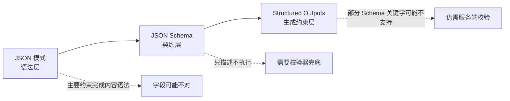
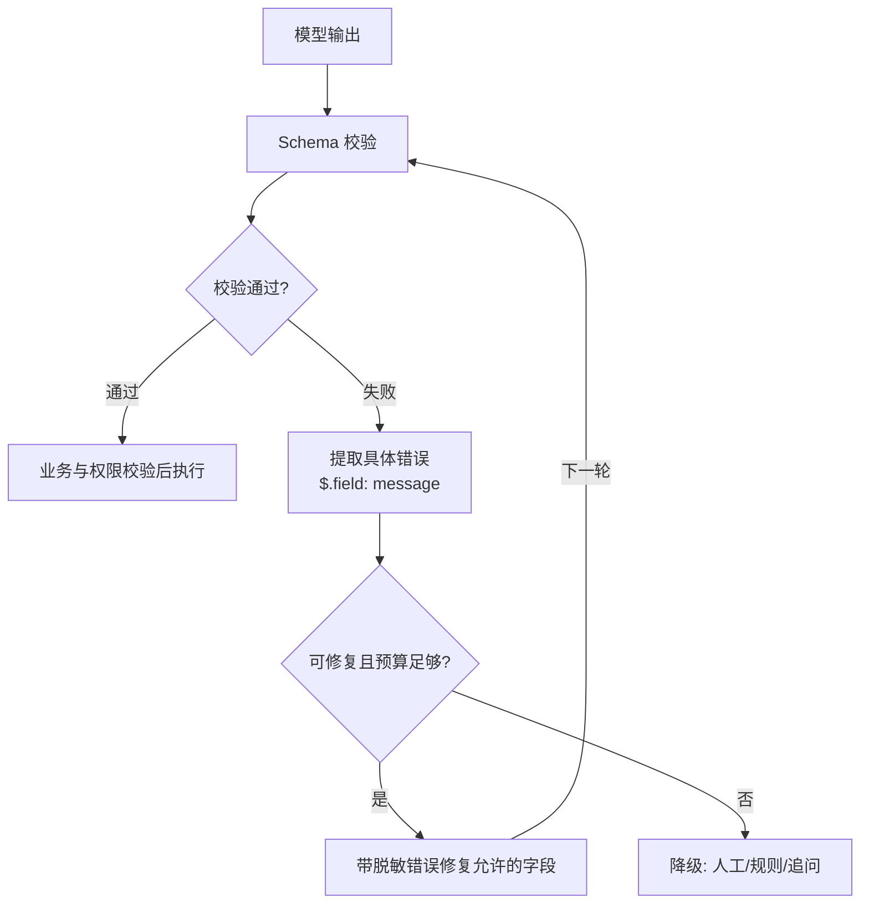

# Prompt 工程和结构化输出怎么落地？

> Prompt 不是咒语，是一份和模型签的契约；结构化输出靠的是约束 + 校验，不是祈祷。

很多人第一次把大模型接进业务都踩同一个坑：本地 Demo 跑得很顺，Prompt 里写一句"请返回 JSON"，模型乖乖吐出一个对象；一上生产就开始冒问题——前面多一句"好的，以下是结果"，少一个必填字段，数字字段变成字符串，或者干脆编一个系统根本不认识的枚举值。解析器一报错，整条链路就断了。

这篇把两件事讲透：一是 Prompt 到底怎么写才算"写清楚"，二是结构化输出怎么从"看起来像 JSON"升级成"后端能稳定消费的契约"。

## Prompt 写得好，到底好在哪

Prompt 好不好不看长度，看有没有把边界讲清楚。一个合格的 Prompt 通常要交代四件事：角色（Role）、任务（Task）、上下文（Context）、格式（Format）。

| 要素           | 作用                         | 常见表述                                      |
| -------------- | ---------------------------- | --------------------------------------------- |
| Role 角色      | 让模型站到合适的知识域和语气 | "请以 Java 性能评审者的视角分析代码"          |
| Task 任务      | 说清要做什么动作             | "请评审下面接口代码的性能问题"                |
| Context 上下文 | 补上和任务相关的背景         | "线上 QPS 2000，响应时间超 500ms"             |
| Format 格式    | 规定输出长什么样             | "输出 JSON，含 bottleneck、solution 两个字段" |

先看一个对比：

```text
差 Prompt：
分析这段代码的性能问题，给出优化建议。

好 Prompt：
请以 Java 性能评审者的视角分析代码（Role），重点关注性能瓶颈与优化依据。
请评审以下接口代码的性能问题（Task）：
- 代码功能：用户订单查询
- 当前状况：线上 QPS 2000，响应时间超 500ms（Context）

输出需包含：
1. 性能瓶颈点（标注代码行号 + 问题描述）
2. 优化方案（附具体修改代码片段）
3. 验证方案与待测指标，明确假设，不承诺未经测量的性能数字（Format）
```

差 Prompt 的问题不是"太短"，而是边界太松：模型知道要"分析性能"，却不知道站在什么角色、业务背景是什么、最后输出到什么粒度。于是它只能猜，猜就有概率偏。

这里有个经验性现象值得记住：模型对放在上下文中间位置的关键信息，利用效果往往更差，也就是常说的 "Lost in the Middle"，开头和结尾的信息更容易被注意到。所以实践里可以把角色定义放开头、格式要求放结尾，让模型更容易记住两头约束。但这不是公式，任务类型和输入长度都会影响最佳顺序，关键还是拿真实样例测一遍。

Prompt 的长度要由任务需要的信息决定。必要的定义、例子与证据可以帮助完成任务，重复、过期或无关内容则会消耗预算并可能干扰判断。不能把长度增加直接等同于质量下降，应在当前模型与业务样本上比较信息完整性、正确率、延迟和成本。

> 网上常把"Prompt 调一版就能上线"当常态，真实项目里一条能上线的 Prompt 往往要经历好几轮调整。最小评测可以这样做：选 10-30 条代表性输入覆盖正常/边缘/异常，固定模型、Temperature、System Prompt 和检索材料，每次只改一个变量，看格式合规率、字段缺失率、人工修改次数，上线后保留失败样例定期回放。

## 让模型吐 JSON，为什么会翻车

结构化输出要解决的核心问题，是把"模型看起来像返回 JSON"升级成"后端能稳定消费的结构化数据"。只靠一句"请返回 JSON"，挡不住下面这几类翻车。

**格式漂移**。你让它返回 JSON，它大部分时候会，但不代表每次只返回 JSON：

```text
以下是分类结果：
{
  "category": "PAYMENT",
  "priority": "HIGH"
}
```

人看没问题，程序解析直接失败。流式输出、长上下文、多轮对话里，模型很容易把"解释型回答习惯"带回来。

**字段缺失**。你要求四个字段，它可能只吐两个。在模型视角里这不一定是"错误"——它可能觉得 `priority` 没把握就省略了。但后端 DTO 反序列化、规则引擎、数据库写入都不会因为它"没把握"就自动补齐。

**类型错位**。这是最隐蔽的错误：

```json
{ "orderId": "1029384756", "needManualReview": "false", "confidence": "0.87" }
```

JSON 语法合法，业务类型不合法：`needManualReview` 是字符串不是布尔，`confidence` 是字符串不是数字。很多系统反序列化时会"宽容"地自动转换，看似省事，其实把上游错误静默吞掉，后续排查更痛。

**幻觉字段与枚举越界**。用户输入越规整模型越稳；一旦输入模糊、矛盾或带攻击性，结构就容易崩。它可能编一个业务系统根本不认识的枚举值，比如把优先级写成 `"urgent"`——后端到底当 `HIGH` 还是当非法值？如果在服务端做模糊映射，就等于把模型的不确定性扩散到了业务规则里。

结论很直接：Prompt 可以表达意图，但替代不了 Schema、校验器、重试机制和权限控制。

## JSON 模式、Schema 约束、Function Calling 不是一回事

面试时最容易把 JSON 模式、JSON Schema、Function Calling 混着答，其实它们不在同一层。

- **JSON 模式（JSON Mode）** 主要约束有效完成内容的 JSON 语法，应用仍要处理截断、拒答和 API 错误，不能把任意响应都当完整 JSON。
- **JSON Schema** 是一种结构描述规范，定义字段、类型、枚举、必填、是否允许额外字段。它只描述结构，本身不参与生成。
- **Structured Outputs** 把供应商支持的 Schema 接入生成阶段。具体保证以目标模型和模式为准，例如 OpenAI 将约束范围限定在完成且非拒答的模型输出，不能据此证明业务事实真实。
- **Function Calling / Tool Calling** 是另一条线：模型根据用户问题和工具描述，生成"调用哪个工具、参数是什么"的结构化意图，真正执行工具的是业务侧。

JSON 模式主要约束语法，JSON Schema 描述结构，Structured Outputs 将支持的约束用于生成。Function Calling 描述工具选择与参数意图，是否严格遵守 Schema 仍需看目标 API 的模式与配置。

| 维度           | JSON 模式      | JSON Schema            | Structured Outputs        | Function Calling             |
| -------------- | -------------- | ---------------------- | ------------------------- | ---------------------------- |
| 本质           | 输出格式开关   | 数据结构描述规范       | 模型 API 的结构化生成能力 | 模型到工具的调用意图生成机制 |
| 约束什么       | JSON 语法合法  | 字段/类型/枚举/必填    | 输出贴合 Schema           | 工具名 + 参数                |
| 是否调外部系统 | 否             | 否                     | 否                        | 只生成意图，执行在业务侧     |
| 适合场景       | 简单 JSON 文本 | 定义数据契约和校验规则 | 抽取、分类、参数生成      | 订单查询、发邮件等工具任务   |
| 仍需服务端校验 | 需要           | 需要                   | 仍需要                    | 需要                         |

三层约束可以这样理解：



Function Calling 的名字最容易误导新人——它不是"模型执行你的 Java 方法"。完整链路是：服务端注册工具定义（工具名、描述、参数 Schema）→ 用户发起请求 → 模型生成调用意图（工具名 + 参数）→ 业务侧校验参数并执行真实工具 → 工具结果回填模型 → 模型生成最终回答。模型只负责"要调什么、参数是什么"，执行、校验、权限、审计都在业务侧。

> 很多文章会列一张"哪个模型支持 Structured Outputs / Function Calling"的版本表，但模型迭代很快，今天列的版本号明天可能就变了。别背版本号，记机制：原生结构化输出是把 Schema 前移到生成阶段，具体支持范围和 Schema 关键字支持子集（如 `pattern`、`format`、`oneOf`、递归 `$ref`）都以各厂商当前文档为准。

## 真要上线：校验、重试、降级三道闸

先确认响应已经有效完成，再检查结构和业务条件。修复适用于允许纠正且预算足够的错误，其他情况应拒绝、追问或降级。
流式参数还未完成时不能提前执行，拒答、截断、API 错误和副作用结果未知也不能统一视作 JSON 格式错误。



**第一道：服务端 Schema 校验。** 模型返回的不一定是合法业务数据，先用 JSON Schema 校验器过一遍类型、必填、枚举、长度。Schema 中一个字段只表达明确的含义，枚举和字段描述也应与业务契约一致。严格生成模式不支持的 Schema 关键字可能导致请求被拒绝，要在注册或启动时核对，不能默认会静默忽略。结构合法以后仍需检查数据来源、对象权限和业务前提。

**第二道：带错误重试。** 不要一失败就把原问题重跑一遍。更好的做法是把校验错误反馈给模型，让它只修结构：

```text
上一次输出没通过 JSON Schema 校验，请只返回修正后的 JSON，不要添加解释。
校验错误：
1. priority 必须是 LOW、MEDIUM、HIGH 之一。
2. confidence 必须是 number。
```

修复次数与总截止时间由任务预算约束，可以从少量修复起步测量。
只传递必要且脱敏的字段错误，不回灌 SQL、堆栈或原始敏感输入。权限拒绝、缺少必须由用户提供的信息，以及业务写入结果未知，不应转成无限换参数尝试。

**第三道：降级兜底。** 必须回答一个问题：结构化输出失败时业务怎么办？

| 场景             | 降级策略                                       |
| ---------------- | ---------------------------------------------- |
| 工单分类失败     | 进人工队列，标记 `AI_PARSE_FAILED`             |
| 订单查询参数缺失 | 追问用户补订单号                               |
| 风险评分失败     | 用规则引擎兜底评分                             |
| 工具调用超时     | 区分只读失败与写入结果未知，必要时先查业务终态 |
| 非关键字段缺失   | 只有业务已约定缺省值时才能补齐，并记录原因     |

关键原则是保留证据与未知状态，不能为填满 Schema 而编造业务事实。
工具超时不证明操作没有执行，写操作应按稳定业务操作号查询终态，再按业务幂等规则恢复，具体见[调用超时与结果未知](./ai-mcp-troubleshooting.html)。

Function Calling 的参数进入真实系统前，需要分别验证结构、业务状态与对象权限。高风险操作可以采用草稿与可信用户确认，确认记录要绑定当前主体、对象、参数与期限。写操作以稳定业务操作号、唯一约束和状态机防重，模型填写一个 `idempotencyKey` 不自动形成保证。审计记录服务端允许了什么、实际执行了什么，不能用模型生成的“用户已确认”替代授权。

## 容易踩的坑

**把长度当作效果判断。** 必要证据和清楚的定义可能提升正确率，无关信息可能制造干扰。比较时固定模型和任务，检查不同信息组合，不能用一个统一长度阈值代替评测。

**强依赖某模型版本特性。** 原生 Structured Outputs、某个采样参数的行为、严格模式的约束细节，都和模型版本强绑定。换模型、换 SDK、换网关时先跑一遍兼容性测试，别默认所有模型都能稳定遵守同一份 Schema。Prompt 和 Schema 里的版本号（`schemaVersion`）也要带上，方便灰度和回滚。

**few-shot 示例未经核验。** 示例应与真实任务匹配，并清楚标明正确行为与边界。数量、顺序和覆盖范围通过业务样本比较，没有通用的“超过3个就失效”规则；错误示范还可能诱导模型重复不合格行为。

**迷信 Temperature=0 一定稳定。** 低温度可以降低部分采样随机性，不保证跨请求逐字一致，也不能消除输入冲突、截断或业务误解。采样参数按目标模型支持范围配置，再用重复运行观察波动。

**工具越多 Agent 越强。** 工具越多模型选择空间越大，误调用概率也上升。工具设计要小而清晰、一个工具只做一件事，大而全的工具最容易让 Agent 犯迷糊。

**以为 Function Calling 能绕过权限。** 它只是参数生成机制，权限控制必须在服务端。Prompt 里写"不要越权查询"只能算提醒，不算安全边界。

## 小结

1. Prompt 好不好的标准是"边界清不清"，不是"长不长"。角色、任务、上下文、格式四要素交代齐，比堆形容词管用得多。
2. "请返回 JSON"只是提示不是契约，挡不住格式漂移、字段缺失、类型错位、枚举越界。
3. JSON 模式管语法、JSON Schema 管契约、Structured Outputs 把契约前移到生成阶段、Function Calling 把意图转成可校验的工具调用——四者不在同一层，别混答。
4. 先判断响应终态，再校验结构与业务条件，只对可纠正错误做预算内修复；工具执行还需要权限、幂等和审计。
5. 别背模型版本号，记机制；别假设模型一定听话，靠约束和校验兜底，不是祈祷。

## 参考

- 综合 docs 下《大模型提示词工程》与《大模型结构化输出：从 JSON 契约到 Function Calling 落地》两篇，交叉验证后用自己的话重写。
- 关键验证点：JSON 模式 / Schema / Structured Outputs 的层次区分、Function Calling 不执行函数只生成意图、服务端校验不可省，均以两篇资料一致表述为准；模型版本支持范围属时效性内容，本文不列具体版本号，以各厂商当前官方文档为准。

2026-11-20 另核对 [OpenAI Structured Outputs](https://developers.openai.com/api/docs/guides/structured-outputs) 的完成响应、拒答、截断和 Schema 支持范围，并对齐站内运行时、上下文与评测篇。本文没有据教学示例承诺某个模型的正确率，也未完成全部供应商的结构化输出联调。
