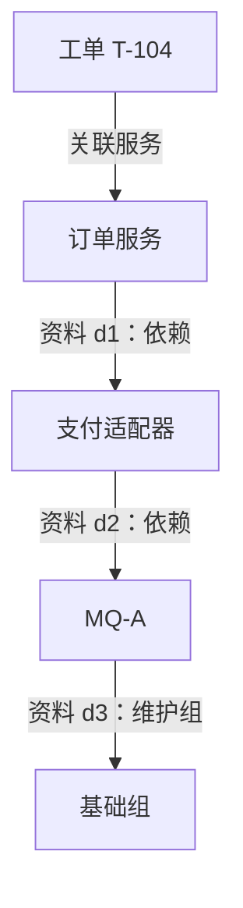

# GraphRAG 什么时候值得用，怎样验证图检索带来的收益？

> 用明确的实体关系补齐证据，再用相同条件的对照实验判断这份额外复杂度是否值得。

## 工单里只有“订单服务”，为什么还要查消息队列的维护组？

客服问：“T-104 的订单服务依赖哪些组件，消息队列由哪个组维护？”工单只关联订单服务，三份资产资料分别记录“订单服务依赖支付适配器”“支付适配器依赖 MQ-A”“MQ-A 由基础组维护”。问题没有写 MQ-A，三份资料也未必重复订单服务这个名字。只拿最相似的几段文本，可能漏掉后两份。

可以先定位订单服务，再沿受控关系收集依赖和维护信息，把每一步的原文交给回答环节。



这里的“依赖”只支持依赖关系。MQ-A 有告警时，图路径不能证明它导致了工单故障；还需时间、调用链和真实运行证据。回答可以列出候选排查对象，不能把连接路径说成已经确认的根因。

若上述关系本来就在资产数据库中，先用参数化查询或固定的连接查询取数更直接。不必先让模型把数据库改写成文本，再重新抽图。模型负责理解用户要问什么、解释查询结果，查询范围和身份仍由后端决定。查数边界见[自然语言查数](./ai-natural-language-analytics.html)。

## 图检索、局部检索和全局归纳分别增加了什么？

广义的 GraphRAG 把图结构作为检索证据的一部分，不限定存储产品。Microsoft GraphRAG 则是一套具体的索引与查询实现，不能把所有图增强方案的能力、字段和成本当成它的统一协议。

| 查询方式               | 主要取什么证据                               | 工单场景里的用途                         |
| ---------------------- | -------------------------------------------- | ---------------------------------------- |
| 文本检索基线           | 按词法、向量或融合排名选文本片段             | 找订单服务的说明和常见处置规则           |
| 图增强的局部检索       | 定位实体，补关系、相关文本和必要摘要，再筛选 | 找这项服务关联的组件与维护组             |
| 社区报告驱动的全局检索 | 对多个社区报告生成局部回答，再汇总           | 归纳一个已授权工单语料集的反复出现的问题 |
| 结构化查询             | 由数据库按明确条件计算行或路径               | 列出指定版本中由某组维护的组件           |

Microsoft 官方的 [Local Search](https://microsoft.github.io/graphrag/query/local_search/) 同时使用实体相关的结构化数据和原文片段，并按上下文预算排序、过滤。它并不等于无限深度遍历。其 [Global Search](https://microsoft.github.io/graphrag/query/global_search/) 使用指定社区层级的报告做分段回答与归并，不是把所有节点直接塞进模型。社区层级改变也会改变细节、报告数量和调用代价。

原始论文研究的重点之一是面向整个语料集的主题归纳，结论来自指定数据与评判方式。不能据此承诺任何多跳问题、任何模型都会更准。官方还提供基础向量检索用于比较；先改写查询、混合召回、补父块或拆问也可能解决当前失败。应先按[RAG 诊断](./ai-rag-retrieval-diagnosis.html)确认缺的确实是关系证据。

## 怎样把一句话抽成一条可以查证的边？

“订单中心”“订单服务”和 `order-service` 可能是同一服务的别名，也可能属于两个环境、两个租户。优先关联资产系统提供的稳定 ID，再在租户和命名空间内处理别名。不能因为名字相同就跨租户合并。对无法确定的对象保留候选，必要时追问，不把不确定关系硬写成事实。

一条应用内部的关系记录可以长这样：

```json
{
  "tenantId": "north",
  "from": "service:order",
  "relation": "DEPENDS_ON",
  "to": "service:payment",
  "source": { "documentId": "asset-order", "revision": 2, "span": "section-3:p2" },
  "extractionVersion": "extractor-demo-v1",
  "reviewStatus": "CONFIRMED",
  "confidence": null
}
```

这组字段是工程示意，不是 Microsoft GraphRAG 的标准输出。来源和原文位置让评审能查到“谁说了这句话”。源版本说明它对应哪次发布，抽取器版本用于定位升级后的变化。模型自行填写的 `confidence: 0.95` 没有经过校准时，不能解释成“95% 概率正确”。本例宁可记录未知，再靠业务验证或人工复核确定是否采用。

建图还要检查关系的方向和适用时间。“曾依赖”不能无条件成为当前依赖。“计划迁移到”也不等于“已迁移”。冲突来源可以并存并展示版本依据，不能只留下后来抽取的那条边。Microsoft 的[索引流程](https://microsoft.github.io/graphrag/index/overview/)包括实体关系抽取、社区发现和报告生成，默认结果可以写成表，并非必须先部署一个独立图数据库。

## 一份摘要的部分来源可见，就能把摘要发给模型吗？

假设一个社区报告同时总结公开工单 d1 和受限工单 d2。用户只能看 d1，报告却写了从 d2 归纳出的内部故障主题。最终隐藏 d2 的引用仍会泄露主题，正文进入模型之前就已经越过授权边界。

派生内容需要自己的可见规则。较稳妥的起点是只在相同授权边界内生成摘要，保留所有依赖的源文档和版本；查询时要求当前用户可访问所依赖的全部来源。来源集合缺失或覆盖不完整时，不能仅凭可见来源的交集放行。若需让用户看到部分来源，基于其可见资料重新生成并单独缓存，而不是在原摘要上删两条引用。

图查询本身也要检查起点、边、终点及来源。允许查看服务名，不代表允许沿它查看客户合同或其他租户的同名节点。查询缓存绑定可信授权范围与索引版本。正文、关系、社区报告和答案缓存都要响应撤权。

更新时记录“源文档 → 关系和实体描述 → 社区报告”的依赖。撤销 d2 后，先让相关派生物不可用，再重建或重新验证；索引回滚仍使用当前权限与删除标记。发布过程沿用[索引生命周期](./ai-rag-index-lifecycle.html)，不把已撤销的边随旧快照一起恢复。

## 怎样用一个小实验检查扩展路径和授权？

以下 Node.js 示例没有调用模型或向量库。它把文本分支的前两条候选固定为 d1 和 FAQ，再从订单服务扩展最多三跳。这个对照只观察预设条件下新增了哪些来源，检查跨租户、受限边及旧版本是否被拦住。保存为 `graph-evidence.mjs`，执行 `node graph-evidence.mjs`。

```javascript
import assert from "node:assert/strict";

const caller = { tenant: "north", groups: new Set(["ops"]) };
const nodes = new Map(
  ["order", "payment", "mq", "platform", "secret"].map((id) => [
    "north:" + id,
    { tenant: "north", groups: [id === "secret" ? "admin" : "ops"] },
  ]),
);
nodes.set("south:mq", { tenant: "south", groups: ["ops"] });

const docs = new Map(
  ["d1", "d2", "d3", "faq", "private"].map((id) => [
    id,
    { tenant: "north", revision: 2, active: true, groups: [id === "private" ? "admin" : "ops"] },
  ]),
);
const edge = (from, to, kind, source, revision = 2) => ({
  tenant: "north",
  from,
  to,
  kind,
  source,
  revision,
});
const edges = [
  edge("north:order", "north:payment", "DEPENDS_ON", "d1"),
  edge("north:payment", "north:mq", "DEPENDS_ON", "d2"),
  edge("north:mq", "north:platform", "MAINTAINED_BY", "d3"),
  edge("north:order", "south:mq", "DEPENDS_ON", "d1"),
  edge("north:order", "north:secret", "DEPENDS_ON", "private"),
  edge("north:order", "north:platform", "MAINTAINED_BY", "d3", 1),
];
const allowedKinds = new Set(["DEPENDS_ON", "MAINTAINED_BY"]);
const visible = (x) =>
  x?.tenant === caller.tenant && x.groups.some((group) => caller.groups.has(group));

function expand(seed, maxHops = 3, maxSources = 3) {
  if (!visible(nodes.get(seed))) return [];
  const seen = new Set([seed]);
  const found = new Map();
  let frontier = [seed];
  for (let hop = 0; hop < maxHops && frontier.length; hop++) {
    const next = [];
    for (const from of frontier) {
      for (const e of edges.filter((item) => item.from === from)) {
        const doc = docs.get(e.source);
        if (
          e.tenant !== caller.tenant ||
          !allowedKinds.has(e.kind) ||
          !visible(nodes.get(e.from)) ||
          !visible(nodes.get(e.to)) ||
          !visible(doc) ||
          !doc.active ||
          doc.revision !== e.revision
        )
          continue;
        if (!found.has(e.source)) {
          if (found.size === maxSources) continue;
          found.set(e.source, { source: e.source, revision: e.revision, hop: hop + 1 });
        }
        if (!seen.has(e.to)) {
          seen.add(e.to);
          next.push(e.to);
        }
      }
    }
    frontier = next;
  }
  return [...found.values()];
}

const textCandidates = ["d1", "faq"];
const expanded = expand("north:order");
assert.deepEqual(
  expanded.map((x) => x.source),
  ["d1", "d2", "d3"],
);
assert.deepEqual(
  expanded.map((x) => x.hop),
  [1, 2, 3],
);
assert.deepEqual(expand("south:mq"), []);
docs.get("d3").active = false;
const afterRevocation = expand("north:order").map((x) => x.source);
assert.deepEqual(afterRevocation, ["d1", "d2"]);
console.log({ textCandidates, expanded, afterRevocation });
```

输出里的图扩展依次来自 d1、d2、d3，三跳才找到维护组。代码同时拒绝了租户字段看似正确、终点却属于别的租户的边，拒绝了受限文档，以及来源修订号不匹配的捷径。撤销 d3 后只留下两跳，回答应说明当前可用证据不足以确认维护组。

真实系统还要限制扫描边数、单节点扇出、总耗时和 Token，而不只是跳数与结果数。少量超级节点也能让两跳变成庞大候选集。保存一条路径上的全部来源，合并重复路径后再排序，避免把“被重复引用得多”当成“证据更可信”。

本例使用手写关系和固定候选，没有抽取错误、词法排序或向量召回，也没有把来源文本交给模型。因此不能从“三份比两份多”推导 GraphRAG 的真实准确率，更不能据此报告性能提升。

## 怎样证明图检索补上的证据值得它的成本？

先从失败案例中分出局部事实、多跳关系、全局主题、精确统计和应拒答问题。每题标注可接受的必要证据集合。局部事实仍用文本检索作对照；全局主题要检查语料覆盖和主题支持，不能只数命中了几段话。

对照时固定同一授权语料快照、生成模型、Prompt、输出上限、缓存与并发条件。给两条路线相同的端到端预算，记录是否发生预算截断。若要单独观察图证据本身的影响，还可以固定最终上下文 Token 预算，再比较哪些必要证据被选中。图路线增加的抽取、建图和报告成本单列，不能只统计最终一次回答。

| 验证项                   | 希望知道什么                                         |
| ------------------------ | ---------------------------------------------------- |
| 必要证据覆盖与关系准确性 | 少了哪一跳，方向、来源与版本是否正确                 |
| 答案及引用               | 路径相关但不足以支持的结论是否被拒绝，是否误报因果   |
| 权限与撤权               | 邻居、路径、社区报告是否越界，旧摘要是否仍可达       |
| 延迟与用量               | 端到端 P95、超时率、上下文 Token、每次尝试和索引开销 |
| 更新成本                 | 修改、删除和撤权后，多少派生物需要重建，多久恢复可用 |

模型输出有波动，比较同题结果并保留多次尝试。把训练抽取器、调规则的问题与最终验收分开，再按[CI 评测门槛](./ai-eval-ci-release-gates.html)决定是否发布。不存在通用的“图检索慢几倍、贵几倍”：语料密度、摘要层级、实现和硬件都会改变结果，只有本次测量能支撑本次判断。

## 小结

1. 先定位失败是否来自缺失关系，再决定补图；已有结构化事实优先用受控查询获取。
2. 局部检索围绕实体收证据，全局检索利用社区报告归纳，安装图数据库不等于具备完整 GraphRAG。
3. 实体、方向、时效和来源共同决定关系是否可用，抽取置信度与图路径不能代替事实验证。
4. 节点、边、来源和派生摘要都遵守当前权限，部分来源可见不能放行整份摘要。
5. 用一致语料和预算比较必要证据、答案、代价与更新，不能把手写路径实验当成生产收益。

## 参考

综合仓库 `docs/` 下图检索、检索优化和知识更新资料，交叉核对 Microsoft 实现和原始论文。修正了“图连接等于因果”“来源有交集即可授权摘要”以及固定成本倍数等过度概括。

- [Microsoft GraphRAG：查询方法总览，含 Basic Search 对照](https://microsoft.github.io/graphrag/query/overview/)
- [Microsoft GraphRAG：Local Search](https://microsoft.github.io/graphrag/query/local_search/)
- [Microsoft GraphRAG：Global Search](https://microsoft.github.io/graphrag/query/global_search/)
- [Microsoft GraphRAG：索引流程](https://microsoft.github.io/graphrag/index/overview/)
- [From Local to Global: A Graph RAG Approach to Query-Focused Summarization，arXiv:2404.16130v2](https://arxiv.org/abs/2404.16130v2)

于 2026-11-20 阅读上述原文，并运行本文 Node.js 固定关系实验，核对路径来源、跨租户和文档可见性、版本及撤销结果。实验未调用 embedding、真实图索引、抽取或生成模型，也未测量线上时延与成本。
