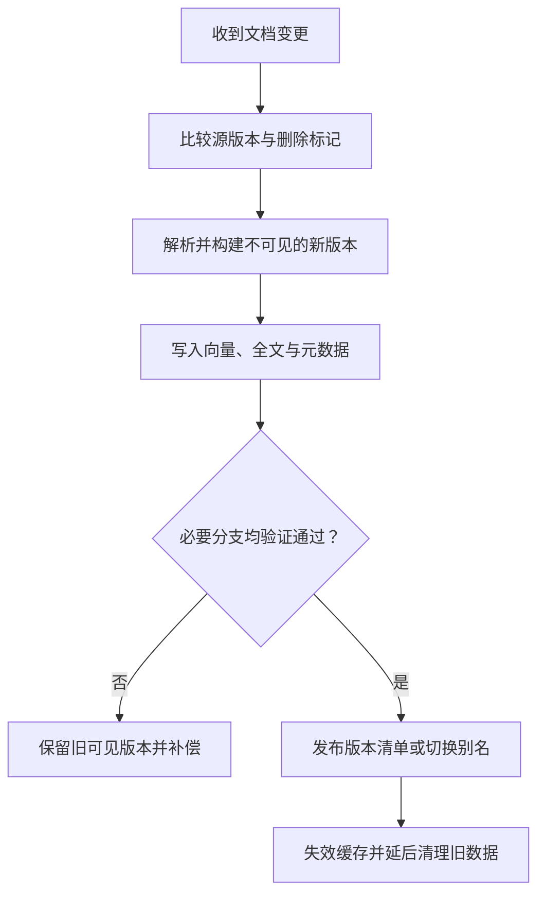

# 知识库改版或撤权后，RAG 为什么还会答旧内容？

> 文档更新要同时处理版本、检索可见性和权限，单独写入新向量无法保证下一次回答使用正确证据。

## 文档已经改了，旧规则从哪里回来？

假设工单助手使用 `escalation-policy` 文档回答升级条件。
旧版要求等待 48 小时，新版改成 24 小时，两处数值只是教学假设。
业务人员发布新版后，助手仍回答 48 小时。

可能是旧块没有退役，也可能是全文索引只更新了一半、检索缓存仍命中旧结果，或者生成服务沿用旧上下文。
因此排查应从答案中的来源标识追到具体文档版本，再逐段检查同步链路。
只检查向量库里“存在新版”还不足以解释当前回答。

## 什么元数据能帮助系统判断该读哪个版本？

文档身份和文档内容要分开保存。
同一文档长期使用稳定的 `documentId`，每次发布的版本另行标记，分块也应能对应回发布版本。

```json
{
  "tenantId": "tenant-demo",
  "documentId": "escalation-policy",
  "sourceRevision": 4,
  "indexGeneration": "knowledge-2026-11-b",
  "chunkId": "escalation-policy:r4:c2",
  "contentHash": "sha256:demo-digest",
  "embeddingSpace": "encoder-a:revision-2:1024",
  "aclRevision": 9,
  "status": "READY"
}
```

这些是应用内部字段，哈希值和编码空间标识也只是示例。
`sourceRevision` 用于判断源文档的新旧，`indexGeneration` 用于选择一次完整发布的检索数据，`aclRevision` 则让权限变更独立于正文更新。

内容相同但权限改变时，也要处理授权和缓存失效。
不能只根据内容哈希相等就跳过整条更新事件。

## 更新一份文档时，先删旧块会有什么故障窗口？

如果先删除旧块，再生成新版向量，编码服务超时会让在线查询暂时找不到任何版本。
一种可选方案是先把新版写入不可见区域，等必要的检索分支都准备好，再发布可见版本。



向量索引和全文索引通常不共享数据库事务。
发布清单可以记录本次必须就绪的分支，每次查询固定一个已发布版本，避免向量走新版、全文仍走旧版。
不支持这种切换的产品，需要设计等价的可见性过滤和失败补偿。

这是一种工程策略，并非所有知识库都必须全量重建。
单文档变更可以只构建该文档的新版本，编码空间或全局解析规则调整时，再评估新建整代索引。

## 消息乱序和删除事件怎样避免旧内容复活？

假设先收到版本 4，再收到延迟到达的版本 3。
消费者应比较源系统提供的版本或等价有序标记，拒绝旧事件覆盖当前可见状态。
相同版本重复投递可以幂等处理，但同版本携带不同正文时，应记录异常并核查来源。

删除也要留下版本化标记。
否则删除完物理数据后，一条较旧的更新事件可能又把文档写回来。
真正重新创建文档，应遵守源系统的新版本或新文档身份约定。

删除标记要覆盖向量、全文、元数据和检索结果缓存。
处理队列失败时用可重试的状态和对账任务修补，并观察还有哪些检索入口保留旧内容。
物理删除和备份清理按保留策略进行，不能把“当前检索不可见”表述成所有副本已经被擦除。

## 撤销权限时，为什么不能等最后显示引用再检查？

假设文档从团队共享改成仅管理员可读，搜索结果缓存里却仍有正文。
即使最终界面隐藏了引用，如果正文已经进入外部重排服务或模型请求，访问边界已经被越过。

检索时应给全文与向量分支都带上可信租户和权限范围。
将候选发送给重排器、模型或其他外部处理器前，再按当前授权判定是否可用。
引用展示和资源下载仍需要鉴权，它们保护的是后续访问，无法追回此前暴露的正文。

这里还要区分逻辑过滤与索引实际执行方式。
例如 pgvector 的近似索引可能先扫描候选再应用过滤，加入 `WHERE` 不意味着底层一定先完成 ANN 预过滤。
应结合产品能力检查召回数量、迭代扫描、分区或独立索引，同时确保未授权内容不会被输出到下游。

## 旧索引可以回滚，旧权限也可以一起回滚吗？

故障时切回上一代内容索引，可以恢复检索服务。
但用户权限撤销和文档删除可能已经发生，不能随内容快照一起恢复成旧授权。
查询时仍要服从当前的授权和删除标记。

查询缓存键至少需要体现检索配置、内容发布版本以及适当的授权作用域。
私有答案缓存也要处理撤权失效，不能只保存“问题文本到答案”的映射。
旧对话中已经出现的敏感内容还需要产品层的历史访问与留存策略，后台重建索引不会自动消除它。

监控可以记录源系统到发布的延迟、部分构建失败、乱序丢弃、旧版本命中、删除后命中和授权拒绝。
这些指标要按知识库或租户观察，具体告警阈值用业务要求和历史基线确定。

## 怎样验证更新链路确实生效？

| 测试场景               | 应验证的结果                 |
| ---------------------- | ---------------------------- |
| 新版构建中有一分支失败 | 查询不会意外读取半成品版本   |
| 新版发布后收到旧事件   | 旧事件不会覆盖新版本         |
| 删除后重放旧更新       | 文档不会被旧事件重新发布     |
| 命中过旧私有缓存后撤权 | 正文在进入重排和模型前被拦截 |
| 回滚内容索引           | 仍遵守当前删除与授权规则     |

需要固定检索输入、知识库状态和调用身份，再核查引用中的版本及下游实际收到的内容。
检索效果如何单独归因，见[RAG 诊断](./ai-rag-retrieval-diagnosis.html)。

## 小结

1. 版本、发布代次与权限各有含义，内容哈希不能代替更新和授权状态。
2. 新版应在必要分支准备好后发布，跨存储的部分成功需要可见性控制和补偿。
3. 源版本判断、删除标记和幂等消费共同防止旧数据复活。
4. 正文进入重排服务或模型前就要满足当前权限，最终隐藏引用无法补救此前的暴露。
5. 内容索引回滚仍须服从当前权限和删除规则，缓存及旧对话访问也要有相应策略。

## 参考

综合仓库 `docs/` 下知识库更新、文档处理、RAG 优化资料，并于 2026-11-20 核对以下官方实现说明。
文中发布清单为推荐设计，修正了先删旧块再构建新版、引用时鉴权就足够、加入过滤就必然在 ANN 扫描前执行等过度简化。

- [pgvector 的过滤与迭代扫描](https://github.com/pgvector/pgvector#filtering)
- [Contextual Retrieval](https://www.anthropic.com/news/contextual-retrieval)

文档和权限变更均为假设，本文未对真实向量库执行更新、删除或授权变更。
