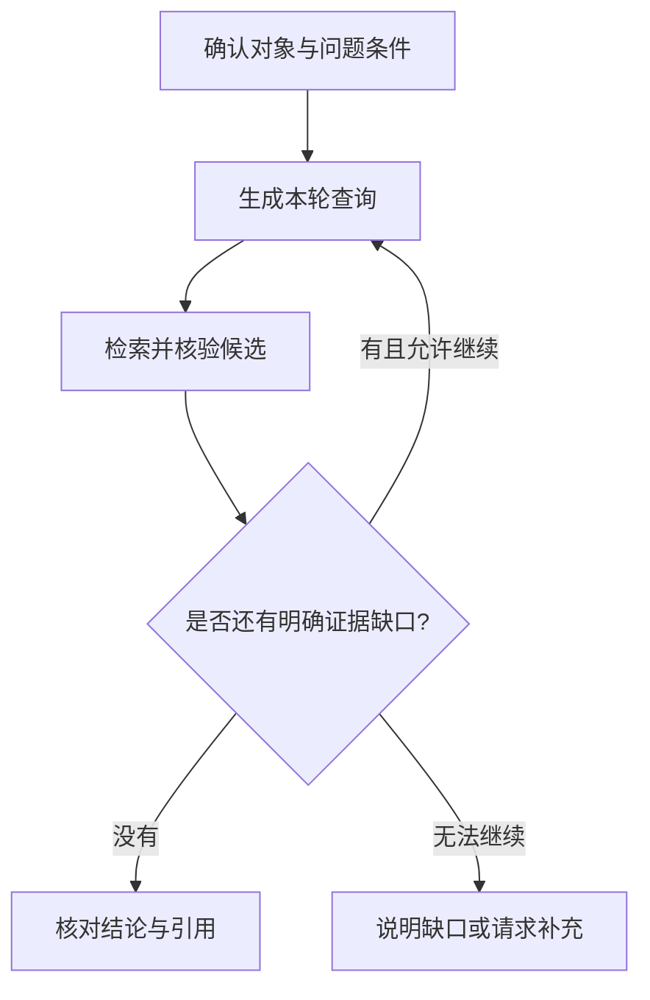

# 多轮 RAG 怎样改写问题，什么时候需要继续检索？

> 把追问恢复成条件清楚的问题，再根据缺少的证据决定是否继续查；改写不能创造事实，循环也不能无限延长。

## 用户问“那周一呢”，检索器到底应该查什么？

假设 north 租户的 alice 正在查询本人工单 T-1048。业务接口返回：工单属于产品 P2，目前为 `WAITING_VENDOR`。

用户先问“为什么还不能升级”，随后追问：

> 那如果没拿到反馈，周一能升级吗？

直接检索这句话，可能找到泛泛的升级规则，却不知道“那”指哪张工单、“反馈”来自谁、“周一”是哪一天。

把所有历史原样交给模型，也可能混入早先回答里的猜测和过期政策。改写要解决的是恢复当前问题，而不是让上一轮答案成为下一轮事实。

本文使用教学场景说明查询规划，不运行检索、模型或业务服务。完整 RAG 链路见[RAG 基础](./ai-rag.html)，各阶段排错见[RAG 故障定位](./ai-rag-retrieval-diagnosis.html)。

## 追问中的哪些条件必须保留下来？

先将问题拆成对象、事实、假设与时间：

| 信息     | 本例中的含义                 | 应怎样取得                           |
| -------- | ---------------------------- | ------------------------------------ |
| 对象     | 工单 T-1048                  | 从当前会话指代中定位，再核验访问权限 |
| 产品     | P2                           | 从获准的业务查询取得                 |
| 当前状态 | 正在等待供应商               | 使用带观察时间的业务记录             |
| 假设条件 | 到目标日期仍未拿到供应商反馈 | 标为用户提出的假设                   |
| 目标时间 | 用户所说的周一               | 按时区和会话语境确认具体日期         |

“如果没拿到反馈”不能改成“已经拿到反馈”，也不能被压缩成“等待时间较长”。否定词改变的是政策适用条件。

同样，“三个工作日”不能简写成“三天”；“P2 产品”不能因另一份政策更容易检索，就换成通用规则。

时间还要区分两个问题：用户可能在问当前政策下的未来条件，也可能在问某个历史日期当时适用的政策。查询计划应明确是哪一种。

假设用户已确认周一指 `2026-11-23`，也只能按现有资料分析条件，不能提前声称那天的反馈状态或政策一定不变。

若同一会话刚讨论两张工单，无法可靠确定指代，就先追问对象。更多检索不能替用户决定他想问哪一张。

## 怎样保存原问题与规范化查询？

原始问题用于复核意图，规范化查询用于检索。两者应分别保存，并记录补充条件的来源。

下面是应用自定义的设计示意，不是某个框架的标准格式：

```json
{
  "original": "那如果没拿到反馈，周一能升级吗？",
  "target": {
    "ticketId": "T-1048",
    "product": "P2",
    "date": "2026-11-23"
  },
  "hypothesis": {
    "vendorFeedbackReceived": false
  },
  "query": "P2 产品工单在未取得供应商反馈时的升级条件与工作日规则",
  "sources": {
    "ticketId": "当前会话中已确认的对象",
    "product": "获准业务查询的结果",
    "date": "用户确认的目标日期"
  }
}
```

租户与访问范围由可信执行上下文提供，不从这段模型生成的 JSON 中认领。即使模型提出查询其他租户，检索入口仍只能使用当前授权范围。

产品、年份等过滤条件可以由语言理解提出，但应用要检查字段类型、允许范围和来源，再与强制授权条件组合。

“保留原问题”也不等于每次都必须让原问题参与召回。是否同时检索原问题与改写问题，应按任务效果和额外成本选择。

## 改写、多查询、拆问和 HyDE，分别在改变什么？

| 方法     | 主要改变                           | 本例中的用途                         |
| -------- | ---------------------------------- | ------------------------------------ |
| 单次改写 | 将追问变为可独立理解的查询         | 补齐工单、产品与反馈条件             |
| 多查询   | 为同一意图生成不同表达             | 同时寻找“升级”“转高级支持”等术语     |
| 拆问     | 将复合问题拆成需要分别回答的部分   | 分别取得升级规则与工作日口径         |
| HyDE     | 生成假设文档，再编码它寻找真实资料 | 当短问题与文档表达差异较大时辅助召回 |

多查询可以增加表达覆盖，也可能引入重复候选与噪声。拆问则要保留子问题之间的关系，不能分别答对后，拼出一个遗漏前提的总答案。

HyDE 中的假设文档可能写出根本不存在的“三天后自动升级”。它只是一条检索线索，不能进入最终证据集合，更不能据此批准操作。

Spring AI 的 RAG 模块提供追问压缩、查询改写和多查询扩展等组件。这些组件帮助组织查询，不意味着接上以后就自动具备可靠的迭代检索、授权或证据充分性判断。

具体能力与调用接口要按所选版本核对。使用哪一种方法，最终仍取决于固定问集上的收益。

## 一轮检索和迭代检索，应该怎样选择？

固定 RAG 通常先生成查询，再执行预定的召回、重排和上下文装配。流程明确，调用数量容易控制。

如果需要的材料可以事先列出，例如同时查政策与工作日规则，一次并行取得两类资料，可能已经足够。

迭代检索则根据新证据决定下一步。例如，第一份政策指向“供应商等待例外”，这条关系原先并不知道，就需要继续查对应条款。



这里的 Agentic RAG 强调根据中间结果组织后续检索，不要求每一步都由模型决定。已知的授权、预算与停止规则应由运行时执行。

如果第一轮已经取得完整依据，就直接回答。复杂编排只有在解决具体缺口时才值得增加。

## 循环状态怎样保存，才不会不断重复搜索？

只保存一段“已经查过资料”的摘要，难以判断下一轮是否有进展。可以维护下面这些结构化信息：

```text
任务条件：对象、产品、目标日期、用户假设及其来源
已知事实：业务状态与观察时间
证据集合：文档标识、版本、位置及支持的条件
当前缺口：还缺哪一项事实、规则或适用范围
已查查询：规范化表达、过滤范围与检索配置
资源预算：轮次、调用数、剩余时间与费用额度
结束原因：为什么交付、追问或停止
```

查询去重不能只比较字符串。两句话可能表达同一检索意图；同一句话在不同版本范围下查询，也可能承担不同任务。

可以把规范化查询、过滤条件和索引发布版本组合记录，再核对新一轮是否取得了之前没有的有效证据。

有效证据也不只是新增文档数量。又查到三份重复政策，仍可能没有补齐供应商例外条款。

模型可以提出“还缺工作日计算规则”，执行器再检查这项查询是否允许、是否重复，以及剩余预算能否支持。不能让模型通过不断声明“还需要查一下”获得新的无限额度。

## 哪些情况应该停止，哪些情况应该换处理方式？

| 情况                           | 合理的后续行为                     |
| ------------------------------ | ---------------------------------- |
| 必要证据已取得且适用条件可核对 | 形成结论并检查引用                 |
| 缺少只有用户能提供的信息       | 追问，而不是重复搜索               |
| 当前主体没有访问权限           | 按访问策略处理，不扩大检索范围     |
| 连续没有新增有效证据           | 保存已知部分，说明未解决的缺口     |
| 达到轮次、费用或时间上限       | 明确预算停止，避免假装已完成       |
| 检索超时或服务故障             | 标记执行错误，按规则有限重试或降级 |

“没有检索到”“检索失败”“当前无权读取”是不同内部状态。用户侧可以遵循统一的信息披露策略，但排障记录不能将它们混成一个空列表。

证据充分性应围绕本题列出的必要条件检查。例如，需要适用政策、供应商例外和工作日口径，就逐项确认来源、版本与适用范围。

检索分数最高，不代表这三项都已满足；模型说“我有把握”，也不能取代这些检查。相关概率边界见[幻觉与拒答](./ai-hallucination-abstention.html)。

## 这次“周一能否升级”，怎样推演一条完整路径？

第一步，确认 T-1048、P2 与目标日期，把“未取得反馈”标为假设。当前真实反馈情况由业务查询提供，两者不能混写。

第二步，查询 P2 的有效升级政策。若找到的普通条款引用供应商例外，就将该引用记成明确缺口，而不是立即套用通用等待天数。

第三步，在同样的授权范围内取得例外条款及必要的工作日规则。日历计算能由代码确定时，不必交给模型猜。

第四步，核对结论能否从这些条件推出。假设条款要求必须取得反馈，那么“到周一仍未取得反馈”的前提下，不能仅凭等待时间宣布满足条件。

若适用条款仍然缺失，就分别说明已经确认的状态与尚无法判断的规则。文章中的条件推演不代表系统真的查询过这些资料，也不代表未来状态已经确定。

## 怎样判断改写与多轮检索真的有帮助？

使用同一份版本化问集，比较原查询、单次改写、固定多查询和有界迭代。证据、权限、初始业务状态与总资源上限保持可比较。

至少覆盖指代歧义、否定条件、产品例外、历史政策、时间口径和证据不足的问题。

分别观察：

- 必要证据是否找齐，以及改写是否改变原意。
- 正确结论、无依据回答、误拒和权限违规。
- 额外模型与检索调用数、总输入量及费用。
- 首个有效内容、任务总时延、超时和预算停止比例。

不能让迭代方案获得无限轮次，再拿它与只能查询一次的基线比较而不报告资源差异。也不能只展示成功题，隐藏无进展循环。

问集和评分依据的保存方式见[评测数据集设计](./ai-evaluation-dataset.html)。本篇只给出比较方案，没有执行效果实验。

## 小结

1. 追问改写要保留对象、时间、否定和适用条件，历史回答与用户假设不能自动成为事实。
2. 原始问题用于追踪，规范化查询用于召回，授权范围始终来自可信执行上下文。
3. 多查询、拆问和 HyDE 各有成本，假设文档只能辅助检索，不能充当证据。
4. 迭代围绕明确缺口推进，记录有效证据、已查查询和资源预算，并区分各种停止原因。
5. 用同一问集与可比较预算衡量证据覆盖、错误、延迟和费用，再决定是否增加检索轮次。

## 参考

综合仓库 `docs/` 下的 RAG 优化、运行时上下文与证据评测资料，交叉整理查询规划和有界迭代。修正了原查询必须共同召回、更多检索必然更准，以及假设文档可以直接支持结论等过度概括。

- [Spring AI 1.1：Retrieval Augmented Generation](https://docs.spring.io/spring-ai/reference/1.1/api/retrieval-augmented-generation.html)——于 2026-11-21 核对追问压缩、查询改写、多查询扩展和检索过滤的原文说明。
- [Precise Zero-Shot Dense Retrieval without Relevance Labels](https://arxiv.org/abs/2212.10496)——同日核对 HyDE 论文摘要，保留假设文档可能包含错误细节的边界。
- [RAG 故障定位](./ai-rag-retrieval-diagnosis.html)、[评测数据集设计](./ai-evaluation-dataset.html)——衔接必要证据、失败归因和同题比较。

工单、政策、查询状态与流程均为教学设计，未执行检索、模型调用或业务操作，未将推演写成实测结果。
