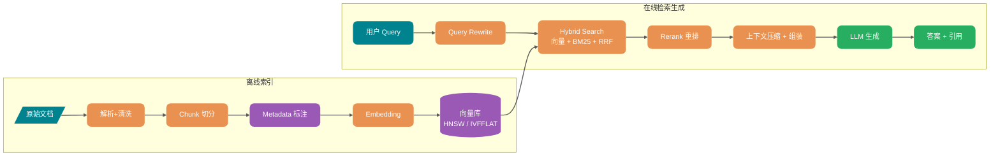

# RAG 从切分到召回怎么做才不翻车？

> 一句话点题：RAG 不是"接个向量库"，切分和召回做不好，再大的模型也救不回来。

做企业知识库问答，很多人第一反应是把文档全塞给大模型。文档少时能跑，涨到几十万字就撞 Token 上限、新内容也不知道，还要算权限、溯源、成本和延迟。于是转向 RAG：先从知识库找出相关片段，再交给模型基于证据回答。听起来就是"检索 + 生成"两步，但做成生产可用，瓶颈往往在更上游——文档没解析对、Chunk 切碎语义、召回候选池没有正确答案。先把全链路串起来：

## RAG 到底解决了什么问题？

LLM 再强也绕不开三件事：知识停在训练截止时间、碰不到企业私有数据、动不动就编。RAG 在回答前先检索相关片段，把"凭参数记忆回答"变成"基于证据回答"——新政策不用重新训练就能喂给模型，私有文档按需暴露相关片段，给模型参考文本能降低编造概率（但检索错了照样翻车，别指望彻底消除幻觉）。那为什么不直接微调？分工很清楚：RAG 解决"模型不知道"，微调解决"模型不会按你的方式说话做事"。

| 维度     | RAG                      | 微调                       |
| -------- | ------------------------ | -------------------------- |
| 知识更新 | 更新索引即可             | 重新准备数据训练           |
| 适合场景 | 知识密集问答、要引用来源 | 风格 / 格式 / 领域术语对齐 |
| 幻觉控制 | 可挂引用溯源             | 仍可能编，来源不可见       |
| 成本结构 | 检索 + Token + 向量库    | 数据标注 + GPU + 评测      |

知识变动频繁、要引用来源优先 RAG；输出风格和任务行为不稳考虑微调；既要懂领域表达又要查实时知识就两者结合，资源有限时先把 RAG 做稳再谈微调。长上下文窗口再大也取代不了 RAG——它适合"单篇长文档深度读"，知识库一大全塞进去成本和延迟扛不住，还会撞上 Lost in the Middle（关键信息在长上下文中间更易被忽略），加上权限隔离、引用溯源这些检索阶段才能解决的事，长上下文做不了。

## 切分这一步，怎么把知识切成能被检索的块？

切分（Chunking）是 RAG 的地基，地基歪了后面重排也难救。

固定长度切分最朴素：每 1000 Token 切一块、相邻重叠 200。实现简单，短文档和 FAQ 够用，但不懂段落、表格、代码块，硬伤是把语义单元切散。比如退货政策：

> "除以下情况外，均可申请七天无理由退货：（一）定制商品；（二）鲜活易腐商品……"

列表刚好跨在切分边界时，前一块只剩"除以下情况外均可退货"，后一块只剩"（一）定制商品"，单看哪个都不完整，模型容易断章取义。递归字符切分模拟人读书：先按段落拆，太大按句号，太长按空格，逐层往下。`RecursiveCharacterTextSplitter` 是典型实现，适合标题不一定每级都有、段落长短不一的文档。语义切分走得更远，用 embedding 判断句子相似度，把意思相近的聚成一组——听起来更智能，但实测容易产出超小块，平均才 43 Token，上下文严重不足，检索基本是废的，还额外吃 embedding 成本、对参数极度敏感。

> 纠偏：网上常把"语义切分"吹成比固定切分高级的银弹，但它对参数敏感、容易产出残缺小块，并不总是更优。设个 `min_chunk_size`（200-400 Token）兜底后效果才会稳，别无脑上。

按文档结构切往往更靠谱：文档自带清晰结构时别强行拆散它。

| 文档类型        | 推荐切分                             | 要点             |
| --------------- | ------------------------------------ | ---------------- |
| Markdown / HTML | 按标题 / 标签层级                    | 不破坏天然结构   |
| PDF             | 按页或章节，复杂布局上 Layout 解析器 | 保住证据边界     |
| 表格密集文档    | 表格单独一块，绝不跨块               | 保住字段关系     |
| 代码            | 按包 / 类 / 函数 / 注释块            | 保住调用语义     |
| 法规合同        | 按条、款、项                         | 保留法律效力单元 |

Chunk 太小丢上下文，太大带噪声、信噪比下降，没有万能值，只有经验起点：FAQ / 短政策 / 接口说明 200-500 Token 起步；技术文档 400-800；法规合同优先按条款结构切；代码按函数 / 类边界切别硬套 Token。通用文本可用 512 Token + 50-100 重叠当基线；事实型查询适合 256-512 的小块，分析型查询适合 1024+ 或页面级切分。

> 纠偏：有实测显示固定 512-token 与递归切分只差约 2 个百分点；页面级切分在金融 / 法律文档上最好（约 0.648），但在 FinanceBench 上 1024-token 反而更优（0.579 vs 0.566）。结论是切分没有银弹，最优策略强依赖文档类型和查询类型，别照搬某个"最佳值"，用评估集选。

重叠是应对边界断裂的标准手段，但不是越大越好：太小边界处语义断裂，太大重复内容多、浪费向量空间还增加检索噪声，当需要手调的参数而不是固定值。语义丢失本质是切分破坏了文本的上下文依赖，而 embedding 只能看到切分后的局部窗口。典型表现：结构截断（条件和流程被切到两块，中间"满足 X 则需 Y"成残缺信息）、表格结构破坏（多行多列表格被解析成混乱文本）。应对办法是给 Chunk 增加语义入口——生成摘要、生成可能回答的问题、把章节标题也入索引；预算够可以试 Parent-Child Chunk：小块（约 300 Token）负责召回，命中后把挂着的父段落（约 1200 Token）放进上下文，兼顾召回精度和上下文完整。

## 向量化与向量库：embedding 怎么选，检索怎么快？

embedding 把文本映射成高维稠密向量，语义接近的文本在向量空间距离更近。维度常见 768 / 1024 / 1536 / 3072，越高表达越丰富但成本越高。选型别只看 MTEB 榜单，要用自己业务问题评测召回率、相关性和延迟：闭源 API（OpenAI text-embedding-3、Cohere、Jina）开箱即用、少运维；开源模型（BGE、GTE、E5、Jina 开源版）适合数据不能出内网、私有化部署。

相似度度量怎么选？余弦相似度看方向是否一致、对长度不敏感，RAG 最常用；内积在向量已归一化时和余弦排序等价、计算更直接；欧氏距离看绝对距离、对幅度敏感，按 L2 训练时用。RAG 用余弦是因为它关心语义方向而非向量长度。

> 纠偏：别凭感觉选度量。要看 embedding 模型是否归一化、官方推荐 metric、向量库索引是否支持对应 operator class。pgvector 里一个常见坑是查询运算符必须和索引 operator class 一致——索引用 `vector_cosine_ops`，查询就得用 `<=>`，否则命中不了索引，退化成全表扫描。

为什么需要向量库和 ANN？没有专门索引时只能全表扫描算距离，百万级数据秒级延迟，实时问答不可接受。ANN（近似最近邻）接受一个工程取舍：不保证 100% 找到绝对最近邻，用一点召回损失换几个数量级的速度提升，把检索压到几十毫秒。常见三类：图索引（HNSW，多层导航小世界图，查询快召回高但吃内存）、量化（IVF-PQ，省内存但有精度损失）、哈希（LSH，相似向量大概率落同桶）。HNSW 和 IVFFLAT 怎么选，核心一句话：HNSW 靠图的连通性找邻居，IVFFLAT 靠聚类缩小范围。

| 特性     | HNSW                     | IVFFLAT                            |
| -------- | ------------------------ | ---------------------------------- |
| 原理     | 分层小世界图             | 聚类 + 倒排桶                      |
| 查询速度 | 更快，召回更稳           | 取决于 lists / probes              |
| 内存     | 高（向量 + 连接）        | 通常更低                           |
| 构建速度 | 较慢                     | 较快但要聚类训练                   |
| 适合     | 中大规模、高召回、低延迟 | 关注内存和构建速度、可接受召回损失 |

HNSW 三个关键参数：`m`（每节点最大连接数，调大召回高但吃内存）、`ef_construction`（构建时搜索范围）、`ef_search`（查询时搜索范围，运行时可调、最该在线调）。pgvector 默认 m=16、ef_construction=64、ef_search=40，实用做法是固定前两个建好索引再调 `ef_search` 找召回与延迟的平衡点，到业务可接受召回就该停。向量库选型没有银弹：小于 100 万且已有 PostgreSQL 优先 pgvector；已有 Elasticsearch 复用 ES 向量 + BM25；百万到亿级上 Milvus / Qdrant / Weaviate；不想自运维用 Pinecone / Zilliz Cloud。规模涨到 1 亿，HNSW 内存和构建成本会成瓶颈，可能要换 IVFFLAT 或专业向量库。

## 召回、重排到上下文，怎么把对的证据送给模型？

朴素 RAG 的召回就是 query 转向量、向量库 Top-K，能跑 demo，生产里很快撞墙。Hybrid Search 是生产默认项。向量检索擅长语义相似，BM25 擅长精确词匹配，两者互补不是替代：问"错误码 E1027"，纯向量可能召回一堆泛化故障，BM25 才能精确命中；问"如何取消订阅"，向量能匹配"关闭自动续费"，BM25 可能匹配不到。两路召回后用 RRF（按排名位置融合，不用比较两种分数）或加权合并，再进 Rerank。

用户的问题不是为检索系统写的——"这个报错咋整""钱能退吗"。Query Rewrite 把问题改写成更可检索的表达：规范化改写、Multi-Query（多说法并行检索）、Query Decomposition（拆子问题）、Step-back（先查背景）、HyDE（先生成假设答案再用它检索）、Self-Query（从问题提取过滤条件）。

> 一个硬坑：Query Rewrite 必须保留原始问题，别只用改写后的查询。让原始 query 和改写 query 一起召回再融合，否则改写模型理解错意图，后面召回全偏。

Rerank 把"相关"重新排成"可回答"。向量检索是双塔思路：query 和 doc 分别编码再算距离，快但不够细；Rerank 用 Cross-Encoder 把 query 和候选放一起打分，更接近"这段话能不能回答这个问题"。问"线程池为什么触发拒绝策略"，向量召回可能找出参数说明、枚举、示例代码，而真正能回答的"队列满 + 达上限触发条件"可能排在后面，Rerank 的价值就是把它顶上来。关键前提：Rerank 前先看 Context Recall，候选池没有正确文档时 Rerank 只是重新排列错误。推荐链路：Metadata 预过滤 → Hybrid Search 粗召回 30-100 条 → 去重 → Rerank 选 5-10 条 → 压缩后进 Prompt。

盲目扩大 Top-K 是最常见的"制造噪声"动作：候选变多、Rerank 延迟升、上下文变长、无关内容多模型更易被干扰。更合理的是分层管理：粗召回 recall_top_k（30-100）→ 重排 rerank_top_n（5-10）→ 上下文 context_top_n（3-6），而不是一个参数管到底。塞太多无关片段，模型会抓错证据、引用错来源。要做去重、压缩、按证据强度排序，并在 Prompt 限定证据边界：只基于上下文回答、上下文不足就拒答、关键结论带引用。

## 评测：怎么判断 RAG 真的变好了？

RAG 优化最怕"我感觉好多了"——没有测试集和回放，就只能记住变好的案例，看不到局部变好整体变差。先建一套最小评估集（50-100 条），覆盖高频问题、线上失败问题、精确匹配问题（错误码 / 版本号 / SKU）、应该拒答的问题，每条带 question、golden_answer、golden_context、必要过滤条件、answer_type。检索指标和生成指标要分开看：

| 指标              | 衡量       | 说明                      |
| ----------------- | ---------- | ------------------------- |
| Hit Rate@K        | 召回       | 正确证据是否进前 K        |
| MRR               | 排序       | 第一个正确证据排得多靠前  |
| Context Recall    | 召回完整性 | 所需证据找全没            |
| Context Precision | 上下文纯度 | 放进上下文的有多少真相关  |
| Faithfulness      | 生成忠实度 | 答案能否被上下文支撑      |
| Answer Relevancy  | 回答相关性 | 答案是否回应了问题        |
| Citation Accuracy | 引用准确性 | 引用位置是否支撑结论      |
| Latency / Cost    | 工程       | P95 延迟、Token、重排耗时 |

RAGAS、DeepEval、LangSmith 都支持围绕这些指标做评估。但 LLM-as-a-Judge 不是裁判真理，只是辅助信号，上线前至少抽样人工复核校准它有没有偏向长答案、漏判引用错误、对中文领域术语不敏感。每次改动（解析器、Chunk、embedding、索引参数、Rerank、生成 Prompt、评估集）都要版本化，否则不知道哪步引入回归。

## 容易踩的坑

- **只调 embedding**：解析错了、Chunk 把条件切丢了、召回候选没正确文档，换再贵的 embedding 也只是让错误更稳定。先用评估集判断是召回 / 排序 / 上下文 / 生成哪类问题，再决定换不换。
- **先向量检索再过滤权限**：Top-10 里 8 条无权限，过滤后只剩 2 条，系统以为"只召回 2 条"，写错还会越权。能预过滤就预过滤。
- **忽略拒答能力**：检索置信度低、证据矛盾、用户无权限时该拒答或追问，而不是编一个流畅答案。
- **过滤条件让 HNSW 退化**：pgvector 的 HNSW 先按向量找候选再过滤，过滤太严结果可能少于 Top-K，必要时增大 `ef_search` / LIMIT 或用带 `WHERE` 的部分索引。

## 小结

- RAG 解决知识时效、私有数据、幻觉三件事；知识变动频繁且要引用来源优先 RAG，输出风格不稳才考虑微调，长上下文替代不了海量知识库和权限隔离。
- 切分没有银弹：固定块够用当基线，按文档结构切更靠谱，语义切分要设 `min_chunk_size` 兜底；Chunk 大小和重叠强依赖文档类型和查询类型，用评估集选。
- embedding 选型别只看榜单；度量要和模型推荐、索引 operator class 一致，pgvector 查询运算符不匹配会退化全表扫描。
- 召回走 Hybrid Search（向量 + BM25 + RRF），Query Rewrite 保留原始问题，Rerank 前先看 Context Recall，Top-K 分粗召回 / 重排 / 上下文三档。
- 评测拆检索指标和生成指标，LLM-as-Judge 只是辅助信号，每次改动版本化并回放——不做评估，优化就是玄学。

## 参考

综合自公开 AI 应用资料《万字详解 RAG 基础概念》《RAG 文档处理与切分策略》《万字详解 RAG 向量索引算法和向量数据库》《万字详解 RAG 优化》，交叉验证后用自己的话重写。主要纠偏点：语义切分易产超小块、切分最优策略强依赖文档 / 查询类型无银弹、相似度度量须与索引 operator class 一致、Top-K 应分阶段管理。涉及 Milvus IVF_RABITQ 等较新量化索引的说法以资料为准（联网核对未成功，未额外编造版本号）。
