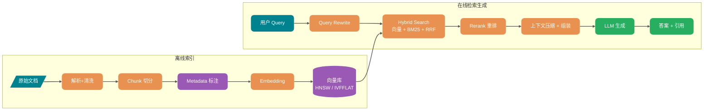

# RAG 从切分到召回怎么做才不翻车？

> RAG 把外部材料变成回答依据，解析、检索、上下文和生成需要分别验证，才能知道证据在哪里丢失或被误用。

做企业知识库问答，可以先把少量材料直接交给模型。资料增长后，就要检查输入预算、时效、权限、来源与延迟。RAG 先找出当前问题需要的片段，再交给模型回答。故障可能出在原文解析、切分、候选召回、上下文裁剪或条件理解，下面先把这些环节串起来。

图中包含混合召回、重排和压缩，是一条可选的完整链路。任务较简单时可以省去未产生收益的环节，再通过评测判断是否需要补充。

## RAG 到底解决了什么问题？

仅靠模型参数，难以及时取得企业当前政策、私有资料和实时业务状态。RAG 在回答前提供可访问的外部证据，并保留来源供核查。它可能减少部分无依据回答，但检索错误、原文过期和生成误读仍然存在，引用本身也需要验证。

| 维度       | RAG                                  | 微调                                         |
| ---------- | ------------------------------------ | -------------------------------------------- |
| 改变的部分 | 回答时获得的外部证据                 | 参数及其对应的输出分布                       |
| 常见用途   | 当前知识、私有资料、可回查来源       | 任务行为、领域表达，也可能改变知识表现       |
| 更新与核查 | 更新资料与索引，处理版本、权限和缓存 | 更新数据、训练与回归，参数知识无逐条撤销保证 |
| 成本结构   | 数据处理、检索、输入与存储           | 数据治理、训练实验、推理与持续回归           |

知识频繁变化、要求回查来源时，可以先评估检索供给。证据已经充分，任务行为仍持续失败时，再比较提示、基础模型和训练候选。微调与 RAG 能组合，具体决策见[微调方案选择](./ai-fine-tuning-decision.html)。

少量材料能满足预算、授权和延迟要求时，直接使用长上下文也可以完成任务。资料规模、更新频率或访问差异增大后，检索有助于缩小每次处理范围。无论是否检索，来源定位与权限都要由系统实现，不能说长上下文本身必然无法引用或过滤资料。

## 切分这一步，怎么把知识切成能被检索的块？

切分（Chunking）决定每份候选带着哪些信息。原文中的条件和例外若已经丢失，后面的重排无法自行补回。

先假设一个教学配置，每 1000 Token 切块，相邻重叠 200。固定切分便于复现，但边界不理解段落、表格或代码的含义。比如退货政策：

> "除以下情况外，均可申请七天无理由退货：（一）定制商品；（二）鲜活易腐商品……"

列表刚好跨在边界时，前一块可能只剩“除以下情况外均可退货”，后一块只有“（一）定制商品”，单独读取会遗漏完整条件。递归切分按配置尝试段落、句子等分隔符，`RecursiveCharacterTextSplitter` 是常见实现。它仍需处理缺少自然分隔符和特殊结构的材料。

语义切分可利用句间表示变化确定边界，也增加编码成本，并可能产生过短或过长的块。应记录长度分布、完整条件覆盖和检索效果，再选择最小长度、最大长度与边界阈值。某份数据中的平均块长或得分差，不能推广成所有材料的固定优劣。

文档具有可靠结构时，可以把这些边界加入候选方案。

| 文档类型        | 可尝试的边界             | 需要保留的关系               |
| --------------- | ------------------------ | ---------------------------- |
| Markdown / HTML | 标题、段落与标签结构     | 章节与正文的关联             |
| PDF             | 阅读顺序确认后的布局区块 | 页码、原文区域与跨页续接     |
| 表格密集文档    | 业务区域或行分组         | 表头、单位、表身份与行列位置 |
| 代码            | 包、类、方法与注释       | 定义、调用背景和所属版本     |
| 法规合同        | 条、款、项及其关联条件   | 适用范围、例外与引用         |

可以先用 512 Token、重叠 64 的教学配置建立基线，再在相同语料和问集上比较 256、512、1024 等目标大小。Tokenizer、模型输入上限和材料结构也要固定。数字只是实验起点，选择时看必要证据是否完整、无关内容、输入量与延迟。

对于大表，可以分组并重复必要表头与单位，不必强塞进一个块。PDF 的阅读顺序也不能仅靠换行推断。具体处理见[文档解析](./ai-rag-document-parsing.html)、[表格证据](./ai-rag-table-evidence.html)和[视觉证据](./ai-rag-visual-evidence.html)。

重叠有助于减轻边界断裂，也会产生重复内容。可以将章节标题与原文一起编码，或尝试 Parent-Child Chunk，用较小子块召回，再读取对应父段落。父段落要保留来源、版本和授权，并计入上下文预算。生成的摘要和假设问题只能作为检索线索，关键结论仍应回到原文核查。

## 向量化与向量库：embedding 怎么选，检索怎么快？

常见稠密 Embedding 模型把文本编码成固定维度向量，再用约定的度量寻找候选。维度更高不自动意味着业务相关性更好。以 1024 维 float32 向量为教学例，原始向量值占 4096 字节，还没有计入索引和存储开销。选型同时检查语言、领域、输入前缀、截断、召回与部署成本，详见[Embedding 与 Reranker](./ai-embedding-reranker.html)。

余弦相似度比较方向，内积也受向量模长影响，欧氏距离衡量空间距离。非零向量都经 L2 归一化后，内积等于余弦相似度，欧氏距离也有对应的排序关系。实际按模型训练与使用说明选择，不把某种度量当成所有 RAG 的固定答案。

pgvector 索引需与距离运算符配套，例如 `vector_cosine_ops` 对应余弦距离 `<=>`。能否使用该索引还取决于查询形状、类型、排序、LIMIT 和规划器成本。应查看执行计划，不能把运算符不匹配直接等同于所有查询必然全表扫描。

精确距离计算的基础工作量通常随候选数与维度乘积增长。候选较少或元数据过滤后范围很小时，精确检索也可能满足要求。ANN 通过图导航、聚类或量化等方式减少搜索工作，通常以近邻召回和资源开销换取速度，但实际收益需测量，不能承诺固定毫秒数。HNSW 使用多层图，IVFFlat 先聚类再搜索部分列表。

| 特性     | HNSW                                     | IVFFlat                           |
| -------- | ---------------------------------------- | --------------------------------- |
| 组织方式 | 多层图及邻接关系                         | 聚类后保存向量列表                |
| 查询取舍 | 调整图搜索范围与过滤策略                 | 调整 `lists`、`probes` 与过滤策略 |
| 构建     | 不需要聚类训练，构图成本受参数影响       | 需要有代表性的数据建立聚类        |
| 资源     | 需保存向量和图连接                       | 需保存向量、列表及聚类信息        |
| 比较方法 | 在目标召回与负载下测延迟、内存、更新成本 | 使用同一数据与目标测量相应代价    |

HNSW 的 `m` 控制连接预算，`ef_construction` 影响构建候选范围，`ef_search` 控制查询搜索范围。本次所读 pgvector 文档默认值为 16、64、40，部署时应核对实际版本。可以固定构建配置，对同一问集改变查询范围，观察目标召回、尾部延迟和资源成本。

已有 PostgreSQL 或 Elasticsearch 时，可以先评估复用检索能力。需要不同扩展、隔离或运维方式时，再比较专门服务。数据条数只是一个输入，向量维度、过滤选择性、并发、更新频率、目标召回和硬件都影响选择，不能按单个规模阈值决定换库。

## 召回、重排到上下文，怎么把对的证据送给模型？

可以分别建立关键词与向量召回基线。问“错误码 E1027”时，关键词通道有助于保留精确词；问“如何取消订阅”时，向量通道可能覆盖“关闭自动续费”这样的改写。若两路在业务问集上互补，再比较 RRF 等融合方案与额外成本。BM25 原理见[相关性打分](../database/elasticsearch/es-scoring.html)，混合检索并非所有任务都必须采用。

用户可能只问“这个报错咋整”“钱能退吗”。Query Rewrite 可以补全或改写查询表达，也可以尝试多说法召回、拆子问题或提取过滤条件。HyDE 生成的假设文本也只能帮助检索，不能当成真实答案或有效授权。

应保留原始问题用于追踪，检查改写有没有丢掉对象、时间、否定条件或单位。是否让原问题与改写问题共同召回，需要按固定问集比较，不能假定增加查询数量总有收益。

Cross-Encoder 是常见 Reranker，把查询与候选一起输入，再按成对分数排序。问“线程池为什么触发拒绝策略”时，可以检查它是否把完整触发条件排到参数枚举之前。重排只能处理已有候选，不能补出未召回的规则，也不保证评分最高的内容真实或适用。

候选池、重排窗口与最终上下文分别管理。教学实验可以先设粗召回 30 条、重排取 5 条、上下文取 3 条，再逐项调整，记录必要证据覆盖与成本。如果一道题需要四份条件，固定取三条就可能不足，窗口数量还要服从证据完整性与模型预算。

上下文去重、压缩后仍需保留限制条件、来源与版本。生成提示可以要求据证回答、材料不足时说明缺口，并验证关键结论与引用相符。如何逐段定位遗漏，见[RAG 诊断](./ai-rag-retrieval-diagnosis.html)。

## 评测：怎么判断 RAG 真的变好了？

先固定一组高价值问题，覆盖常见查询、已确认失败、错误码与版本号、不同身份及应该拒答的情况。可以把 50–100 条作为教学起步规模，不能据此认为样本已经足够代表生产分布。每题记录问题、黄金证据、可接受结论、身份过滤与答案类型，调参集和最终验收集分开。检索指标和生成指标分别观察。

| 指标              | 衡量       | 说明                      |
| ----------------- | ---------- | ------------------------- |
| Hit Rate@K        | 召回       | 正确证据是否进前 K        |
| MRR               | 排序       | 第一个正确证据排得多靠前  |
| Context Recall    | 召回完整性 | 所需证据找全没            |
| Context Precision | 上下文纯度 | 放进上下文的有多少真相关  |
| Faithfulness      | 生成忠实度 | 答案能否被上下文支撑      |
| Answer Relevancy  | 回答相关性 | 答案是否回应了问题        |
| Citation Accuracy | 引用准确性 | 引用位置是否支撑结论      |
| Latency / Cost    | 工程       | P95 延迟、Token、重排耗时 |

证据 ID、版本和对象权限可以先做确定性检查，开放表达质量再用人工或经校准的模型评分辅助。检查 Judge 是否偏向长答案、漏判引用错误或误解领域术语。解析器、切分、编码器、索引、重排、生成配置和问集都应版本化，才能追踪变化来自哪个环节。

## 容易踩的坑

- **只调 embedding**：先检查原文和解析，再判断证据是否进入候选、上下文与答案，避免用换模型掩盖上游缺失。
- **权限检查只放在最后显示引用时**：未授权正文若已进入重排服务或模型，隐藏引用无法追回此前的暴露。全文与向量分支都应带可信作用域，并在正文送往下游处理器前复核当前授权。更新与撤权的完整链路见[索引生命周期](./ai-rag-index-lifecycle.html)。
- **忽略拒答能力**：检索置信度低、证据矛盾、用户无权限时该拒答或追问，而不是编一个流畅答案。
- **过滤后数量不足只改最终 LIMIT**：pgvector 近似索引扫描后应用过滤可能留下较少结果。应比较搜索范围、版本支持的迭代扫描、部分索引或分区，并核对执行计划与预算，最终 LIMIT 本身不保证找回缺失候选。

## 小结

- RAG 为回答供给外部证据，事实、引用与权限仍需验证，微调和长上下文按任务条件组合。
- 切分保留条件与来源，块大小、重叠和父子块策略通过固定问集比较，表格分组仍保留字段关系。
- 编码空间、度量、查询形状与索引配套，维度或数据条数不能独立决定质量和选型。
- 关键词、向量、改写与重排按实际收益配置，候选、重排和上下文窗口分别观察必要证据覆盖。
- 检索与生成分段评测，模型评分需要校准，版本、身份与成本条件固定后再比较改动。

## 参考

综合仓库 `docs/` 下 RAG 基础、文档处理、向量存储与检索优化资料，按 2026-11-20 读取的官方原文校准。
去掉缺少对应实验条件的得分与加速数字，将参数和规模建议改为可验证的比较起点，补充表格分组、模型空间与规划器边界。

- [Sentence Transformers：独立编码与检索用途](https://www.sbert.net/docs/sentence_transformer/usage/usage.html)
- [Cross-Encoder：成对评分与分数契约](https://www.sbert.net/docs/cross_encoder/usage/usage.html)
- [pgvector：索引、过滤和查询条件](https://github.com/pgvector/pgvector)
- [PDFBox 3.0.8：文字提取与顺序](https://javadoc.io/static/org.apache.pdfbox/pdfbox/3.0.8/org/apache/pdfbox/text/PDFTextStripper.html)
- [Apache POI：单元格、类型与表格结构](https://poi.apache.org/components/spreadsheet/quick-guide.html)

本文没有进行真实向量库压测、OCR、训练或模型效果实验。文中数值示例用于说明配置与工作量，实际性能和质量应按锁定版本及业务样例测量。
