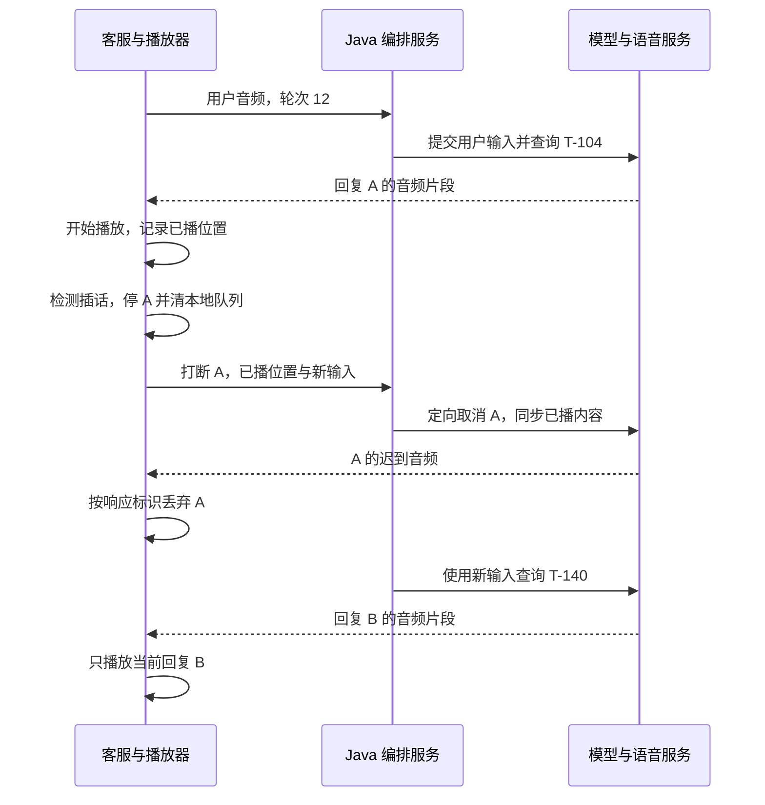

# 实时语音 Agent 怎样降低首音延迟，并处理打断后的旧音频？

> 沿音频真正进入播放的路径量首音，打断时先停本地播放，再取消旧生成并同步已播进度。

## 客服说“不是这张工单”时，系统还有哪些声音在路上？

客服说“查一下 T-104”。助手刚播出“这张工单”，客服接着说“不是，是 T-140”。此时旧回复可能同时存在于模型生成队列、TTS 合成队列、网络和播放器里。只改当前工单号，旧音频仍可能在新回答前响起来。若完整回复已提前写进会话历史，模型还可能以为客服听完了后面的处理建议。

可以先按职责把链路拆开。级联方案中，VAD 判断人声活动，ASR 转成文本，模型决定查什么工具，TTS 把回复转成声音。原生音频模型可以直接接收音频并产生音频，仍需要轮次控制、工具授权和播放器治理。直接音频输出减少了显式中间环节，但是否更快、更便宜、转写是否覆盖实际说出的内容，都需用同样的问题和设备测量。模型首字的定义另见[推理延迟](./ai-llm-inference-latency.html)。



图中把媒体路径简化到一起。浏览器直连供应商 WebRTC 时，音频可以不经过 Java 服务。Java 侧保留会话授权、受控工具与业务状态，具体媒体和事件路由按接入方式安排。

## 首音究竟从哪一刻开始算？

“模型 300 毫秒就回了”可能指模型首个 Token，也可能指首个压缩音频包，两者都还没经过播放器。先为一轮对话定义时间点，再确定报表口径。

| 时间点               | 记录在哪里                                   | 能解释什么                       |
| -------------------- | -------------------------------------------- | -------------------------------- |
| `lastSpeechFrame`    | 客户端采集时间轴上，回溯本轮最后一帧有效人声 | 用户最后说话的参考位置           |
| `turnCommitted`      | 断句规则确认结束、准备提交的地方             | 为判断用户说完等了多久           |
| `firstAudioReceived` | 客户端收到当前回复的第一个音频片段           | 生成与传输已有首包               |
| `firstAudioRendered` | 播放器首次输出该回复的非静音采样位置         | 播放等待、解码与缓冲后的首音估计 |

业务可以用 `firstAudioRendered - lastSpeechFrame` 作为首音延迟。识别人声范围需要等后续信息，`lastSpeechFrame` 可在断句后回填；把静音等待之后的提交时刻当起点，会藏掉用户实际等待的一段时间。若产品按“松开说话按钮”计时，则单列这个口径，不与自动断句混算。

这些时间尽量落在同一个客户端单调时钟上。跨服务 Span 用于拆段，不能直接相减两台未校准机器的时间戳。浏览器回调、计划播放时刻和硬件真正出声也有差异。Web Audio 的输出时间戳可帮助映射播放位置，设备延迟仍有误差；要声称测到了用户耳边的声学首音，需要回环录音等设备实验。记录里注明当前用的是播放估计，避免把“收到首包”写成“用户听到”。

级联链路里可在关键路径上拆出断句等待、ASR 收尾、上下文与工具等待、模型首句、TTS 首包、下行和播放器缓冲。流式环节会重叠，不能把每个组件完整耗时直接相加。先看同一次运行的时间线，找到首音前真正串行等待的环节。

## 优化首音时，哪些等待能提前做？

连接、语音会话和必要上下文可以在用户说话前准备，ASR 在采集过程中持续转写，TTS 在拿到可朗读的短句后开始工作。短句边界要兼顾语义、数字和读音，例如不能把金额“1250 元”的前半段先当最终结果播出。基于未定转写预取只读数据时，给结果绑定输入版本，最终识别变化后重新验证适用性。

断句阈值压得越低，中途停顿被误切的概率可能越高。测试时保留短反馈、带停顿的工单编号、远场噪声和扬声器回声。VAD 提示有人声不等于确认用户说完，也不单独证明那是用户插话。AEC、音频设备配置、连续帧判定与业务按钮可以共同参与控制。助手说话时把麦克风全部丢掉，确实能减轻自我回声，但用户的“不是”也会一起消失。

工具慢时可以先播放明确的过程提示，例如“我在查询 T-140”，不能先编造查询结果。报告首音时，把过程提示与首个有业务结果的语音分开，不然一句预录的“请稍等”就能让指标很好看。每种负载还应保留 p50/p95、超时率、误断句率、误打断率和音频卡顿，分别对照冷启动、正常网络与弱网条件。

## WebRTC 和 WebSocket 把哪些工作交给了应用？

WebRTC 接入一般用媒体轨道承载音频，用数据通道承载控制事件。协议栈管理实时媒体传输与抖动缓冲，实际路由可能经过中继，并不保证任意网络下都更低延迟。`getUserMedia()` 采到麦克风，再经 WebSocket 发送，是 WebSocket 音频链路；使用了浏览器音频 API 不会把传输自动变成 WebRTC。

WebSocket 接入通常需要应用定义音频格式、采样率、分帧、输入提交与输出队列。传输在一条连接内有序，应用的异步解码任务、并行 TTS 流和重连前后的回调却可能以不同顺序完成。不要将这些竞态统称为“WebSocket 乱序”。对 PCM，先约定单声道或多声道、采样率、位深及字节序，播放端按同一格式解释；换供应商不能只替换 URL。[模型调用契约](./ai-llm-provider-contracts.html)

浏览器直连需要短期会话凭据或受控的会话协商，长期模型密钥留在服务端。Java WebSocket 事件循环只做轻量转发与状态推进，解码、阻塞 SDK 和业务查询分别受并发与时限控制。为会话设置待播时长和队列字节上限，播放落后时按策略停掉旧生成并提示重试，不能无限缓存。连接级流控仍不足以保证模型、TTS 和播放器共同响应取消。[流式后端与取消](./ai-streaming-sse-backend.html)

## 一次打断为什么要依次处理本地、生成和上下文？

识别到有效插话时，本地立即使旧回复失效，停止正在播放的节点，清掉已解码和待解码的旧队列，同时继续采集用户的新输入。这一步先完成，再等待服务器确认。声音已交给设备的极短缓冲未必能瞬间撤回，所以打断延迟也要测到播放器，而不只测到取消请求发出的时刻。

随后发送带旧回复标识的取消。级联服务把取消传给对应的模型、TTS 与尚未启动的任务，旧任务完成回调只能修改旧任务的记录。收不到确认时保留“取消结果未知”，本地也不能重新接收这条旧回复。新回复进入后，迟到的旧取消确认更不能把新播放器清空。

最后同步会话理解。假如模型已生成 5 秒语音，用户只听到前 800 毫秒，不能把 5 秒全文作为已经告知用户的内容。播放位置按具体音频项记录，不是收到包数除一个平均速率。文本与音频没有可靠对齐信息时，保留中断和播放区间，不凭时间比例切出一段“精确已听文本”。

以 **2026-11-20 核对的 OpenAI Realtime SDK 类型**为例，`response.cancel` 用于取消进行中的生成，`response_id` 可指向指定回复；`conversation.item.truncate` 用音频项标识和 `audio_end_ms` 同步截断，服务端会移除该项的文本转录，避免把未播放内容留作已听上下文。应用不能假设截断后仍保留逐字的已播文本。`output_audio_buffer.clear` 是 WebRTC/SIP 专用的输出缓冲事件，不能照搬到 WebSocket 作为本地清队列接口。供应商自动打断配置与客户端手动控制也要一起核对，避免重复取消或截断错对象。

取消说话也不能撤销业务。用户说“算了”时，升级工具可能已经提交。语音层停止后续播报，业务层仍按操作号查询终态；需要撤回时走明确的补偿或新审批。[业务工具调用](./ai-tool-calling-business-api.html)

## 怎样用代次和响应标识挡住迟到音频？

为一次连接分配 `connectionEpoch`，每次开始新回复分配递增代次，再绑定供应商的 `responseId`。级联生成的每个 TTS 子任务也绑定这个组合。打断先使当前组合失效，事件到达、异步解码完成、入队和开始播放时都核对。已经入队的旧数据则由停止和清队列处理。

下面是应用内部控制逻辑，用自定义序号演示有限重排；它不是任一供应商的原始音频报文。保存为 `voice-generation.mjs` 后用 Node.js 22+ 执行。`playNext()` 模拟完整播放一块，真实播放器需要按已输出采样更新部分播放进度。

```javascript
import assert from "node:assert/strict";

let epoch = 1;
let generation = 0;
let active = null;
const same = (a, b) => a?.epoch === b?.epoch && a?.generation === b?.generation && a?.id === b?.id;

function begin(id) {
  assert.equal(active, null, "必须先结束或打断旧回复");
  const key = { epoch, generation: ++generation, id };
  active = { key, next: 0, pending: new Map(), ready: [], playedMs: 0 };
  return key;
}

function receive(key, seq, durationMs) {
  if (!active || !same(active.key, key)) return "stale";
  assert.ok(Number.isSafeInteger(seq) && seq >= 0);
  assert.ok(Number.isFinite(durationMs) && durationMs > 0 && durationMs <= 200);
  if (seq < active.next || active.pending.has(seq)) return "duplicate";
  // 教学上限：最多等待四块缺口，最多缓存八块；生产再限制字节与等待时间。
  if (seq - active.next > 4 || active.pending.size + active.ready.length >= 8) {
    return "overload";
  }
  active.pending.set(seq, durationMs);
  while (active.pending.has(active.next)) {
    active.ready.push(active.pending.get(active.next));
    active.pending.delete(active.next++);
  }
  return "accepted";
}

function playNext() {
  if (!active || active.ready.length === 0) return false;
  active.playedMs += active.ready.shift();
  return true;
}

function stop(key) {
  if (!active || !same(active.key, key)) return null;
  const cut = { ...active.key, playedMs: active.playedMs };
  active = null; // 先撤销旧回复，实际播放器还需立即 stop 并清空调度。
  return cut;
}

const old = begin("response-A");
assert.equal(receive(old, 0, 200), "accepted");
assert.equal(receive(old, 1, 200), "accepted");
assert.equal(playNext(), true);
assert.equal(stop(old).playedMs, 200); // 已收 400ms，只播了 200ms。
assert.equal(receive(old, 2, 200), "stale");

const current = begin("response-B");
assert.equal(receive(current, 1, 100), "accepted");
assert.equal(playNext(), false); // 解码 1 先完成，等待 0。
assert.equal(receive(current, 0, 100), "accepted");
assert.equal(receive(current, 0, 100), "duplicate");
assert.equal(stop(old), null); // 旧取消确认不能停止新回复。
assert.equal(playNext(), true);
assert.equal(receive(old, 3, 200), "stale");
assert.equal(playNext(), true);
assert.equal(stop(current).playedMs, 200);

epoch++; // 重连前清理播放器与任务，再切换连接代次。
const reconnected = begin("response-B");
assert.equal(receive(current, 2, 100), "stale");
assert.equal(receive(reconnected, 0, 100), "accepted");
assert.equal(playNext(), true);
assert.equal(stop(reconnected).playedMs, 100);
console.log("旧帧、重复帧、乱序完成、迟到取消和重连断言通过");
```

只按 `responseId` 核对，可能漏掉重连后沿用的本地标识；只按当前状态是不是 `speaking` 核对，也会在新回复正在播时放进旧回复。幂等处理同一打断事件时，应保留目标组合，不能每次都取消“现在的回复”。如果缺口超时、解码失败或队列满，发出可追踪错误并停止对应代次，不能为了追赶进度随意拼接音频。

## 如何验证从“停了”到“停对了”？

固定几段含工单编号、自然停顿和短反馈的录音，标注人声边界与期望任务。可控地让旧回复延迟到达、旧 TTS 在取消后完成、回调重复触发，再核对新回复的内容与实际播放轨迹。真实媒体测试还要覆盖耳机与外放、回声、权限拒绝、音频设备切换、浏览器后台、弱网与重连。

每轮把会话、连接代次、输入轮次、回复项、工具操作号和取消原因串起来。指标分别记录首音、业务结果首音、插话到旧声停止、丢弃旧音频的时长、取消后仍生成的音频与用量。日志保留必要的时间和状态，不默认保存原始录音；录音用于评测时另行明确同意、可见范围和保留期。

## 小结

1. 从用户有效人声结束到播放输出定义首音；提交、首包、播放和声学出声各有观测边界。
2. 级联方案与直接音频输出都要验证断句、队列、工具和播放，组件耗时按关键路径比较。
3. 打断先停本地旧声，再定向取消生成、同步已播位置，麦克风仍要接收新输入。
4. 连接代次、回复代次和响应标识贯穿解码与播放，迟到帧和旧确认不能影响新回复。
5. 语音取消不撤销已提交业务，工具终态和补偿仍由业务状态机负责。

## 参考

综合仓库 `docs/` 下的语音链路与 WebSocket 资料，并于 2026-11-20 交叉核对官方接口。修正了“助手说话时丢弃输入即支持打断”“停止播放即撤销操作”和“音频首包即用户听到”等概括，按实际协议区分缓冲清除与截断。

- [OpenAI Realtime SDK 事件类型：核对的源码版本](https://github.com/openai/openai-node/blob/c3f42fa9229cd837c24bfff53d93321216c34484/src/resources/realtime/realtime.ts)
- [Microsoft Foundry：Realtime WebRTC 媒体轨道、数据通道与会话协商](https://learn.microsoft.com/en-us/azure/foundry/openai/how-to/realtime-audio-webrtc)
- [W3C：WebRTC Statistics 的抖动缓冲与接收统计](https://www.w3.org/TR/webrtc-stats/)
- [Web Audio：getOutputTimestamp 与输出位置](https://www.w3.org/TR/webaudio/#dom-audiocontext-getoutputtimestamp)

在 Node.js 24.8.0 上执行了文中纯逻辑断言，验证旧帧、重复帧、异步完成顺序、迟到取消和重连隔离。该实验没有采集或播放真实音频，也没有测量声学首音、弱网表现或连接供应商语音服务，指标数值需要单独的设备与链路实验。
