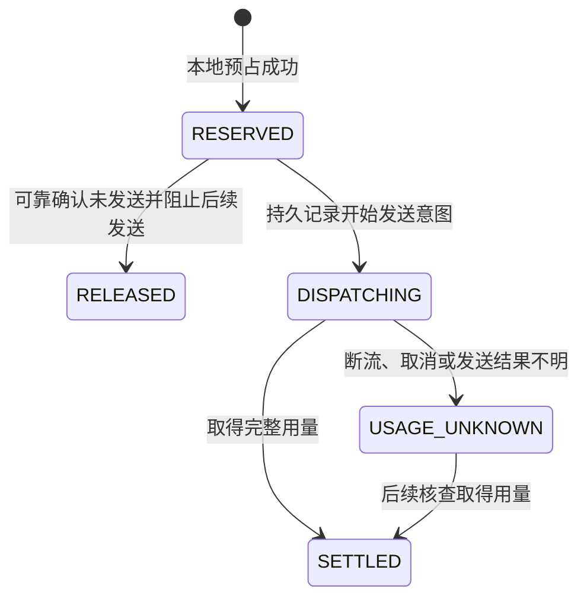

# Token 预算怎样预占、结算，并避免并发超扣？

> 发出请求前原子地占住预算，取得实际用量后幂等结算；发送结果未知时保留待核查记录，不能靠超时直接退款。

## 两个实例都看见余额足够，为什么最后还是超了？

假设 north 租户的工单助手还有 10,000 个内部预算单位。两个网关实例同时收到请求，各预计需要 7,000 单位。

如果都先读取余额，再分别判断，两个请求都会看到 10,000，随后都发给供应商。余额更新即使最后没有变成负数，也可能已经放出了 14,000 单位的请求。

问题不在 Token 估算是否足够精确，而在“检查额度”和“占用额度”没有成为同一个原子决策。先做准入，再做实际用量对账，才能分别处理并发超放与估算偏差。

本文给出教学台账与状态推演，不创建数据库表，也不执行模型、并发或对账实验。网关整体分工见[AI 应用工程化](./ai-application-engineering.html)。

## 应用预算、供应商限流和客户收费，为什么要分开？

| 约束或账目             | 回答什么问题                   | 不能混同的地方                  |
| ---------------------- | ------------------------------ | ------------------------------- |
| 应用任务或租户预算     | 这项任务还允许花多少资源？     | 可以按 Token 或内部费用单位管理 |
| 供应商 RPM、TPM 等限制 | 此时还允许发多少请求或 Token？ | 各家窗口、估算和恢复规则不同    |
| 供应商实际成本         | 已经向上游产生多少费用？       | 包含失败尝试，取决于用量与价目  |
| 客户套餐或收费         | 按产品约定应向客户扣多少？     | 未必与每次供应商成本一比一对应  |

例如，应用按实际用量归还了一部分费用预占，并不意味着供应商立即归还本分钟的 TPM。供应商请求计数也可能不会因应用重试或取消而恢复。

并发信号量又是另一个维度：调用确认终止后释放执行名额，不代表它消耗的费用也应该退回。几种控制可以配合，但必须各有状态和规则。

若预算以金额计量，应使用明确币种与精度的整数单位或合适的十进制定点类型，避免浮点累计误差。下文的“单位”只是统一的教学记账单位，不是供应商计价。

## 一个可核对的预算账户，需要记录什么？

可以先维护三项聚合值：

```text
可用额度 available = 本期额度 limit - 已结算消耗 settled - 在途预占 held
```

其中 `held` 包含尚待确认的发送和未知用量。它不能因为任务已经在前端显示失败就消失。

账户还应带上主体作用域、周期、计量单位和版本。跨越月末的调用，要按约定记录预占所属周期与最终归属，不能直接修改“当前月份”的余额了事。

聚合值之外，需要能够回查每一次变化：

| 记录     | 关键内容                                               |
| -------- | ------------------------------------------------------ |
| 账户     | 作用域、周期、额度、已结算量、预占量、状态版本         |
| 调用尝试 | `requestId`、`attemptId`、供应商、模型、估算与输出上限 |
| 预占     | 尝试标识、关联账户、占用量、发送状态与期限             |
| 用量事实 | 请求标识、原始 usage、来源、是否完整、计价版本         |
| 账务变更 | 预占、释放、结算或调整的唯一事件及前后关系             |

一项业务请求可能有多次模型尝试。每次真正的新调用都要有自己的 `attemptId`；应用内重放同一次预占或接收重复回调，则沿用原标识。

业务结果去重与成本记录要分开。用户最终只得到一份报告，不能因此把前两次失败生成的上游成本删掉。标识的不同职责见[Agent Trace](./ai-agent-observability.html)。

## 怎样原子地做到“全部账户都够，才占用额度”？

对于单个账户，可以采用带余额条件的原子更新，并检查受影响行数。若一次还受用户、租户和任务等多个内部账户约束，就需要明确这些账户如何一起完成准入。

在同一关系数据库内，一种可理解的设计是短事务：

```text
开始本地事务
  以 attemptId 定位或创建唯一的尝试记录
  若相同尝试已存在，核对请求摘要后返回已有决定
  按固定顺序锁定本次涉及的预算账户
  检查每个账户的可用额与本次需要量
  全部足够才增加预占量，并保存预占记录
提交事务
事务提交之后，才允许进入供应商调用阶段
```

唯一标识必须由数据库约束等可靠机制落实，不能只在应用中先查一次。重复的 `attemptId` 如果携带不同请求摘要，也不能复用原来的额度授权。

多个账户按一致顺序加锁，有助于减少死锁；遇到事务冲突时有限重试，并继续保持相同尝试标识。等待模型响应期间不要持有这些锁。

Redis Lua 可以在其支持的执行范围内完成条件判断和更新，但原子执行不等于跨 Redis 分片、关系库与供应商的分布式事务。还要考虑多键路由、持久化、故障切换与台账一致性，不能只加一段 Lua 就声称账目永不丢失。

若费用账户与限流设施分属两个系统，应用需要为已取得的本地许可设计失败释放及核查，明确无法保证的跨系统原子性。费用预算的事务不能直接套成供应商配额的退款事务。

## 预占成功后，怎样处理发送时刻的崩溃？

“数据库已写入”和“供应商已经收到”之间存在网络边界。普通本地事务不能同时保证这两件事。

可以采用下面的教学状态：



这些名称属于应用设计，不是模型 API 的统一枚举。`DISPATCHING` 只表示可能进入了发送阶段，不能证明供应商确实接收，更不能证明只执行了一次。

释放尚未发送的预占时，取消方与发送方也要通过状态条件更新等机制竞争同一记录。必须确保“释放成功”会阻止旧执行者随后发送，不能一边退款，一边让持有旧许可的 worker 继续调用。

已经进入发送边界的尝试，进程可能在请求发出后、保存响应前退出。此时按供应商请求标识、查询能力或账单核查；没有证据就保留未知，而不是重新生成一个尝试并把旧成本当作零。

租约过期只说明执行者没有按时续约，TTL 到期也只说明时间经过，二者都不能证明调用未发生。可保留预占、暂停后续准入，或按明确的保守暂估策略记账，并单列未确定项。

## 实际用量回来以后，怎样结算才不会重复扣费？

结算应同时处理账户和尝试状态：锁定或条件更新同一预占，确认本次用量事件尚未处理，再释放对应预占、增加实际消耗并保存事件。整个变化在本地账务边界内保持原子。

如果重复收到同一份终态 usage，应返回已经形成的结算结果，不能再执行一次“扣实际、退预占”。不同来源提供的修正用量，则经过核对后生成有版本的调整记录，保留原始事实。

流式用量还要检查字段语义：有的记录是最终累计值，不能把每次累计值继续相加；有的事件只是局部信息，不能见到第一份就当作最终账单。

继续用 10,000 单位额度演示：

| 时刻                       | 已结算 settled | 预占 held | 可用 available |
| -------------------------- | -------------- | --------- | -------------- |
| 初始                       | 0              | 0         | 10,000         |
| A 原子预占 7,000           | 0              | 7,000     | 3,000          |
| B 也申请 7,000，被拒绝     | 0              | 7,000     | 3,000          |
| A 实际消耗 4,500，完成结算 | 4,500          | 0         | 5,500          |
| A 同一结算事件再次到达     | 4,500          | 0         | 5,500          |

这组数字说明并发准入和结算防重的预期关系，不是程序执行记录。B 如果之后重新申请，仍要按当时的剩余额度检查，不能直接复用上次拒绝前读到的余额。

## 实际消耗超过预占，是否可以只扣预占的数？

不可以把事实裁成预算。输入估算可能偏小，模型包装和计量也可能与近似器不同，最终实际用量可能超过预占。

一旦成本已经发生，就要记录完整消耗与差额，必要时形成超额或欠额状态并阻止新请求。拒绝后续调用可以限制继续扩大损失，却不能追溯取消已经发生的供应商费用。

更严格的控制需要对完整输入、实际接口的输出上限及其他计费项建立可信上界，并在继续生成或新一轮调用之前重新准入。没有可靠上界时，预占只能提供基于估算的风险控制，不能宣传为绝不超支。

供应商切换也要建立新的尝试与预占，并共同受原任务总预算约束。旧尝试仍为用量未知时，它的在途额度不能因为“现在换了模型”就自动清零。

## 缓存和推理 Token，为什么容易算重？

先保存原始字段，再按对应接口的定义归一化。缓存输入可能已经包含在总输入中，推理 Token 也可能包含在总输出中，不能把这些细分项再完整叠加一次。

费用计算应绑定供应商、模型、地区或服务类型、币种和价格版本。输入、缓存读写、输出及其他能力的计价规则可能不同，不能把总 Token 乘一个固定价格推广给所有接口。

内部额度、成本流水和面向客户的账单可以引用同一份用量事实，但各自按明确规则计算。若客户产品约定失败不收费，也只是由产品承担对应上游成本，不表示那次请求没有成本。

## 要设计哪些故障用例，才能检查这本账？

- 两个实例同时申请超过剩余额度的预占，只能放行满足整体约束的请求。
- 相同尝试重复预占、重复结算，账户和事件均不发生重复变化。
- 确认未发送的取消与发送方竞争时，只能产生一致的准入结果。
- 断流缺 usage、发送边界崩溃或取消后收到迟到用量，未知项能被保留并正确结算。
- 实际用量超估、跨周期回调及更正账单，差额与归属仍可追溯。

检查时同时观察账户聚合、预占状态、实际用量和变更流水，而不只是最后一个余额。对未知项数量、等待时长、超估比例和对账差额建立监测，才能发现“金额看起来没超，但许多旧调用一直没结清”的问题。

## 小结

1. 应用预算、供应商限流、上游成本与客户收费各有规则，本地退款不代表上游配额恢复。
2. 准入把检查与预占做成原子决定，多账户需要明确事务边界，模型调用不持有长事务。
3. 每次真实调用单独记尝试，重复预占与结算要幂等，实际消耗不能因最终结果去重而删除。
4. 超时、取消和租约到期都不能证明未发送，未知用量应保留核查，防止错误释放额度。
5. 用量明细与价格分别版本化，超估、迟到与更正通过可追溯的结算和调整处理。

## 参考

综合仓库 `docs/` 下的模型网关、API 限流和成本归因资料，结合站内推理预算、异步任务与用量观测篇整理。将估算与对账展开为账户、预占和尝试状态，纠正了业务去重即成本去重、过期自动退款，以及一种令牌桶可以同时代表所有账目的混淆。

- [PostgreSQL 18：Explicit Locking](https://www.postgresql.org/docs/18/explicit-locking.html)——于 2026-11-21 核对行级锁、多对象一致加锁顺序及长事务的边界。
- [Redis：Scripting with Lua](https://redis.io/docs/latest/develop/programmability/eval-intro/)——同日核对脚本原子执行、多键声明与执行阻塞，不将其解释为跨系统事务。
- [推理模型预算](./ai-reasoning-model-budget.html)、[Agent 用量观测](./ai-agent-observability.html)——衔接输出计量、任务预算与费用事实。
- [异步任务与恢复](./ai-async-task-pipeline.html)、[供应商能力契约](./ai-llm-provider-contracts.html)——衔接发送边界、失败分类和未知状态。

本文的台账、状态和数字均为教学设计，未创建或操作数据库、执行 Redis 脚本、运行并发任务或调用真实模型，未将设计判据写成测试结果。
