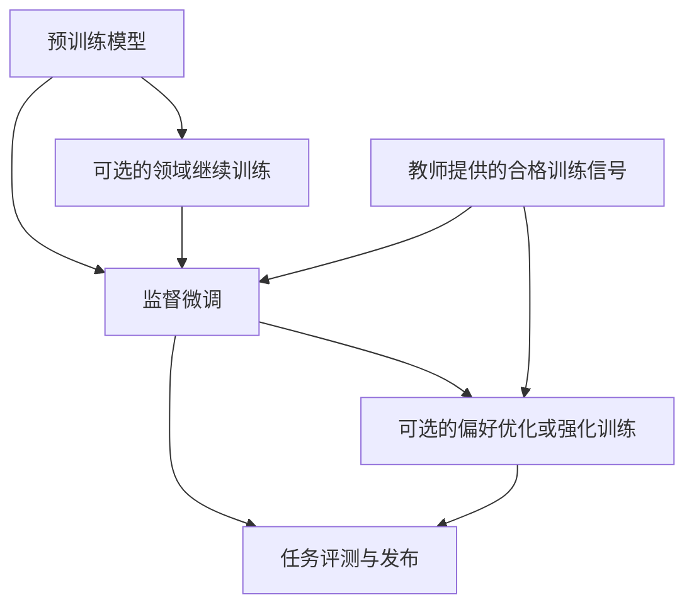

# 预训练、后训练、偏好优化和蒸馏分别改变什么？

> 先分清要改变模型的哪种能力，再看训练目标、数据和更新方法；这些名词并不是一条人人相同的升级流水线。

## 工单助手不好用，为什么不能直接说“再训练一下”？

假设我们正在设计一个工单助手，它出现了四种问题：

- 不理解“供应商挂起”等领域用语。
- 能看懂材料，却总把分诊结果写成自由文本。
- 两份回答都符合事实，但一份漏掉下一步处理建议。
- 现有模型效果合格，每次调用的费用却超过预算。

这些问题可能分别涉及领域适配、监督微调、偏好学习和蒸馏，也可能通过补材料、约束输出或换模型解决。

先确定希望改变的行为，才能判断该收集文档、示范答案、偏好对还是教师输出。只说“我们有很多聊天记录”，还不知道这些记录能支持哪种训练。

## 预训练让模型学到了什么？

对常见的自回归语言模型，预训练的重要任务是根据前文预测后续 Token。

模型在大量文本上更新参数，逐渐学到语言规律、常见知识、代码结构以及一些任务模式。这里的知识存放在参数中，不是一张可以逐条查询、更新和删除的事实表。

因此，训练目标与应用目标之间存在距离：让后续文本更符合训练分布，不等于保证每句话都有最新证据，更不等于满足某个企业的授权规则。

假设训练材料里反复出现“等待三天可以升级”，但当前政策增加了“必须先取得供应商反馈”。模型仍可能补出旧结论。

把新政策放进 Prompt 或检索上下文，是改变本次输入；继续训练，则会更新模型参数。两者的更新速度、成本和可追溯性不同。

还要区分 **上下文学习与训练**：在问题前放三条示例，模型可以据此调整本次输出，但并不意味着发生了梯度更新。GPT-3 论文讨论的 few-shot 用法就强调这一点。

## 继续预训练和后训练，分别接着做什么？

继续预训练通常沿用语言建模等目标，让已有模型继续接触特定领域、语言或其他新增语料。

工单领域的文档可以帮助模型适应术语和表达，但“见过文档”不能证明它会按照业务要求分诊。训练也可能带来遗忘、偏差或旧能力退步，需要另设回归。

后训练则是一个更宽的名称，通常涵盖基础训练之后改善指令遵循、任务表现、偏好或推理能力的多种方法。

可以用下面的图理解常见关系，但不能把它当成所有模型的固定配方：



有的项目直接微调已有指令模型，有的组合多个目标反复训练；蒸馏提供的信号也可以参与其中。

**Base、Instruct、Reasoning 是理解模型用途的线索，不能单靠名称反推出训练细节。**

| 常见名称  | 通常强调什么             | 使用时仍需核对什么                 |
| --------- | ------------------------ | ---------------------------------- |
| Base      | 基础语言建模能力         | 是否适合直接对话，怎样组织输入     |
| Instruct  | 按指令完成任务           | 工具、输出约束和领域任务的实际表现 |
| Reasoning | 处理多步问题的能力或模式 | 推理预算、调用契约和任务收益       |

Reasoning 模型可能使用可验证奖励、偏好数据或其他训练组合。模型能输出较长解释，也不能单独证明它采用过某种强化学习算法。

## SFT 和 LoRA，为什么可以一起出现？

SFT 指监督微调：使用输入与期望输出等监督信号，让模型学习目标行为。

例如，输入包含工单材料，目标输出包含合法队列、优先级和依据。样本教的是“面对这些条件应当怎样处理”，不能只保留一段看起来通顺的回复。

LoRA 描述另一件事：怎样更新参数。它通常冻结基座权重，通过可训练的低秩更新适配模型，因此可以用 LoRA 实现 SFT，也可以选择全参数更新。

可以把两者分别理解为：

```text
SFT：用什么任务目标和监督数据学习？
LoRA：通过哪些参数来学习？
```

数据准备、损失覆盖的 Token、切分和适配器发布，详见[监督数据与 LoRA 评测](./ai-fine-tuning-data-evaluation.html)。LoRA 减少可训练参数，不会自动修正错误标签，也不会消除训练所需的其他资源。

## 经典 RLHF 与 DPO，怎样利用“哪个回答更好”？

只有合格答案时，可以构造监督样本；要学习回答之间的取舍，还需要偏好信息。

假设同一个工单问题产生两个回答：

- A：状态准确，列出缺少的供应商反馈，并解释下一步。
- B：状态准确，却直接建议升级，遗漏适用条件。

标注者选择 A，偏好记录至少要保存问题、两个候选、选择结果和判断依据。若标注者只偏爱更长的文字，训练也可能学到冗长，而不是条件判断。

经典的 InstructGPT 路线可以拆成三步：

1. 用标注者提供的示范回答做监督微调。
2. 收集候选回答的排序，训练预测偏好的奖励模型。
3. 使用 PPO 等强化学习方法优化策略，并约束它不要过度偏离参考策略。

这是理解 RLHF 的一个经典实例，不代表所有后训练都必须采用这三步。

DPO 从偏好优化目标出发，直接利用偏好对更新策略模型。标准离线 DPO 通常借助参考模型，调整被偏好回答相对于另一回答的概率关系。

| 维度             | 经典奖励模型加 PPO 路线        | 标准离线 DPO                 |
| ---------------- | ------------------------------ | ---------------------------- |
| 主要偏好信号     | 回答排序或比较                 | 被偏好与未被偏好的回答对     |
| 单独训练奖励模型 | 通常需要                       | 不需要这一独立步骤           |
| 策略优化阶段     | 采样回答，再按奖励优化         | 使用已收集的偏好对更新       |
| 主要工程关注     | 奖励质量、采样成本、优化稳定性 | 偏好质量、参考模型、数据分布 |

所以，“DPO 不需要偏好数据”是错误的；“DPO 与奖励完全无关”也不准确。它与偏好奖励目标存在推导关系，只是不要求单独拟合并调用一个奖励模型。

算法流程更简单，也不保证适合所有任务或永远优于其他路线。

对于能验证结果的任务，还可以使用答案核验、测试或执行结果提供奖励。即便如此，也要检查验证器是否完整：通过某几个测试，不等于满足全部业务要求。

## 蒸馏是在压模型，还是在换一种监督来源？

蒸馏的核心是让学生模型学习教师提供的信号，常用于把较昂贵的能力迁移到更易部署的模型。

常见信号至少有两类：

| 教师提供什么         | 学生可以学什么           | 需要什么条件                   |
| -------------------- | ------------------------ | ------------------------------ |
| 输出分布等软信号     | 多个候选之间的相对关系   | 能取得兼容的分布或其他中间信号 |
| 教师生成的答案或序列 | 在给定输入下模仿合格输出 | 合格的输入、教师输出和筛选规则 |

通过 API 拿到一段答案，再用它做监督训练，可以属于序列层面的蒸馏路线，但不能说自己已经进行了完整的 logits 蒸馏。

工单场景中，可以让教师对脱敏材料生成分诊候选，再由规则和人工检查字段、条件与证据，筛选后用于训练学生。

这里有三个容易忽略的问题：

- **教师也会错**：未经核验的输出会把错误、冗长和偏差一起传递。
- **材料不一定可用**：教师服务条款、源数据权限和允许用途都要确认。
- **评测可能被污染**：若让教师针对保留测试题生成训练答案，学生的高分不能说明泛化能力。

学生不一定必须比教师小，蒸馏也不保证所有能力都保留。应按目标任务比较质量、延迟和总成本，不能直接套用历史论文中的收益数字。

## MoE 又属于哪一层概念？

MoE 是模型架构与计算组织方式，常通过路由让部分专家参与一次计算；它不是预训练之后必经的一道训练阶段。

总参数与每次激活的参数，分别描述不同的资源维度。激活参数较少，可能减少部分计算，却不能推导为“显存只需要容纳这些参数”。

未激活专家的权重如何存放、是否卸载、怎样分片，以及路由和通信开销，都影响实际部署。显存问题可继续看[权重、KV Cache 与量化](./ai-model-memory-quantization.html)。

## 真正比较方案时，应该固定哪些东西？

回到工单助手，先记录要改善的是术语理解、格式稳定、条件判断还是费用，再确定对应数据与方法。

一份训练方案至少应能串起这些信息：

```text
业务目标与失败类型
→ 数据来源、使用范围、清洗和切分版本
→ 基础模型、Tokenizer 与对话模板
→ 训练目标、参数更新方法及配置
→ 模型权重或适配器制品
→ 独立评测与回退配置
```

验收时保留未用于调参的样本，同时检查目标任务和旧能力。更低的训练损失、更符合偏好的措辞，都不能抵消事实错误、越权或不可接受的延迟。

如果问题是实时工单状态不准，先修查询；如果是政策证据缺失，先修检索。是否值得训练，继续看[Prompt、RAG 与微调选型](./ai-fine-tuning-decision.html)。

## 小结

1. 预训练学习广泛的语言与任务模式，不提供逐条事实更新、引用或授权保证。
2. 后训练包含多种能力调整方式，Base、Instruct、Reasoning 名称不能证明固定训练配方。
3. SFT 是监督训练目标，LoRA 是参数更新方法；经典 RLHF 与 DPO 都依赖合格的偏好信号。
4. 蒸馏利用教师信号，软分布与生成序列的条件不同，教师错误和数据泄漏都需要防范。
5. 方案比较必须绑定数据、模型和配置版本，用独立任务验收质量、成本与旧能力退步。

## 参考

综合仓库 `docs/` 下模型运行机制资料，结合站内微调决策与监督数据评测篇，按训练目标、数据和参数方法重新组织。纠正了 SFT 与 LoRA 互斥、DPO 不需偏好数据，以及模型名称代表固定训练流水线等混淆。

以下原论文于 2026-11-21 核对摘要，用于确认方法目标与基本路线；未据摘要推广具体训练配置或当前性能收益：

- [Language Models are Few-Shot Learners](https://arxiv.org/abs/2005.14165)。
- [Training language models to follow instructions with human feedback](https://arxiv.org/abs/2203.02155)。
- [Direct Preference Optimization: Your Language Model is Secretly a Reward Model](https://arxiv.org/abs/2305.18290)。
- [Distilling the Knowledge in a Neural Network](https://arxiv.org/abs/1503.02531)。

本文只讲原理与方案边界，工单为教学场景，未执行训练、蒸馏或真实模型效果评测。
