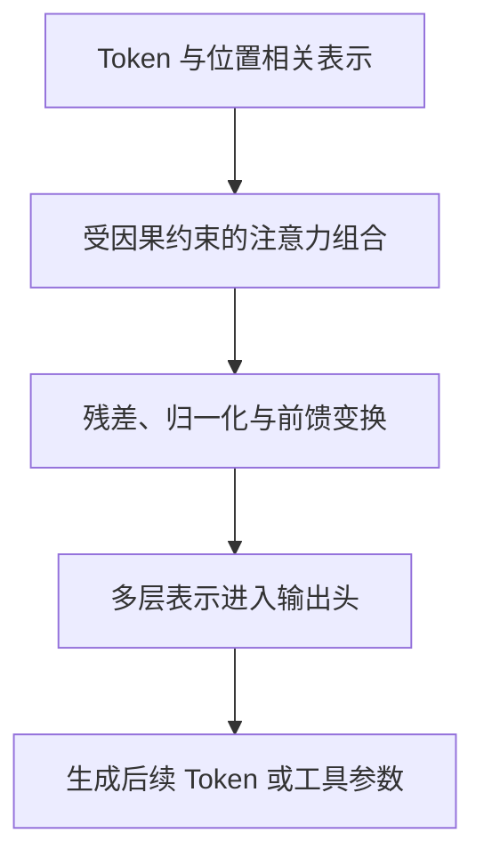

# Attention 怎样利用上下文，位置编码解决什么问题？

> 注意力让一个位置根据当前表示组合其他位置的信息，位置机制和因果约束再规定信息的顺序与可见范围。

## 工单状态和“它”之间，模型怎样建立联系？

假设上下文写着“工单 T-1048 正在等待供应商，用户问它为什么还没处理”。
模型处理“它”时，需要利用前面的工单和状态，而非只看最近一个词。
注意力机制为这种跨位置的信息组合提供了计算方式。

这不是在模型里执行一条按工单号查询数据库的 SQL。
模型处理的是经过训练得到的数值表示，真正的实时工单仍需要工具查询并提供证据。
本文以常见的自回归 Transformer 解释机制，不把所有模型架构都归为同一种实现。

## Q、K、V 分别是什么，为什么需要三组表示？

输入经过 Token 化和嵌入后，每个位置得到一个向量。
在一层注意力中，模型用学习到的投影分别得到 Query、Key 和 Value。

| 表示 | 在一次注意力计算中的作用           | 工程理解边界           |
| ---- | ---------------------------------- | ---------------------- |
| Q    | 表示当前位置用于匹配其他位置的特征 | 不是用户问题字符串     |
| K    | 与 Q 计算匹配分数                  | 不是数据库主键         |
| V    | 被相应权重组合的信息               | 不是原始文本的直接复制 |

常见缩放点积注意力写为 `softmax(QKᵀ / √dₖ + mask)V`。
先计算 Q 与各个 K 的点积，按维度缩放并应用遮罩，再将 softmax 得到的权重用于组合 V。
这些权重由当前输入和模型参数共同决定。

多头注意力使用多组投影，在不同子空间里组合信息，然后把各头输出合并。
不能承诺某一头永远只识别主语、时间或权限，头的解释需要具体实验支持。

## 一个很小的例子，怎样看出加权组合与遮罩？

下面只是单头注意力的数值演示，没有训练，也不包含完整 Transformer。
假设当前位置只能看到前两个位置，第三个位置是未来信息。

```javascript
function attention(q, keys, values, visibleCount) {
  const scores = keys.map((k, index) =>
    index < visibleCount
      ? q.reduce((sum, value, j) => sum + value * k[j], 0) / Math.sqrt(q.length)
      : -Infinity,
  );
  const max = Math.max(...scores);
  const exp = scores.map((s) => Math.exp(s - max));
  const total = exp.reduce((sum, value) => sum + value, 0);
  const weights = exp.map((value) => value / total);
  const output = values[0].map((_, j) =>
    values.reduce((sum, row, i) => sum + weights[i] * row[j], 0),
  );
  return { weights, output };
}

const result = attention(
  [1, 0],
  [
    [1, 0],
    [0, 1],
    [1, 1],
  ],
  [
    [10, 0],
    [0, 10],
    [5, 5],
  ],
  2,
);
console.log(result);
```

示例输入保证维度一致且至少有一个可见位置。
权重约为 `[0.670, 0.330, 0]`，输出约为 `[6.698, 3.302]`。
第三份 Value 没有参与组合，原因是其分数被遮成负无穷。
减去最大分数用于改善 softmax 的数值稳定性，不改变归一化后的相对权重。

真实实现还有批次、多个头、残差连接、归一化和前馈网络等部分。
不能把这段演示代码当成可替换生产推理内核的完整实现。

## 因果遮罩和位置编码，为什么需要分别处理？

因果遮罩限制当前位置只能使用允许的历史。
训练时可以同时计算多个位置的预测，但位置 j 的预测仍不能偷看它之后的目标 Token。
生成时则利用已有前缀逐步产生后续输出，具体缓存与调度见[推理延迟](./ai-llm-inference-latency.html)。

位置机制让模型区分序列中的位置关系。
“先批准，再执行”和“先执行，再批准”包含相似词，却有完全不同的业务含义。
只保留各 Token 的内容表示，不足以表达丰富的位置和距离关系。

原始 Transformer 论文使用加到输入嵌入上的位置编码，也讨论了可学习位置表示。
后来模型还会采用旋转位置编码等方案，它们的注入位置和计算方式并不完全相同。
不能认为所有模型都把同一份正弦向量直接加到输入上。

## 注意力之后，为什么还需要其他层？

注意力完成信息混合后，前馈网络进一步变换表示，残差与归一化帮助深层计算。
经过多层处理，输出头产生词表上的分数，再结合解码策略选择后续 Token。



2017 年论文研究的完整模型是编码器—解码器结构。
许多生成式大模型采用 decoder-only 结构，不能把论文中的每一组件原样套到所有当前模型。

## 既然能够关注证据，为什么仍然会答错？

注意力权重反映一种内部组合关系，不能直接作为事实真实性、业务权限或因果解释的证明。
模型还可能误解条件、利用过期信息或生成没有依据的内容。
在业务里仍要检查来源、版本、对象权限和最终结果。

长输入带来更多可用信息，也引入预算、干扰和计算问题。
不能把完整注意力的平方项直接换算成整个请求的耗时倍数，也不能规定所有模型统一的“有效窗口比例”。
怎样选择和压缩输入，见[Agent 上下文装配](./ai-agent-context-engineering.html)。

## 小结

1. Q 与 K 产生匹配分数，softmax 权重用于组合 V，三者都是学习表示。
2. 因果遮罩控制可见信息，位置机制表达顺序与距离，二者承担不同职责。
3. 多头、前馈网络、残差与输出头共同构成计算链，注意力不是完整模型。
4. 原始编码器—解码器 Transformer 与 decoder-only 生成模型需要区分。
5. 注意力不能证明事实或权限，业务应用仍需来源核验、工具约束与结果验收。

## 参考

综合仓库 `docs/` 下大模型运行机制和上下文工程资料，于 2026-11-20 对照原论文与官方推理说明。
将局部计算、完整模型与应用验收分开，避免把注意力权重当成可信引用或把特定结构推广到全部模型。

- [Attention Is All You Need](https://arxiv.org/abs/1706.03762)
- [Transformers：LLM inference](https://huggingface.co/docs/transformers/main/en/llm_tutorial)

示例只做小向量计算，权重与输出经过独立核算，不代表模型训练、完整推理实现或效果测试。
