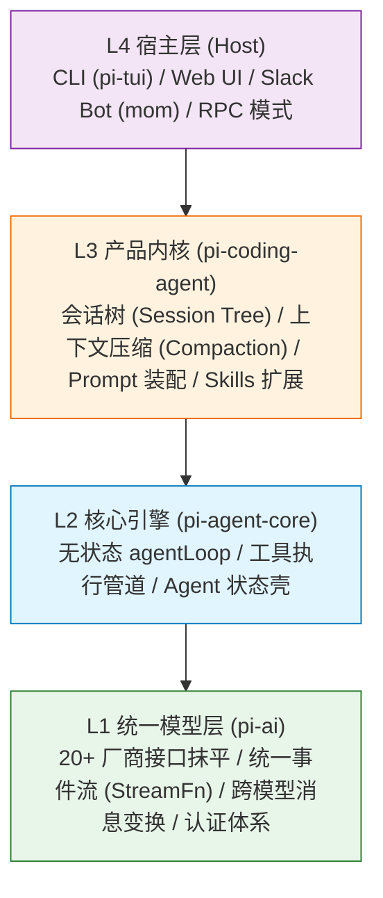
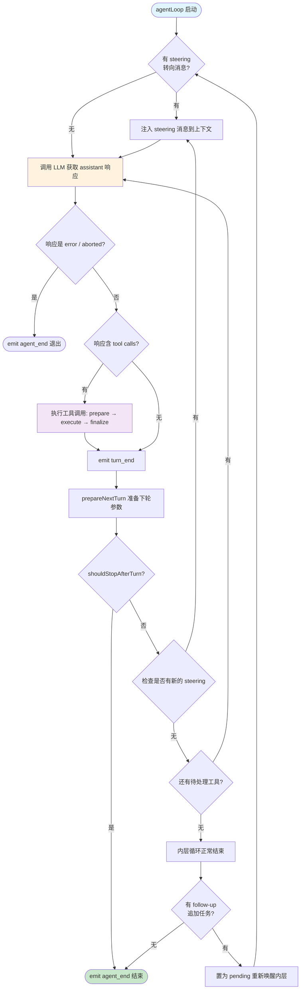
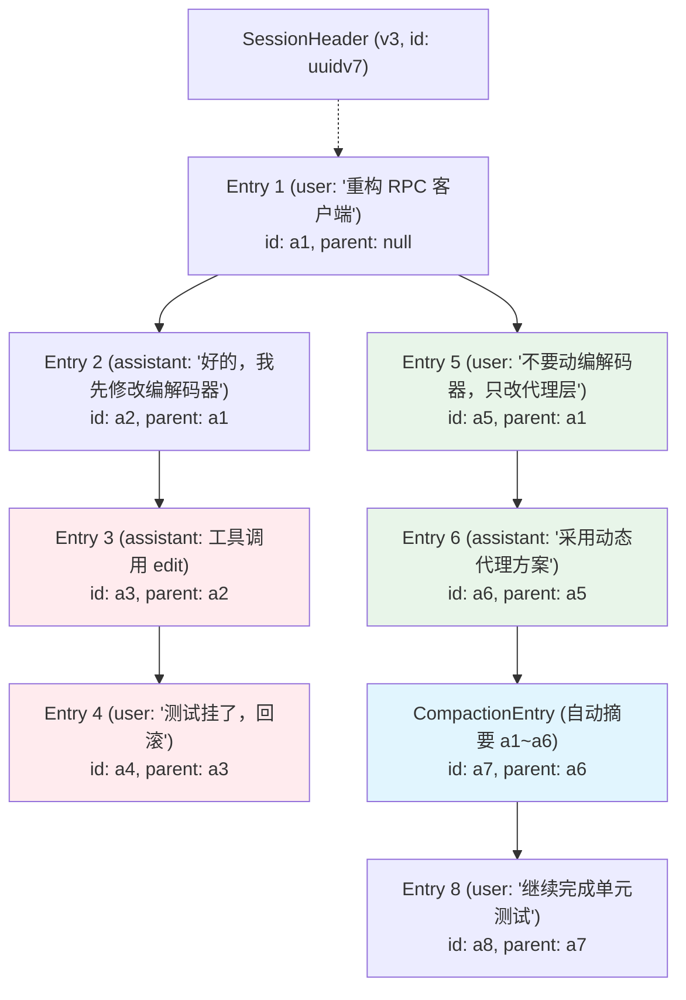
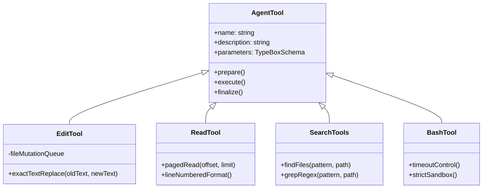

# 读《pi 的设计艺术》：生产级 Coding Agent 运行时架构与工程决策复盘

之前我自己折腾过一个自动化修改代码的小 Agent 脚本，当时想得特别简单：只要写个 `while (true)`，把历史消息塞进 OpenAI SDK，模型如果返回了函数调用就跑一下本地命令，跑完把结果 `messages.push()` 进去再继续调模型——不就是一个闭环了吗？

结果一上线，现实结结实实地给我上了一堂工程毒打课：

- **调度失控**：模型中途改偏了文件，我想紧急敲回车纠偏（“停，不要动数据库迁移脚本！”），由于单层循环正在傻傻等待工具返回，消息要么被丢弃，要么在下一轮粗暴覆盖，Agent 像个“耳聋的推土机”一路横冲直撞；
- **回滚绝望**：用简单的数组存聊天记录，Agent 连改了 5 个文件测试挂了，我想“回到两步之前换种思路”，却发现除了原地物理清空数组、或者彻底重开一个 session 丢失前面所有上下文，根本无法做到无损的分支与回退；
- **压缩失忆**：上下文快爆时，我让大模型“把上述对话精简总结一下”。大模型总结得文采飞扬：“排查了用户模块并做了必要修改”，结果下一轮再让它写代码，它两眼一抹黑反问我：“请问你刚才改的是哪个文件？”——自然语言把最关键的**文件路径和修改集元数据**当废话吞了；
- **工具翻车**：给模型一把万能 `bash` 工具，让它自己跑 `sed -i` 改代码，结果模型引号转义写串，直接把整个配置文件清空，引发灾难性事故。

直到最近精读了张汉东老师的开源著作《pi 的设计艺术：构建生产级 Coding Agent 的架构决策》（基于开源项目 `pi-mono`），我才彻底想明白：**我之前踩的所有雷，根本不是 Prompt 写得不够好，而是缺少一个严肃的“Agent 运行时（Runtime）”。**

这本书没有空话，每一章都在回答一个极其尖锐的工程抉择：**为什么这样选？放弃了什么？得到了什么？** 这里结合我自己的试错体会与后端系统架构视角，做一次深度的技术复盘。

---

## 1. 范式转变：从“LLM 调用库”到“Agent 运行时（Runtime）”

市面上 95% 的教程都在讲 LangChain、Prompt 技巧或拼装 Demo。这种思维本质上是**“RPC 调用库思维”**：重点在怎么组装参数、怎么序列化 JSON、怎么发 HTTP 请求。

但真正的 Coding Agent，调大模型只占复杂度的 10%，剩下的 90% 全在**“大模型响应之后怎么治理”**。

| 关注维度     | 通用 LLM 调用库（如 LangChain / Vercel AI SDK）     | 生产级 Coding Agent 运行时（如 pi）                         |
| :----------- | :-------------------------------------------------- | :---------------------------------------------------------- |
| **核心职责** | 怎么发 HTTP 请求、怎么把 JSON 序列化送进模型        | 模型返回后如何运转闭环、状态机如何流转                      |
| **错误观念** | 将网络异常、API 报错当做异常抛出（throw exception） | 错误是一等公民，被编码进统一事件流（`stopReason: "error"`） |
| **生命周期** | 单次 Request-Response 或单纯的流式打字机            | 持续自愈的无状态执行循环（Agent Loop）                      |
| **多轮治理** | 简单的消息数组（`messages.push(...)`）              | 非线性会话树、分支跳转、自动上下文压缩（Compaction）        |
| **工具交互** | 暴露函数给模型，听天由命                            | 严格的三阶段管道（准备、执行、终结）与类型护栏              |

正如书开篇所言：**pi 是一个 Agent 运行时（Runtime），而不是又一个 LLM 包装器（Wrapper）。** 它管理的是一个持续运行、自主感知环境、纠正错误、并在有限窗口中自愈的操作系统式状态机。

---

## 2. 全局骨架：四层洋葱架构与依赖纪律

在大型系统中，模块拆分最怕“互相越权”。pi 采用严格由外向内的**四层洋葱架构**：



每一层都遵守近乎偏执的**单向无知纪律**：

- **L1 (`pi-ai`)**：只负责连接各大模型提供商。它根本不知道世界上还有“工具执行”或者“文件读写”这回事，它只负责输出标准事件流（`text-delta`, `tool-call-delta`）。
- **L2 (`pi-agent-core`)**：是底层的发动机。它只认识消息和工具接口，负责死循环调度。它不知道什么是 Git 仓库，不知道用户开的是终端还是 Slack，更不知道什么叫项目配置。
- **L3 (`pi-coding-agent`)**：特化为面向 Coding 场景的产品内核。它接管文件树、会话树持久化、上下文超出后的压缩策略、Markdown 格式的 Skill 发现。
- **L4 (宿主壳)**：纯粹的交互外壳。同一颗内核，插上 `pi-tui` 就是终端应用，插上 JSON-L 协议就是后台 RPC 服务，连上 Web 就是浏览器 IDE。

这套架构带来的收益极其巨大：核心循环足够薄、足够干净，就可以在任意宿主中零成本复用。

---

## 3. 内核发动机：`agentLoop` 源码解剖与双层循环

很多初学者（包括我自己）写 Agent 时，循环逻辑往往兼任了“大内总管”：既管发消息，又管记历史，还管失败重试。

但 pi 提出了一个反直觉的抉择：**循环引擎应该知道尽可能少的事情。** 打开 `packages/agent/src/agent-loop.ts`，核心注释只有两句话：

> _"Agent loop that works with AgentMessage throughout._  
> _Transforms to Message[] only at the LLM call boundary."_

### 核心源码解剖：`runLoop()` 的设计精髓

这是 `agentLoop` 的无状态核心驱动逻辑（取自 `packages/agent/src/agent-loop.ts:155-320` 核心骨架）：

```typescript
async function runLoop(
  currentContext: AgentContext,
  newMessages: AgentMessage[],
  config: AgentLoopConfig,
  signal: AbortSignal | undefined,
  emit: AgentEventSink,
  streamFunction: StreamFn,
): Promise<void> {
  let pendingMessages: AgentMessage[] = (await config.getSteeringMessages?.()) || [];

  // 外层循环：挂起等待，消费用户追加的 follow-up 任务
  while (true) {
    let hasMoreToolCalls = true;

    // 内层循环：处理 tool calls 和用户实时的 steering 转向指令
    while (hasMoreToolCalls || pendingMessages.length > 0) {
      // 1. 优先注入 pending 消息（用户打断/转向）
      if (pendingMessages.length > 0) {
        for (const message of pendingMessages) {
          currentContext.messages.push(message);
          newMessages.push(message);
        }
        pendingMessages = [];
      }

      // 2. 调用 LLM，获取 assistant 响应流
      const message = await streamAssistantResponse(
        currentContext,
        config,
        signal,
        emit,
        streamFunction,
      );
      newMessages.push(message);

      // 3. 错误或中断 → 直接退出
      if (message.stopReason === "error" || message.stopReason === "aborted") {
        return;
      }

      // 4. 工具调用管线：prepare → execute → finalize
      const toolCalls = message.content.filter((c) => c.type === "toolCall");
      const toolResults: ToolResultMessage[] = [];
      hasMoreToolCalls = false;

      if (toolCalls.length > 0) {
        const batch = await executeToolCalls(currentContext, message, config, signal, emit);
        for (const result of batch.messages) {
          currentContext.messages.push(result);
          newMessages.push(result);
        }
        toolResults.push(...batch.messages);
        // 工具可主动叫停：整批结果都标记 terminate 时不再续轮
        hasMoreToolCalls = !batch.terminate;
      }

      // 5. turn 间热切换：支持动态替换 context / model / thinkingLevel
      const snapshot = await config.prepareNextTurn?.({
        message,
        toolResults,
        context: currentContext,
        newMessages,
      });

      // 6. turn 校验：是否满足优雅停止条件
      if (
        await config.shouldStopAfterTurn?.({
          message,
          toolResults,
          context: currentContext,
          newMessages,
        })
      ) {
        return;
      }

      // 7. 每轮末尾检查：是否有用户在当前 turn 期间插队的 steering 消息
      pendingMessages = (await config.getSteeringMessages?.()) || [];
    }

    // 内层结束，检查有没有在任务完全结束后追加的 follow-up 消息
    const followUpMessages = (await config.getFollowUpMessages?.()) || [];
    if (followUpMessages.length > 0) {
      pendingMessages = followUpMessages;
      continue; // 重新唤醒内层循环
    }

    break; // 彻底无新任务，退出
  }
}
```

### 为什么必须是“双层”而不是“单层”？

看懂了这段源码，就明白了我之前写的单层循环为什么会被用户骂“耳聋”：

1. **Steering（转向指令）**：Agent 正在改代码，用户中途发现方向偏了，输入“别改 A 文件，去改 B”。这种消息必须在**当前 turn 的工具执行完毕后立刻插队注入（第 7 步获取）**，影响下一次 LLM 推理。它发生在内层。
2. **Follow-up（追加任务）**：Agent 已经完整完成了当前需求并准备停下来（内层退出），用户接着说“好的，顺便把单元测试也补上”。这是**外层循环在 Agent 即将停下时将其重新激活**。

两类消息的消费时机和生命周期完全不同：**Steering 是干活时的抢占式插队，Follow-up 是交工后的下一单委托。** 只有双层循环才能优雅解耦两者的消费时机。



---

## 4. 会话状态建模：为什么不用聊天记录，而用“会话树”？

常规聊天机器人的会话数据结构是一个平铺的 `List<Message>`。但在 Coding 场景下，线性列表是完全不可用的：

- Agent 尝试用方案 A 重构，改了 8 个文件后测试跑崩了。用户想：**“撤销刚才的全部操作，回到改之前，换方案 B 重试”**。
- 用户在第 15 轮发现第 3 轮选型有瑕疵，想从第 3 轮分叉出一个新分支进行对比实验。

线性列表面对这种诉求，要么只能粗暴截断，要么必须完整深拷贝整个会话。

### JSONL + parentId 树形存储

pi 设计了一套极简但容错率奇高的存储模式：**单文件 JSONL，每行一个节点，通过 `parentId` 链接**。



这里有两个极为精巧的设计细节：

1. **两种 ID 的权衡**：
   - **Entry ID**：采用 8 位短十六进制（如 `randomUUID().slice(0, 8)`），因为 Entry ID 会高频暴露在 TUI 终端和分支切换命令中，短小直观。
   - **Session ID**：采用 **UUIDv7**。UUIDv7 具备时间自增单调性，让不同时间维度的会话天然具备时间局部性，这对多用户路由集群下的 Prompt Cache（提示词缓存）命中至关重要。
2. **Append-only 的坚韧性**：
   - 会话文件只做追加写入（Append），从不原地修改或覆写。即使机器掉电、进程强杀，尾部损坏的一两行可以直接丢弃，整棵历史树的主干依然安然无恙。

---

## 5. 胜负手：Compaction（把无限对话装进有限窗口）

当用户和 Agent 深入排查一个复杂 Bug 时，几十轮对话、反复的 `grep` 输出、长文本读写会轻易把 128K 甚至 200K 的 Context Window 打满。

如果直接截断历史，Agent 会瞬间“失忆”，连刚刚讨论到哪个文件都不记得。pi 落地了一套高度工程化的 **Compaction（上下文压缩）机制**。

### 触发水位线设计

Compaction 并不是每轮都做，而是在阈值触碰时才激活：
$$\text{Trigger Condition: } ContextTokens > (ContextWindow - ReserveTokens)$$
其中 `ReserveTokens` 默认保留 16K。**为什么要给模型留出整整 16K 的余量？** 因为如果等到上下文只剩 1K 时才触发压缩，大模型根本没有足够的 output token 来生成高质量的总结摘要，甚至会在摘要生成中途报截断错误。

### 关键细节：追踪文件变更集（File Operations Tracking）

绝大部分 Agent 压缩时只是让 LLM 写一段自然语言总结（“讨论了 RPC 异常并做了修改”）。**但在真实工程开发中，这会导致灾难性的幻觉**——模型很快忘了自己到底读过哪些文件、具体改动了哪几个模块。

pi 在压缩对话时，设计了双通道提炼：

```typescript
interface CompactionDetails {
  readFiles: string[]; // 明确记录：读过哪些文件
  modifiedFiles: string[]; // 明确记录：改过哪些文件
}
```

通过静态扫描工具调用的消息历史，即使把数万 Token 的工具输出压缩为一段几百字的主干总结，**`readFiles` 和 `modifiedFiles` 列表也会作为结构化上下文永久锚定在当前分支中**。下一次循环时，Agent 依然确切知道当前项目的改动边界。

---

## 6. 工具设计哲学：约束即保护

很多开发者误以为“给 Agent 一个通用的 `bash` 工具，让它为所欲为，能力最强”。但在生产环境中，**越无约束的工具，故障率越高**。

pi 提出的工具设计核心法则是：**工具是带护栏的接口，约束即保护。**



### `edit` 工具源码设计：为什么必须逆序替换？

很多人以为文件修改就是正则替换。看下 `edit-diff.ts` 的实现逻辑：

```typescript
// packages/coding-agent/src/core/tools/edit-diff.ts:193-260（核心精髓）
export function applyEditsToNormalizedContent(
  normalizedContent: string,
  edits: Edit[],
  path: string,
): AppliedEditsResult {
  // 1. 统一 LF 换行空间
  // 2. 严格校验：oldText 不能为空，且在原文件中必须【唯一存在】（count === 1）
  // 3. 检测重叠：相邻 edit 的匹配范围绝不能重叠
  // 4. 按匹配位置排序后，【从后往前替换（Reverse Order）】！
  const sortedEdits = [...edits].sort((a, b) => b.startIndex - a.startIndex);
  let currentContent = normalizedContent;

  for (const edit of sortedEdits) {
    currentContent =
      currentContent.slice(0, edit.startIndex) + edit.newText + currentContent.slice(edit.endIndex);
  }
  return { newContent: currentContent };
}
```

为什么必须**“从后往前替换”**？
如果从前往后替换，第一个修改完成后，后面的文本字符偏移（offset）全部会发生漂移，第二个修改就会改错位置甚至直接写穿。而从后往前替换，前面的索引坐标稳如泰山。

再加上基于单文件维度的 `file-mutation-queue` Promise 互斥排队锁，彻底杜绝了并发写入导致文件内容交叉损坏的可能。

---

## 7. 反主流选择背后的判断：极简核心，能力外置

在 Agent 技术浪潮中，各种复杂的概念层出不穷：多智能体编排（Multi-Agent Swarm）、庞大的外部工作流框架、各种可视化拓扑。

pi 的设计哲学非常克制，在书中总结为一句话：

> **“如果一个功能可以用更底层的机制组合出来，就不应该把它内建到内核中。”**

### 为什么坚决不内建 Sub-Agents？

主流框架喜欢搞一堆 `CoderAgent`、`ReviewerAgent`、`PlannerAgent` 互相传小纸条，看起来高大上，但在实际编码中，通信损耗极大、错误级联放大、上下文割裂严重。

pi 怎么做？**内核根本没有 Sub-Agent 的概念。**  
它只提供一个普通的 `AgentTool` 工具。当主 Agent 需要委派子任务时，它只需发起一次常规的工具调用：`execute(AgentTool, { prompt: "去检索某某库的 API" })`。而在 `AgentTool` 的执行体内部，只是实例化一个新的无状态 `agentLoop` 去执行。

对主引擎来说，调用一个子 Agent，和调用一次 `grep` 没有本质差别：**发出参数，等待工具结果返回**。这种设计让内核的复杂度降低了一个数量级，同时拥有了无限嵌套组合的能力。

### 为什么 Skill 只是带 frontmatter 的 Markdown？

pi 的 Skill 机制不依赖任何复杂的插件加载器或外部 RPC 服务。一个 Skill 就是一段带有 frontmatter 描述的 Markdown 说明书。Agent 在需要时把 Markdown 读进 System Prompt，模型就自然学会了这套业务规范。**用最朴素的文本和协议替代沉重的代码，是系统能够长期演进的秘诀。**

---

## 8. 映射到经典系统设计：Java 后端眼中的 Agent 运行时

如果把视角拔高到分布式与高并发架构，会发现 pi 的每一个 Agent 设计决策，在经典的 Java / 后端基础设施中都能找到几乎完全一致的灵魂投射：

| pi Agent 运行时设计                | Java / 分布式系统经典设计                     | 为什么两者的设计直觉完全相通？                                                                                                                                       |
| :--------------------------------- | :-------------------------------------------- | :------------------------------------------------------------------------------------------------------------------------------------------------------------------- |
| **`agentLoop` 无状态单向轮转**     | **Netty 的 `EventLoop` (Reactor 模式)**       | 核心驱动循环绝对不能被繁重的业务逻辑阻塞；EventLoop 只管事件分发与推动，业务与持久化全部剥离给外部处理。                                                             |
| **JSONL + parentId 会话树**        | **MySQL WAL (重做日志) / Raft Log**           | 面对随时可能崩溃退出的环境，只有不可变的 Append-only 顺序日志最坚韧；天然支持像 Git / Raft 分区一样的分支与回溯。                                                    |
| **Compaction（保留文件操作追踪）** | **RocksDB 的 LSM-tree Compaction**            | 内存中的热数据不断堆积膨胀，必须定期与历史数据做合并压缩；压缩丢弃冗余细节的同时，必须保留类似于 Bloom Filter 和 SSTable 元数据索引（`readFiles`/`modifiedFiles`）。 |
| **统一流式事件与消息变换**         | **API 网关协议适配 / Dubbo Filter 链**        | 面对下游多异构协议（OpenAI、Anthropic、Gemini），在系统入口做统一格式标准化，错误统一收敛为标准错误码。                                                              |
| **`file-mutation-queue` 队列**     | **`ConcurrentHashMap` 分段锁 / 分布式排它锁** | 杜绝全局粗粒度锁，按文件路径作为 Key 细粒度串行化排队，既保证并发读写安全，又保持非冲突文件的吞吐。                                                                  |

软件工程演进了几十年，从单机到分布式，再到今天的 AI Agent，**处理“状态、并发、不确定性与故障恢复”的底层工程智慧，从未改变。**

---

## 小结与思考

从后端架构师的视角来看，设计一个生产级 Coding Agent，本质上是在解决**“如何为一个不可靠、不可预测的概率计算引擎（LLM），构建一套确定性的状态机与安全沙箱”**：

1. **分层无知**：洋葱模型确保各层职责单一，模型适配层不干预循环，循环引擎不干预业务；
2. **状态纯粹**：把循环引擎做成无状态的纯函数，将状态管理交给外围的会话树；
3. **数据韧性**：JSONL + parentId 支撑分支回溯，自动 Compaction 守住上下文边界；
4. **防御性工具**：杜绝万能权限，用精确替换和结构化工具收敛模型的犯错空间。

无论未来底层大模型如何迭代演进，这些关于状态、上下文、并发与沙箱隔离的工程法则，依然是软件工程中最经得起时间考验的基石。

---

## 参考

- [pi-book: 《pi 的设计艺术：构建生产级 Coding Agent 的架构决策》](https://zhanghandong.github.io/pi-book) (张汉东)
- [pi-mono 开源仓库](https://github.com/ZhangHanDong/pi-book)
- 结合本项目生产环境上下文管理与 AI 编程工程实践复盘
